# Sukrara Aura — the watch face, to build

*2026-11-16 · design spec for the Garmin face (Descent Mk3i 43 mm first) · four design rounds with the owner on the
design canvases ([round 4, final](https://claude.ai/code/artifact/5566d39a-3822-451a-a956-5b3cbadf8d54); earlier rounds
[1](https://claude.ai/code/artifact/ec45d2e6-51a8-4489-897f-afa2df1681a2),
[2](https://claude.ai/code/artifact/c776bd6b-3168-4398-92d8-afa308541260),
[3](https://claude.ai/code/artifact/e688cba0-0747-4025-b524-82ec60451605)) · research behind every choice:
[docs/42](../../../docs/42-watch-faces.md)*

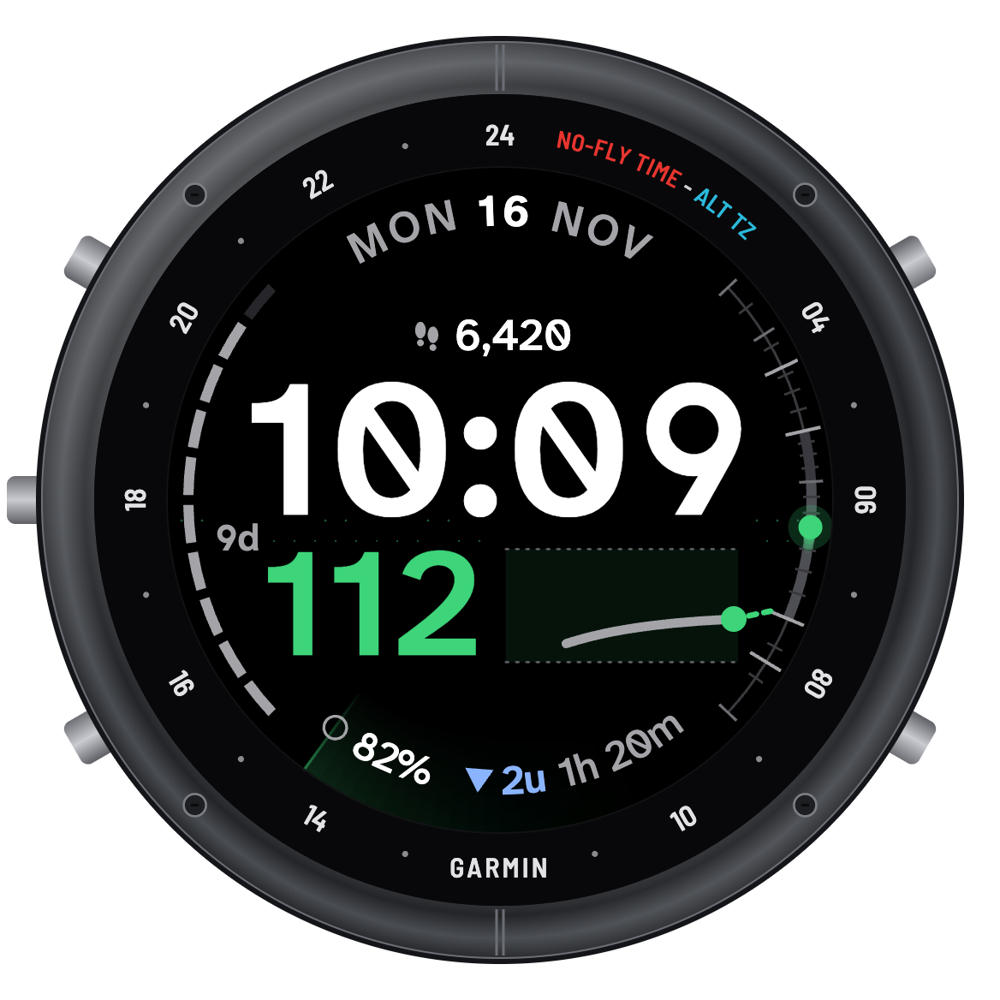

**What it is.** A Sukrara face where the dial is the *aura* of your glucose: it gathers at your level, spreads the
further out of range you are, fades as you head back to the ideal and strengthens as you head away. Around it, an
instrument laid out on the bezel's four screws: the calendar and one field of yours on top, the time and the glucose
value in the middle, a level rail from 1:30 to 4:30, the battery rail opposite, two fields along the bottom, the seconds
as a faint sweep at the rim.

**How to use this spec.** Everything here is also executable:

| File | What it is | Use it to |
|---|---|---|
| [`tools/watchface/aura.js`](../../../tools/watchface/aura.js) | **The reference implementation**: one pure function, `layout(cfg)`, giving every value of the face, and `svg(cfg)` drawing it. Where this text and the code disagree, the code wins (and this text gets fixed). | Read the exact formula of anything; port it |
| [`cases.json`](cases.json) | 115 states (every state of §9), each with its inputs and **what must be true, in words** | Acceptance, state by state |
| [`expect.json`](expect.json) | Every value `layout()` returns for each case (positions, sizes, colours, texts, angles) | Unit-test the port's numbers (§10) |
| [`docs/img/aura/ref/<case>.png`](../../../docs/img/aura/ref/) | Each case drawn at **390 × 390, the screen 1:1**, no bezel | Compare with the simulator's screenshot (§10) |
| [`docs/img/aura/store/*.png`](../../../docs/img/aura/store/) | 10 renders on the Descent, 1168 px, transparent | Connect IQ store, website (§12) |
| [`tools/watchface/build.mjs`](../../../tools/watchface/build.mjs) | Regenerates `expect.json` and every PNG from `aura.js` (needs Node and Google Chrome) | After any design change |
| [`tools/watchface/render.html`](../../../tools/watchface/render.html) | Draws one face in a browser: `render.html#cfg={"glucose":62,"rate":-1.4,"size":390,"bezel":false}` | Look at any state, any input |

**Ground rules** (from docs/42 §4 and CLAUDE.md, binding):
1. **Sukrara decides, the face shows.** Bands, freshness, the trend (angle and doubling), the pill (need, quiet, mute),
   sensor states and durations come from Sukrara exactly as every other surface gets them. The face never re-decides
   them; it only computes the *age* from the reading's time and the watch clock, every time it draws (§3).
2. **Never an old value as current; never a figure that could pass for glucose** during warm-up, LO / HI, no data.
3. **Never colour alone**: position on the rail, the pill's word and icon, inversion and strike-through carry every
   state too (checked with the Red Shift and grey cases).
4. **The time is always readable**, in every state and mode.
5. **One graph everywhere**: the face is a Sukrara surface. Register it in `contracts/graph/surfaces/surfaces.json`;
   its settings go in `contracts/settings/settings.json`; its words in en and es; FEATURES.md and README in the same
   change (CLAUDE.md).

---

## 1. Device, coordinates, units

- **Garmin Descent Mk3i 43 mm**, Connect IQ id `descentmk343mm`, API 5.1; 1.2″ round AMOLED, **390 × 390 px**, 12.8
  px/mm, 16-bit colour; watch-face memory 128 KB; awake ~10 s at 1 Hz after a wrist raise, otherwise 1/min or
  always-on (≤ 10 % luminance). Details: [docs/evidence/42-watch-faces/garmin.md](../../../docs/evidence/42-watch-faces/garmin.md).
- **The printed bezel** (24-hour ring, "NO-FLY TIME – ALT TZ", GARMIN, four screws at 1:30 / 4:30 / 7:30 / 10:30) is
  *outside* the pixels. It is drawn in the mockups only (`bezel: true`); the face never draws it. The design aligns to
  it: the rails run screw to screw.
- **Coordinates** in this spec and in `expect.json`: origin at the **screen centre**, x right, y **down**, 1 unit = 1
  device pixel. Device pixel = (195 + x, 195 + y). The screen is the circle r = 195; everything is clipped to it.
- **Angles**: degrees **clockwise from 12 o'clock**. A point at radius r and angle a: **P(r, a) = (r·sin a, −r·cos a)**.
  An arc "from a1 to a2" runs clockwise unless it says counter-clockwise.
- Round as the reference does: positions to 0.1 px (`r1(x) = round(10x)/10`).

## 2. Type, colour, icons

### Type
- **Atkinson Hyperlegible Next** for everything (built for telling 1/7, 3/8, 6/9/0 apart; humanist; no thin weights).
  Weights used: 500, 600, 700.
- **Sizes are set by cap height**: font px = cap / 0.668.
- **The big numbers use the font's own figures and kerning**, no hand-made cells: the default (proportional) figures,
  whose 1 has no foot, and the font's GPOS `kern` pairs. Measured from `apps/garmin/fonts/AtkinsonHyperlegibleNext-wght.ttf`
  at weight 600 (fontTools + HarfBuzz; `numerals()` in aura.js), per em:

| Glyph | 0 | 1 | 2 | 3 | 4 | 5 | 6 | 7 | 8 | 9 | : | . | L | O | H | I |
|---|---|---|---|---|---|---|---|---|---|---|---|---|---|---|---|---|
| advance | .656 | .430 | .569 | .592 | .621 | .602 | .617 | .529 | .621 | .578 | .253 | .253 | .548 | .737 | .699 | .415 |

  Kern pairs (per em, added between the two glyphs): 23 −.004, 24 −.013, 28 −.01, 41 −.006, 42 −.009, 44 +.01, 49 −.024,
  51 −.02, 53 −.02, 55 −.006, 56 −.007, 59 −.004, 61 −.026, 67 −.006, 71 +.02, 73 +.01, 74 −.044, 77 +.03, 78 −.02,
  7. −.03, 81 −.02, 82 −.01, 87 −.01, 89 −.019, 92 −.02, 94 −.004, .1 −.03, .O −.03, LO −.03, O. −.03, OI −.023, IO −.023
  (none with the colon). The tabular figures (`tnum`) are all **0.632** wide.
- **A run of glyphs**: the pen starts at 0; before each glyph after the first it moves by the pair's kern; the glyph is
  centred on its advance (centre = pen + advance/2); the pen moves by the advance. The run's width is the pen's end.
  Each glyph is drawn centred on its centre (its advance centred there).
- **Value** (§6.4): one run (it changes only with a reading). **Time** (§6.3): the hour, the colon and the tens of
  minutes as one run; the **last digit tabular**: centred in a cell 0.632 wide (the font's plain figure, no foot, not
  its `tnum` glyph), no kerning into it, so the minute that changes every minute never jitters. The time's width
  changes only at :x0 (and with the hour); its size only with the hour (§4).
- **Label widths** (pills, fields, the chip) are measured with Atkinson's advance widths (`widths()` in aura.js, per
  em) × size × 1.03; an unknown glyph counts 0.6 em.
- **Sizes in use** (font px; build each as a Garmin font resource, digits-only where the text is digits):

| Use | Sizes (font px) | Glyphs |
|---|---|---|
| Time | 92.8, 95.8, 98.8, 101.8, 104.8, 107.8, 110.8, 113.8 (caps 62–76 in steps of 2) | `0–9 :` |
| Value | 80.8, 83.8, 86.8, 89.8 (caps 54, 56, 58, 60) | `0–9 . L O H I` |
| "No reading since" time | 53.9, 59.9 (caps 36, 40) | `0–9 :` + weekday and month names |
| Date | 26 (weight 500, day 700), letter spacing 2 | A–Z incl. Á É Í Ó Ú Ñ |
| Top field | 24, 25, 26 (500) | the field texts |
| Pill, chip, bottom fields | 24 (pill 600, others 500; treatment amounts 600) | as used |
| Battery label | 22; 20 for days and percent (600; 700 under 2 days) | `0–9 d h % ·` |
| Messages | 25, 30, 32 (600) | the message words |

### Colour
Three palettes (`pal()` in aura.js). **Awake:**

| Token | Hex | Use |
|---|---|---|
| ink | `#FFFFFF` | time, value in white, field texts (pure white: the brightest the AMOLED shows, as other faces) |
| soft | `#A3A3A8` | labels, date, sparkline line, reading time |
| dim | `#6E6E73` | mid ticks |
| faint | `#3A3A3E` | rail hairline, minor ticks |
| grid | `#26262A` | unlit battery segments |
| band / band2 | `#38383E` / `#4E4E55` | the in-range band on the rail / its very-good part |
| grey | `#8E8E93` | old (struck) value, hollow bead, the sweep and the dials when not current |
| texture | `#19191C` | the map dial |
| veryLow · low | `#C2413B` · `#F0524F` | |
| tight (very good, 70–140) · target (good, 141–179) | `#3DD47A` · `#8CC63F` | value / bead / dial / sweep in range (green on by default) |
| high · veryHigh · extremelyHigh (≥ 300) | `#F5A524` · `#FF7A45` · `#E35BD0` | |
| now | `#C6F432` | Sukrara's neon: bead in range when green is off; the reveal line |
| rapid · long · carbs · note | `#8AB4FF` · `#C9B0FF` · `#FFB74D` · `#B4B4B4` | treatments and pills (note = mute / sensor) |
| neutral | `#A3A3A8` | dials in range when green is off |

**Night** (the watch in Do Not Disturb, which its Sleep Mode turns on): ink `#8C8C92`, soft `#5E5E64`, dim
`#46464B`, faint `#2A2A2E`, grid `#1A1A1D`, band `#242428`, band2 `#303035`, grey `#56565B`, veryLow `#A63A35`, low `#B8433F`, tight
`#2E9C5C`, target `#6B9631`, high `#B57C1E`, veryHigh `#BC5C36`, extremelyHigh `#A84A9C`, now `#7E9A26`, rapid
`#5F7EB3`, long `#8C7AB3`, carbs `#B3833A`, note `#7A7A7E`, neutral `#5E5E64`.
**Always-on**: as awake but ink `#C9C9CE`, soft `#7A7A80`, dim `#55555A`, faint `#323236`, grid `#1C1C1F`, band and
band2 `#2A2A2E`, grey `#6E6E73`, now `#A9CF2A`.

- **The value's colour**: struck (old) → grey; very low (≤ 55, and LO) → `#FFFFFF` on a very-low block (inverted;
  always-on: the always-on ink on the block at 35 %, `#441715`, §8);
  out of range → its colour (extremely high from 300 has its own); in range → tight / target when *green in range* is
  on (default), else ink.
- **Pills**: filled = the kind's colour with text and icon `#1C1C1E`; tonal = the kind's colour at **0.24** opacity
  with text and icon in the kind's colour.
- Band of a value (Sukrara's `Bands.of`, defaults; the person's own limits replace them): very low ≤ 55, low 56–69,
  very good 70–140, good 141–179, high 180–249, very high ≥ 250 (colour extremely high from 300); LO < 40, HI > 400.

### Icons
24 × 24 boxes, centred at (12, 12); drawn at the size given, rotated where said. `s` = stroked (width 2 in the box,
round caps and joins), otherwise filled (even-odd). Path data (exact, also in `icons()`):

| Key | Kind | Path |
|---|---|---|
| sun | s | `M12 2.5v3M12 18.5v3M2.5 12h3M18.5 12h3M5.3 5.3l2.1 2.1M16.6 16.6l2.1 2.1M5.3 18.7l2.1-2.1M16.6 7.4l2.1-2.1M16 12a4 4 0 1 1-8 0a4 4 0 1 1 8 0` |
| steps | f | `M4.6 8.5a3.4 5.3 0 1 0 6.8 0a3.4 5.3 0 1 0-6.8 0zM5.8 16.6a2.2 2.2 0 1 0 4.4 0a2.2 2.2 0 1 0-4.4 0zM12.6 11.5a3.4 5.3 0 1 0 6.8 0a3.4 5.3 0 1 0-6.8 0zM13.8 19.6a2.2 2.2 0 1 0 4.4 0a2.2 2.2 0 1 0-4.4 0z` |
| sunset | s | `M3 18h18M7 18a5 5 0 0 1 10 0M12 3v7M9 7.5l3 3 3-3` |
| bolt (body battery) | f | `M13.5 2L5.5 13.5h5.2L9.8 22l8.2-12h-5.3z` |
| mountain (altitude) | f | `M2 20L9.5 7l4 6.5 2.3-3.6L22 20z` |
| heart | f | `M12 20.5s-7.5-4.6-7.5-10.4A4.1 4.1 0 0 1 12 7.6a4.1 4.1 0 0 1 7.5 2.5c0 5.8-7.5 10.4-7.5 10.4z` |
| bell (notifications) | s | `M6 16.5V11a6 6 0 0 1 12 0v5.5l1.8 1.8H4.2zM10 20.5a2 2 0 0 0 4 0` |
| ring (time in range) | s | `M12 4a8 8 0 1 1 0 16a8 8 0 1 1 0-16M12 4a8 8 0 0 1 7.6 10.5` |
| globe (second time zone) | s | `M12 3a9 9 0 1 1 0 18a9 9 0 1 1 0-18M3 12h18M12 3c2.6 2.7 3.8 5.7 3.8 9s-1.2 6.3-3.8 9M12 3c-2.6 2.7-3.8 5.7-3.8 9s1.2 6.3 3.8 9` |
| stairs (floors) | s | `M3 20h5v-5h5v-5h5V5h3` |
| phoneOff | s | `M8 3h8a1 1 0 0 1 1 1v16a1 1 0 0 1-1 1H8a1 1 0 0 1-1-1V4a1 1 0 0 1 1-1zM3 3l18 18` |
| sensor (Sukrara's sensor disc) | f | `M21.3 12a9.3 9.3 0 1 1-18.6 0a9.3 9.3 0 1 1 18.6 0zM18.7 12a6.7 6.7 0 1 0-13.4 0a6.7 6.7 0 1 0 13.4 0zM15 12a3 3 0 1 1-6 0a3 3 0 1 1 6 0z` |
| rapid ▼ (Sukrara's insulin mark) | f | `M2 4.2H22L12 20.9Z` |
| long ▽ | s, width 2.8 | `M3.5 5.4H20.5L12 19.6Z` |
| carbs ● | f | `M20 12a8 8 0 1 1-16 0a8 8 0 1 1 16 0z` |

Bells in the pills are Material Symbols (Apache 2.0, the same Sukrara's card uses), 960 box, `transform:
translate(cx − 11.8, cy − 11.8) scale(0.0246) translate(0 960)`: **paused** (quiet / a side muted)
`M370-320h220v-72H480l110-136v-72H370v72h110L370-392v72ZM160-200v-80h80v-280q0-83 50-147.5T420-792v-28q0-25 17.5-42.5T480-880q25 0 42.5 17.5T540-820v28q80 20 130 84.5T720-560v280h80v80H160Zm320-300Zm0 420q-33 0-56.5-23.5T400-160h160q0 33-23.5 56.5T480-80ZM320-280h320v-280q0-66-47-113t-113-47q-66 0-113 47t-47 113v280Z`;
**off** (Mute all) `M160-200v-80h80v-280q0-33 8.5-65t25.5-61l60 60q-7 16-10.5 32.5T320-560v280h248L56-792l56-56 736 736-56 56-146-144H160Zm560-154-80-80v-126q0-66-47-113t-113-47q-26 0-50 8t-44 24l-58-58q20-16 43-28t49-18v-28q0-25 17.5-42.5T480-880q25 0 42.5 17.5T540-820v28q80 20 130 84.5T720-560v206Zm-276-50Zm36 324q-33 0-56.5-23.5T400-160h160q0 33-23.5 56.5T480-80Zm33-481Z`.

## 3. Inputs and defaults

What the face reads (`opt()` in aura.js). The `cfg` key is the reference's name for it (what `cases.json` sets); the
default is the reference's (every case starts from it):

| Input | `cfg` key: values | Default | From · notes |
|---|---|---|---|
| glucose (mg/dL) | `glucose` | 112 | Sukrara · < 40 = LO, > 400 = HI |
| rate (mg/dL/min), trend present | `rate`, `trend`: true/false | 0.4, true | Sukrara's trend (docs/34) · no rate → no trend |
| **age** of the reading (min) | `age` | 0.5 | Sukrara's reading time + the watch clock: age = now − reading time, recomputed at every draw, never from when the watch received it |
| history | `history`: the readings before the current one, oldest first (the rail trail takes the last 6); `spark`: the sparkline's series, current last | from the rate | Sukrara (the payload's `hist`: the 36 readings of the 3 hours before, 5 min apart) · `null` = a missed reading: its point is left out (§6.5, §6.8). Without either, the reference makes 13 points from the rate (`g − 5·rate·k`) |
| status | `status`: `auto` (needed when out of range), `quiet`, `muted`, `none`; `left`: minutes, or `"never"` (no end) | auto, 25 | Sukrara ([`contracts/graph/status.json`](../../graph/status.json)) · `quiet` = held after a treatment; `muted` = a side muted (out of range) or Mute all (in range); `none` = no pill: Sukrara says nothing, or a quiet or mute ran out on the watch's clock before the phone said what follows (the face never decides a need itself) |
| last treatment(s) | `last`: `{items: [{k: rapid/long/carbs, a: amount}], ago: min}`, or `lastKind`, `lastAmount`, `lastAgo` | rapid 2u, 80 min | Sukrara · a meal = insulin + carbs together; `items: []` = none in the last 24 h |
| sensor | `sensor`: `ok`, `warmup` (+ `warm`: fraction done), `almost`, `ending` (+ `sensorLeft`: hours), `endedSending`, `ended`, `none` | ok, 0.45, 5 | Sukrara · "ending" = the last 8 h; the ready time is Sukrara's (the reference fakes it from `warm`) |
| unit | `unit`: `mgdl`, `mmol` | mgdl | Sukrara · mmol/L = mg/dL ÷ 18.0182, one decimal |
| band limits | `limits`: [very low, low, very good, high, very high, extremely high] | 55, 70, 140, 180, 250, 300 | Sukrara (the payload's `bands`) · every band, the rail's notches and zones, the sparkline's range move with the person's limits (`fields-spark-wide-range`) |
| time and date | `time`: `"H:MM:SS"` or `"live"` | 10:09:36, Mon 16 Nov 2026 | watch · 12/24 h from the watch |
| language | `lang`: `en`, `es` | en | watch |
| battery | `battery`: days left; `batteryPct` | 8.6; null (= days × 10) | watch |
| mode | `mode`: `awake`, `aod`, `night` | awake | watch: wrist, power mode, Do Not Disturb (its Sleep Mode) |
| privacy | `privacy`: `open`, `private`, `revealed` (held); `reveal`: the fraction of the 5 s left | open, 0.6 | the setting + touch-and-hold (§8) |
| phone connected | `phone`: true/false | true | watch |
| colour check | `filter`: `none`, `redshift`, `grey` | none | reference only (§8) |
| field data | `steps`; `tir`: today's time in range (%), `null` = not known (under a quarter of the day so far, or the phone's day is over); others fixed in the reference: 14°, 17:42, 62, 1,240 m, 64, 3, NYC 4:09, 8 | 6420, 82 | watch / Sukrara (time in range, until the end of the phone's day) |
| settings | §11 | | |
| mockup only | `size` (px), `bezel`, `metal`: `carbon`/`bronze` | 584, true, carbon | not the face's |

## 4. Layout: what goes where

The face is a stack of rows, **centred between the date and the bottom fields, as large as the circle allows**. When
the row under the value is empty, everything re-centres and grows; when it holds something, the numbers step down.

**Rows** (top to bottom): top field (if a top field is chosen) · time · value (or a message) · chip row (if any).
Gaps: top field → time 20, time → value 22, value → chip row 18.

**Chip row kind**: `pill` when a pill shows (§6.6) · `age` when only the reading's time shows (late / old), or the
"Ready at" line of a warm-up · none.

**Size sets** (time cap T, value cap V, top-field font TF), tried in order, first that fits wins (else the last):

| Chip row | Sets |
|---|---|
| pill | (68, 54, 24), (66, 54, 24), (64, 54, 24), (62, 54, 24) |
| age | (70, 56, 24), (68, 56, 24), (66, 56, 24), (64, 56, 24), (62, 54, 24) |
| none | (76, 60, 26), (74, 60, 26), (72, 60, 26), (70, 60, 26), (68, 60, 26), (66, 58, 26), (64, 56, 25), (62, 54, 24) |

**The time grows by its string**: the larger time sizes come first, so a narrower time is drawn bigger, up to about
1.27 × the value's cap (76 over 60: the value's digits stay 79 % of the time's height, the clear second; a time drawn
as big as it fits would reach 84–90 over 58–60 and take over). In practice every 2-digit hour fits at 72 or more, so
the ceiling holds the time at 72–76 (none), 68–70 (age), 66–68 (pill).

**Heights**: value row vb = V; or a message (§6.7): no readings 16.7 + 12 + c₂ (c₂ = 40 when the chip row is empty,
else 36), warm-up 34, sensor ended 32, not monitoring 20. Chip row height: pill 38, age 17.
`H = (top row ? TF·0.668 + 20 : 0) + T + 22 + vb + (chip ? 18 + chipH : 0)`; first row starts at `y₀ = −7 − H/2`.
Then: top-field baseline `tfBase = y₀ + TF·0.668`; time top `tTop` and baseline `tBase = tTop + T`; value top
`vTop = tBase + 22`, value baseline `vBase = vTop + vb`; chip row centre `chipC = vBase + 18 + chipH/2`.

**Fits** when all hold: `halfAt(y) = √(171² − y²) − 6`;
- time: tWfit/2 ≤ halfAt(tTop) (tWfit = the time's width with the widest tens-of-minutes digit 0–5 at this hour, §6.3,
  so the size changes only with the hour);
- value (when there is one, **even while private hides it**): total/2 ≤ halfAt(vTop) and ≤ halfAt(vBase) (total =
  value + arrow or sparkline, §6.4);
- battery label (§6.9), unless always-on: its bottom `tBase + 6 + battH ≤ vTop` (it sits in the gap above the row), or
  the row's left edge ≥ `−166 + battW + 8`. The row's left edge: the value's `−total/2`; or a message's first line:
  warm-up `−(46 + w)/2`, sensor ended `−(38 + w)/2`, no readings / nothing paired `−w/2` (w = its text width, §6.7).
- **Days and percent** (§6.9) are stacked when some size set fits with the stack; otherwise the sizes are chosen with the
  one-line label, which always sits in the gap.

**Stable on purpose**: always-on keeps the top field's row even though the field is hidden (nothing moves when the
watch dims); private lays out the value's row as if the value were shown (nothing moves on reveal).

Examples (from `expect.json`):

| Case | Chip | T / V / TF | tfBase | tBase | vBase | chipC |
|---|---|---|---|---|---|---|
| `glucose-in-range` | none | 76 / 60 / 26 | −87.3 | 8.7 | 90.7 | — |
| `glucose-late` | age | 70 / 56 / 24 | −100.5 | −10.5 | 67.5 | 94 |
| `alerts-high-insulin-taken` | pill | 68 / 54 / 24 | −109 | −21 | 55 | 92 |
| `glucose-no-readings` | none | 74 / 60 / 26 | −90.7 | 3.3 | 94 (message) | — |
| `sensor-warmup` | age | 70 / 56 / 24 | −89.5 | 0.5 | 56.5 (message) | 83 |

**Z-order** (back to front): black screen · glow dial · dial layers (laser glow, main, second) · seconds sweep · date
· top field · time · battery rail and label · level rail (hairline, bands, zone, ticks, trail, bead, chevrons) · value
(inverted block, digits, strike, arrow, ring, reveal line) · sparkline · reading time · pill · message · bottom
fields · edge hairline (r 194.5, 1 px `#121214`). The dial layers are masked by the halo (§6.13); the sweep is not.

## 5. States and words

### Freshness (Sukrara's steps)
| Age | State | The face |
|---|---|---|
| ≤ 1.5 min | fresh | value, trend; nothing about time |
| ≤ 5 min | late | value, trend; the **reading's time** on the chip row (soft) |
| ≤ 20 min | stale ("old") | value **struck through and grey**; no trend (hollow ring); bead **hollow**; no trail; sweep and dials grey and still; reading's time shown; no status pill |
| < 3 h | no readings | **no value at all**: "No reading since" + the time it was (large); no bead; no pill |
| ≥ 3 h | long gap | as no readings (no history anywhere) |
| > 12 h, or another day | | the reading's time gains the weekday ("Sun 19:09", `glucose-long-gap`; "Sun 23:40" an hour old just after midnight, `glucose-another-day`) |
| > 6 days | | the date instead ("9 Nov", `glucose-week-old`) |

The steps and the reading's time are Sukrara's (`Freshness.timeText`, [`contracts/graph/freshness/freshness.json`](../../graph/freshness/freshness.json) `steps` and `times`): take them from there, with its cases as tests.

### Words (en / es)
From Sukrara's card words ([`contracts/graph/words/words.json`](../../graph/words/words.json)) unless marked **new** (add them there, in both
languages, when the face lands):

| Use | en | es | Sukrara key |
|---|---|---|---|
| Pill: eat | Carbs | Hidratos | `badge_carbs_short` |
| Pill: take insulin | Insulin | Insulina | `badge_insulin_short` |
| Pill: mute with no end | Muted | Silenciadas | `badge_muted_short` |
| Pill: ended, still sending | Ended | Terminado | `badge_sensor_ended_short` |
| Pill: sensor ended (replace it) | Sensor | Sensor | `badge_replace_sensor_short` |
| Sensor ended (message, with the flag) | Ended | Terminado | `badge_sensor_ended_short` |
| Warm-up | Warming up · Ready at %s · Almost ready | Calentando · Listo a las %s · Casi listo | `card_warming_up`, `card_ready_at`, `card_almost_ready` |
| No readings | No reading since | Sin lecturas desde | `card_no_reading_since` |
| Nothing paired | No readings | Sin lecturas | **new** (`card_no_readings_short`; the card's long form is `card_no_readings_yet`) |
| Phone out of reach (field) | No phone | Sin móvil | the face's own string (a watch field, not a card word) |
| Durations | now · 7m · 2h · 1h 20m · 6h · 2d | ahora · 7 min · 2 h · 1 h 20 min · 6 h · 2 d | `duration_*`: Sukrara's compact format ([`contracts/settings/durations.json`](../../settings/durations.json) `compact`): from 6 h whole hours only, from 48 h whole days; under a minute "now" (`alerts-muted-long`) |
| Weekdays (date, upper case) | SUN MON TUE WED THU FRI SAT | DOM LUN MAR MIÉ JUE VIE SÁB | — |
| Months | JAN … DEC | ENE FEB MAR ABR MAY JUN JUL AGO SEP OCT NOV DIC | — |
| Reading time with day | Sun … Sat | dom … sáb | — |
| Reading date (after 6 days) | 9 Nov (Jan … Dec) | 9 nov (ene … dic) | — |

Numbers: thousands with `,` (en) / `.` (es); decimals `.` / `,` (4.5u / 4,5u); mmol/L with one decimal in the
watch's language.

## 6. Elements

### 6.1 Date
Text on the arc **r = 160 from 300° to 60°** (clockwise, so it reads left to right over the top), centred
(startOffset 50 %), font 26, weight 500, letter-spacing 2: `WEEKDAY␣` (soft) `DAY` (weight 700, ink) `␣MONTH` (soft);
␣ = no-break space. Always-on: weekday/month dim, day soft.

### 6.2 Top field
One field (§6.10) centred on the baseline **tfBase**, font TF (24–26), icon size `round(TF·0.83)` centred at
(x, tfBase − TF·0.334), runs laid left to right (icon, gap, text), the whole centred on x = 0. Icon soft, text ink.
Hidden in always-on (its row stays). `none` removes the row (and the layout re-centres).

### 6.3 Time
`H:MM`, no leading zero on the hour, 24 h or 12 h as the watch is set (no AM/PM mark). Font px = T / 0.668, weight
600, ink. The hour, the colon and the tens of minutes as one kerned run of the font's figures, then the last digit
centred in a 0.632·fs cell (§2); tW = the run's width + the cell. The whole is centred (`t0 = −tW/2`), at baseline
tBase. The time's width changes at :x0 (the tens digit's own advance: at most 0.226 em, from :09 to :10, which moves
the time ≤ 13 px each side at T 76) and with the hour; its size only with the hour (§4). Example `glucose-in-range`
(10:09): fs 113.8, baseline 8.7, glyph centres −125 −63.2 −11.5 40.2 113.5. Always-on: no fill, stroke grey 2.2 (an outline).

### 6.4 Value and arrow
- **Text**: LO / HI; mmol/L `(g / 18.0182).toFixed(1)`; mg/dL rounded. Font px = V / 0.668, weight 600; one kerned
  run of the font's figures (§2), letters and the point included: vW = the run's width, which changes with the
  reading; the arrow or the sparkline follows it.
- **Arrow layout** (setting: trend = arrow): gap 0.08·fs, box 0.62·fs; total = vW + gap + box; the group is centred: `x0 = −total/2`;
  digits from x0; arrow centre `(x0 + vW + gap + box/2, vBase − V/2)`.
- **Arrow**: Sukrara's glyph, unit path pointing right, scaled by s = 1.05·box: shaft rectangle (−0.42, −0.07)–(0.25,
  0.07); head (0.46, 0) (0.06, 0.30) (0.16, 0) (0.06, −0.30); a **second head** (0.12, 0) (−0.28, 0.30) (−0.18, 0)
  (−0.28, −0.30) when Sukrara's band is ±3 (doubled). Rotation **−clamp(rate / 3, −1, 1) × 90°** (negative = up). Fill
  = the value's colour. *(Angle and doubling are Sukrara's trend, [`contracts/trend`](../../trend/README.md): the same angle formula, doubled with the band and its hold (`TrendAngle.isDouble`); the reference simply doubles at |rate| ≥ 3.)*
- **No trend** (no rate, LO / HI, old): a hollow ring where the arrow goes, r 0.24·box, stroke 0.11·box, the value's
  colour. Never a flat arrow.
- **Very low (≤ 55) and LO — inverted**: a block `x0 − 12, vBase − V − 12, (arrow: total; sparkline: vW) + 24,
  V + 24`, rx 12, filled very low; digits and arrow `#FFFFFF`. Always-on: the block `#441715` (very low at 35 % over
  black) with the digits and arrow in the always-on ink (§8); the sparkline's ray stays very-low red.
- **Old — struck**: a line from x0 − 6 to x0 + vW + 6 at y = vBase − 0.48·V, width 0.075·fs, round caps, grey; the
  digits grey.
- **Private, held — reveal line**: neon `#C6F432`, 3 px, round, at y = vBase + 13, centred on the digits, length
  vW × the time left of the 5 s (1 → 0).

### 6.5 Sparkline (setting: trend = sparkline, the default)
Replaces the arrow. **It takes the whole width the fits allow** (the owner: a shorter value leaves room, and the room
shows more time, never a stretch). The row's edges: right `xr = min(halfAt(vTop), halfAt(vBase))` (§4); left `xl = −xr`,
or, where the battery label sits beside the row (not always-on, its bottom below vTop), `max(−xr, −166 + battW + 8)`.
The digits start at `x0 = xl`; the box's right edge, *now*, is at xr whatever the value (it never moves with the
reading); its width `SW = min(xr − (xl + vW + 14), K·ln 19)` (at least 100: the size sets' fit, §4, asks for
vW + 14 + 100), so `sx = xr − SW`; total = xr − xl. Top `sy = vBase − V − 6`, height SH = V + 14. Examples: 112 at
V 60, SW 135.6 (the last 2 h 10 min); 98 or 71, SW 151.3 (3 h); 180, 110.6 (1 h 16 min).
- **Time axis is logarithmic, the same scale at every width**: x(age) = xr − K·ln(1 + age/10), K = 100 / ln 7 (100 px
  = the last hour, as the box was); the newest 10 min take about 36 px. A wider box shows older readings: the box
  reaches back `min(180, 10·(e^(SW/K) − 1))` minutes. **At most 3 hours**: a meal's whole rise and fall and rapid
  insulin's main action; past that an hour takes under 15 px. Points every 5 min, age of point j = reading age +
  5·(n − 1 − j); only the ages the box reaches. **The axis ends at now**, so an old reading stops short of the right
  edge. A missed reading (`null`) leaves its point
  out: the line breaks there, and a lone reading between two gaps is a dot (its zero-length piece with the round cap,
  `fields-spark-gap`).
- **Height is a fixed scale, 0.6 px per mg/dL, never rescaled**, so a slope always means the same speed (the owner,
  2026-11-16: rescaling makes you lose the notion of whether a slope is steep). The box shows a window of
  span = SH / 0.6 mg/dL (113–123), centred on `mid`: y₀(v) = sy + SH/2 − (v − mid)·0.6.
- **The window pans** (the owner's "band in view") **on the last hour alone**, whatever the width shows: what you act
  on is the last hour and your range, an excursion 2 h ago must not drag the window away from now, and the window
  doesn't move when a reading's width changes the box; older readings outside it fade in the bands (below). With the
  hour's readings from hLo to hHi, the newest `last`, and the
  person's range from the low limit L to the high limit H:
  - **Framed**: when the hour fits in the window together with the whole range (max(hHi, H) − min(hLo, L) ≤ span),
    mid = (max(hHi, H) + min(hLo, L)) / 2: both limits show and the frame stays still while you stay near range
    (`fields-trend-spark`, `fields-spark-turning`).
  - **Panned**: otherwise mid = the hour's middle (hLo + hHi)/2, kept within 0.4·span of `last` so the newest reading
    stays inside (`fields-spark-panned`, `fields-spark-overflow`). A range wider than the window is never framed: the
    window follows the hour and the limits sit wherever they fall (`fields-spark-wide-range`).
  - Without readings in the hour, hLo = hHi = last = the value.
- **Overflow fades, never clips**: a y₀ outside the box is squeezed into a 12 px band beyond the edge it crossed,
  y = sy − 12·(1 − e^((y₀ − sy)/12)) above, sy + SH + 12·(1 − e^((sy + SH − y₀)/12)) below; and everything in the
  sparkline but the end dot is drawn with an opacity by height: 1 inside the box, 0.45 at 6 px out, 0.15 at 12 px
  (linear between), so an overflowing start of a rise stays visible, faint (`fields-spark-overflow`). The fade reaches
  2 px into the pill's top edge at most, at 15 %.
- **Range**: the person's limits as two dotted lines at y(H) and y(L) across the box, `#5C5C62` (always-on `#3A3A3E`),
  1.4 px, dash 1.5 / 4.5, round caps, always drawn at their squeezed height (faded when outside, so a line never
  appears without the band's edge); between them a quiet band, the very-good green at **9 %** opacity.
- **Line**: 5.4 px, soft (old: dim), round joins and caps.
- **Trend ray** (when there is a trend): from the last point, 22 px at the arrow's angle, 3.4 px, dash 4.5 / 4.5, the
  value's colour (very low: very-low red).
- **End dot** r 7.5: filled with the bead's colour when current with a trend; otherwise hollow (black fill, stroke 3:
  grey when old, else the value's colour).

### 6.6 Chip row: reading time and pill
Centred group on chipC: the reading's time (only when late or old) then the pill, 14 apart: the group's left edge is
`rx0 = −(ageW + gap + pillW)/2`, ageW = the time's text width at 24, gap = 14 when both show.
- **Reading time**: font 24, weight 500, soft, left-aligned at rx0, baseline chipC + 8. It is not the number, so it
  shows in private too (`modes-private-old`).
- **Pill**: height 38, radius 19; padding left 15.2, icon 23.6, gap 9.5, text (font 24, weight 600), padding right
  17.1: `w = 48.3 + text width + 17.1`. Icon centre (pill x + 27, chipC); text baseline chipC + 8.

| Sukrara's status | Pill | Icon | Text |
|---|---|---|---|
| needed, low side | filled carbs | ● carbs | Carbs |
| needed, high side (high, very high, extremely high, HI) | filled rapid | ▼ rapid | Insulin |
| quiet after a treatment (taken) | tonal, the side's colour (carbs / rapid) | paused bell | time left (`10m`) |
| a side muted (paused) while out of range | tonal, the side's colour | paused bell | time left, or Muted with no end |
| Mute all while in range | tonal note | off bell | time left (`1h 20m`), or Muted with no end |
| sensor ended but still sending (no other pill) | filled note | sensor | Ended |
| sensor ended | filled note | sensor | Sensor |

Status pills show only with a current value (not when old). A quiet or mute whose time has run out shows no pill until
the phone says what follows (status `none`, `alerts-quiet-ended`). In private, the pill shows; a *needed* pill also
unmasks the value (§8).

### 6.7 Messages (no value)
- **Warm-up / almost ready**: a disc (circle r 17, stroke 2.5 soft) with a pie r 12.5 (soft) filling clockwise from 12
  o'clock by the warm-up fraction (clamped 0.02–0.98; almost: 0.96), then "Warming up" (font 32, 600, ink). The group
  is centred: width `tot = 34 + 12 + text width`, `mx = −tot/2`; disc centre (mx + 17, vTop + 17); text left-aligned at
  mx + 46, baseline (vTop + 17) + 32·0.668/2. On the chip row, centred at baseline chipC + 8: "Ready at H:MM" or
  "Almost ready" (24, 500, soft).
- **Sensor ended**: Sukrara's checkered flag + "Ended" (32, 600, ink), centred: `tot = 26 + 12 + text width`,
  `mx = −tot/2`, flag top fy = vTop + 1; pole (stroke 2.4, ink, round) from (mx + 2, fy − 2) to (mx + 2, fy + 30); the
  flag's 22.5 × 15 outline from (mx + 3, fy); three filled 7.5 px cells at (mx + 3 + 7.5i, fy + 7.5j) for (i, j) = (0,0)
  (2,0) (1,1); text left-aligned at mx + 38, baseline vTop + 16 + 32·0.668/2. Pill "Sensor".
- **Nothing paired**: "No readings" (30, 600, soft) centred at vTop + 20; no level rail at all.
- **No readings / long gap**: "No reading since" (25, 600, soft) at vTop + 16.7, then the reading's time in the
  numeral font (cap 40 when the chip row is empty, else 36; 600; ink) at vTop + 16.7 + 12 + cap.

### 6.8 Level rail (right, 1:30 → 4:30)
- **Scale: Kovatchev's risk transform** (Diabetes Care 1997): K(g) = 1.509·((ln g)^1.084 − 5.381), g in mg/dL.
  **angle(g) = 133° − 86° · (K(g) − K(40)) / (K(400) − K(40))**, g clamped to 40–400 (40 at 133°, 400 at 47°; up =
  higher). Default limits land at 55 → 121.3°, 70 → 112.4°, 112.5 → 94.8°, 140 → 86.6°, 180 → 77.2°, 250 → 64.8°,
  300 → 57.9°. Lows get ~24 % of the rail (8 % on a linear scale).
- **Track**: hairline arc r 182 from 47° to 133°, faint, 1.5 px. In-range band arc r 182 from angle(180) to angle(70),
  6 px (always-on 2 px), band; its very-good part angle(140)→angle(70) band2.
- **Zone**: when out of range and current (not always-on), the current zone's arc in its colour, 3 px, opacity 0.85:
  very low angle(55)→133°, low angle(70)→angle(55), high angle(250)→angle(180), very high 47°→angle(250).
- **Ticks** (radial lines): minor 50 60 80 90 100 110 120 130 150 160 170 200 220 240 280 350 from r 177 to 187, faint
  1.4 (hidden in always-on); mid 40 140 300 400 from r 175 to 189, dim 1.6; major (the limits) 55 70 180 250 from r
  171 to 192, soft 2.
- **Bead** at P(182, angle(g)), r 7 (always-on 6); colour: out of range its band's colour; in range tight / target
  (green on) or neon (green off); a glow r 13 at opacity 0.2 when awake. Old: hollow (black, stroke grey 2.4). No
  value: no bead. LO pinned at 133°, HI at 47°, with a chevron beyond the end: LO tip P(182, 139.5), base P(176.5,
  135.6) P(187.5, 135.6); HI tip P(182, 40.5), base P(176.5, 44.4) P(187.5, 44.4).
- **Trail**: the 6 previous readings (5 min apart, oldest first, i = 0…5) at P(182, angle(v)), r 2.2 + 0.45i, opacity
  0.1 + 0.07i, the bead's colour; a missed reading leaves its dot out. Not when old, always-on, LO / HI.
- Hidden entirely when not monitoring.

### 6.9 Reserve rail (left, battery)
- 10 segments on r 182, 6 px: segment i from 227° + 8.78°·i to +6.98°. Lit: the first `ceil(days)` (max 10) in the
  battery colour; the rest grid.
- **Battery colour**: soft; **amber (high) under 2 days, red (low) under 1 day**.
- **Label at 9 o'clock, just under the time**: x = −166 (left-aligned), first baseline `tBase + 6 + fs·0.668`; font 22
  (20 for both), weight 600 (700 under 2 days), the battery colour. Text by setting: days (`9d`; under a day hours,
  `14h`, at least 1h), percent (`86%`), or both: stacked (days, then percent on a second line 0.668·fs + 9 lower) where
  the stack fits beside the value or message (§4), else one line, days ␣·␣ percent (`9d · 86%`,
  `fields-battery-both-spark`).
- Hidden in always-on.

### 6.10 Bottom fields
Two fields on the arc **r = 172 from 232° to 128° counter-clockwise** (reads left to right along the bottom; length
312.2), font 24. Each field is a run of pieces laid along the arc: icons 20 px wide, texts their width at 24 (§2),
fixed gaps (the numbers in the table); fields 26 apart. The line starts at `s₀ = max(0, (312.2 − total)/2)` along the
arc (centred). A text piece starting at arc length s sits on the arc from there (glyphs follow the curve, upright to
it). An icon piece starting at s is centred at P(164, a) with a = 232° − (s + 10)/172 rad, rotated by a − 180°.

| Field | Pieces |
|---|---|
| steps (default top field) | steps icon (soft), 5, `6,420` (ink) |
| treatment (default 2nd) | per item: its mark (▼ rapid / ▽ long / ● carbs, in its colour), 4, amount in its colour weight 600 (`4.5u`, `45g`); items 8 apart; then 9, time since (soft): `▼ 4.5u ● 45g 35m` |
| weather | sun, 6, `14°` |
| sunset | sunset, 6, `17:42` |
| body battery | bolt, 4, `62` |
| altitude | mountain, 6, `1,240 m` |
| heart rate | heart, 5, `64` |
| notifications | bell, 5, `3` |
| time in range (Sukrara, today; default 1st) | ring, 5, `82%` (`--` when not known, `fields-tir-unknown`) |
| second time zone | globe, 6, the city's code and its time: `NYC 4:09` (the city: §11) |
| floors | stairs, 5, `8` |
| sensor ending (automatic) | sensor, 5, hours left (`5h`) |
| no phone (automatic) | phoneOff, 5, `No phone` |

- **No value**: a field whose value the watch doesn't have (no weather yet, no altitude fix, time in range not known)
  shows `--`; the treatment field with nothing in the last 24 h is left out (`fields-no-treatment`); `none` shows nothing.
- **Automatic**: in the sensor's last 8 h the first field becomes *sensor ending*; with the phone out of reach it
  becomes *no phone*.
- **Too long for the arc** (> 304 px): drop the least important field until it fits (sensor / no phone 3 > treatment 2
  > others 1). A meal next to steps drops steps (`fields-meal-steps`); time in range (the default 1st) is short enough
  to stay beside a meal.
- Hidden in always-on.

### 6.11 Seconds sweep
A radar sweep once a minute, near the rim, in the bead's colour (out of range: its band's, extremely high from 300;
in range: very good / good green, or neon when green in range is off; grey when the reading is not current or there is
none); its leading edge is the second hand, so where it sits against 12 o'clock says how long until :00.
- **Tail**: 25 nested wedges from the centre, wedge k from (−75° + 3k) to 0°, each with opacity δk so the cumulative
  opacity at the leading edge is 0.17 and falls as ((k + 1)/25)^2.2 behind it: `T(k) = 0.17·((k+1)/25)^2.2`,
  `δk = 1 − (1 − T(k))/(1 − T(k−1))` (all wedges share the leading edge: no seams).
- **Leading line**: from r 140 to 196 at 0°, 1.6 px, opacity 0.5.
- **Only near the rim**: the whole sweep is multiplied by a radial ramp, 0 inside r = 137 (0.7·196), rising to 1 at
  r = 193.
- Rotation = seconds × 6°, **one step a second** (like a quartz second hand; a smooth sweep would need the screen
  redrawn many times a second, which a watch face can't afford). The reference animates it 1 s linear for the
  mock-ups only.
- **Awake only.** Setting: on (default) / off.

### 6.12 Dials (the aura)
Common inputs (awake only; nothing in always-on or at night):
- `kv = K(clamp(g, 40, 400))`; **ext** = clamp(|kv| / 1.9, 0, 1) — how extreme (0 at 112, ~0.46 at the range's edges,
  1 near 45 / 305); 0 without a value.
- **toward** = clamp(−sign(kv)·rate / 2, −1, 1) × min(1, |kv| / 0.3) when current with a trend, else 0 (+ = heading back
  to 112).
- **I** = 1 + 0.65·max(0, −toward) − 0.55·max(0, toward) (0.45 heading back … 1.65 heading away).
- **spd** = clamp(|rate| / 3, 0, 1) with a trend, else 0.
- **levelY** = −182·cos(bead angle) (the bead's height); 60 without a value. **idealY** = 15.3 (112.5's height).
- **Colour**: not current → grey; out of range → the band's colour; in range → tight / target (green on) or neutral.

| Dial (setting) | Drawing |
|---|---|
| **grain** (default) | Dots on a 12 px grid: rows y = −192, −180, … 192, columns x = −192 … 192, shifted +6 on rows where y/12 is odd; only dots with x² + y² ≤ 190². Each dot a filled circle in the colour. Radius = rmax·exp(−((y − levelY)/σ)²), σ = 16 + 20·ext + 175·ext², rmax = (0.75 + 1.5·ext)·I^0.9, capped 5.4, dots under 0.3 skipped. Layer opacity clamp((0.42 + 0.3·ext)·min(1.25, I), 0.2, 0.9). Not current: every dot 0.6, opacity 0.3. |
| **contours** | Soft round rings that never touch, centred at (30, levelY): ring k = 1, 2, … while k·spc < Rf, spc = 22 − 7·ext, Rf = 85 + 270·ext (240 not current); r(θ) = k·spc·(1 + 0.05 sin(2θ + 0.9) + 0.035 sin(3θ + 2.1)) + spc·0.14·spd·sin(4θ + 0.5k), point = (30 + r cos θ, levelY + r sin θ), 120 samples. Width 1.3·(0.8 + 0.3·I). Opacity by distance from the centre (radial, radius Rf): 1, 0.72, 0.36, 0.11, 0 × peak at 0, 0.22, 0.48, 0.76, 1; peak = clamp((0.36 + 0.4·ext)·I, 0.1, 0.95) (0.22 not current, dashed 2 / 6). A high paints the top of the dial, a low the bottom. |
| **waterline** | wave(y₀, a): a polyline, x from −196 to 196 every 6, y = y₀ + a·sin(x/14 + 0.8); a = 2 + 7·spd. The waterline wave(levelY, a): 2 px, the colour, opacity 0.75 (not current: 0.32, grey, dashed 2 / 6; no value: at y = 150). Below it (current only): waves at levelY + k·step, amplitude a·max(0.35, 1 − 0.04k), while k·step < depth and above y 196; step = clamp(9 − 3.4·(I − 0.45), 5, 9), depth = 45 + 150·ext; 1.3 px, opacity fading linearly from peak at levelY to 0 at levelY + max(20, depth); peak = clamp((0.36 + 0.32·ext)·I, 0.12, 0.9). |
| **lasers** | Seeded LCG (seed 1337: s = (s·1664525 + 1013904223) mod 2³², value s/2³²; compute in 64-bit integers or the sequence drifts), drawn once into 70 tuples of 5 in order (u₁, u₂, x, unused, tilt); laser i uses tuple i. n = round(5 + 9·ext + 14·ext²) (4 not current), σ = 12 + 60·ext (90). Laser i: gz = √(−2 ln u₁)·cos(2πu₂), y = levelY + gz·σ, pivot x = −100 + 200·x, slope tan((2·tilt − 1)·(6 + 8·spd)°), drawn **edge to edge** (x −200 → 200). \|gz\| < 0.9 (current): bright 1.7 px at opacity pk + an underlay 6 px at 0.16·pk; others 1.1 px at 0.38·pk; pk = clamp((0.55 + 0.3·ext)·I, 0.2, 1) (0.3). All fade with distance from (30, levelY): 1, 0.9, 0.62, 0.3, 0 at 0, 0.22, 0.48, 0.76, 1 of r = 200 + 140·ext. Round caps. Not current: 4 thin grey lasers, σ 90, all at 0.38·0.3, dashed 2 / 6. |
| **glow** | Current only: a radial glow centred on the bead P(182, bead angle), radius 90 + 320·ext + 40·spd, opacity go at the centre, 0.4·go at half, 0 at the edge; go = clamp((0.06 + 0.34·ext)·I, 0.03, 0.55). |
| **map** | Decorative, never reacts: 12 rings centred (−38, 52), r = 24k·(1 + 0.12 sin(3t + 1.3) + 0.07 sin(5t + 0.4) + 0.05 sin(2t + 2.2)) + 5 sin(4t + 0.9k), 120 samples, texture `#19191C`, 1.2 px. |
| **black** | Nothing. |

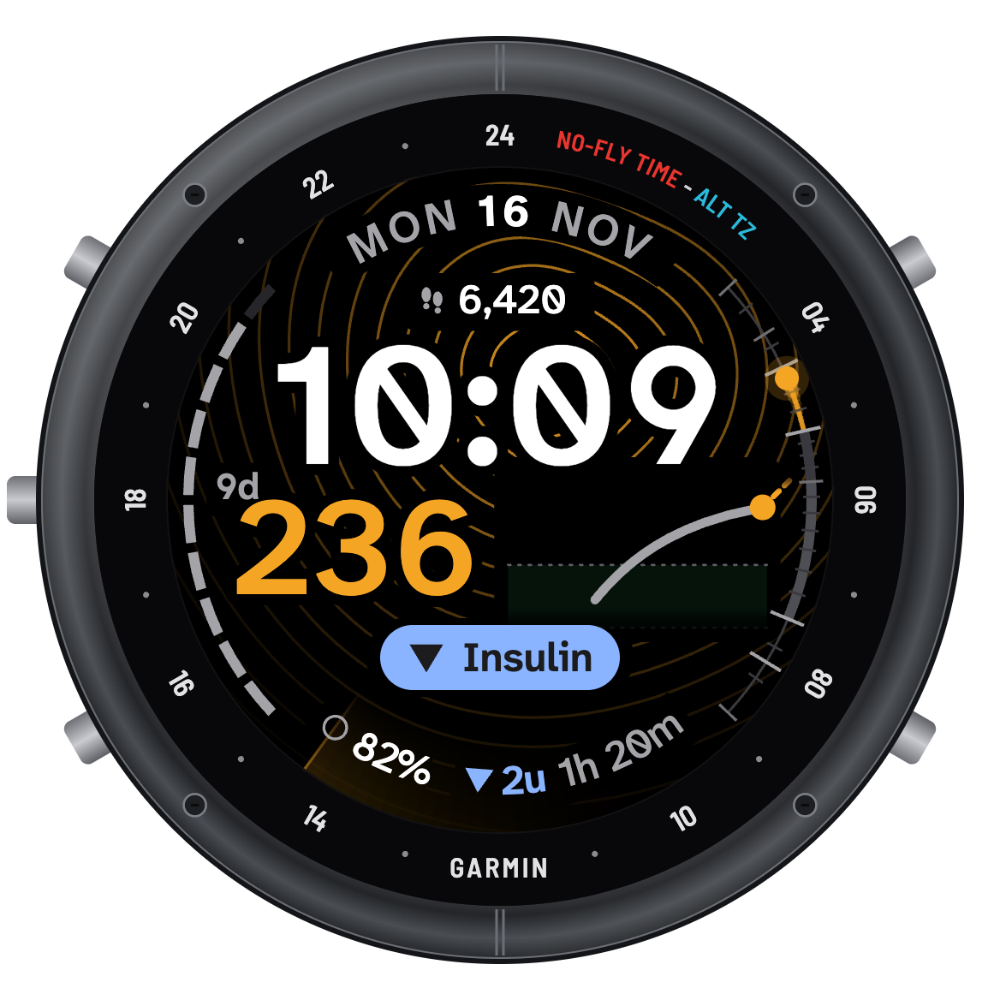 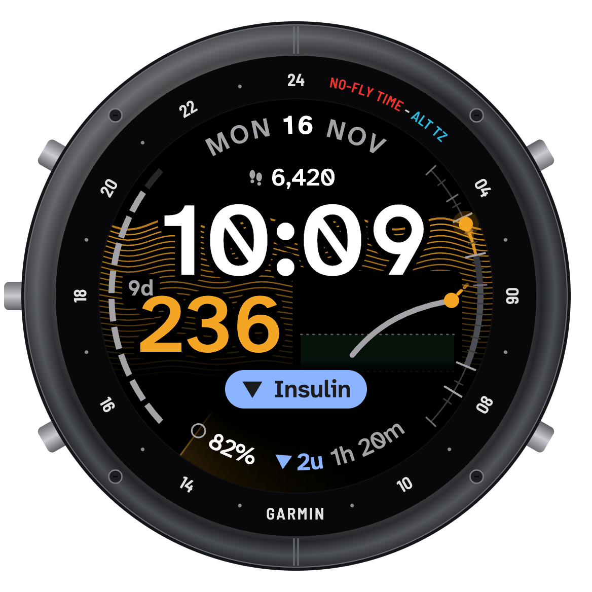 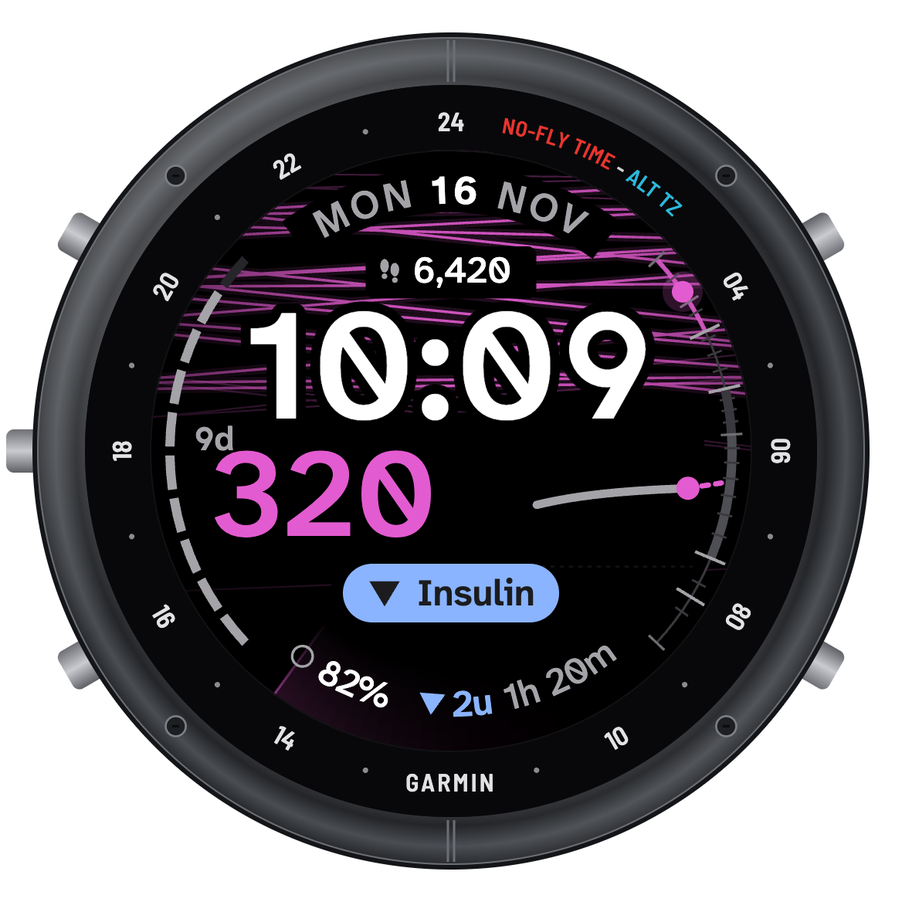 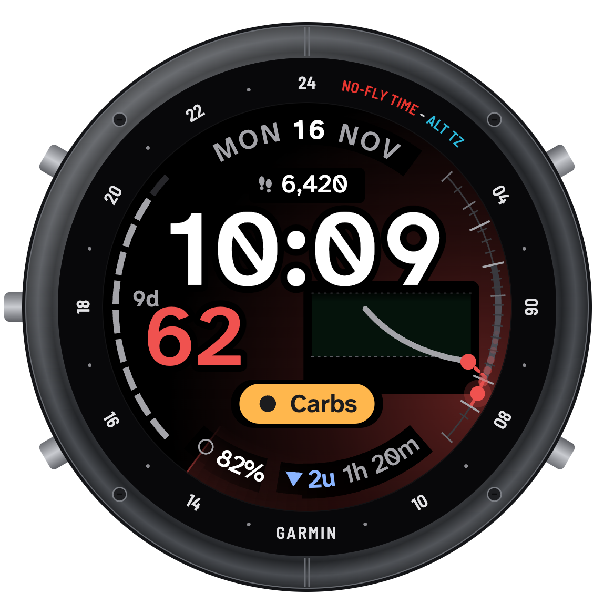

### 6.13 Halo (setting: outline, box, none)
The dial stops short of every text, so no dial line reads as a strike-through (which means "old").
- **Outline** (default): the dial is cut out around each glyph of the time and the value and around the arrow, by
  6.5 px (the glyphs stroked 13 px, round joins). The smaller texts are cut by their line grown 5.5 px (at 24 px the
  grown glyphs would merge into it anyway): the line's box is from Atkinson's ascender 0.73 em over the baseline to its
  descender 0.2 em under it, and the top field's reaches up to its icon (max(0.73·TF, icon/2 + 0.334·TF)):
  - the top field: (−w/2 − 5.5, tfBase − up − 5.5, w + 11, up + 0.2·TF + 11), rx 5.5;
  - the battery label, each line: (−171.5, baseline − 0.73·fs − 5.5, its width + 11, 0.93·fs + 11), rx 5.5;
  - the date: a band along its arc, centre r 169.5, 30 wide, over its width (each glyph + its letter-spacing 2) + 5.5 at
    each end;
  - the bottom fields: per piece a band along the arc over its length + 5.5 at each end: texts centre r 172 − 6.4,
    33.3 wide; icons centre r 164, 29.2 wide.

  And rectangles: the sparkline box with its fade bands (sx − 8, sy − 20, 116, SH + 40, rx 8), the chip row with the reading time and the
  pill (rx0 − 8, chipC − 23, its width + 16, 46, rx 22) and a message (below, rx 14). In the reference these shapes are
  `arcs.halo` (not compared: the port draws them from the same rule).
- **Box**: rounded rectangles: the time (t0 − 10, tBase − T − 10, tW + 20, T + 20, rx 16); the value (x0 − 12,
  vBase − V − 12, total + 24, V + 24, rx 16) or the message's box; the chip row as above (rx 22); the top field
  (−w/2 − 8, tfBase − TF·0.668 − 8, w + 16, TF·0.668 + 16, rx 12).
- **Message boxes** (x, y, w, h): warm-up (mx − 10, vTop − 6, tot + 20, chipC + 14 − vTop); sensor ended (mx − 10,
  vTop − 6, tot + 20, 44); not monitoring (−w/2 − 10, vTop − 8, w + 20, 36); no readings (−120, vTop − 8, 240,
  16.7 + 12 + cap + 16).
- **None**: the dial runs behind everything.
- Only the dial layers are cut; the sweep, rails and content are not.

## 7. Motion
- **A new reading**: the bead and trail glide to their new angles, the arrow turns to its new angle: 0.9 s,
  cubic-bezier(0.25, 0.9, 0.3, 1.1) (a slight overshoot). Digits change in place (no rolling).
- **Seconds sweep**: one step a second, awake only (§6.11).
- **Reveal** (private): the value appears at once; the neon line shrinks from full to nothing in 5 s, then the value
  hides.
- No other motion; nothing blinks. Reduced motion: drop the glides (jump) where the platform says so; Connect IQ has
  no such setting, so on Garmin the glide always runs (it is short, once per reading, and only after a wrist raise).

## 8. Modes
- **Awake** (wrist raised, ~10 s, 1 Hz): everything.
- **Always-on**: outlined time; no sweep, no dial, no top field, no bottom fields, no battery (their rows kept); rail
  hairline, 2 px band, mid and major ticks, bead r 6, no trail, no glow, no zone; value, arrow, chip row, pill and
  messages as awake in the always-on palette. Must stay **under 10 % of the total luminance** (API 5+; over it the face
  goes black in always-on) and follow Garmin's burn-in shift (≤ 4 px a minute, the whole face). **Keep a margin: no
  state above about 7 %**, so a very low never risks a black screen. That's why the very-low block is dimmed in
  always-on (`#441715`, very low at 35 %) with the digits in the always-on ink instead of white: the shape, the light
  digits on red and the pill keep their meaning, and very low and LO went from 9.7 % / 9.9 % to about 7 %. Measured as
  the share of the round screen's light (Rec. 709 luminance of the sRGB values, `garmin_test.py`'s always-on lines; in
  brackets the same in linear light), on the reference: in range 3.7 % (2.0 %); no readings 3.6 % (1.7 %); a filled
  pill (high) 6.1 % (3.4 %); very low 6.9 % (3.6 %); LO 7.2 % (3.8 %). The face in the simulator, 2026-11-16: LO
  7.1 %, very low 6.8 %, high 6.1 %, in range 3.8 %. Its run measures every always-on variant (`aod-*`) this way and
  fails at 10 %.
- **Night** (while the watch is in Do Not Disturb, which its Sleep Mode turns on at the scheduled sleep): the night
  palette; no sweep, no dial; everything else as awake. Not the profile's sleep and wake times: on the Descent they
  aren't the Sleep Mode schedule (set per day) and put the face in night in the afternoon. A low at night keeps its colour, place and pill.
- **Private** (setting): the value row is empty (reserved) and the bead alone says where you are. **Press and hold**
  the face (the Descent gives faces touch-and-hold) shows the value for 5 s with the countdown line. A **needed** pill
  unmasks the value. Everything that isn't the number still shows: the reading's time when late or old, quiet / mute
  pills, messages, the rails (a hollow bead when old), the sweep and dial. The struck value and the trend ring go
  with the value. The rows are laid out as if the value were shown, so nothing moves on reveal.
- **Checks, not modes**: `filter: redshift` (the whole screen through a red-only colour matrix) and `grey`
  (desaturated) exist in the reference to prove nothing depends on colour alone (cases `modes-redshift`,
  `modes-grey`). Garmin's real Red Shift re-tints the screen itself.

## 9. Every state (acceptance, one by one)
Every case in [`cases.json`](cases.json) is an acceptance criterion: its `expect` sentence must be true, its numbers
must match [`expect.json`](expect.json) (§10) and its picture `docs/img/aura/ref/<id>.png`. The groups:

| Group | Cases | Covers |
|---|---|---|
| glucose | in-range, rising, falling-fast, late, old, no-readings, long-gap, another-day, week-old, lo, hi, mmol-widest | freshness and the reading's time, trend, LO / HI, units |
| alerts | low, very-low, low-carbs-taken, muted-low, muted-in-range, muted-forever, muted-long, high, high-insulin-taken, quiet-ended, very-high, extremely-high, falling-fast-in-range | every band and pill, durations, a countdown run out |
| sensor | warmup, almost, ending, ended-sending, ended, none, none-es, ended-es, phone-lost, battery-low | sensor, phone, battery states; Spanish messages beside the stacked battery label |
| modes | awake, aod, night, night-low, private, private-held, private-act, private-old, redshift, grey, spanish | modes and the colour checks |
| fields | default, meal, meal-steps, no-treatment, hiking, sukrara, tir-unknown, long-acting, green-off, green-very-good, green-good, battery-both, battery-percent, battery-both-spark, trend-arrow, trend-spark, spark-turning, spark-old, spark-gap, spark-panned, spark-overflow, spark-wide-range, spark-short-value, spark-old-gap, seconds-off | fields and settings, missing values and readings |
| dial | {grain, contours, waterline, lasers, glow} × {ideal, heading-up, high-rising, high-falling, very-high, low-falling, low-recovering, old}; {black, map} × {ideal, high-rising} | the aura's two axes |
| halo | outline, box, none | the halo |

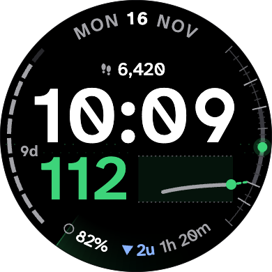 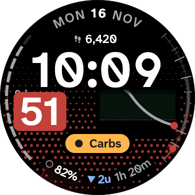 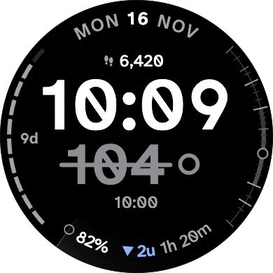 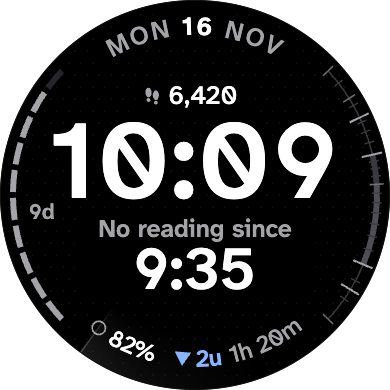 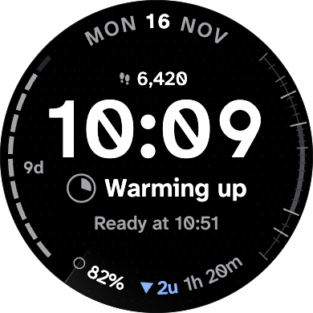 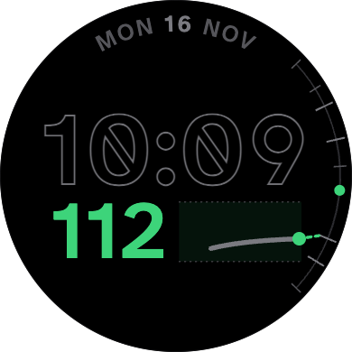

**Edge cases** (each must hold; most have a case):
- One-digit hours (`9:05`) re-centre the time; 12 h shows no AM/PM; midnight `0:00` (24 h) / `12:00` (12 h).
- Values at every limit (55, 56, 69, 70, 140, 141, 179, 180, 249, 250, 299, 300) take Sukrara's band ([`contracts/graph/range/bands.json`](../../graph/range/bands.json));
  39 never shows as a number (LO), 401 never (HI); mmol/L widest `22.2`, `10.0`.
- Rate exactly 0, ±1, ±2, ±3 (doubled from Sukrara's band), no rate (ring), rate with LO / HI (ring).
- The reading time in the future (clock skew): age 0 (fresh).
- History shorter than 6 / 13 readings, or with gaps: draw what exists (fewer trail dots, a shorter sparkline).
- Battery above 10 days: 10 segments; 0: none lit, label `1h`.
- Steps ≥ 100,000 and any long field text: the overflow rule (§6.10).
- Spanish everywhere (`modes-spanish`, `sensor-none-es`, `sensor-ended-es`): longest words fit (pill `Silenciadas`,
  `Sin lecturas desde`, `Terminado` beside the stacked battery label). Words stay short ("Insulin", "Ended") so the
  numbers keep their size.
- Private + old, private + no readings, private + always-on, night + out of range, always-on + old.
- The battery label never meets the value or a message, whatever the width (sparkline, mmol/L `22.2`, LO / HI),
  language, battery text (`9d`, `14h`, `86%`, both) or top field: in the reference, all 5,184 combinations of those are
  clear. Test it the same way in the port.
- A mute with no end (`alerts-muted-forever`), Mute all while out of range (the side's pill with its time).
- Phone out of reach: the value ages by itself (late → old → no readings) from the reading's own time.
- A new sensor mid-warm-up after a gap; sensor ended while the phone is away.
- The top field set to none; both bottom fields the same kind is allowed.

**Also check against docs/42 §11**: the 2-second glance (time, value, direction, current); nothing moves, flashes or
turns saturated in range except the slow sweep; night lights nothing up; every state can be left.

## 10. Proving the port matches (do this, don't eyeball)
1. **Numbers.** Make the face's layout code callable from a test (a pure function of the same inputs, Monkey C unit
   tests or a desktop harness). For every case in `cases.json`, compare with `expect.json`: positions ±0.5 px, sizes
   ±0.5, angles ±0.1°, opacities ±0.01, colours and strings exact. `expect.json` holds everything `layout()` returns
   (long paths summarised as subpath counts: match the count). Each element has a `disp` (`inline` / `none`): its
   other numbers are computed even when hidden, so compare them only where it is drawn, and compare `disp` always.
   `layout` holds the row maths (§4), `info` the dial's inputs (ext, toward, I, spd, levelY, idealY, colour).
2. **Pictures.** Add a debug-only way to load a case into the face (CLAUDE.md: debug code never in release builds),
   take the simulator's 390 × 390 screenshot, and diff it with `docs/img/aura/ref/<id>.png` (for example ImageMagick
   `compare -metric AE -fuzz 15% ref.png sim.png diff.png`). Fonts rasterise differently, so expect differences on
   glyph edges only: **any difference that is not a glyph edge is a bug** (an element moved, a colour, a missing
   piece). Keep the diff images for review.
3. **Look at it.** `node tools/watchface/build.mjs` also writes a gallery of every case (path printed) for a side by
   side look; `render.html#cfg=…` shows any input you want to try.
4. When the design changes: change `aura.js` first, run `build.mjs`, then this text, then the face.

## 11. Settings
All user settings (the Garmin face's own, set on the watch and in the Connect IQ app) — register them in
`contracts/settings/settings.json` (CLAUDE.md "Settings never diverge"):

| Setting | Values (reference `cfg` value) | Default |
|---|---|---|
| Dial (`dial`) | grain (`halftone`), black (`black`), map (`map`), contours (`topo`), waterline (`water`), lasers (`laser`), glow (`glow`) | grain |
| Halo (`halo`) | outline, box, none | outline |
| Trend (`trendStyle`) | arrow (`arrow`), sparkline (`spark`) | sparkline |
| Seconds sweep (`seconds`) | on, off | on |
| Green in range (`rangeColour`) | on, off | on |
| Top field (`topField`) | weather, steps, sunset (`sunset`), body battery (`bodyBattery`), altitude, notifications, time in range (`tir`), second time zone (`tz2`), floors, heart rate (`heart`), none | steps |
| Bottom fields (`fields`: two keys) | the same list + treatment (`treatment`) | time in range, treatment |
| Battery label (`battLabel`) | days, percent, both | days |
| Private (`privacy`) | on (`private`), off (`open`) | off |
| Second time zone (`tz2`) | a city, by its code: UTC LON LIS MAD PAR BER ATH CAI IST MOW DXB DEL BKK SIN HKG SHA TYO SEL SYD AKL HNL ANC LAX DEN MEX CHI NYC BOG SCL BUE SAO LOS JNB (its daylight saving follows the place) | NYC |

Units, band limits, language and 12/24 h come from Sukrara / the watch, not from the face.

**Where they are set**: on the watch, hold MENU on the face › Watch face › **Customize** (Garmin's standard menus: the
face's name as the title, one row per setting above: an on / off one is a switch, the others show their current choice
and open the list of choices with it marked *Selected*; picking one saves it and goes back, back leaves without a
change); and in the Connect IQ app on the phone. The face shows the new choice at once.

## 12. Store and website
`docs/img/aura/store/` (1168 × 1168, transparent, synthetic data only): `hero` (in range), `grain-high`,
`contours-high`, `waterline-high`, `lasers-very-high`, `glow-low`, `sparkline`, `always-on`, `night`, `spanish`. Other
sizes or states: `node tools/watchface/build.mjs --case <id> --bezel --size <px> --out <file>` (ids from
`cases.json`'s `store` and `cases`). The bezel is a drawing of the owner's watch, GARMIN print included; check
Garmin's marketing guidelines before using it on the store or the website, or render without it (`bezel: false`) and
place the screen on Garmin's official device image.
The Connect IQ store's icon, hero and screens are bezel-less, in `docs/img/aura/store/ciq/`
(`node assets/brand/sukrara/connectiq/render.mjs`; the listing text: docs/20-publishing.md › Connect IQ store).

**Descriptions** (store alt text, the website, any accessible label the face gets): Sukrara's spoken sentence for the
card ([`contracts/graph/spoken/card.json`](../../graph/spoken/card.json)), e.g. "112 milligrams per decilitre,
falling, in range, 2 min ago". The reference's own `aria-label` is a mock-up approximation, not that sentence.

## 13. Platform notes (how, not what)
Not design rules (docs/42 "platform limits are facts"); hints for building it on Connect IQ:
- **Fonts**: custom bitmap fonts per size in the table of §2, digits only for the big ones (memory: the face has 128 KB).
  Text along an arc: `drawRadialText` (API 4.2.1+) with the vector system font as a fallback is *not* the design's
  font; prefer pre-rendered glyphs placed along the arc yourself (each glyph at its angle), as the reference does.
- **Alpha and gradients**: draw into an alpha-capable `BufferedBitmap` (`Graphics.createColor(alpha, r, g, b)`, API 4.0).
  Contours are concentric with their fade, so each ring gets one alpha (the fade at its radius). The waterline's lines
  each get one alpha (the fade at their depth). Split each laser into a few segments with stepped alpha. The glow: a
  handful of concentric filled circles with stepped alpha, or a pre-rendered radial bitmap tinted.
- **Halo outline**: after the dial, paint the halo in black over it, then the content: the time and the value with
  grown variants of their glyphs (atlases of each glyph stroked 13 px), the arrow's polygons grown 6.5 px, the small
  texts' boxes and arc bands as §6.13 says.
- **Cost**: the dial is painted into a bitmap and painted again only when its inputs change (a new reading, the mode,
  a setting), a few pieces a frame to stay under the watchdog; every frame copies it. The seconds sweep redraws at 1 Hz
  while awake, a step a second.
- **Data**: the 5-min background poll (docs/08) is a limit to solve, not a design input: a phone push or a companion
  app gets readings to the face within seconds.
- **Touch-and-hold**: the face's delegate receives the press (`WatchFaceDelegate.onPress`, 4.2.0; the Descent has no
  tap on faces).
- **Rotation**: affine transforms (4.2.0) rotate the arrow, the bottom icons and the bead; or precompute the points.
- **Motion** runs only in high-power mode (the ~10 s after a wrist raise): a reading that arrives in low power is
  drawn in its place, without the glide.
- **Awake or always-on**: the last of the watch's callbacks decides: a wrist raise or a button (`onExitSleep`) and
  `onShow` (back from a menu) → awake; `onEnterSleep` → always-on on an AMOLED; `onDisplayModeChanged` → the display
  mode. The display mode alone (read in `onShow`) put the face in always-on while the person was looking at it.
- **Night** is `DeviceSettings.doNotDisturb`: the profile's sleep and wake times aren't the Sleep Mode schedule on the
  Descent (set per day) and put the face in night in the afternoon; the per-day schedule needs API 6.
- **Second time zone**: the watch's own Alternate Time Zones aren't open to Connect IQ, so the face keeps its own city
  list with each city's coordinates and asks `Gregorian.localMoment` for the zone and its daylight saving.
- **Readings, the report, the screen events**: [docs/43](../../../docs/43-garmin-link.md) and
  [`contracts/watchface/payload`](../payload/README.md).
- Garmin facts with sources: [docs/evidence/42-watch-faces/garmin.md](../../../docs/evidence/42-watch-faces/garmin.md).

## 14. Not designed yet
- A 12-hour AM/PM mark (none for now).
- Exercise / sport changing the face (Garmin shows activity screens instead).
