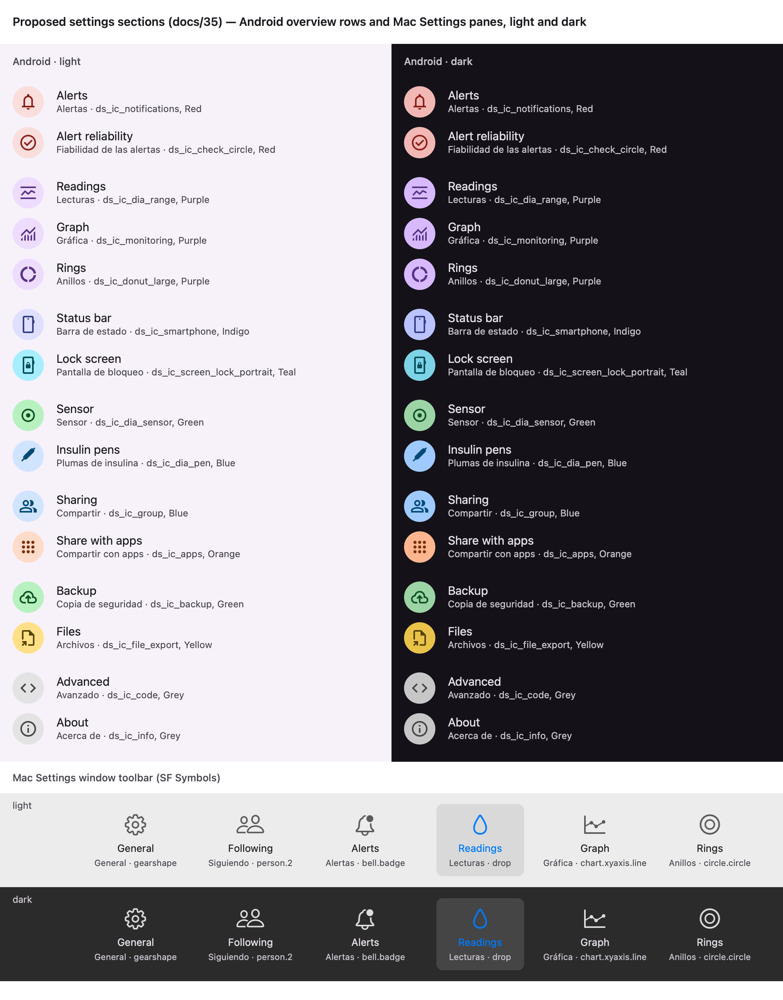

# 35 — Settings organisation: what belongs where, on both apps

*2026-11-14 · investigation report · issue #205 · triggered by #204 (trend arrow) · sources: THE schema
`contracts/settings/settings.json`, the Android settings pages (`apps/android/feature/settings`), the Mac Settings
window (`apps/macos/Sources/SukraraApp/Windows/Settings`, after b525f07f), the PoC's approved UX
([10-showcase](10-showcase.md)), Material and Apple guidance, the documentation and issue trackers of Dexcom G7,
FreeStyle LibreLink, xDrip+, AAPS, Loop and Juggluco · a plan only: nothing is moved until the owner approves*

## Goal

The settings grew one section at a time and some sit where they don't belong. The owner (2026-11-14): the new
trend-arrow setting (#204) isn't a Graph setting, and "maybe other things that are in graph also don't belong there".
Plan the organisation of every setting on Android and Mac from the person's point of view: the sections, their names
(en + es), order and icons, what goes in each and why, what is advanced, how search finds everything, how followers'
mirrored settings show, and the same organisation on both apps where the platform allows.

## Short answer

- **Ranges and the unit aren't graph settings**: they colour the graph, the rings, the report, the status bar and the
  menu bar. They form a new **Glucose** section with the **Trend arrow** (#204): "my numbers".
- **The rings get their own page on Android** (the Mac already has a Rings pane). Graph keeps only the chart.
- **The sensor's time left and countdown go to the sensor**: Android's Sensor page, with **Sensor end as its
  subpage**. The Mac has no sensor page, so they go in Glucose › Sensor.
- **No global advanced mode.** The rare rows go in one named subpage at the end of their own section (Alerts ›
  *Fine-tuning*). Search finds every row.
- **Mac panes**: General · Following · Alerts · Glucose · Graph · Rings.
- **Setting ids, stores, keys and the wire stay unchanged.** Only the schema's `section` (a display grouping) changes.
  The new trend settings need a wire key: a PROTOCOL-v2 change on both apps.

## 1. What exists

**Android overview** (`SettingsOverview.kt`), group by group:

- Profile (wearer only)
- Mute all strip
- [Alerts · Alert reliability]
- [Settings from (follower only) · Ranges · Graph]
- [Status bar · Lock screen]
- [Sensor · Sensor end · Sharing · Share with apps · Insulin pens]
- [Backup · Export]
- [Show closed tips · Advanced · About]

**Mac panes** (b525f07f): General · Graph · Rings · Alerts · Following.

What each page or pane holds today:

| Area | Android | Mac |
|---|---|---|
| Unit | **Ranges** page (top) | **General** › Glucose (with the read-aloud shortcut) |
| The 6 range bands | **Ranges** page (its own page, live preview) | **Graph** pane › Ranges |
| Time shown (default + per place), lines, vertical lines, treatments on the graph, time in range distribution + crown | **Graph** page | **Graph** pane |
| Rings (`ringCount`, `slots`, `ringRange`, `ringMarks`, `ringOrder`) and last treatment (`lastPlace`, `lastElse`) | **Graph** page ("Beside the value", "Ring order") | **Rings** pane (its own) |
| `graph.sensorTime.place` | Graph page › Sensor | Graph pane › Sensor |
| `sensor.countdownHours` | **Sensor end** page | **Graph** pane › Sensor |
| Sensor reminders and calendar | Sensor end (Android only) | — |
| Glucose source, Juggluco | Sensor page (`source.source`, the secret) | General › Source (Juggluco on this network) |
| Alerts | Alerts page: switch, kinds, night, escalation, review, quiet times, wait, notification actions, sounds; plus Alert reliability | Alerts pane: the same sections, plus Focus |
| Settings from | an overview row (follower) | General, and atop every mirrored pane |
| Search | yes (`search/SettingsIndex.kt`) | none (the schema says "a few panes") |

Mismatches between the two apps:

- **The unit** is on Ranges on Android and in General on the Mac.
- **The ranges** are their own page on Android and inside Graph on the Mac.
- **The rings** are inside Graph on Android and their own pane on the Mac.
- **The sensor countdown** is in Sensor end on Android and in Graph on the Mac.

Mismatches between the schema's `section` and the screens. `section` is documentation only: `tools/settings/gen.py`
doesn't read it.

- `general.unit` says general; on Android it's on Ranges.
- `sensor.countdownHours` says graph; on Android it's in Sensor end.
- `graph.band.*` says graph; on Android it's Ranges.
- `widget.overrides` says graph; it lives in the widget's own configure screen.
- `source.jugglucoSecret` says general; on Android it's on the Sensor page.

None of the ranges, the sensor time or the countdown are graph settings. The Mac's own footer under the ranges says
so: "Used by the graph, the rings, the report and the menu bar colour".

## 2. The person's life

| Moment | What they look for | Where they'd think it is |
|---|---|---|
| First setup, after a clinic visit | unit, target range | "my numbers", not "how the graph looks" |
| A night of false alarms | thresholds, quiet times, night alerts, wait before alerting | Alerts: the most visited page and the highest stakes |
| "The arrow lied" (#204) | where the trend comes from, smoothing | "the arrow / the trend"; it also drives *Falling fast* / *Rising fast* |
| A new sensor every 10–15 days | pairing, source, when it ends, reminders | Sensor (today Sensor end is a separate overview row next to it) |
| Sharing with a partner or a parent | followers, apps, the clinic, backup | Sharing; for the follower, Settings from decides what they see |
| Bored, making it theirs | graph, rings, status bar, lock screen | how it looks |
| Travel | unit (another country's clinic), night window | Glucose, Alerts › Night alerts |

**Rarely touched**: trend smoothing, how long alerts wait near a threshold and the bounce margin, the lengths that a
notification's Mute and Relax offer, pen detection, relays and the log.

**Dangerous to change by accident**:

- alerts off, *Very low* or *No data* off, *Like an alarm* off (these already ask first);
- the thresholds (kept in order);
- *Settings from* (changes which alerts apply);
- the trend source (it changes the rate alerts: the page must say so).

## 3. What others do

- **Material settings pattern** ([Android](https://developer.android.com/design/ui/mobile/guides/patterns/settings)):
  an overview, then groups. From about 15 settings, a subscreen. Search for deep hierarchies. "The label of the
  setting that opens a group must match the subscreen title". *Good; we follow it.*
- **Apple HIG Settings** ([HIG](https://developer.apple.com/design/human-interface-guidelines/settings)): a
  noncustomizable pane toolbar, the window titled after the pane, reopen on the last pane, "minimize the number of
  settings", task options where the task is. *Good; already done in b525f07f.*
- **Dexcom G7** ([App Essentials](https://dexcompdf.s3.us-west-2.amazonaws.com/en-us/G7-App-Essentials.pdf),
  [older user guide](https://s3.us-west-2.amazonaws.com/dexcompdf/G7/AW00046-05_UG_G7_OUS_en_MMOL.pdf)): alerts moved
  from *Menu › Settings › Alerts* to *Profile › Alerts* between versions, and guides in circulation give both paths.
  *Bad: the muscle-memory cost we want to pay once only.*
- **FreeStyle LibreLink / Libre 3**
  ([2024 manual](https://freestyleserver.com/Payloads/IFU/2024/q2/ART48222-101_rev-A.pdf),
  [2025 manual](https://freestyleserver.com/Payloads/IFU/2025/q3/ART46937-301_rev-A.pdf)): *Alarms* is its own
  main-menu item. The unit and the Target Glucose Range are under Settings, and the manual says the target range "will
  not set glucose alarm levels". *Good: ranges and alert thresholds are different things, kept apart.*
- **xDrip+**: the rare settings in *Less common settings* are where people get lost. In
  [#1006](https://github.com/NightscoutFoundation/xDrip/issues/1006) a user looked under *Alarms and advices* for what
  lived in *Less common › Advanced calibration*. Three smoothing settings sit in three menus
  ([#3709](https://github.com/NightscoutFoundation/xDrip/discussions/3709)). There's a request to move rarely used
  settings out of sight ([#1740](https://github.com/NightscoutFoundation/xDrip/issues/1740)). A maintainer asked a
  trend-arrow setting to go "to the home shelf as that is where all the settings related to the trend arrow are"
  ([#691](https://github.com/NightscoutFoundation/xDrip/issues/691)). *Bad: no "misc" bucket. Good: one home per
  topic.*
- **AAPS** ([Preferences](https://wiki.aaps.app/en/latest/SettingUpAaps/Preferences.html)): *Simple mode* hides many
  settings globally. Its search then lists a setting that Simple mode hides on the page it opens
  ([#5464](https://github.com/nightscout/AndroidAPS/issues/5464)). *Bad: no global advanced mode.*
- **Loop** ([Settings](https://loopkit.github.io/loopdocs/loop-3/settings/),
  [Therapy Settings](https://loopkit.github.io/loopdocs/loop-3/therapy-settings/)): a short top level (Closed Loop,
  Therapy, CGM, Services, Support). Therapy settings are behind the same authentication as a bolus. *Good: few
  sections, and dangerous changes are guarded.*
- **Juggluco** ([help](https://www.juggluco.nl/Jugglucohelp/index.html),
  [menus](https://www.juggluco.nl/Jugglucohelp/introhelp.html)): one *Settings* in the left menu holding unit, alarms,
  display ranges and colours. *Compact, hard to discover (the menus open by touching parts of the screen).*
- **The PoC** (binding; [10-showcase](10-showcase.md)): "Settings → Graph & time in range (both roles), with a live
  preview". Every page that changes the card keeps a live preview.

The searches found no Reddit threads on these questions; the complaints above come from the apps' own trackers and
manuals.

## 4. Proposal

### Sections

The schema's `section` becomes the screen section, the same on both apps.

| # | `section` | en / es | Android icon | Mac SF Symbol | What goes in it and why |
|---|---|---|---|---|---|
| 1 | `alerts` | Alerts / Alertas | `ds_ic_notifications`, red | `bell.badge` | Every `alerts.*`. Subpages: each alert, Night alerts, and **Fine-tuning / Ajuste fino** (new: `alerts.persistence.*`, `alerts.actions.*`). On Android, Alert reliability and Review alert thresholds stay next to it. |
| 2 | `glucose` | Glucose / Glucosa (replaces Ranges) | `ds_ic_dia_range`, purple | `drop` | "My numbers": the unit, the 6 ranges and the **Trend arrow** (#204), with a live preview on top. The ranges colour the graph, rings, report, status bar and menu bar, so they aren't graph settings. |
| 3 | `graph` | Graph / Gráfica | `ds_ic_monitoring`, purple | `chart.xyaxis.line` | The chart only: time shown (default + per place), lines, vertical lines, treatments on the graph, time in range distribution + crown. Live preview. |
| 4 | `rings` | Rings / Anillos ("Rings and numbers beside the value, last treatment") | `ds_ic_donut_large`, purple | `circle.circle` | Ring count and slots, what a ring's centre counts, rewards, ring order, last treatment and its fallback. **Android gets its own page** (the Mac already has the pane). Live preview. |
| 5 | `statusbar`, `lock` | Status bar / Barra de estado, Lock screen / Pantalla de bloqueo | unchanged | — | Android only, unchanged. |
| 6 | `sensor` | Sensor / Sensor | `ds_ic_dia_sensor`, green | (no pane) | Android: the Sensor page, with **Sensor end as its subpage** (reminders, calendar, countdowns, `sensor.countdownHours`, and `graph.sensorTime.place` as a *Time left* group). One overview row fewer; "my sensor" is one place. |
| 7 | `pens` | Insulin pens / Plumas de insulina | unchanged | — | Moves next to Sensor: both are devices on the body. |
| 8 | `sharing`, `apps` | Sharing / Compartir, Share with apps / Compartir con apps | unchanged | — | Followed by Backup and Export. |
| 9 | `general` | General / General | — | `gearshape` | Mac: Settings from, the read-aloud shortcut, open at login, updates, About, Quit. Android has no General page: updates stay in About, Settings from stays an overview row. |
| 10 | `advanced`, `about` | Advanced / Avanzado, About / Acerca de | unchanged | — | App-level and technical: settings file, relays, log. |

**Android overview, new order** (each group in brackets):

- Search
- Banner
- Profile
- Mute all strip
- [Alerts · Alert reliability]
- [Settings from (follower) · Glucose · Graph · Rings]
- [Status bar · Lock screen]
- [Sensor · Insulin pens]
- [Sharing · Share with apps · Backup · Export]
- [Show closed tips · Advanced · About]

**Mac panes, new order**: General · Following · Alerts · Glucose · Graph · Rings.

- General stays first (HIG).
- Following comes second: on a Mac it's where every reading comes from, and the first thing set up.
- `settings.pane` gains `glucose`.
- The panes' tooltips are rewritten.

### What "advanced" means

No global mode (AAPS and xDrip+ show why). Each page keeps its common rows on top. The expert rows go in one named
subpage at the bottom of their own section:

- Alerts › *Fine-tuning* (on the Mac, a *Fine-tuning…* sheet like the alerts' *Details…*);
- Glucose › Trend arrow › *Smoothing*;
- Insulin pens › *Detection* (exists).

Search always finds them.

### Trend arrow (#204): Glucose › Trend arrow

- **Trend from**: *The readings* (default) / *The sensor*, as radio rows on Android and a Picker on the Mac.
- **Smoothing**: a preset choice. While *The sensor* is chosen it's disabled, with the reason *Uses the sensor's own
  trend*.
- **Footer**: "Every arrow, spoken trend and the Falling fast / Rising fast alerts use this."
- **Preview**: the page's live preview card turns its arrow with a spring when the choice changes. With reduced
  motion it changes without the animation.
- **Schema**: both settings are mirrored, with `section: glucose` and new ids (e.g. `glucose.trend.source`,
  `glucose.trend.smoothing`).
- **Wire**: they need a key in the PROTOCOL-v2 settings payload: a protocol change on both apps in the same round
  (parity group `protocol-v2`).
- **Order**: built after #204's math research and #195.

### How search finds everything (Android)

- The `SettingsIndex` trails follow the moves: Glucose, Rings, and Sensor › Sensor end.
- New `Section.Glucose` and `Section.Rings`.
- Keywords (en + es):
  - target range, TIR, colours → the ranges;
  - arrow, trend, direction, rate, delay, smoothing → Trend arrow;
  - mmol, mg/dL → the unit;
  - GMI, average, CV, rings → Rings;
  - countdown, expiry, replace → Sensor end.
- The old page names ("Ranges", "Graph") stay as keywords on the moved rows, for muscle memory.
- Optionally, a test that every schema setting with Android UI has a search entry whose page matches its `section`.
- The Mac keeps no search field at 6 panes (the HIG doesn't ask for one). Revisit if it passes about 7.

### Mirrored settings

The pattern doesn't change:

- **Mac**: `SettingsFromSection` atop Alerts, Glucose, Graph and Rings.
- **Android**: read-only rows with "From ‹name›'s phone" and the way to *Settings from*.
- **Mixed pages**: Glucose mixes mirrored rows (ranges, trend) with the device's own unit, which stays editable.
  Graph's time per place and the Sensor page's time-left places stay each device's own.

### Every setting that moves

| Setting(s) | Schema `section` | Android | Mac |
|---|---|---|---|
| `graph.band.*` (6) | graph → glucose | Ranges → **Glucose** (the same page renamed, route `ranges` → `glucose`) | Graph › Ranges → **Glucose** › Ranges |
| `general.unit` | general → glucose | stays (its page is renamed) | General › Glucose → **Glucose** › Unit |
| Trend source + smoothing (new, #204) | glucose | Glucose › Trend arrow | Glucose › Trend arrow |
| `graph.ringCount`, `graph.slots`, `graph.ringRange`, `graph.ringMarks`, `graph.ringOrder`, `graph.lastPlace`, `graph.lastElse` | graph → rings | Graph page → **Rings** page | stays in Rings |
| `graph.sensorTime.place` | graph → sensor | Graph › Sensor → Sensor › Sensor end › Time left | Graph › Sensor → **Glucose** › Sensor (the Mac has no sensor page; a follower sees the wearer's sensor) |
| `sensor.countdownHours` | graph → sensor | stays in Sensor end (now under Sensor) | Graph › Sensor → **Glucose** › Sensor |
| `sensor.reminders`, `sensorCalendar.*` | sensor | overview row → Sensor › Sensor end | — |
| `alerts.persistence.*`, `alerts.actions.*` | alerts | Alerts groups → Alerts › Fine-tuning | Alerts sections → *Fine-tuning…* sheet |
| `source.jugglucoLan`, `source.jugglucoAddress`, `source.jugglucoSecret` (Mac) | general → source | — | General › Source → **Following** › Juggluco on this network (both answer "where does this Mac get glucose"; the owner decides) |
| `widget.overrides` | graph → rings (or a `widgets` section) | stays in the widget's configure screen | — |

These stay where they are: `graph.hours`, `graph.hours.place`, `graph.lines`, `graph.gridHours`, `graph.marks`,
`graph.side`, `graph.columnCrown`, `general.readAloudShortcut`, and everything else not listed.

**Setting ids, stores, keys and wire names stay unchanged.** Renaming `graph.band.*` would only churn the stores and
the protocol for no gain to the person.

## 5. States and exits (settings navigation)

**Android**

- **Pages**: overview → page → subpage. Back / predictive back goes up one level. Each page's title matches the row
  that opens it.
- **Search**: a result opens through its parent pages (e.g. Sensor, then Sensor end), and Back walks up them to the
  overview.
- **Links from outside**: a notification or home link into Sensor end puts Sensor under it.
- **Follower in Wearer mode**: the Glucose, Graph, Rings and Alerts rows are read-only, with the exit *Settings from*
  (switch to Custom).
- **Smoothing**: disabled with *Uses the sensor's own trend*; the exit is *Trend from › The readings*.
- **Fine-tuning**: Back leaves; its own *Reset* asks first.

**Mac**

- **Panes**: any pane from the toolbar at any time. The window reopens on the last pane; an unknown stored pane opens
  General.
- **Links from the panel**: the night row opens Alerts, *Following* opens Following, Juggluco opens Following (if it
  moves there).
- **Fine-tuning sheet**: closes with *Done* or Esc.
- **VoiceOver**: every toolbar pane button is labelled.

## 6. Risks

- **Muscle memory.** The owner opens Graph for the rings, and Dexcom's moves confused people. Mitigation: the old names
  as search keywords, a CHANGELOG line, and one reorganisation only (no later reshuffles).
- **Deep links**:
  - Android: the `SettingsKey` strings in `SukraraNavigation.kt` (`ranges` → `glucose`, new `rings`, `sensorend`
    pushes Sensor first) and `SettingsRoute`;
  - Android: home's no-readings action (→ Sensor), the sensor-end notifications;
  - Mac: `PanelView`'s `openSettingsPane(.general)` for Juggluco;
  - schema: the `settings.pane` values.
- **Search index**: the `Section` enum, the trails, en/es keywords, `StringsParityTest`.
- **Docs and screenshots to update**:
  - FEATURES.md: Settings; Graph and value card; the *Settings from* list; Settings search; each page's States and
    exits;
  - README;
  - QA.md;
  - `docs/img/settings/*`;
  - the Android settings Roborazzi goldens and the Mac `WindowSnapshots` panes;
  - the Mac `Localizable.xcstrings` tooltips;
  - the schema's `section` values.
- **Protocol**: the trend setting's wire key is a PROTOCOL-v2 change on both apps in the same round.
- **The PoC's live preview**: every page that changes the card (Glucose, Graph, Rings) keeps a live preview. The new
  Rings page on Android needs the `PreviewCard`.
- **Both apps in one round**: the merge check fails a one-sided change, so Android and Mac move together.

## In Sukrara

Built in one round on both apps (#205), after the owner's review (§7, which wins over §4). Implementation reference:
AOSP Settings and SettingsLib SPA (vendored as `settingslib-spa`): the homepage's groups of coloured icons
(`top_level_settings.xml`) for the overview, a page's parents opened before it as a search result opens (Settings'
`SubSettingLauncher` path; `SettingsIndex.path`), the search index as one declarative list with keywords
(`BaseSearchIndexProvider`, `settings:keywords`) and SettingsIntelligence's ranks, the searched row flashed (SPA
`HighlightBox`, Settings' `EXTRA_FRAGMENT_ARG_KEY` highlight), links between pages as rows that open the other screen
(SPA `SettingsEntryBuilder.createLinkFrom`), and one preference key shown on two screens for the second places.

| Built | Why |
|---|---|
| Schema: the `section` values follow the sections (`readings`, `rings`, `sensor`, `source`); `settings.pane` = general, following, alerts, readings, graph, rings | one grouping, written once, the same on both apps |
| Android overview: [Alerts · Alert reliability] [Settings from · Readings · Graph · Rings] [Status bar · Lock screen] [Sensor · Sensor end · Insulin pens] [Sharing · Share with apps · Backup · Import and export] [tips · Advanced · About]; icons a drop (Readings), a donut (Rings), a chequered flag (Sensor end) | §4 and §7 |
| Readings (the old Ranges page, route `readings`): unit, Trend arrow, ranges, *See also* Alerts; Rings split off Graph with its own live preview and Reset all | §4, §7 |
| Alerts › Fine-tuning (waits near a threshold, the notification buttons, *Reset fine-tuning*); Mac: a *Fine-tuning…* sheet | no global advanced mode |
| Import and export (Export data, Import history, the settings file) out of Share with apps and Advanced; Sharing, Share with apps, Backup and Import and export each link the other three | §7 data pages |
| Second places: the trend in Falling / Rising fast (Mac: in their Details…), THE night in Sensor end, the sensor's time left in Sensor end and Graph, a Ranges row atop Graph | §7 |
| Links (*See also*): Alerts ↔ Alert reliability, Alerts ↔ Readings, Rings → Readings, Sensor ↔ Sensor end, Night alerts ↔ Sensor end | §7 |
| THE night: the sensor reminders take the night alerts' window (`alerts.night.from` / `to`); `sensor.reminders` no longer stores a night (no migration) | §7: two nights could disagree |
| Mac: panes General · Following · Alerts · Readings · Graph · Rings; Readings pane (unit, ranges, trend); Juggluco into Following | §7 |
| Search: the moved rows, new pages, links, old names as keywords (*Ranges*, *Graph*, *Export*, *Advanced*); `SchemaSearchTest` (every schema setting with an Android row is found on its section's page, every second place too), `SecondPlacesTest` | §6 muscle memory |

| Left out | Why |
|---|---|
| Sensor end as a subpage of Sensor only | §7: it keeps its own row and Sensor links to it |
| Moving the Mac's sensor countdown / time left to Readings | the Mac has no sensor page and §7 makes Graph its second place; Readings stays "how each reading is shown, judged and where it heads" |
| The six ranges editable on Graph itself | a *Ranges* row atop Graph (the target in use) opens Readings: six band rows twice on two pages would double the longest page for a value people set once; the row is where they look, the editor is one tap away |
| The card's arrow as a link to Trend arrow (§7 table) | the arrow is drawn by the one renderer on every surface; a tap target on it would change home's card for a settings shortcut. The trend is reachable from Readings and both fast alerts |
| Trend smoothing as its own subpage (§4 *Glucose › Trend arrow › Smoothing*) | #204 shipped one choice of four (Quick · Balanced · Smooth · From the sensor), nothing left to hide |
| A Mac search field | six panes; the HIG doesn't ask for one |
| Renaming ids, stores or wire keys (but the night) | §7: a later reorganisation stays cheap |

## 7. The owner's review (2026-11-14) and what it changes

The proposal above stands, with these decisions. The owner expects another reorganisation later; this round keeps
ids, stores and wire keys unchanged so a later one stays cheap.

| Topic | Decision | Why |
|---|---|---|
| "Glucose" section | **Readings / Lecturas** | Glucose isn't something you adjust; the section holds how each reading is shown (unit), judged (ranges) and where it heads (trend arrow). "Targets" reads like alert levels; "Ranges and units" leaves the arrow out. |
| Readings icon (Android) | **a drop**, as on the Mac | `ds_ic_dia_range` looks like Graph's chart icon. |
| "Graph" | **keep: Graph / Gráfica** | Native-English CGM apps say graph: Dexcom G7 "trend graph" ([guide](https://dexcompdf.s3.us-west-2.amazonaws.com/en-us/G7-CGM-Users-Guide.pdf)), LibreLink "glucose graph" ([manual](https://freestyleserver.com/Payloads/IFU/2024/q2/ART48521-101_rev-A.pdf)), xDrip+ "Graph Settings" ([docs](https://navid200.github.io/xDrip/docs/Display/Display.html)); only Loop says "Glucose Chart" ([displays](https://loopkit.github.io/loopdocs/loop-3/displays-v3/)). |
| Sensor end | **its own row stays, and Sensor links to it** (both places, one page) | Keeping it as a subpage only would save an overview row but hide it from people who look for "when does my sensor end" at the top level; a row plus a link from Sensor serves both. Icon: **a chequered flag** (the finish), not an hourglass. |
| Night | **one night setting**, editable from Alerts › Night alerts and from Sensor end | Two separate "nights" (alert night rules, quiet sensor reminders) can disagree; one time range, two entry points. |
| Data pages | Sharing, Share with apps, Backup and a new page for Export data + Import history + Settings file (out of Advanced); each page's foot links the other three | The four looked alike; the split is live-to-people, live-to-apps, automatic copy, one-off files. The settings file isn't an advanced feature. |
| The new page's name | **Import and export / Importar y exportar** (decided 2026-11-14) | "Files / Archivos" didn't convince the owner. |
| Mac | Juggluco into **Following**; Following the **second pane** | Both answer "where this Mac gets glucose", the first thing set up on a Mac. |
| Expert alert rows | **Fine-tuning / Ajuste fino** subpage | No global advanced mode (AAPS #5464, xDrip+ #1006 show where that goes wrong). |
| Second places | a setting can be **editable from several pages** where people expect it (same setting, same store, never a copy), plus **links between pages** | Table below. |

### Second places and links

| Setting / page | Home | Also editable in | Links |
|---|---|---|---|
| Trend source + smoothing | Readings › Trend arrow | Alerts › Falling fast / Rising fast | the card's arrow → Trend arrow |
| The 6 ranges | Readings | Graph (a *Ranges* row atop) | Rings' *ring range* → Readings; Readings ↔ Alerts (thresholds stay separate, as LibreLink keeps them) |
| Alert thresholds | Alerts › each alert | Alerts › Review thresholds (exists) | Readings ↔ Alerts |
| Sensor time left on the graph | Sensor end | Graph (a *Sensor countdown* row) | Sensor ↔ Sensor end |
| Night | Alerts › Night alerts | Sensor end (reminders) | — |
| Alert reliability | its own row | — | Alerts ↔ Alert reliability |
| Settings from | overview row (Mac: General) | — | atop every mirrored page (exists) |
| Sharing / Share with apps / Backup / the data page | own rows | — | each page's foot links the other three (as Sharing does today) |

### Icons

### Building it

One round on both apps after #204 lands. Use the stock Android Settings app as the implementation reference
(AOSP `packages/apps/Settings` and `frameworks/base/packages/SettingsLib`, incl. SettingsLib SPA, which the app already
vendors): how it builds the overview, subpages, search index, highlighting a searched row, deep links into a page and
"also in" entry points.
