# 36 — One glucose notification: can it also ring the alerts?

*2026-11-14 · investigation report · follow-up of #195 · Android source (frameworks/base `NotificationAttentionHelper`,
`NotificationManagerService`, SystemUI `HeadsUpCoordinator`, DeskClock), the Android docs, the sources of xDrip+,
Juggluco and GlucoDataHandler · prototype on an Android 17 emulator (API 37.0)
([`investigations/195-one-notification`](../investigations/195-one-notification)) · no real health data*

## Goal

The owner, 2026-11-14, about the Pixel 10 Pro (Android 17, rooted, release `5e669eb5`):

> "I'm very concerned about the 2 notifications issue. They basically show the same content duplicated. The
> permanent notification has several issues: it doesn't show the trend, the Open Sukrara button is unnecessary, the
> second line shows just "mg/dL" which is nonsense, and most important: it is not showing any graph at all... (unlike
> the emulator). In my phone I have root and I don't have the glucose status bar pill, and the notification looks very
> different, which is against the project rules to keep things consistent. Are you sure a permanent notification (or
> live activity, whatever it is) can't be triggered to show multiple times during its existence? In Google Maps, I
> would expect it pops up every time I need indications, so there must be a way."

#195 kept two notifications on Android on purpose (SPEC §1 "Showing an alert", FEATURES *What stays on screen*). It
argued that one notification has one channel, that an ongoing notification isn't bridged to a watch, that it can't be
the swipe that answers a very low, and that Android's guidance lists alerts as an inappropriate use of Live Updates.
This report checks each of those claims against the platform, and asks whether one notification can carry the alerts
safely.

## Short answer

- **Yes, one notification can ring as often as needed.** The foreground-service notification is posted again with
  the **same id on the alert kind's channel**, without `setOnlyAlertOnce`. It plays the channel's sound at the
  channel's volume, vibrates and shows heads-up, every time. It passes Do Not Disturb by the channel's own override.
  It opens full screen over the lock screen whenever it comes from the silent channel. It **stays a promoted Live
  Update**, chip included. Afterwards it goes back to the silent channel, and the swipe still reaches the app.
  Measured on an Android 17 emulator (§4), and it is what the AOSP source says (§3).
  "One notification has one channel" is true at any given moment, but the channel can change with every post.
- **What one notification can't do.** It can't reach a **watch**: Wear OS doesn't bridge ongoing notifications, and
  a foreground-service notification is always ongoing. Only Wear OS 7 may bridge a Live Update, and only if the
  manufacturer configures it. Separately, Android's Live Update guide names "alerts" as an inappropriate use; that is
  guidance and is not enforced. Three more points are rules to follow rather than blockers:
  - Each post after a ring must stay on the sounding channel while the sound plays; switching to the silent channel
    stops the sound.
  - A swipe during a ring must be posted back on the silent channel, or it rings again.
  - The full-screen intent fires on the switch from silent to alert, not on every re-ring.
- **The phone (part 1).** The phone was **not reachable over adb** during this session: adb listed no device and
  macOS showed no Pixel on USB in four checks spread over the run. So the diagnosis below comes from the code at
  `5e669eb5`, and the notification was reproduced on the emulator; the read-only checks to confirm it are listed.
  What it shows:
  - **There is no graph** because the phone shows the **Live Update** layout (*Live Update chip* on by default and
    granted by Android 17). Promotion forbids custom views, and the graph only exists in the chip-off custom card.
  - **The "mg/dL" line** is MetricStyle's metric **label**, which Sukrara sets to the unit.
  - **The trend is missing** because the big value has none: only a tiny text arrow in the title and the small icon.
  - ***Open Sukrara*** is added to every value state.
  - **The status-bar pill is off by default** (*Value in the status bar*). It also needs the LSPosed module scoped to
    System UI and a System UI restart.
- **Recommended**, pending the owner's decisions (end of §5):
  - **One notification on the phone.** The glucose notification is the alert while one is up, and rings on that
    kind's own channel.
  - **The card with the graph is the default layout everywhere.** It is the renderer's card, so it is the same on every
    Android version. The Live Update chip becomes an opt-in, and is redundant when the root value is in the bar.
  - **A separate copy of each alert only for people who choose *Alerts on my watch*.**

## 1. The owner's phone

**Not reached.** `adb devices` listed only this session's emulator at the start of the session and three more times
during it, and `system_profiler SPUSBDataType` showed no Pixel. No phone command was run. What follows comes from the
code at `5e669eb5` (`LiveNotification`, `LiveNotificationContent`) and its reproduction on the API 37 emulator with the
same notification. The read-only commands at the end of this section confirm it on the phone.

| What the owner sees | Cause (code at `5e669eb5`) |
|---|---|
| No graph; "looks very different from the emulator" | Settings › Status bar › *Live Update chip* is on by default, and Android 17 grants promotion (`canPostPromotedNotifications`), so `Layout.LIVE_UPDATE` applies. A promoted notification may not have custom views or be colorized ([Live Updates](https://developer.android.com/develop/ui/views/notifications/live-update); `Notification.hasPromotableCharacteristics`, [android17-release](https://android.googlesource.com/platform/frameworks/base/+/refs/heads/android17-release/core/java/android/app/Notification.java)). The renderer's card (surface `notification`: header row + chart) is drawn only in `Layout.CARD`, which is used when the chip is off or refused. The emulator pictures (Roborazzi `NotificationCardShotsTest`, API 36.0 images, which have no promotion) show that card. So **two different notifications** come out of one surface, depending on the Android version and a setting: the Live Update is the `notification-text` glyph surface, not the card. That is the "One graph everywhere" violation |
| Second line "mg/dL" | `metricStyle()` adds `Metric(FixedText(value), label = unit)`. With a single metric, Android 17 lays MetricStyle out compactly: the title on the first line, the **label** on the second, and the value large at the end (reproduced: title `138 mg/dL ↗`, line `mg/dL`, a big green `138`). The slot metrics (`GlucoseCard.slotTexts`) were missing on the phone, so it had one metric. That happens when the Notification place shows no slots (`notificationCardStyle`), which was not confirmed on the phone |
| No trend | The big metric value is `look.text` alone. The only arrows are the small icon and a text `↗` at title size, with no colour, which the eye misses next to the large value |
| *Open Sukrara* button | `LiveNotificationContent.value()` adds `OPEN_APP` to every value. A promoted card draws actions full width, so it becomes a large button that repeats the tap (which already opens Add treatment, or the app) |
| No status-bar pill (root) | *Value in the status bar* is **off by default** (FEATURES "Root status bar"). Only someone who turns it on is asked for root. If it is on: KernelSU never prompts, so Sukrara must be allowed in its Superuser list (*Allow root for Sukrara*). The clock placements need the LSPosed module to be **enabled with System UI in its scope**, plus a **System UI restart** after every install whose `HookCode.VERSION` changed (home's *Restart System UI* card). The `slot:` placements show with root alone |

Read-only checks for the phone, for the next session that has it connected:

```sh
P="adb -s 62240DLCH0005W"
$P shell dumpsys notification --noredact | grep -B2 -A45 'pkg=app.mauri.sukrara.*id=1 '   # channel, flags (PROMOTED_ONGOING), style, actions
$P shell appops get app.mauri.sukrara | grep -i promot                              # Live Updates allowed for Sukrara?
# the settings (chip, Value in the status bar, placement): read on screen in Settings › Status bar (release build)
$P logcat -d | grep -E "Sukrara\.(notify|systemui|root)|LSPosed|Xposed" | tail -100       # module loaded? hook errors?
$P shell su -c 'ls /data/adb/lspd/; cat /data/adb/lspd/log/modules_*.log | tail -50'   # only if su is allowed for the shell
$P shell dumpsys statusbar | grep -i sukrara                                         # our slots (root icons) present?
```

## 2. What others do

| App | One notification or two | How it gets attention |
|---|---|---|
| Google Maps navigation | One Live Update (ETA, next turn, progress, chip) ([Android Authority](https://www.androidauthority.com/google-maps-testing-live-updates-3593335/)) | Its **voice** is audio the app plays (Navigation SDK `setAudioGuidanceSettings`: mode, volume, vibration; [Navigator.AudioGuidance](https://developers.google.com/maps/documentation/navigation/android-sdk/reference/com/google/android/libraries/navigation/Navigator.AudioGuidance)), not the notification's sound. The SDK's foreground notification is shared under one id ([background usage](https://developers.google.com/maps/documentation/navigation/android-sdk/background-location-usage)). Re-alerting by mistake on every update is a known bug: "pops into view" and vibrates every ~3 s ([react-native-navigation-sdk #696](https://github.com/googlemaps/react-native-navigation-sdk/issues/696)), which shows that an update re-alerts |
| AOSP Clock: timers | Two ids on one channel: running timers `Int.MAX_VALUE-2` (`notify`), expired `Int.MAX_VALUE-3` (`startForeground`, full-screen intent) ([NotificationModel.kt](https://android.googlesource.com/platform/packages/apps/DeskClock/+/refs/heads/main/src/com/android/deskclock/data/NotificationModel.kt), [TimerNotificationBuilder.kt](https://android.googlesource.com/platform/packages/apps/DeskClock/+/refs/heads/main/src/com/android/deskclock/data/TimerNotificationBuilder.kt)) | The app's own klaxon (`TimerKlaxon.start()`, [TimerModel.kt](https://android.googlesource.com/platform/packages/apps/DeskClock/+/refs/heads/main/src/com/android/deskclock/data/TimerModel.kt)) |
| AOSP Clock: alarms | Firing alarm = the foreground notification `Int.MAX_VALUE-7` on `alarmNotification` (HIGH), `CATEGORY_ALARM`, full screen, **no sound of its own** ([AlarmNotifications.kt](https://android.googlesource.com/platform/packages/apps/DeskClock/+/refs/heads/main/src/com/android/deskclock/alarms/AlarmNotifications.kt)) | The app's klaxon |
| xDrip+ | Two: ongoing id 8811 (`setOnlyAlertOnce`, optional promoted chip on API 36) and the BG alert ([Notifications.java](https://github.com/NightscoutFoundation/xDrip/blob/master/app/src/main/java/com/eveningoutpost/dexdrip/utilitymodels/Notifications.java)) | The app's MediaPlayer; the alert notification is re-posted on every repeat ([AlertPlayer.java](https://github.com/NightscoutFoundation/xDrip/blob/master/app/src/main/java/com/eveningoutpost/dexdrip/utilitymodels/AlertPlayer.java)). Since its alert channel went silent, alarms no longer reach the Pixel Watch ([xDrip #4749](https://github.com/NightscoutFoundation/xDrip/issues/4749)) |
| Juggluco | Two by default (81431 ongoing, 81432 alarms); a legacy `alertseparate=false` puts alarms on the ongoing id, and JugglucoNG notes upstream forces separate at start ([Notify.java](https://github.com/j-kaltes/Juggluco/blob/primary/Common/src/main/java/tk/glucodata/Notify.java), [JugglucoNG #675](https://github.com/ctqvva/JugglucoNG/pull/675)) | The app plays a looping `Ringtone` itself (channels have no sound: outside Android's per-channel choices) |
| GlucoDataHandler | Two: alarms 801–807 on an alarm channel (`setOnlyAlertOnce(false)`, `CATEGORY_ALARM`), permanent notifications separate ([AlarmNotificationBase.kt](https://github.com/pachi81/GlucoDataHandler/blob/master/common/src/main/java/de/michelinside/glucodatahandler/common/notification/AlarmNotificationBase.kt)) | `RingtoneManager` with `USAGE_ALARM`; switches the DND filter itself |
| AAPS | Alert notification + an `AlarmSoundService` that plays the sound ([AAPS #692](https://github.com/nightscout/AndroidAPS/issues/692)) | The app's service |
| Dexcom G7, Libre 3 | Layout not public. Libre plays alarms itself with an in-app "Override Do Not Disturb" ([Abbott safety info](https://www.freestyle.abbott/en-us/safety-information.html)) | — |

**Takeaway.** Nobody found here rings from the ongoing notification by default. Those that come close (Juggluco,
the Clock) **play the sound themselves**, which puts it outside Android's per-channel choices, Do Not Disturb and the
watch. Maps "pops up" with its voice, not its notification. Ringing the ongoing notification on the alert's own
channel, as below, keeps every per-kind channel choice and DND override, which the others give up.

## 3. Android facts (with source)

- **An update without `FLAG_ONLY_ALERT_ONCE` alerts again.** In `buzzBeepBlinkLocked`,
  `shouldMuteNotificationLocked` returns `MUTE_REASON_SILENT_UPDATE` only for `record.isUpdate && (flags &
  FLAG_ONLY_ALERT_ONCE)`
  ([NotificationAttentionHelper.java](https://android.googlesource.com/platform/frameworks/base/+/refs/heads/main/services/core/java/com/android/server/notification/NotificationAttentionHelper.java)).
  In SystemUI, `HeadsUpCoordinator.shouldHunAgain` is `!entry.hasInterrupted() || (flags & FLAG_ONLY_ALERT_ONCE) == 0`,
  so the heads-up shows again
  ([HeadsUpCoordinator.kt](https://github.com/aosp-mirror/platform_frameworks_base/blob/main/packages/SystemUI/src/com/android/systemui/statusbar/notification/collection/coordinator/HeadsUpCoordinator.kt)).
- **A sound still playing stops** on an update whose channel has no sound (`if (wasBeep && !hasValidSound)
  clearSoundLocked()`, same file). A muted update on a channel that has a sound does not stop it.
- **The channel is resolved on every post.** `enqueueNotificationInternal` looks up the post's `channelId` and does
  not compare it with the old record's channel. `postNotification` keeps the foreground-service flag on an update
  ([NotificationManagerService.java](https://github.com/aosp-mirror/platform_frameworks_base/blob/main/services/core/java/com/android/server/notification/NotificationManagerService.java)).
  `NotificationRecord.updateNotificationChannel` recomputes the importance
  ([NotificationRecord.java](https://android.googlesource.com/platform/frameworks/base/+/refs/heads/main/services/core/java/com/android/server/notification/NotificationRecord.java)).
- **Live Update rules.**
  - The notification must request promotion, be ongoing, have a title, use the standard, BigText, Call, Progress or
    Metric style, have no custom views, not be colorized and not be a group summary.
  - Its channel must be above `IMPORTANCE_MIN`.
  - Only the system sets `FLAG_PROMOTED_ONGOING`, and it clears it when the person revokes promotion.
  - The attention helper has no rule for promoted notifications, so promotion doesn't stop a sound.
  - The guide says, under **"Inappropriate uses: Ads, promotions, chat messages, alerts, upcoming calendar events…"**,
    and also *"Don't repost Live Updates that the user dismissed"*
    ([Live Updates](https://developer.android.com/develop/ui/views/notifications/live-update)).
  - That is guidance; nothing in the source enforces it.
- **The foreground notification can be dismissed** on Android 14+ (except CallStyle, media and a few system cases),
  but not on the lock screen or by *Clear all*
  ([Android 14 changes](https://developer.android.com/about/versions/14/behavior-changes-all#non-dismissable-notifications)).
  A full-screen intent or `CATEGORY_ALARM` doesn't change that.
- **Full-screen intent.** Android 14+ allows it only for calling and alarm apps (`canUseFullScreenIntent`). When
  denied, Android removes the intent and the notification becomes a sticky heads-up (`FLAG_FSI_REQUESTED_BUT_DENIED`)
  ([Android 14](https://developer.android.com/about/versions/14/behavior-changes-14)). SystemUI starts it from
  `onEntryAdded`. In the prototype it also fired on an update that made a silent notification an alerting one, but not
  on an alert-to-alert re-ring (§4).
- **Do Not Disturb.** `setBypassDnd` works only with DND access and only on a channel the person hasn't edited
  ([PreferencesHelper.java](https://android.googlesource.com/platform/frameworks/base/+/refs/heads/main/services/core/java/com/android/server/notification/PreferencesHelper.java)).
  This is unchanged: Sukrara's `AlertChannels.setDndBypass` already handles it.
- **Watch.**
  - Wear OS bridging skips local-only, **ongoing** (`FLAG_ONGOING_EVENT`) and `FLAG_NO_CLEAR` notifications
    ([bridging](https://developer.android.com/training/wearables/notifications/bridger)).
  - Wear OS 7 may bridge Live Updates, depending on the manufacturer's configuration, and doesn't support MetricStyle
    ([Live Updates on Wear](https://developer.android.com/training/wearables/notifications/live-updates)).
  - No official word on whether an update of a bridged notification buzzes the watch again.
- **Cooldown (Android 15+)** exempts `CATEGORY_ALARM` (`MUTE_REASON_COOLDOWN` in the attention helper). Every Sukrara
  ring already posts as `CATEGORY_ALARM`.
- **MetricStyle (API 37).** `Metric(value, label[, semanticStyle])`, up to 3 metrics. `FixedText(value, unit)` takes a
  unit of its own. Semantic colours apply only when promoted
  ([MetricStyle](https://developer.android.com/develop/ui/views/notifications/metric-style),
  [FixedText](https://developer.android.com/reference/android/app/Notification.Metric.FixedText)).

## 4. The prototype

`dev.spike.onenotif` (README in the investigation folder) runs a `specialUse` foreground service with three channels:

- `live`: default importance, no sound or vibration; Sukrara's `glucose.live`.
- `alarm`: HIGH, the alarm ringtone on `USAGE_ALARM`, vibration, DND bypass granted.
- `notif`: HIGH, the notification sound.

Every post is `setRequestPromotedOngoing(true)` + `setShortCriticalText`. A ring is the same id on `alarm`, without
`setOnlyAlertOnce`, `CATEGORY_ALARM`, *Mute…* / *Log carbs*, and a full-screen intent. Emulator: API 37.0
(`CE2A.260420.051.A3`). Each step was observed through `logcat` (`RingtonePlayer`, heads-up), `dumpsys notification
--noredact` (channel, flags, `mSoundNotificationKey`, `mIntercept`), `dumpsys power` and screenshots. The screenshots
were kept out of the repo and deleted.

| Step | Observed |
|---|---|
| `start` (silent, promoted) | `ch=live`, flags `ONGOING_EVENT|ONLY_ALERT_ONCE|NO_CLEAR|FOREGROUND_SERVICE|PROMOTED_ONGOING`; the chip `↑ 138`; no sound |
| `ring` (same id → `alarm`) | `RingtonePlayer: play …alarm_alert`, `mSoundNotificationKey` and `mVibrateNotificationKey` = this notification, heads-up with *Mute…* / *Log carbs*; flags keep `FOREGROUND_SERVICE|PROMOTED_ONGOING` (**still a Live Update**, chip `↑ 62` while ringing); `NO_CLEAR` dropped |
| `update` on `alarm` with `setOnlyAlertOnce` (after the sound, and 1 s into it) | silent; **the sound playing kept playing** |
| `ring` again on `alarm` (alarm → alarm), screen on | sound and heads-up again, on every re-ring tried |
| `quiet` (→ `live`) 2 s into a ring | `RingtonePlayer: stop` — **switching to the silent channel stops the sound** |
| Screen off, locked, `ring` from `live` | sound, and the **full-screen activity started** (`AlarmActivity fsi=true`, screen woke) |
| Screen off, `ring` again while already on `alarm` | sound, **no** full-screen intent, screen stayed asleep |
| Screen off, `quiet` then `ring` 1 s later | sound **and** the full-screen intent again |
| DND *Priority* (alarms allowed, the channel's bypass on) | `mIntercept=false`, sound and heads-up. DND *Total silence*: intercepted, like any notification |
| Swipe in the shade while ringing | the delete intent arrives (the swipe = an answer); the re-post **on `alarm` rang again** (a new record is not an update, so `onlyAlertOnce` doesn't apply) → a re-post after a swipe must be on the silent channel |
| `move` (startForeground on the alert's id, cancel the glucose id) | works, but the alert then becomes a foreground notification: `NO_CLEAR` is added a moment later, so a watch wouldn't get it either |
| API 37 MetricStyle as in `5e669eb5` (one metric, label = unit, *Open Sukrara*) | the owner's card: title line, a line saying only `mg/dL`, a big green `138` with no arrow, one full-width *Open Sukrara* |
| MetricStyle `FixedText("138 ↗", "mg/dL")`, label *In range*, + 2 slot metrics | `In range (mg/dL)` over a big green `138 ↗`, then `74%`, `4.5u`; ringing: `Low (mg/dL)` over a red `62 ↗`. The chip stays `↑ 140` (`setShortCriticalText`), so it never shows two arrows |

Not covered: a real watch (no Wear emulator paired), the Pixel's own System UI (it may differ from the emulator's;
the 0.14.x promoted card did), and an alarm sound longer than its file.

## 5. Proposal

### 5.1 The glucose notification is the card, on every Android

"One graph everywhere" asks for the renderer's card wherever the value shows, and the owner's first complaint is the
missing graph. A Live Update can't hold the graph (§3), and none of the promotable styles draws one (docs/19). The
ProgressStyle band timeline is at most 10 segments and 4 points, so it isn't the card. So:

- **Default: the card** (`Layout.CARD`, surface `notification`): the renderer's header row (value, arrow, late time,
  pill, slots) and its chart, the same on Android 16 and 17, emulator and phone. The status bar keeps the value
  without the chip: the *number icon* (default on), or the root value with the module.
- **Live Update chip: opt-in** (Settings › Status bar, *Live Update chip*, off by default). It is for people without
  root who want the value pill and the lock-screen Live Update more than the chart. Its summary says so: *"Shows the
  value as a chip; Android then hides the chart"*. While the root value is in the bar, the row says the bar already
  shows it.
- **While the chip is chosen, the Live Update says the same as the card's header.** MetricStyle on Android 17 is
  `FixedText("138 ↗", unit)` (the face's value and THE text arrow, the unit inside the value), with the range in
  words as its label (*In range*, *Low*, *High*, the late time when late; never the bare unit), then the slots. On
  Android 16 it is BigText, as today. The chip stays the arrow icon + `setShortCriticalText`.
- ***Open Sukrara* goes.** The tap already opens Add treatment (Carbs during a low), or the app. The only actions are
  ones the tap doesn't do: *Replace sensor*, *Set up sensor*, and the alert's actions while one is up (5.2).

### 5.2 One notification that rings

While an alert is up, the glucose notification is the alert. There is no second notification on the phone.

- **Silent (no alert).** Today's content on `glucose.live`.
- **A ring** (a rule fires: first alert, repeat, a worse kind; or *Send a test alert*). The same id is posted on the
  kind's own channel (`alert.<kind>` / `alert_alarm.<kind>`, with the person's sound, vibration, volume and DND
  choices), without `setOnlyAlertOnce`, as `CATEGORY_ALARM` (or `REMINDER`, per the existing `AlertCategory` rule).
  - The headline goes into the card's pill and the title: *Low glucose · Eat carbs*.
  - The alert's actions are added: *Mute…*, *Remind less*, *Log carbs*.
  - Alarm-level kinds add the full-screen intent.
  - `UnlockedAlertSound`, `SoundGap`, `AlertRingOrder` and the one-sound-per-second rule stay as they are.
- **During the ring window** (the existing 10 s; the sound's length if longer), every update stays on the alert
  channel with `setOnlyAlertOnce`, so the sound keeps playing (§4). A *Mute* or a *clear* in that window switches to
  the silent channel, which stops the sound at once (§4); that is what Mute should do.
- **After the window**, the notification goes back to `glucose.live`, still showing the alert: headline, pill and
  actions, the live value. So the next ring is a switch from silent to alert again, which brings back the heads-up
  and the full-screen intent (§4).
- **Two groups at once** (low + falling fast): the ring that is due takes the channel. The other is a line in the
  text (*also falling fast*) and rings through the same notification when its own turn comes.
- **Swipe** = the answer. Today's delete intent reports it, `ack` (#39, a very low answered) and *seen*. The re-post
  is **always on the silent channel**, without the alert part, until the next ring (§4: a re-post on the alert channel
  rings again).
- **The service is dead when an alert is due** (the alert alarm ticks it). The runtime posts the same id with
  `nm.notify`. It is a plain notification then, and `startForeground` with the same id adopts it when the service is
  back. The fallback chain stays: if the merged post throws, the plain alert (today's `showPlain`, its own id), then
  the *Monitoring problems* notice.
- **Watch: *Alerts on my watch*** (Settings › Alerts). Off by default; on by default when a bonded Bluetooth device
  is a wrist watch. When on, each **ring** is also posted as today's separate alert, so the watch is bridged. Its
  value updates follow #195's thresholds, so the watch doesn't buzz every minute. This is the one case with two
  notifications on the phone, and it is the owner's choice (decision 3). Not yet known: whether a copy that is silent
  on the phone still buzzes the watch. It needs a real watch. If it doesn't, the copy rings and the merged
  notification takes that ring silently.
- **Followers (Android).** The same, fed by the protocol's `fire` / `show` / `clear` / `answered` (no protocol
  change). The follower's glucose notification rings with the follower's own sound choices.
- **Mac.** Unchanged. It has no ongoing notification: the menu bar shows the value, and an alert is already the only
  notification. Its body stays the card's face (#195).

**How #195 maps onto it**

| #195 behaviour | In one notification |
|---|---|
| The value is now's, re-posted at 5 mg/dL / arrow / freshness steps | The glucose notification shows every reading anyway (`PostGate`). `AlertLiveValue` is kept only for the watch copy |
| Never in the 10 s after a ring | Posts in the window stay on the alert channel, muted (the sound keeps playing); none goes to the silent channel early |
| Silent show between alerts (`show`) | The alert part reappears on the silent channel |
| Seen = away until the next ring | Swipe or tap removes the alert part (the glucose card stays); the next ring brings it back |
| No data clears the level and rate alerts | The card's *No readings since 14:05* is the no-data alert's content; it rings on `alert.no_data` |
| One slot per group | One notification; the second group is a line, its ring takes the channel |

### States and exits

| State | What shows | Ways out (also with TalkBack, without a notification) |
|---|---|---|
| Glucose, no alert | The card (or the Live Update if chosen) | Settings › Status bar (layout, chip, number icon, lock screen) |
| Ringing (≤ 10 s, or the sound's length) | Heads-up / full screen; the card with the headline and *Mute…*, *Remind less*, *Log carbs* | Mute / Mute all (sound stops at once), *Log carbs*, swipe (answer), the reading back in range (clear), the app's pill and Active now |
| Alert up, silent | The card with the headline and actions | The same actions; swipe → seen; next ring |
| Seen | The card without the alert part; the pill still says it | The pill and Active now in the app; the next ring |
| Watch copy (opt-in) | The bridged alert on the watch, and its copy in the phone's alert group | *Alerts on my watch* off; dismissing it on the watch = seen |
| Chip chosen, refused by Android | The card, and the *Allow Live Updates* row | As today |

### Risks

- **The Pixel's System UI may differ from the emulator's.** Promotion while on a HIGH channel, the full-screen intent
  on a silent-to-alert update, and heads-up on a promoted re-ring must be checked on the phone with a debug build before
  shipping. The owner's phone was not reachable this session.
- **Google's guidance against alerts on Live Updates.** With the card as the default nothing is promoted, so it
  doesn't apply. With the chip chosen it does, but nothing in the source enforces it. A future Android release could
  enforce it, by demoting or silencing promoted notifications. The scenario tests plus a QA check on each new Android
  release keep watch on it.
- **A missed ring would be a regression.** The alert scenarios (`notifications.txt`) gain the presentation steps
  ("rang on channel X", "back to silent"), and an instrumented test reads back the record's channel and
  `mSoundNotificationKey` (as `AlertLiveNotificationTest` does today).
- **The channel choices people already made** are kept: the alert channels and their ids don't change.

**Decisions for the owner**

1. Merge alerts into the glucose notification on Android: yes / no.
2. The default layout: the card with the graph (chip opt-in), or the Live Update chip (no graph).
3. Do you use a watch for alerts (Wear OS / Pixel Watch)? This decides whether *Alerts on my watch* is needed now.
4. Remove *Open Sukrara* from the glucose notification: yes / no.

## In Sukrara

Brought in (round 3, branch `i36-one-notification`; the owner's decisions after §8: one notification, A by default and
B with the root value, a choice between them, *Alerts on my watch*, no *Open Sukrara*; details §9):

| Added | Where |
|---|---|
| The glucose notification is the alert: rings on the kind's channel, the 10 s ring window, back to silent with the alert, Mute / clear / swipe silent at once, full screen only from silent, the swipe = answer + seen with a silent re-post, two groups as a line, the service-dead post | `:monitor` `GlucoseAlertPresenter`, `LiveNotification` (`GlucoseAlertSink`), `GlucoseAlert`, `AlertActions`, `AlertActionReceiver` (`TIDY` with `GLUCOSE`), `OneNotificationTest` |
| *Alerts on my watch* (`alerts.watch`): the separate alerts as before, the glucose notification without them | `contracts/settings/settings.json`, Settings › Alerts, `AlertsModule` |
| The chip by default, the card whenever the root value is on; the illustrated picker; *Card in the range colour* (`statusbar.colorize`) | `LiveNotificationContent`, `MonitorModule`, Settings › Status bar (`NotificationStylePicker`) |
| No unit, no *Open Sukrara*; Android 17 metric *Now* / the late time, the muted *Time left* | `LiveNotificationContent`, `LiveNotification` |
| Actions *Treatment* (both sides) · *Remind less* · *Mute*, no "…", Unmute only when muted, compact chips, the lengths sheet in a Live Update | copy.json, both apps (Mac: `NotificationIDs`, `AlertText`), `AlertActions`, `MuteAlertActivity` |
| The card: value + slots as separate renderer parts, two rings; pills per surface and the contrast rule | `NotificationCard`, `:core:graph` + `SukraraGraph` (`CardStyle.ground` / `rangeSaid`, `PillContrast`), contracts/graph |
| SPEC §1 "Showing an alert" (one notification), §2 actions, §6; FEATURES, QA, README | docs |

Discarded, with the reason:

| Left out | Why |
|---|---|
| The sparkline / ProgressStyle strip in the Live Update (option C) | §9.1: MetricStyle drops the large icon; a thumbnail isn't the graph; a new renderer surface |
| Action icons as the label | Android 16 / 17 draw none in these templates (measured); words carry the meaning |
| *Change time* on the muted notification | The owner: unmute and mute again |
| Scenario changes | Alert timing didn't change: the rules and their scenarios are the same; the presentation is Android's (`OneNotificationTest`) |

**Left out (round 1, still)**

| Left out | Why |
|---|---|
| Playing the alert sound from the app (Juggluco, the Clock) | It bypasses the person's per-kind channel choices and Android's DND rules, and doesn't reach the watch |
| Moving the foreground service to the alert's id (`move`) | It still isn't bridged to a watch, it's one more state to keep right, and it gains nothing over ringing the glucose notification |
| ProgressStyle or BigPicture "graph" in the Live Update | Not the card: 10 segments / 4 points, or not promotable (docs/19) |
| `FLAG_INSISTENT` (a looping sound) | It isn't today's behaviour; the repeat rules already re-ring |

## 8. The owner's questions (round 2)

*2026-11-14, second round. The phone was checked read-only over adb. The pictures come from the prototype's `mock`
command on Android 17 (API 37.0) and Android 16 QPR2 (API 36.1) emulators, with synthetic values only. Option B uses
the renderer's own card pictures (`NotificationCard.renderNotificationArt`). Research: the Android docs and the AOSP
source on `android16-qpr1/qpr2-release` and `android17-release`.*

> "'Value in the status bar': I would expect that by default a user sees the glucose in the status bar, probably with
> the chip, because the other requires root. If we merge notifications, what happens with the quick actions? I need to
> see some examples (images/screenshots) of how the proposal would look to decide. I'm worried about 'Google's
> guidance against alerts on Live Updates': what do they suggest, having duplicate notifications? It doesn't seem like
> a good alternative... But when I use root for the status bar number, I no longer have a Live Update? So it is a
> different thing?"

### 8.1 The phone, now (0.14.5, `14005`, installed 17:19; Android 17 `CP3A.261005.005`)

| Checked | Found |
|---|---|
| The glucose notification (`dumpsys notification`) | id 1 on `glucose.live` in **`DecoratedCustomViewStyle`**, colorized, with both custom views (the card with the graph). Title `113 mg/dL →`, subtext *1 follower*, one action *Open Sukrara*. **Not promoted** (no `PROMOTED_ONGOING`): it is the card, not a Live Update |
| Settings › Status bar (on screen) | ***Live Update chip* off**, *Number as notification icon* on, *Glucose on the lock screen* on. With root: ***Value in the status bar* on** (*Before the mobile signal*), *Colour by range* on, *Hide Sukrara's notification icon* on |
| Android's *Live updates* switch for Sukrara | On (allowed). The app-op `POST_PROMOTED_NOTIFICATIONS` was last refused 1 d 17 h ago, which matches when the chip was turned off |
| Status bar | `111→` before the signal icons: the root value works. `dumpsys statusbar` lists both of Sukrara's slots (`sukrara_glucose`, `sukrara_glucose_trend`) as visible |
| LSPosed (logcat) | Sukrara's module is loaded in System UI (`attached to KEYGUARD`). **The PoC's module (`app.mauri.sukrara.poc` 0.11.52, installed 2026-10-25, suspended) is also still enabled with System UI in its scope.** Its hook runs too (`fit skip … not a slot: placement`, 23 lines), so two Sukrara hooks share one System UI. The PoC's module should be turned off in LSPosed, or the PoC uninstalled |
| System UI | Running since 16:39, before the 17:19 install. It logs `Failed to open APK` for three deleted Sukrara install paths, so it still holds the earlier APKs. That is what *Restart System UI* after an install is for |

So the round-1 diagnosis holds for the state the owner described, with the chip **on**: the Live Update, with no
graph and the `mg/dL` line. The phone has since been switched to chip off and root value on. That gives **the card with
the graph and the value in the bar**: option B below, plus root.

### 8.2 Chip, number icon and root value: three different things

| | What it is | Root | Where it shows | Graph in the notification |
|---|---|---|---|---|
| **Live Update chip** | Android's own pill for a *promoted* notification (System UI `chips/notification`). It shows the small icon (Sukrara's trend arrow) and `setShortCriticalText` (≤ 7 characters; 96 dp at most per the guide) | no | Next to the clock, **unlocked only** ("Chips are never shown when locked"). Hidden while Sukrara is on screen and while the shade is open. One chip per app and 3 at most system-wide (`MAX_VISIBLE_CHIPS`); all shrink to icons when crowded. A tap shows the notification as a heads-up | **no**: promotion forbids custom views and colorizing |
| **Number as notification icon** | The notification's small icon drawn as the number with the arrow under it (`ValueGlyphs.icon`), tinted by the system | no | Among the notification icons on the left, at the system's icon size, which is tiny (see B). It moves into the overflow dot when many apps have icons | yes (the card) |
| **Root value** | Sukrara draws the value itself: either two status icons through root (`slot:` placements), or text by the clock or the signal with the LSPosed module | yes | Always, including the lock screen's status bar, coloured by range. **Not a notification**, so it doesn't depend on the notification's layout | yes (the card) |

**So yes, they are different things.** The chip *is* the notification, promoted. The root value is drawn next to it,
whatever the notification is. The two can coexist, but then the value shows twice in the bar. With the root value on,
the chip adds nothing and costs the graph. That is why the phone, with the chip off, now has the card and no Live
Update.

**The default.** Agreed: everyone should see the value in the status bar by default, without root. The chip and the
number icon both do that without root:

- The chip is **readable**: full-size digits and the arrow in a pill. It takes the graph out of the notification.
- The number icon keeps the graph, but it is **small** (the B pictures).

That trade-off is the decision.

### 8.3 Can a Live Update show the graph?

**Not the card.** In `Notification.java` (android17-release), `hasPromotableCharacteristics()` requires
`hasPromotableStyle()`, which allows no style, BigText, Call, **Metric** or **Progress**. It also requires
`!containsCustomViews() && !isColorizedRequested()`. Each way to show a graph, checked:

| Way | Verdict |
|---|---|
| BigPictureStyle | **Not promotable** (missing from `hasPromotableStyle`). Posting one gives a plain notification without the chip |
| MetricStyle (API 37) | Up to 3 metrics (value, label, unit; text, numbers, times, timers). **No chart**, and "this style doesn't display the large icon" |
| ProgressStyle | At most **10 segments** (`MAX_PROGRESS_SEGMENT_LIMIT`; more are merged into one) and **4 points**. Colours are kept (adjusted for contrast), and it takes tracker, start and end icons. Prototyped as option C: the last 3 h as 10 segments of 18 min, coloured by range; a red point where the low began; the trend as the tracker. It reads as "in range, then low", not as a curve. The AOD redraws it white on black |
| Large icon (a bitmap) | **Shown** in the promoted card in the shade and on the lock screen, but not with MetricStyle. The AOD keeps only a grayscale icon, tinted white. Prototyped as a 3 h sparkline (option C): about 48 dp, a trend shape rather than a readable graph |

So the most a Live Update can carry is option C: a 10-step range strip plus a thumbnail sparkline. The value is then
only title text, not big. Under "One graph everywhere", the sparkline would also have to become a renderer surface (a
new `CardPart`).

### 8.4 Google's guidance on alerts, and Maps

- **The exact words** ([Live Updates](https://developer.android.com/develop/ui/views/notifications/live-update)):
  - "**Inappropriate uses:** Ads, promotions, chat messages, alerts, upcoming calendar events, and quick access to app
    features."
  - The appropriate uses: "Active navigation, ongoing phone calls, active rideshare tracking, and active food delivery
    tracking."
  - "A key use case for Live Updates is monitoring, when the user gets significant benefit from glancing at the Live
    Update to keep an eye on the evolving state of the activity."
  - "If an activity occurs in the past, don't use a Live Update. Instead, use a standard notification."
- **What they suggest instead, and why.** For alerts, the guide gives no reason and names no alternative.
  - The nearest is "use a standard notification" for something that has already happened.
  - That is today's design: the Live Update for the ongoing glucose, and the alert as a standard notification beside
    it. **So yes, their implied alternative is two notifications** (D).
  - The rule reads as being against *promoting a notification in order to alert*: using the chip and the top of the
    shade to grab attention. It doesn't read as being against an ongoing monitoring Live Update whose state turns
    urgent.
  - The guide says nothing about sound, heads-up or `setOnlyAlertOnce` on a Live Update.
- **Not enforced.**
  - `isPromotable()` checks only the characteristics and that the channel's importance is above MIN.
  - The attention helper and System UI's heads-up suppressors never look at promotion. A promoted notification on an
    alert channel rings like any other: measured in §4, and visible in these pictures.
  - So the risks are policy, not behaviour. A future release could demote or quiet promoted rings, and the person can
    turn off Live Updates for Sukrara.
  - The card (B) is not promoted, so the guidance doesn't apply to it at all.
- **Maps.** Nothing found shows Maps' Live Update popping up, sounding or vibrating at a turn.
  - Every report describes the heads-up only **after a tap on the chip**
    ([Android Authority](https://www.androidauthority.com/google-maps-live-updates-3532808/),
    [9to5Google](https://9to5google.com/2025/03/06/google-maps-android-16-live-updates-feature/)). System UI has
    exactly that path (`isShowingHeadsUpFromChipTap`).
  - The turn prompts are Maps' voice guidance, audio that Maps plays itself (round 1, §2).
  - So **Maps doesn't do what we propose**: it keeps its Live Update quiet. Ringing through the Live Update is allowed
    by the platform, but it goes beyond Google's own example.

### 8.5 Quick actions in the merged notification

Android shows at most 3 actions.

**Found in the prototype (Android 17): a promoted notification drops a direct-reply action.** Today's *Mute…* is a
`RemoteInput` that offers the lengths as chips. In the Live Update it disappeared: only *Log carbs* and *Remind less*
showed, although 3 actions were posted. In the card (B, not promoted) the chips show inline, as today. So in a Live
Update, *Mute…* has to be a plain button. It opens the lengths sheet over the lock screen, the way *Log carbs* opens
the treatment dialog.

| State | Buttons (≤ 3, in this order) | Tap on the notification |
|---|---|---|
| Normal (wearer) | None (*Open Sukrara* goes, since the tap already opens the app). *Replace sensor* once the sensor has ended; *Set up sensor* when not monitoring | Add treatment (quick dialog) |
| Alert ringing, low side (very low, low, falling fast) | *Log carbs* · *Mute…* · *Remind less* (*Remind as usual* while relaxed) | The quick dialog, Carbs focused |
| Alert ringing, high side (high, rising fast) | *Mute…* · *Remind less* (no log action: today's `addLogAction` is carbs only) | The app |
| Between rings (the alert still up, silent) | The same as while ringing | The same |
| Muted | *Log carbs* (low side) · *Unmute* · *Change time*. The countdown is a `TimeDifference` metric on Android 17 (A) or the card's pill (B) | The same |
| No data | *Mute…* · *Remind less* | The app (source / sensor) |
| Follower | *Mute…* · *Remind less*; *Log carbs* only with *Can add entries* (`canLog`, as today). No buttons while no alert is up | The app |
| Swiped while an alert is up | Back to the normal buttons (seen), re-posted silently | — |

In B, the lock screen shows the card **collapsed** (the header row, no buttons) until it is expanded. In A and C the
Live Update shows expanded, with its buttons. An alarm-level kind opens full screen in every option.

### 8.6 Pictures

Each picture shows three panels: the heads-up while ringing (otherwise the home screen's status bar), the shade, and
the lock screen. They are Android 17 unless the file name says `android36`. Synthetic values: 138 → in range, then a
low falling to 62. Dark theme, like the owner's phone.

**A. The chip by default (Live Update: MetricStyle on Android 17, BigText on 16).** The bar shows `→ 138` / `↘ 62`
in a pill. The card has no graph.


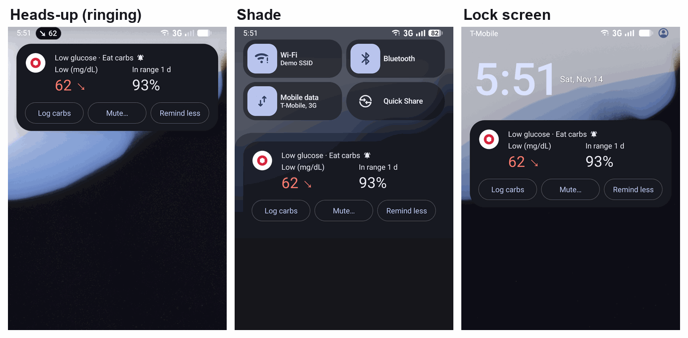

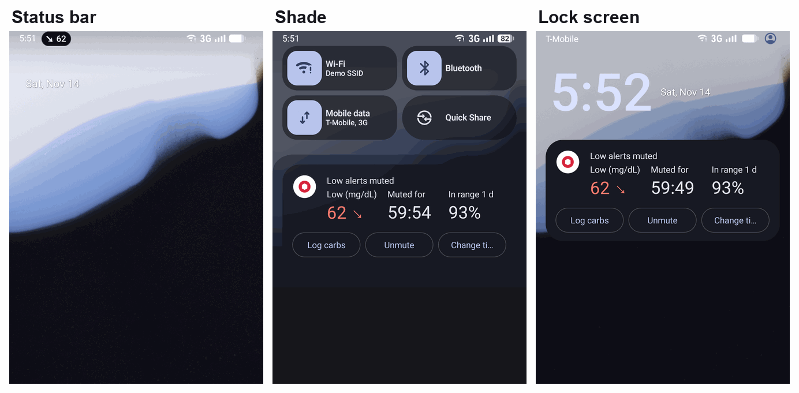
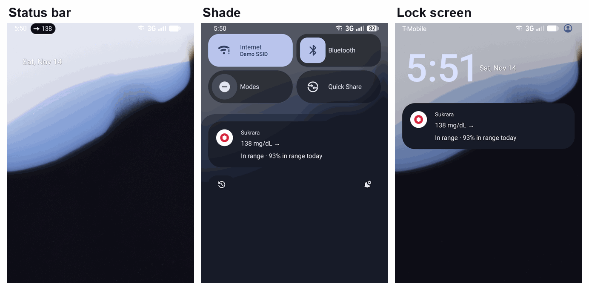
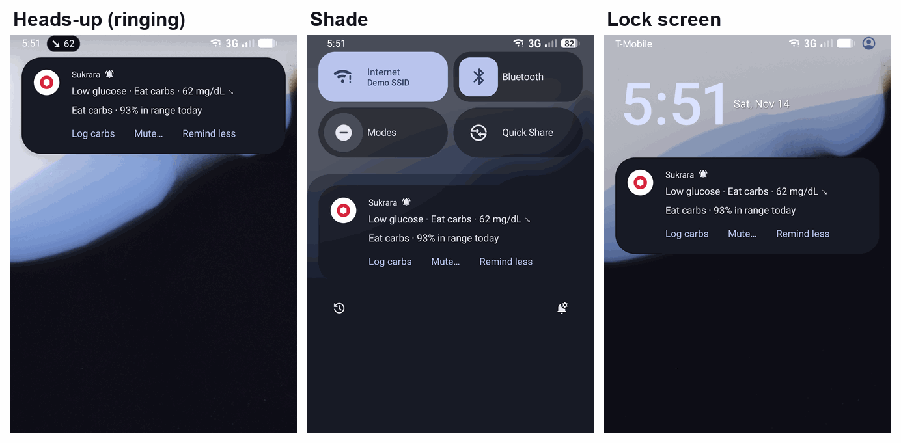

**B. The card with the graph by default (the number icon in the bar).** The renderer's card in the range colour, with
its pill (*Eat carbs*; *1h left · Low*). The bar shows the small number icon.

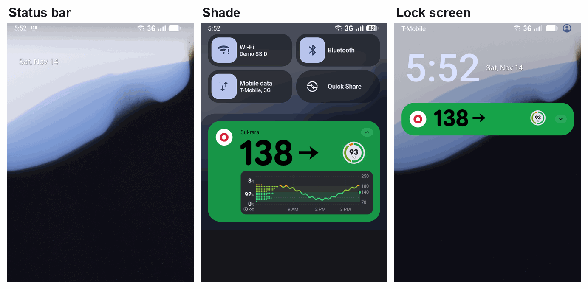
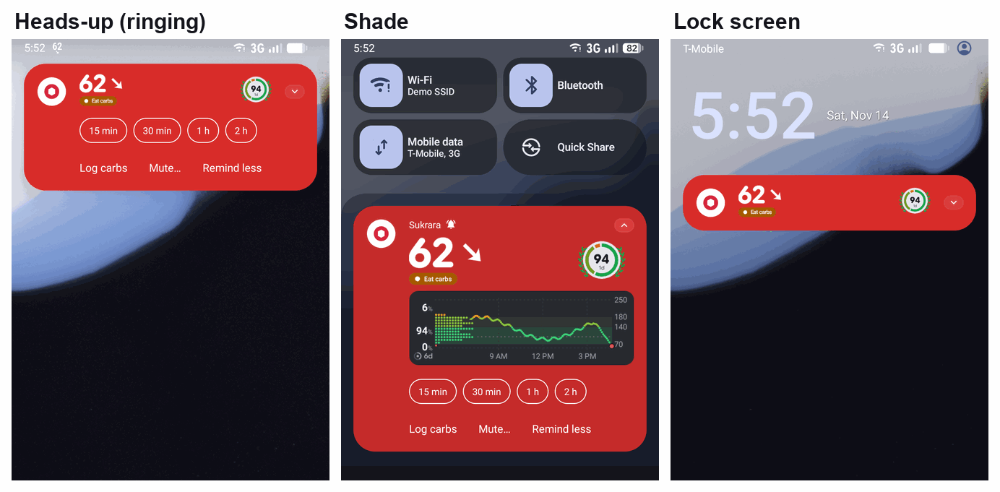

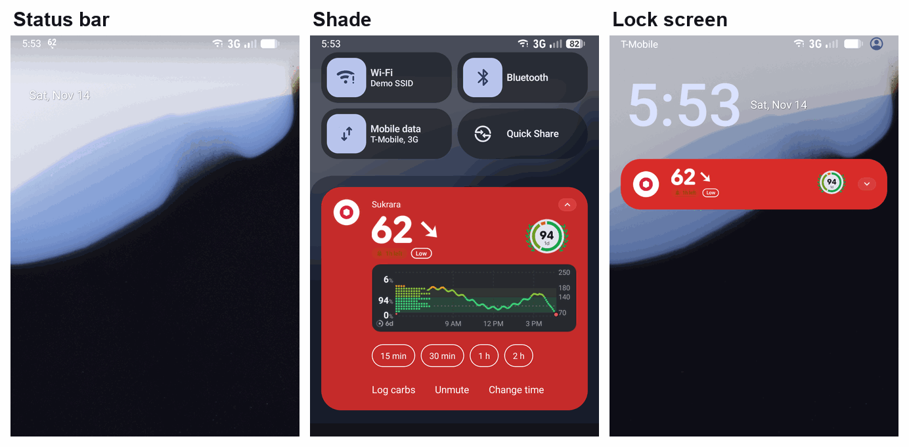
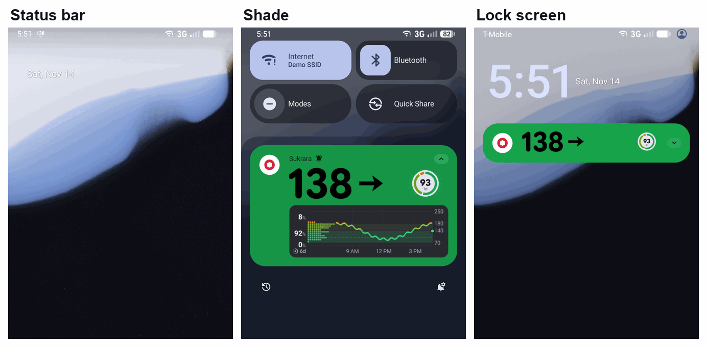
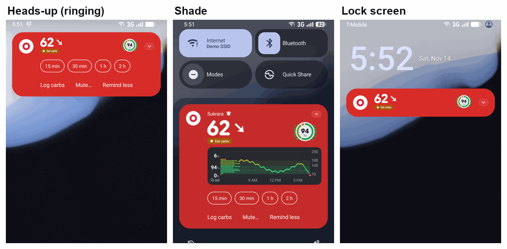

**C. A "graph" inside the Live Update (a ProgressStyle range strip + a sparkline as the large icon).**

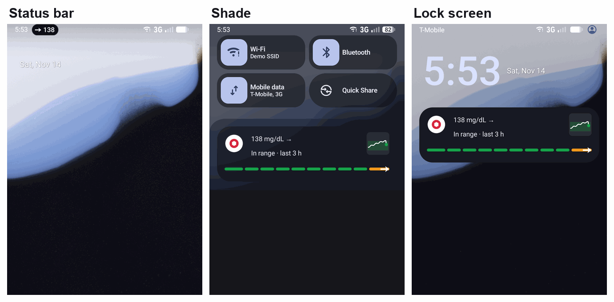
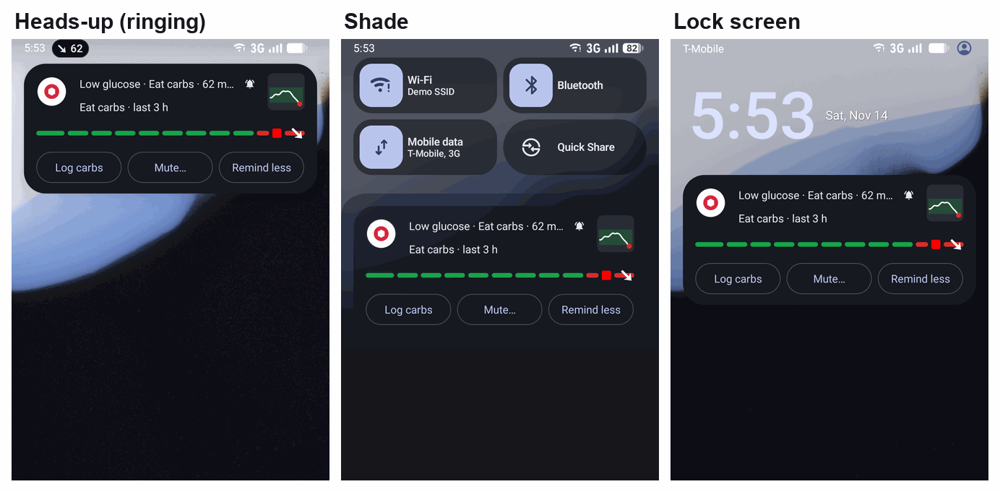
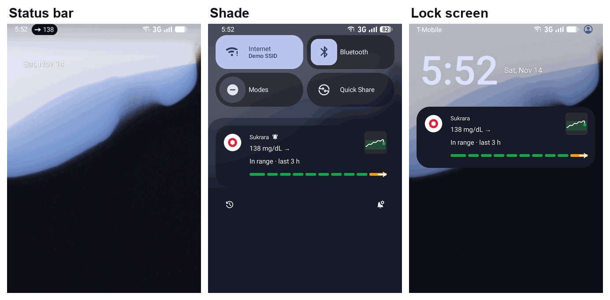
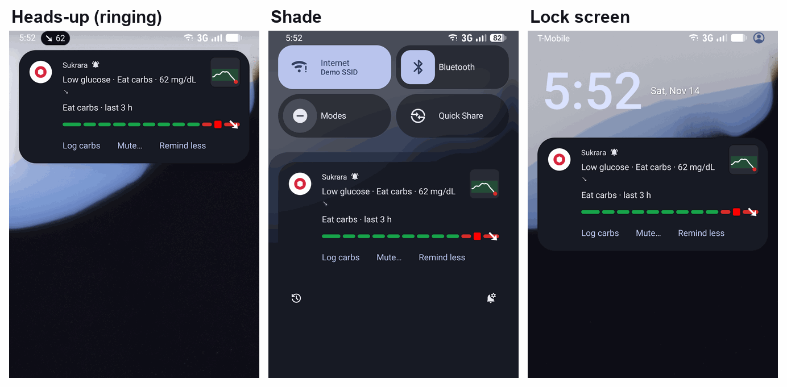

**D. Today: 0.14.5's default, the Live Update (with the `mg/dL` line and *Open Sukrara*) plus the alert as a
notification of its own.**

- While ringing, the heads-up is the alert, not the card.
- The shade and the lock screen hold two Sukrara notifications that both say 62.
- On the Android 17 lock screen, the alert that was already seen even collapses to a dot under the Live Update.

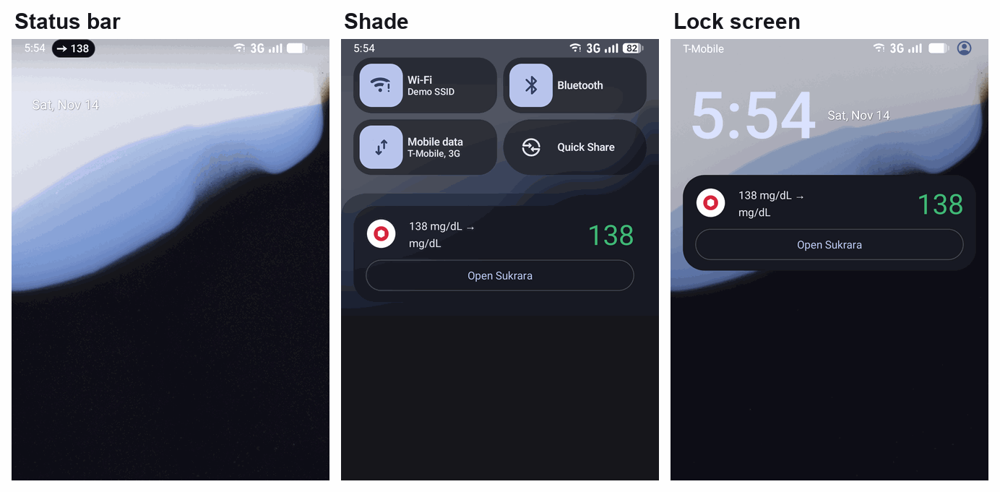
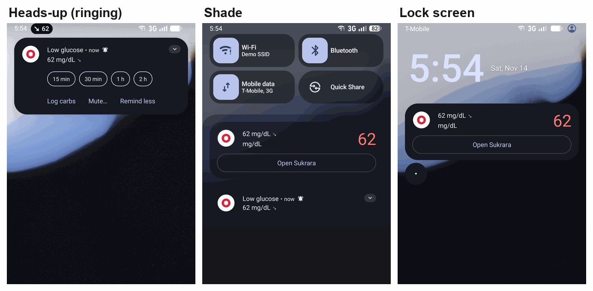
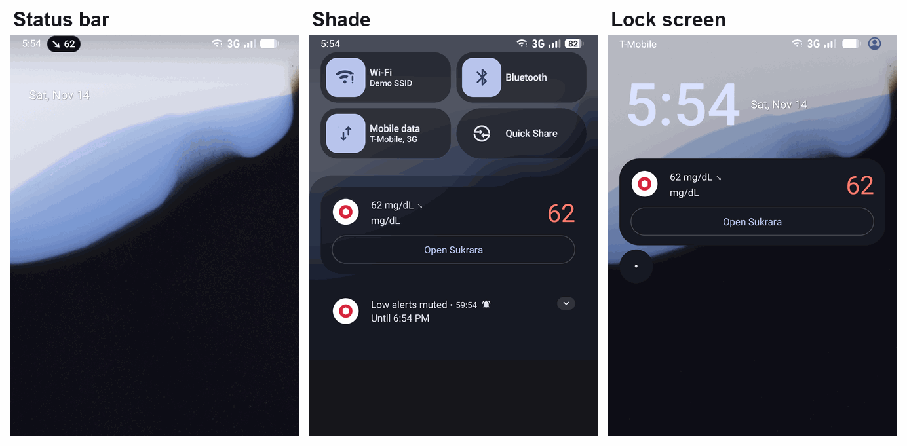

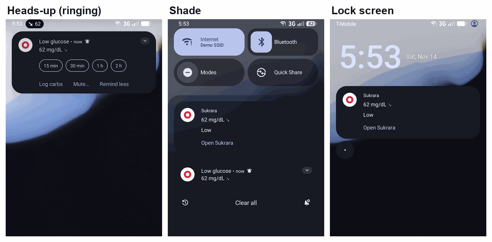

### 8.7 Comparison

| | A. Chip (Live Update) | B. Card with graph | C. Live Update + strip/sparkline | D. Today (two) |
|---|---|---|---|---|
| Value in the status bar without root | **Readable pill** + arrow (unlocked, and not while Sukrara is open) | Small number icon | Readable pill | Readable pill |
| Graph | No | **The renderer's card** | 10-step range strip + 48 dp sparkline | No |
| The alert rings through it | Yes (same id, on the alert channel) | Yes | Yes | No: a separate notification |
| Duplicate notifications | No | No | No | **Yes** |
| *Mute…* lengths as inline chips | No (plain button → sheet) | **Yes** | No (plain button) | Yes (in the alert) |
| Lock screen | Expanded, with buttons | Collapsed header until expanded | Expanded, with buttons | The Live Update + the alert |
| Same look on Android 16 and 17 | No (BigText vs MetricStyle) | **Yes** (Sukrara draws it) | Nearly (ProgressStyle on both) | No |
| Watch | Wear OS 7 *may* bridge Live Updates (the manufacturer's choice); otherwise *Alerts on my watch* | Never bridged (it's ongoing): *Alerts on my watch* | As A | The alert is bridged today |
| Root needed | No | No | No | No |
| Google's guidance | Off-guide while ringing (not enforced) | Doesn't apply (not promoted) | Off-guide while ringing | Follows it |

### 8.8 Recommendation

**One notification in every case: A, B or C, never D.**

- D's duplicate shows in every ringing picture: two Sukrara entries say 62, the heads-up isn't the card, and on the
  lock screen the alert can fold into a dot.
- Google's alternative is exactly this duplicate. Its concern is Live Updates used to grab attention, not a monitoring
  Live Update that turns urgent.
- The platform rings the merged notification like any other (§4, and these pictures).

**The default follows the status bar, as the owner expects:**

1. **Without the root value: the chip (A) by default.** It gives everyone a readable value in the bar without root,
   and that is what people glance at dozens of times a day. The notification is then the A card. On Android 17 that
   is the big value with its arrow, coloured by range, the range or the alert in words, the slot, and the muted
   countdown. *Mute…* becomes a plain button that opens the lengths sheet.
2. **With *Value in the status bar* (root) on: the card (B), automatically.** The bar already shows the value, so the
   chip is redundant and only costs the graph. That is the owner's phone today, but done by Sukrara instead of by
   hand. The Status bar page then says the chip is off because the bar already shows the value.
3. **A switch for people without root who prefer the graph:** *Graph in the notification*. It means B: the chip off,
   and the number icon carries the value.
4. **C is left out.**
   - 10 segments of 18 min and a 48 dp thumbnail aren't the graph.
   - The sparkline would be a new renderer surface to maintain.
   - MetricStyle can't show it, and the AOD drops it.
   - If the owner still wants a hint of history inside the Live Update, the ProgressStyle strip alone is the only
     cheap one (no new surface). It would replace MetricStyle's big value, so it isn't recommended.

This reverses round 1's "card by default" for people without root. For them, the status bar matters more than the
graph, which is one tap away in the app and on the widgets. The card stays wherever the bar already has the value.
The rest of §5.2 is unchanged: ringing through the one notification, the ring window, going back to silent, the
swipe, *Alerts on my watch*. The one addition is that *Mute…* is a plain button in the Live Update.

**Decisions for the owner (round 2):**

1. One notification, A or B depending on the root value as above: yes / no.
2. C's range strip in the Live Update: no (recommended) / yes.
3. A watch for alerts? (from round 1, still open)

**Phone follow-ups (no code):** turn off the PoC's module in LSPosed (or uninstall PoC 0.11.52), then *Restart System
UI* once.

## 9. Built (round 3): the one notification

*2026-11-14, after the owner approved one notification (A by default, B with the root value, a choice between them,
Alerts on my watch, no Open Sukrara) and reviewed the §8 pictures point by point. Emulators Android 17 (API 37.0) and
Android 16 QPR2 (API 36.1), the debug build's synthetic sensor (`SYNTHETIC`, now with a 3-day backfill so the 1-day and
7-day rings show); real alerts from the runtime, except the Android 16 card's ring (`ALERTS --es kinds low`, which now
goes through the same presenter). No real data.*

### 9.1 What was decided where the owner left it open

| Point | Decision | Why |
|---|---|---|
| The A metric label ("Low (mg/dL)") | **Now** while fresh, the reading's time once late (it also replaces the separate *Reading* metric, which frees a slot: two rings as words, *in range 1d · in range 7d*); the title says the range (*In range*, *Low*…) or the alert | The label can't be empty (`Metric(value, label)` takes a label); the range is the title's, the unit is obvious; *Now* / *14:05* says the one thing the big number can't: how fresh it is |
| Units | None: the title `138 ↗`, the metric `138 ↑`, `62 ↓ · Low glucose · Eat carbs` on Android 16 | The owner's call; the alert's own body (watch mode, the plain fallback) keeps its unit (it's read alone, on a watch) |
| Action icons | Every action carries one (Treatment *add*, Remind less *snooze*, Mute *notifications off*, Unmute *notifications active*) | Measured: Android 16 and 17 draw **no** action icon in the standard, promoted (Live Update) or decorated-custom templates (the v2 pictures: text buttons only). The icons show on Wear OS (watch mode's separate alert) and cost nothing; the words must stand alone |
| *Mute* or *Mute for* | **Mute** (es *Silenciar*), no "…" anywhere (copy.json) | Android's actions are short verbs that name the result ("Reply", "Snooze"); Apple's HIG: "a short, title-case name that clearly describes the result". *Mute for* reads unfinished as a Live Update button (where it opens a sheet); the chips / the sheet / the direct reply's label *Mute for (e.g. 45 min, 1 h 30)* give the length |
| *Treatment* in Spanish | **Tratamiento** | The app's dialog is *Añadir tratamiento*; the button names the place it opens. On the high side it opens on Rapid insulin; the word advises no dose (SPEC §1 "Headline") |
| Sparkline in A | **Not added.** Android 17 keeps MetricStyle (big value in the range's colour, the slots); Android 16 BigText | MetricStyle draws no large icon ("this style doesn't display the large icon"), so a sparkline means giving up the big coloured value on 17 for a 48 dp thumbnail the AOD draws grey (§8.3), and a new renderer surface (`CardPart`) to keep in step. The graph is B's; the picker now makes that choice obvious |
| Mute in a Live Update | A plain button that opens the **lengths sheet** over the lock screen (`MuteAlertActivity`: 15m 30m 1h 2h, TalkBack "Mute for 30 min") | Android drops a direct reply from a promoted notification (§8.5) |
| Muted, A | The title *Low alerts muted*, a timer metric *Time left* (Android's own countdown), *Treatment* · *Unmute* | The owner: Unmute only |
| B title | A TextView over the card with the alert's title (*Low glucose*, *Low alerts muted*), and the heads-up while it rings shows title + header (no chart) | A decorated custom view shows the app name, not the title; the pill under the value already says *Eat carbs* |
| B sizes | The value drawn in a 48 dp box (40 collapsed) beside the slots at the header's full height (64 / 48 dp) | The renderer's own parts (`CardPart.VALUE` + `CardPart.SLOTS`): the value is smaller, the rings full size, two of them (the widget's two); collapsed rings no longer shrink |
| B colour | The system's notification colour by default (the value in its range colour, the theme's palette); **Card in the range colour** (`statusbar.colorize`) for the old look | The owner's call |
| Pills per surface | Renderer rules in both apps (contracts/graph *Pills per surface*): a level alert's title names the range, so the notification draws no separate range word (`CardStyle.rangeSaid`); on a colourised card every pill passes 3:1 against its ground and 4.5:1 for its words, else it turns black / white (`CardStyle.ground`, `PillContrast`, tested on every pill kind × palette × ground) | The owner: the amber mute pill on red was illegible, *Low* beside *Low glucose* redundant |
| The setting | Settings › Status bar › *Glucose notification*: **Chip** and **Graph** side by side, each with a picture (chip + text notification / number icon + the card with ring and curve), one radio group; with the root value on, Graph and the chip disabled with its note | AOSP's illustrated choices (System navigation: `IllustrationPreference` over `SelectorWithWidgetPreference`); here each choice has its own picture because the point is comparing them |
| Alerts on my watch | Settings › Alerts › Sounds, off by default; the summary suggests it when the Wear OS, Pixel Watch or Galaxy Wearable app is installed (`<queries>` for those three) | Whether a watch is paired can't be read without Bluetooth permission prompts; the companion app is the honest signal |

### 9.2 Pictures (v2)

Replaced by §10.3's v3 pictures after the owner's review; the Android 16 in-range pictures (nothing changed in
them) stay:

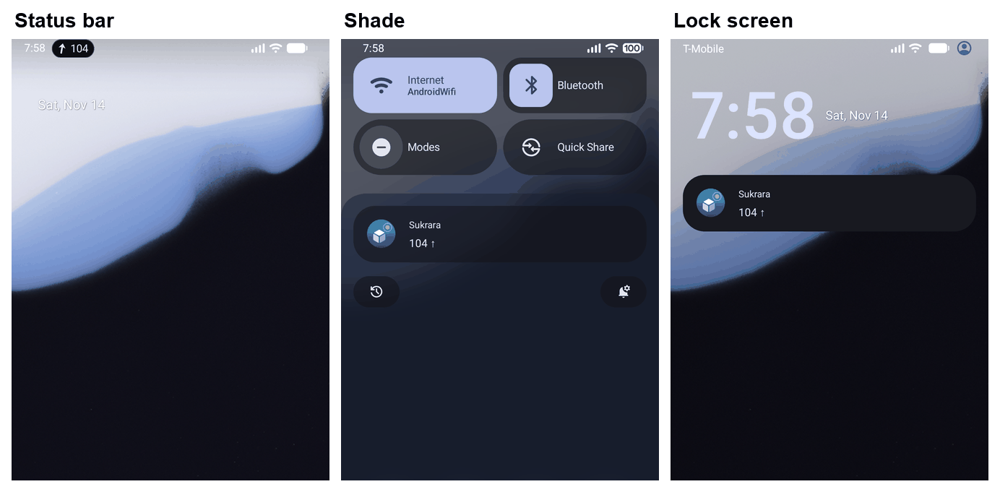
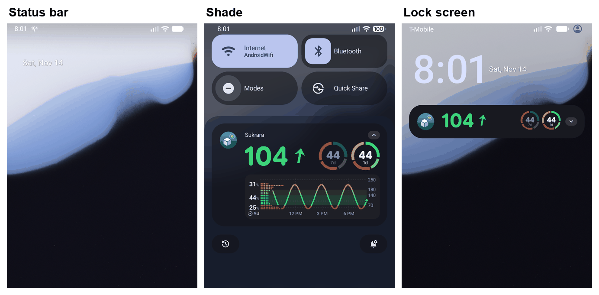

Found and fixed on the emulator: the card's title TextView took a RemoteViews call (`setImportantForAccessibility`) that
System UI refuses, which crashed the foreground service (`BadForegroundServiceNotificationException`); it's in the
layout now, and `OneNotificationTest` inflates every view of the card with an alert as System UI does.

### 9.3 Alert-safety review (2026-11-14)

An independent read of the code and the emulators (Android 17 API 37.0, Android 16 QPR2 API 36.1; `dumpsys
notification`, `logcat -b events notification_alert`), with what it changed:

| Found | What the person got | Now |
|---|---|---|
| The full-screen intent rode on an update of the glucose notification. System UI starts one only in `onEntryAdded` (AOSP `HeadsUpCoordinator`); on Android 16 QPR2 a very low *like an alarm* with the screen off rang but never opened full screen (Android 17 did) | A very low at night: sound only, no screen | An alarm-level ring that may open full screen is the alert's own notification for the 10 s (added: full screen on both), the glucose notification shows it silently and carries it on (`GlucoseAlertPresenter`, `OneNotificationTest`) |
| Two rings on one reading: the runtime posts the one that must be heard first, the presenter put the newest in front | *Falling fast* as the title over *Also: Very low glucose*, the notification moved off the alarm channel (Android had muted the second ring: `MUTE_REASON_RATE_LIMIT`) | The first stays in front on its channel, the second is a line |
| The glucose notification's channel turned off: Android drops every post on it | A ring stayed as it rang: never updated, muted or cleared | The alerts are notifications of their own then (as *Alerts on my watch*), what is up moves there silently |
| The card without its pictures (screen off: nothing is drawn) titled only *Low glucose* | No value on the lock screen until the redraw | `62 ↓ · Low glucose · Eat carbs`, as the text notification |

Checked and sound: the ring's channel and flags (no only-alert-once on a ring; the 10 s posts `MUTE_REASON_SILENT_UPDATE`
and the sound plays on; `glucose.live` is IMPORTANCE_DEFAULT without sound, so the window's end and a Mute stop it,
and the notification stays on the lock screen where silent ones are hidden); the heads-up of an update (System UI's
`shouldHunAgain`: not only-alert-once); Android's update rate limit (5 a second, an average: the gate allows one a
second plus a ring); the post lock (a post built before a ring never lands after it); the swipe of an older firing;
the muted note; watch mode; the plain stand-in; `:core:alerts` and the scenarios untouched; the debug `ALERTS` and the
3-day backfill only in `src/debug`. The *Time left* label of the muted metric is the code's (§10.3 shows it).

Not covered: a real watch (watch mode's buzz), the Pixel's own System UI, Do Not Disturb and the full-screen intent
locked on a phone (QA.md Q5 lists them for the owner's debug build), and the emulators had no audio (the ring is read
from `dumpsys notification`: the channel and the flags).

## 10. Round 3 feedback

*2026-11-14, the owner on the v2 pictures. Each point: what changed and why, with the alternatives weighed. Emulators
Android 17 (API 37.0) and Android 16 QPR2 (API 36.1), the synthetic sensor, synthetic data only; rings from the
runtime, and from the debug `ALERTS` command (the same presenter) where a ring had to be shot on a settled service.*

### 10.1 A, the chip / Live Update

| Point | Done | Why (alternatives) |
|---|---|---|
| "'In range 7d' should be dynamic and show what the 2nd ring would show" | It already was: the metrics are `GlucoseCard.slotTexts` over the card's own style (`notificationCardStyle`), the configured slots in the card's order (default TIR 1 d, TIR 7 d). `SlotTextTest` now pins it for other slot kinds too | A second list of metrics would drift from the rings; the renderer's own list can't |
| "Some places uppercase, some all lowercase" | Every label in sentence case: the slot labels come out of the renderer as *In range 1d*, *Avg 7d* (`Slots.text`, `SlotTextTest`), the value's label too | Android's writing guidelines: sentence case for labels and titles; the renderer's word list stays lower case for sentences (TalkBack) and capitalises where it is a label |
| "'Now' as the description is nonsense" | The value's label is the **trend in words** (*Falling*, *Steady*, *Rising fast*) while fresh; the **rate** (*2.4/min*) when a rate alert's title already says the trend (*Falling fast*); the **reading's time** once late (`MetricLabelTest`) | Considered: no label (the API takes one: `Metric(value, label)`), the reading's time always (it repeats the notification's own time while fresh), the range (the title's). The trend in words says what the arrow says for TalkBack and at a glance, never the title |
| "A better arrow asset, or text only?" | **Text only, THE text arrows** (`TrendAngle`). Picture `v3-arrows-android37` | A metric's value is a `CharSequence`; a picture can't travel in it (an `ImageSpan` isn't parcelable), and a bold `StyleSpan` was dropped by System UI (tried on the emulator). In the system font, Supplemental Arrows-C (wide-headed, all 8 directions) is missing (tofu, sets 3–5); the Dingbats / Misc Symbols arrows (set 2) mix weights: a heavy ➡ beside light diagonals. The current set (set 1) is the only one with one weight and one centre line in every direction |
| "The mute time picker is ugly" | The app's own Material 3 length dialog (`NumberDialog`): *Mute lows* · *For 15 min* … *For 2 h* · *Custom…* radio rows, the person's first length selected, *Cancel* | Compared: the chips sheet (wrapped 3 + 1, no selected state, nonstandard), a bottom sheet with a slider (imprecise), Android's Do Not Disturb duration dialog (radio rows with − / + and *Until you turn off*), Clock's snooze list. A radio list is the M3 "simple dialog" pattern and the one *Mute alerts* on home already uses (same component, same words), so the app has one way to pick a length |
| "'Low alerts muted' can be 'Lows muted'" | Mute lines name the side short on both apps: *Lows muted · 12 min left*, *Lows: remind every 30 min*, TalkBack *Lows: mute for 30 min* (es *Bajas silenciadas · quedan 12 min*; Spanish side names are feminine plurals so *silenciadas* agrees: *Bajas*, *Altas*, *Bajadas rápidas*, *Subidas rápidas*, *Alertas sin datos*) | copy.json, `MuteText` / `MuteCopy`; the settings history (*Lately*) keeps its own sentences |
| "Don't show the same info twice" | Checked every state: the muted Live Update says *Lows muted* · *Time left 29m* (the label no longer repeats the title); a level alert's or a muted side's title names the side, so the card draws no separate range word (`rangeSaid` for the muted note too); the title adds the pill's words only when the headline doesn't already say what to do (*Low · eat more* gets none) and, on the card, the mute's time left where the value box only has room for the pill's icon; the Live Update on 17 counts a mute down in its metric, not in the title | The pill under the value and the title are in different views (collapsed vs expanded), never both saying it in one |

### 10.2 B, the card

| Point | Done | Why (alternatives) |
|---|---|---|
| The Status bar copy | The two choices say exactly what each puts where: **Chip** · *Status bar: your glucose in a chip / Notification: basic*; **Graph** · *Status bar: the notification icon / Notification: complete, with the graph*, the icon highlighted in its picture. Every summary adds something: *Number as notification icon* · *Otherwise the trend arrow*; *Coloured background* · *Red when low, orange when high, green in range*; *Only with the graph* where a row doesn't apply to the chip; the footer says why it's one or the other | "Notification icon" is Android's own user-facing name (the status bar's *Notification icons*); the developer docs' "small icon" isn't a user word |
| The value shrinks under a pill | The renderer keeps the value at ≥ 85 % of its size: the pill goes in a row right under the baseline, or beside the arrow where it fits whole (words, else its icon), the rings never change (contracts/graph "The value with a pill", `PillValueSizeTest` / `PillValueSizeTests`, both apps) | Compared: shrinking the rings (the owner: no), moving the pill above (it would sit between the title and the number), a fixed pill row (the v2 look) |
| "Just 'Very low' is enough" | Headlines without "glucose" on both apps: *Very low*, *Low*, *High*, *Very high*, *Extremely high*, *Falling fast*, *Rising fast*, *No data* (es *Muy baja*, *Baja*, *Alta*, *Muy alta*, *Extremadamente alta*, *Bajada rápida*, *Subida rápida*, *Sin datos*); context *Low · eat more*, *High · still after insulin*, *Very low · no response*; the test alert *Test · Low*; the locked-boot alarm *No data · unlock your phone*; the escalation settings' quotes. Kept: "Open Sukrara to see your glucose." (glucose is the object there), channel names | copy.json, SPEC §1, `AlertCopy` / `AlertText`; the scenario drivers write their own words, so no timeline changed |
| Red in dark, white in light | Confirmed: v2's dark picture had *Card in the range colour* on, the light one off. Both themes already behave the same; the setting is now **Coloured background** and the picture `v3-b-background-android37` shows it off and on in both themes. The card's art is also redrawn when the pill's state changes (its cache key missed it) | — |
| "'Alerts on my watch' is a bad name" | **Separate alert notifications** (`alerts.separate`): *Each alert is also its own notification, apart from the glucose one. Watches and other connected devices get only these*; off: *Alerts ring in the glucose notification. Watches and other connected devices don't get it*; the watch app suggestion stays a summary. The glucose channel turned off still falls back to it (3caad9a6) | Android calls a notification that stands alone a separate notification (as opposed to a grouped or an ongoing one); the watch is one reason, not the feature |

### 10.3 Pictures (v3)

Android 17 unless named `android36`; dark theme unless said. They replace v2's (the Android 16 normal states
`v2-a-normal-android36` and `v2-b-normal-android36` stay: nothing in them changed). On Android 16 the card is the same
renderer picture as on 17.

| Picture | What |
|---|---|
| 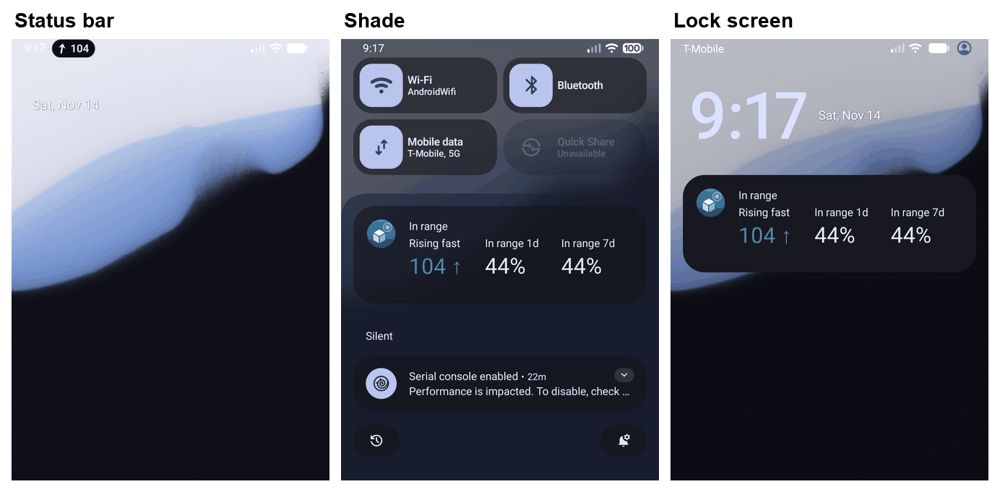 | A in range: title *In range*, the value labelled *Rising fast*, *In range 1d* · *In range 7d* (the rings) |
| 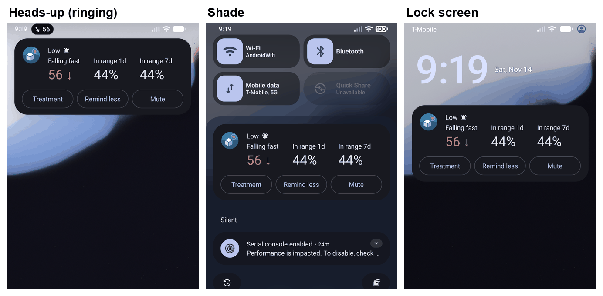 | A, a low ringing: *Low*, *Falling fast* `56 ↓` (a muted side's countdown would add *Time left*) |
|  | A between rings, back on the silent channel: *Low*, *Falling* |
| 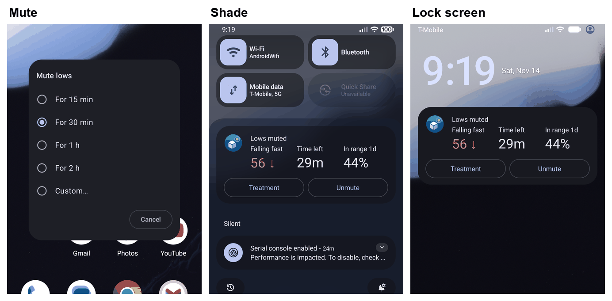 | A, *Mute*: the length dialog, then *Lows muted* · *Time left 29m*, *Treatment* · *Unmute* |
| 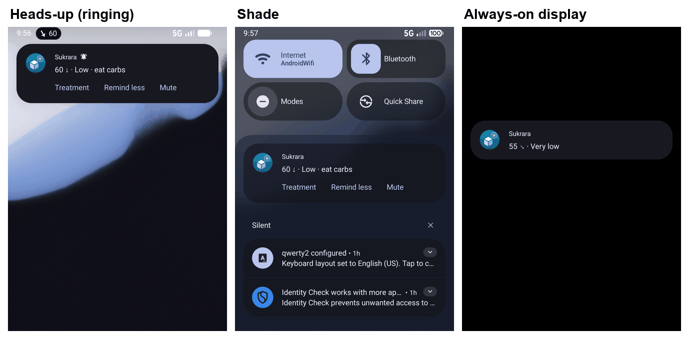 | A on Android 16 ringing: `60 ↓ · Low · eat carbs`; the always-on display |
| 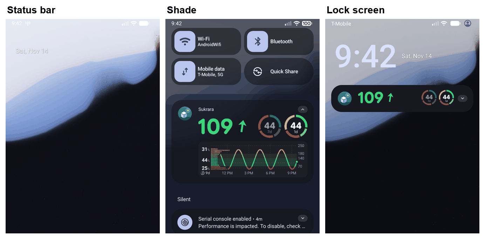 | B in range: the value large, two rings, expanded and collapsed |
| 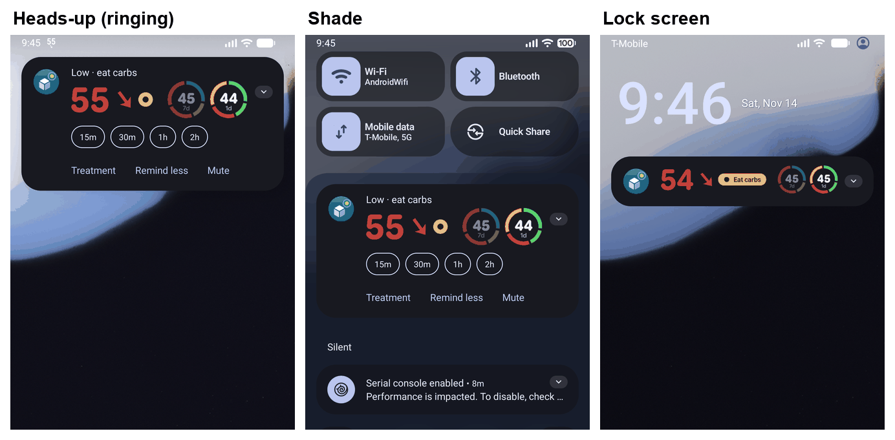 | B, a low ringing: *Low · eat carbs*, the chips 15m 30m 1h 2h |
| 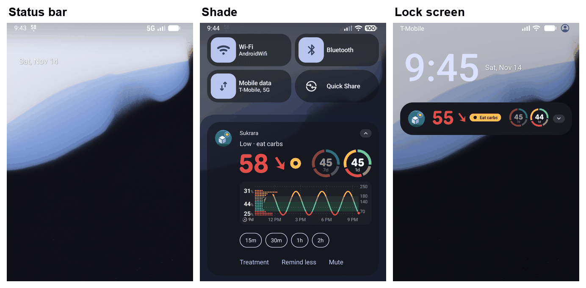 | B between rings |
| 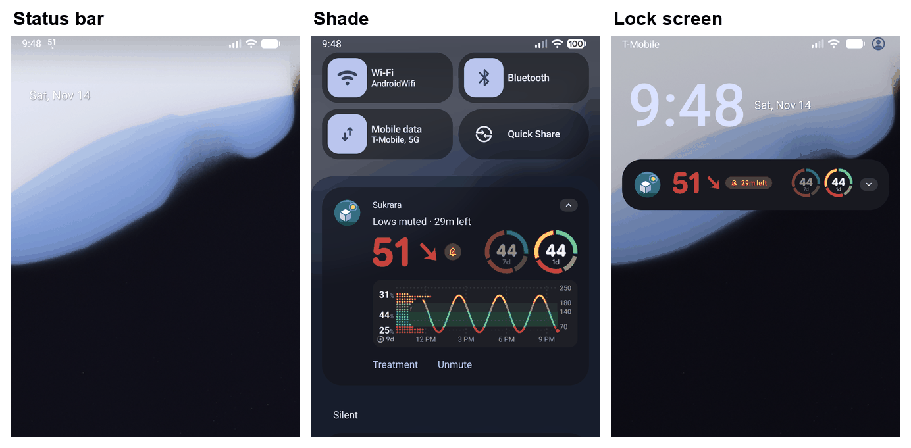 | B muted: *Lows muted · 29m left*, no range word |
| 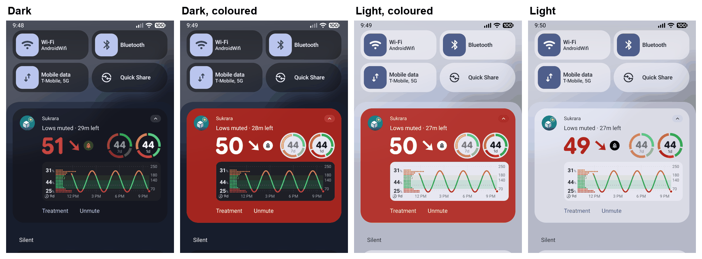 | *Coloured background* off and on, dark and light |
| (Settings › Status bar) | Replaced by `v4-settings-glucose-notification` (§11) |
| 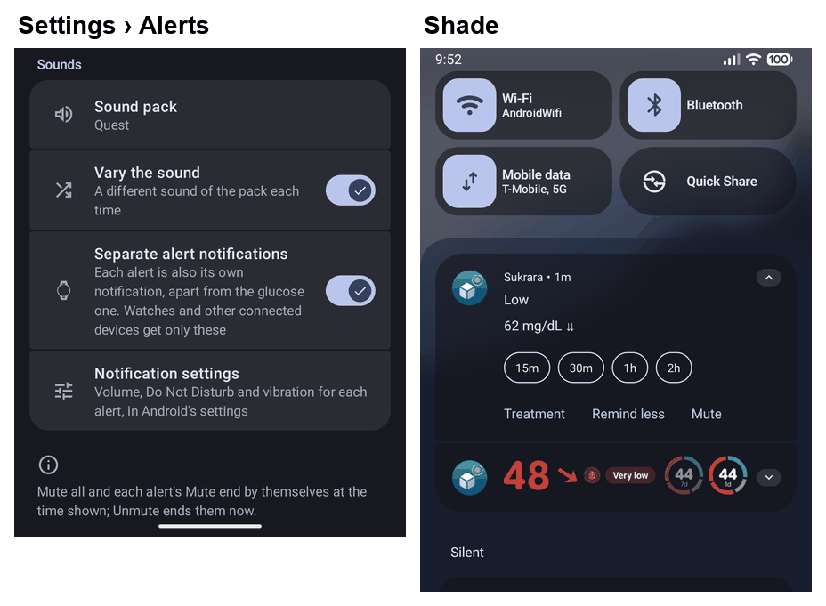 | *Separate alert notifications* on: the alert of its own above the glucose card, which carries none |
| 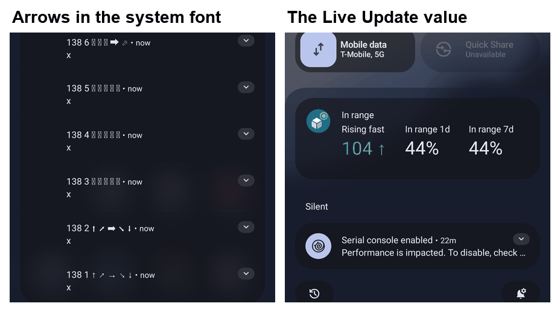 | Arrow sets in the system font (1 = THE text arrows, 2 = Dingbats / Misc Symbols, 3–5 = Supplemental Arrows-C: not in the font) and the Live Update's value |

Seen on the way: a ring that comes while the monitoring service starts (here a debug `SYNTHETIC` restart) is posted
first as the text notification (the foreground start never draws the card), then the service's own post follows.

## 11. Round 4 feedback

*2026-11-15, the owner on the v3 pictures. Each point: the alternatives weighed, the choice and why. Emulator Android 17
(API 37.0), the synthetic sensor, synthetic data only; the settings and setup pages also from the Robolectric galleries
(`SettingsGallery`, `SharingScreenshotTest`).*

### 11.1 "The icon for Separate alert notifications is wrong; it should not be a watch"

| Option | For | Against |
|---|---|---|
| Watch (was) | The main reason to turn it on | Names one use, not the feature (the owner) |
| `notifications_active` (ringing bell) | Alerts | Already the alerts' own icon in Settings: two rows, one icon |
| `stacks` / `library_add` (layers) | "Separate" | Says nothing about notifications |
| **`notification_add` (bell with a plus)** | A notification of its own added beside the glucose one: what the switch does | — |

Chosen: Material Symbols [`notification_add`](https://fonts.google.com/icons?selected=Material+Symbols+Outlined:notification_add)
(`ds_ic_notification_add`; `ds_ic_watch` deleted). Picture `v4-separate-alerts-icon-android37`.

### 11.2 "No screenshot of the Live Update with different dynamic values, especially after treatments"

Taken on Android 17 with real entries from *Add treatment* (rapid 4 u, carbs 30 g, both). The metrics after the value
are the card's own slots in the card's priority (main ring, a recent treatment, the second ring: `GlucoseCard.slotTexts`),
so a treatment takes the second ring's place, as on the card.

Found on the way and fixed: **with both, the carbs were lost**. The card draws running insulin and the carbs that ride
along it as one pair, but the text slot only wrote the insulin (`4u`). Now `4u · 30g` (`Slots.text`, `SlotTextTest`
written first and failing). Kept as decided in #206: the time since it is the value (it is what changes) and the amount
its label. Considered: the amount as the value and *Rapid · 12m ago* as the label (a label that changes every minute
and needs a word per kind); a stopwatch metric (`Metric.TimeDifference`) counting up from the entry (live without a post,
but MetricStyle shows it as `12:04`, a clock, for a time that matters in minutes).

The Live Update follows a new entry on the next reading (≤ 1 min with Libre 3), as the card does.

### 11.3 The settings cards: hierarchy, light-theme contrast, equal heights, simpler texts

Researched how Android does "choose how the system shows something": AOSP Settings' **System navigation**
(`SystemNavigationGestureSettings`: an [`IllustrationPreference`](https://cs.android.com/android/platform/superproject/main/+/main:frameworks/base/packages/SettingsLib/IllustrationPreference/)
of the *selected* option over [`SelectorWithWidgetPreference`](https://cs.android.com/android/platform/superproject/main/+/main:frameworks/base/packages/SettingsLib/SelectorWithWidgetPreference/)
radio rows; [a copy of the source](https://github.com/xDroidOSS-Pixel/packages_apps_settings/blob/thirteen/src/com/android/settings/gestures/SystemNavigationGestureSettings.java)),
Material 3 [radio buttons](https://m3.material.io/components/radio-button/guidelines) ("listed vertically, one always
selected") and [lists](https://m3.material.io/components/lists/guidelines) (the whole row is the target). Other diabetes
apps don't help here: Juggluco has one on/off *Glucose notification* ([settings help](https://www.juggluco.nl/Jugglucohelp/settinghelp.html)),
GlucoDataHandler adds extra notifications only to get more status bar icons, and its users find an app icon where the
value should be "useless" ([GDH #241](https://github.com/pachi81/GlucoDataHandler/issues/241)); xDrip+ users can't find
how to hide its status bar icon ([xDrip #3485](https://github.com/NightscoutFoundation/xDrip/discussions/3485)): the
choice must be findable and say what it changes.

| Option | Hierarchy | Equal heights | Light theme | Cost |
|---|---|---|---|---|
| Cards side by side (v3) | Picture, title, two-line summary per card, all equal weight | No: text wraps differently | The notification's grey vanished in the selected card's tint | — |
| Cards stacked, full width | Better | Still text-driven | Same tint problem | — |
| **One picture of the selected choice + radio rows** (System navigation) | Picture first (what you get), then one list of names | Yes: one-line title, one-line summary | The picture sits on the page, not in a tinted card: the notification on its own surface with an outline in both themes | Pictures compared by switching, not side by side |
| Dropdown | Compact | — | — | Hides the choices; no picture |

Chosen: the System navigation pattern, as one shared component (`GlucoseNotificationChoice`, `:core:designsystem`) for
the settings page and setup. The texts are names: the title is what the **status bar** shows (*Chip*, *Notification
icon*, *Status bar text*), the summary what the **notification** is (*Basic notification*, *Notification with the
graph*, *… · Needs root*); the group title *Glucose in the status bar* says what the names are of, so neither repeats
it. The picture draws the status bar (the glucose highlighted where it shows) and the notification (short and basic, or
with the graph and a ring); it fades through on a change (cut with reduced motion), TalkBack reads it as one sentence.
Under the choice only the chosen one's own rows; then *Notification* (*Coloured background*, *Glucose on the lock
screen*). Picture `v4-settings-glucose-notification` (chip and notification icon light, status bar text dark).

### 11.4 Where the choice lives, the root option, setup's steps

**The page.** Considered: keep it inside *Status bar* (the owner: someone looking for the notification won't look
there); split it over *Status bar* and a *Notification* page (the two halves of one choice on two pages); **one page
named for the thing people look for, *Glucose notification*** (the overview row and search: *Where your glucose shows
in the status bar*). Chosen: the last; *Status bar* is gone, its rows (root placement and colour, number icon, lock
screen) are under the choice they belong to. The *Lock screen* page (the root lock-screen widget) stays its own.

**The third option, *Status bar text* (root only).** The root value in the status bar, Sukrara's notification icon
hidden, the notification with the graph. One stored choice over the existing keys (`NotificationStyleSettings`:
`statusbar.hook` on + `statusbar.hideNotifIcon` on; otherwise `statusbar.chip`), so the hook, the module and the
settings schema didn't change. Choosing it is the request for root (#178: never asked before), with root's or the
module's missing step as the shared card below it (`AccessStepBanner`, moved to `:core:designsystem/root` so setup
can show it). A build without root features shows two options.

**Setup.** Two optional steps after *Keep Sukrara up to date*: **Root** (root builds only), then **Glucose notification**.
Root: *Is this phone rooted?* with *Yes, it's rooted* / *It isn't rooted* / *Later*. "Automatic if possible": when the
phone already shows signs of root (LSPosed answers, a `su` file, the module), the question is skipped and the check
runs by itself; otherwise only the person's *Yes* asks, because asking `su` unprompted pops Magisk's dialog (where it still has one)
on a phone whose owner didn't expect it, and KernelSU hides `su` from every app not allowed in its manager ("su is
invisible to all applications by default", [KernelSU #1838](https://github.com/tiann/KernelSU/issues/1838)), so a
silent probe can't tell "not rooted" from "not allowed yet". Magisk is going the same way: its interactive prompt is
being removed for granting apps ahead of time in its Superuser list ([Magisk #10139](https://github.com/topjohnwu/Magisk/pull/10139)),
which is why the card's first instruction is to allow Sukrara there and come back. After *Yes*: the shared card (*Allow root for Sukrara*, *Root
needed*, … with *Check again*); root granted completes the step by itself. Glucose notification: the same component,
*Status bar text* already picked when Sukrara has root (once; the person can choose another), *Continue* only (the chip
is already an answer). Considered: one step with the root question inside the choice (the question would sit between
three options and hide the picture); the root check inside *Permissions* (an essential step for an optional feature).
Picture `v4-setup-root-notification`: the question, *Yes* on a phone without usable root, the choice without root, the
choice with root picked.

### 11.5 Pictures (v4)

| Picture | What |
|---|---|
| 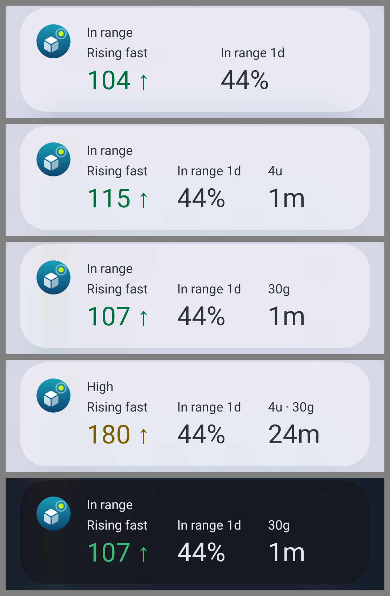 | Live Update on 17: no treatment (*In range 1d*); rapid 4 u (*4u* · *1m*); carbs 30 g (*30g* · *1m*); both (*4u · 30g* · *24m*, the value high); carbs in the dark theme |
| 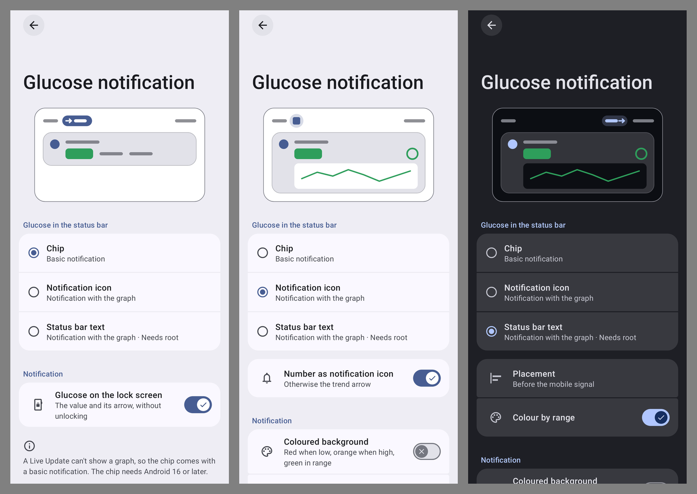 | Settings › Glucose notification: chip (light), notification icon (light), status bar text with root (dark) |
| 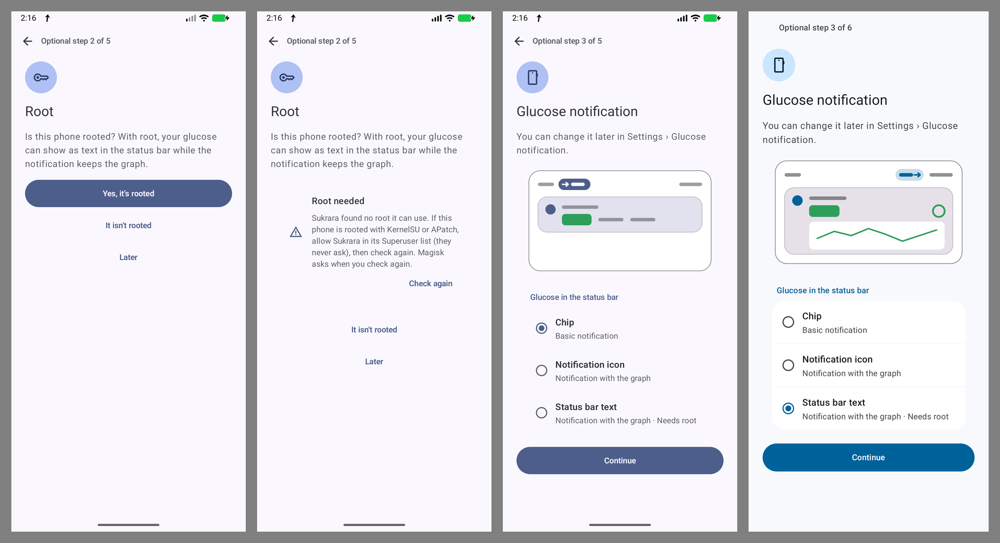 | Setup: *Root*; after *Yes* on a phone without usable root; *Glucose notification* without root; with root granted, *Status bar text* picked |
| 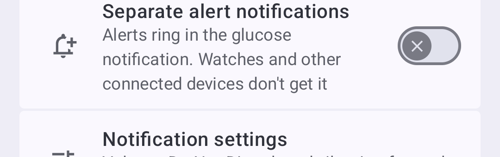 | Settings › Alerts › *Separate alert notifications* with its new icon |

