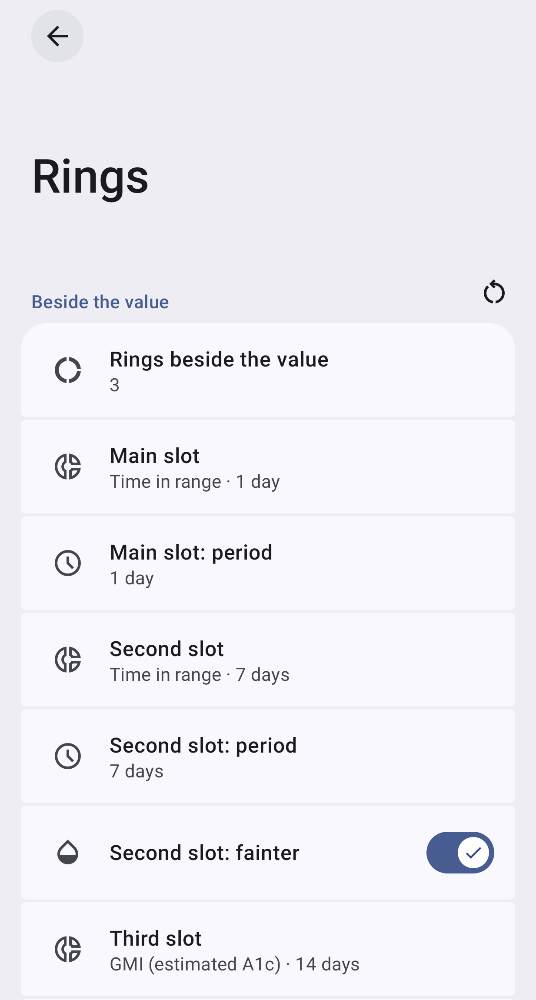
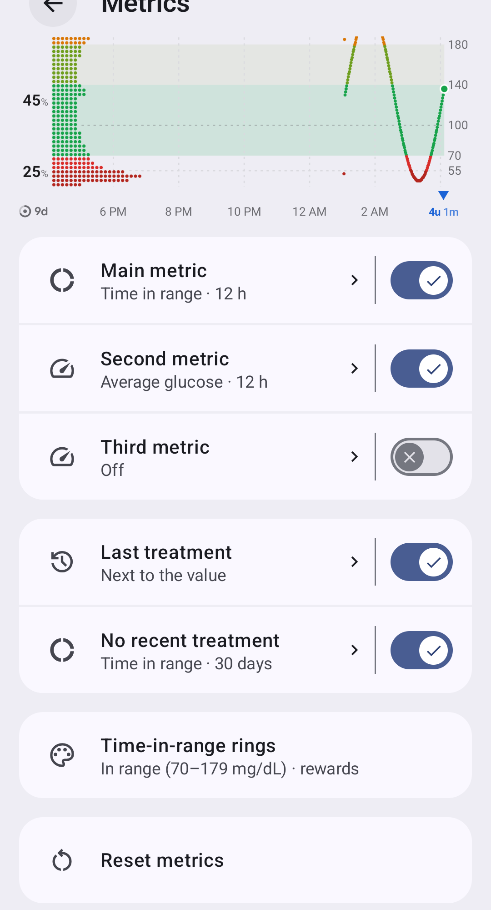
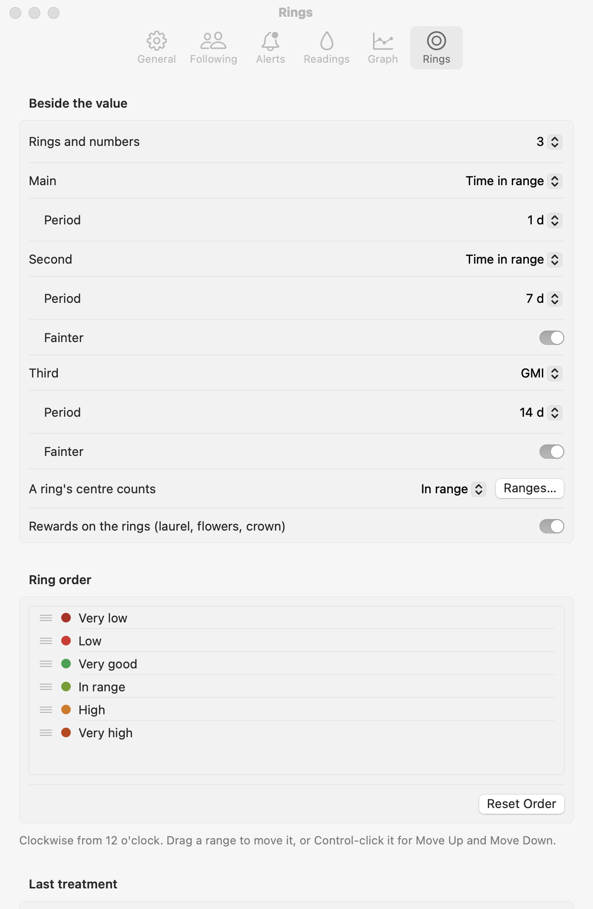
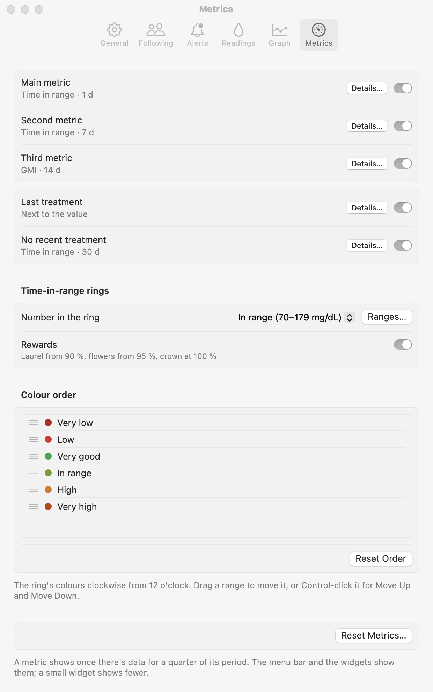

# 39 — Metrics beside the value (once "Rings")

*2026-11-15 · decision · Android and Mac*

## Goal

The owner: Settings › Rings "needs a complete redesign … there isnt any hierarchy or grouping … if ring is disabled
think how the group should be … maybe … individual toggles for each ring instead of a count select … copywriting …
needs rewriting … we call this 'Rings', but they dont have to be rings".

## The person

| Moment | What they want from the round things beside the number |
|---|---|
| Lock screen, widget, a meal | *Did I bolus? How long ago?* The time since the last insulin is the most asked-for thing next to the value (people count needles, buy timer caps: "I really couldn't remember if I had taken my insulin"; a parent wants to see the bolus "to ease my worries") |
| End of the day | Today's time in range: "a great motivator", for others "obsessed about being in the green", "burnout" |
| Before the clinic | GMI over weeks; a GMI next to the lab A1c leaves people "confused or disappointed"; "a daily A1C makes no sense" |
| A small widget, the notification | Fewer things fit; the one that matters must stay |

So: each thing on or off on its own (easy to drop what stresses), the last treatment first-class, a GMI only over
weeks, words that say what each number is and its goal.

## Problems found

| # | Problem | Fix |
|---|---|---|
| 1 | One flat group of up to 14 rows; titles like *Main slot: period*, *Without a recent treatment: fainter* | A row per thing beside the value, each opening its page |
| 2 | A count (0–3) instead of switches: the second can't be off while the third is on; hidden settings behind the count | A switch per metric |
| 3 | "Rings": GMI, average and CV are gauges, the last treatment a timer | **Metrics** |
| 4 | Said twice: *Time in range · 1 day*, then *Main slot: period · 1 day* | The row says it once; the page has the parts |
| 5 | Jargon: *A ring's centre counts*, *Fainter*, *slot* | *Number in the ring*, *Dimmed*, no "slot" |
| 6 | The fallback's rows appeared and disappeared with the last treatment's place (the one exception left in a1ccea39); the Mac showed / hid rows with the count | Nothing appears or disappears: greyed with why |
| 7 | Ring-only options (number, rewards, a 6-row drag list) were siblings of the slots, also with no ring shown | Their own page / section *Time-in-range rings* |
| 8 | Turning the last treatment off lost its place (one enum OFF / NEAR / END) | `graph.last` switch + `graph.lastPlace` kept |
| 9 | A GMI over 12 h or 1 day was possible | GMI periods 7–90 days (`gmiWindow`); switching to GMI from less starts at 14 days |
| 10 | A widget's *Rings: 0* still showed the last treatment; its *Rings count* / *Tight range* didn't match Settings' words | Widget *Metrics*: *None* / *Up to 1–3* things beside the value, in the card's order; *Number in time-in-range rings*: *In range* / *Very good* |
| 11 | Android and Mac named things apart (*Next to the value* / *After the other slots* vs *Next to the number* / *At the right end*; *Average* vs *Average glucose*) | One set of words |
| 12 | The footer said everything applies to the widgets (a widget can differ); nothing said why a 30-day metric is missing on a new phone | Footer: shown once a quarter of the period has data; a widget can show fewer |

Found, not fixed: the Mac keeps 31 days of readings (Android 90), so a metric over more than 31 days counts only those
on the Mac.

## Choices

| Decision | Chosen | Considered and discarded |
|---|---|---|
| Name | **Metrics** / *Métricas*: the owner's own word ("info metrics"), the consensus's "CGM metrics", LibreView's "Glucose Metrics", Android 17 `MetricStyle` (its `TimeDifference` metric is a timer: the last treatment fits), Pixel Watch "Key Metrics", Apple Workout "Metrics" | *Stats* (Clarity, Tidepool, xDrip: friendly, but a "stat" isn't the time since a dose either); *Complications*, *pills*, *tiles* (platform or shape jargon); *Slots* (the container); *Beside the value* (a place, and too long for the Mac toolbar) |
| On / off | A switch per metric, the stock two-target row (AOSP `PrimarySwitchPreference`; the app's alerts and quiet times; Mac: switch + *Details…*, System Settings › Sharing) | Count select (only Garmin sets a count, for a whole screen); slider (Android, NN/g, HIG: not for a few exact values); *None* as a kind (Pixel shortcuts, Apple Watch: turning off loses what it showed, two taps); an add / remove / reorder list (Quick Settings, Sugarmate: order is priority, but reordering three is rare); tabs (the owner's idea: they hide the other metrics' state, and tabs were rejected for places in docs/38) |
| Off state | Row *Off*, switch off; the page's options greyed under its main switch (Google: "disabling the parent switch disables the dependent controls"); *No recent treatment* greyed with *Needs the last treatment on* | Hiding the options (the owner's rule: nothing appears under a switch) |
| Names of the three | *Main / Second / Third metric*: priority, not position (the main is at the right end, wears the sensor countdown, stays on the smallest surface) | *First / second / third* (the first sits at the right: against reading order); position names (wrong when fewer fit); the content as title (two rows both "Time in range") |
| The kinds | Radio rows on the page, each with what it is and its consensus goal (the gauge's tick) | A dialog (radio buttons belong "in a dialog or child screen": the page is the child screen, one tap, the live card shows it) |
| Time-in-range rings | One page (Android) / section (Mac): number in the ring (with the values each counts), rewards, colour order | Inline on the main page (ring-only options as siblings of the metrics) |
| The last treatment | Its own row and page (switch, *Where*), its fallback a row under it using the metric page | A fourth "kind" in the metric list (priority and position are separate in the renderer; a big layout change for no gain) |
| A widget's own | *Metrics*: at most N things beside the value, in the card's priority (the renderer's new `maxSlots`) | Keeping a ring count that ignored the last treatment |

The Mac keeps Apple's patterns: a grouped form, switches with *Details…* sheets (radio group, the period pop-up,
*Dimmed* with its subtitle), the rings' look inline. **Discarded for later**: highlighting the metric being edited
on the live card (a renderer change on both platforms); a live card in the Mac pane (needs a registered surface).

## Words

| Was | Now |
|---|---|
| Rings / Anillos | Metrics / Métricas |
| Rings beside the value: 0–3 | a switch on each metric |
| Main slot · Second slot · Third slot | Main metric · Second metric · Third metric |
| Main slot: what it shows / period / fainter | Shows / Period / Dimmed (*Lighter than the main metric*) |
| GMI (estimated A1c) · Average · Variability (CV) | GMI · Average glucose · Variability, each with one line: *Estimated A1c · goal under 7 %*, *Goal under 154 mg/dL*, *CV: how much glucose swings · goal 36 % or less* |
| Last treatment: Off / Next to the value / After the other slots | Last treatment (switch) · Where: Next to the value / At the right end |
| Without a recent treatment (+ period, fainter) | No recent treatment (switch, its page) |
| A ring's centre counts | Number in the ring: In range / Very good (with the values) |
| Ring rewards | Rewards |
| Ring order | Colour order |
| Widget: Rings / Rings count / Tight range | Metrics (None, Up to 1–3) / Number in time-in-range rings / Very good |

## In Sukrara

- **Added**: schema `graph.last`, `gmiWindow`; `graph.slots` and `graph.lastElse` carry an on field
  (`KIND:windowS:dimmed:on`); section and Mac pane `metrics`; `widgetSlots` (a widget's maximum). Renderer:
  `RingSpec.on`, `CardStyle.maxSlots` (Android `Slots.MAX`, Mac `Slots.maxCount`), `GraphConfig.lastOn` /
  `lastWhere` with `lastPlace` derived. Android `MetricsPages.kt` (`MetricsContent`, `MetricContent`,
  `LastTreatmentContent`, `TirRingsContent`, routes `Metrics`, `MetricPage`, `LastTreatment`, `TirRings`, search
  entries); Mac `MetricsPane.swift` (`MetricDetails`, `LastTreatmentDetails`, *Reset Metrics…*). PROTOCOL-v2
  settings keys and the `settings-mirror` fixture; the widget snapshot version 3.
- **Discarded**: `graph.ringCount` and `ringCount` (number), `ringWindow` (now `metricWindow`), `RingsContent`,
  `RingsPane.swift`, the slot dialogs, `widgetRings`, the `OFF` place of `graph.lastPlace`; no migration.

## Pictures

| Before | After |
|---|---|
|  |  |
|  |  |

[`img/metrics/`](img/metrics/): Android on an emulator with the synthetic sensor (the main and second metric set to
12 h so they fill on a fresh emulator; the app panel fits two slots, so the 12-hour average gives way to the last
treatment): `metrics-light`, `metrics-rows-light`, `metrics-dark`, `metrics-es-dark`, `metric-third-light`,
`metrics-last-off-light` (*No recent treatment* greyed), `tir-rings-light`. Mac (`sukrara-snap windows`):
`mac-metrics-light` / `-dark`, `mac-metrics-wearer-light` (outside Custom), `mac-metric-details-light`,
`mac-last-treatment-details-dark`, `mac-no-recent-details-dark`, `mac-metrics-es-dark`.

## Sources

- Android settings guide (groups, subscreens for equivalent items, dependency, parent switch, radio buttons in a
  dialog or child screen, sliders): https://developer.android.com/design/ui/mobile/guides/patterns/settings
- AOSP two-target row: https://source.android.com/docs/core/settings/patterns-components
- Android 17 MetricStyle and `Metric.TimeDifference`: https://developer.android.com/develop/ui/views/notifications/metric-style ·
  https://developer.android.com/reference/android/app/Notification.Metric
- Wear OS complications (*Empty*): https://developer.android.com/training/wearables/watch-faces/adding-complications ·
  Apple Watch complications (*Off*): https://support.apple.com/guide/watch/change-apple-watch-faces-apda6559ad78/watchos ·
  Pixel lock-screen shortcuts (*None*): https://www.androidcentral.com/apps-software/how-change-lock-screen-shortcuts-android-14 ·
  Quick Settings (order = what shows first): https://support.google.com/pixelphone/answer/14850259 ·
  Garmin data fields (a count per screen): https://www8.garmin.com/manuals/webhelp/GUID-0221611A-992D-495E-8DED-1DD448F7A066/EN-US/GUID-638CD68D-11B0-4D9C-B8B7-E28D15EC4566.html ·
  Pixel Watch / Fitbit Key Metrics: https://support.google.com/googlehealth/answer/14237206
- Apple HIG: toggles (primary and subordinate switches in a grouped form) https://developer.apple.com/design/human-interface-guidelines/toggles ·
  radio buttons, pop-up buttons, steppers, settings https://developer.apple.com/design/human-interface-guidelines/settings ·
  System Settings › Sharing (switch + ⓘ): https://support.apple.com/en-gb/guide/mac-help/mchl26e04309/mac
- NN/g on sliders: https://www.nngroup.com/articles/gui-slider-controls/ · users' language:
  https://www.nngroup.com/articles/ten-usability-heuristics/
- CGM metrics (Battelino 2019): https://pmc.ncbi.nlm.nih.gov/articles/PMC6973648/ · LibreView "Glucose Metrics":
  https://api.libreview.io/document/fsreporttour?lang=en · Dexcom G7 key metrics, GMI after 7 days:
  https://www.dexcom.com/en-us/faqs/how-do-i-see-my-gmi · Sugarmate tiles (GMI replaced eA1c):
  https://help.sugarmate.io/en/articles/4673390-customizing-tiles · xDrip+ extra status line:
  https://navid200.github.io/xDrip/docs/Extra-status-line.html · "A daily A1C makes no sense":
  https://github.com/NightscoutFoundation/xDrip/issues/1653
- People: daily time in range as motivation and stress
  http://forum.diabetes.org.uk/boards/threads/freestyle-libre-app-issues.107616/ ·
  https://forum.diabetes.org.uk/threads/time-in-range.122221/ · remembering a dose
  https://forum.diabetes.org.uk/boards/threads/ways-to-remember-taking-insulin.93214/ · a parent and the bolus
  https://forum.fudiabetes.org/t/remote-monitoring-boluses-from-childs-tslimx2-dexcom-g6/9415 · GMI vs lab A1c
  https://www.ncbi.nlm.nih.gov/pmc/articles/PMC11034459/
- Spanish words (LibreView es-ES "Glucosa promedio", "Variabilidad de la glucosa"):
  https://www.juntadeandalucia.es/export/drupaljda/Formaci%C3%B3n%20avanzada%20sistema%20Flash.pdf
