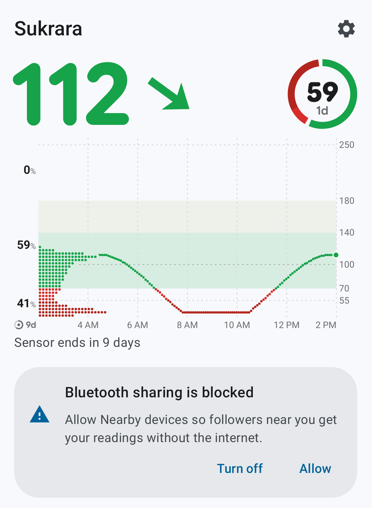
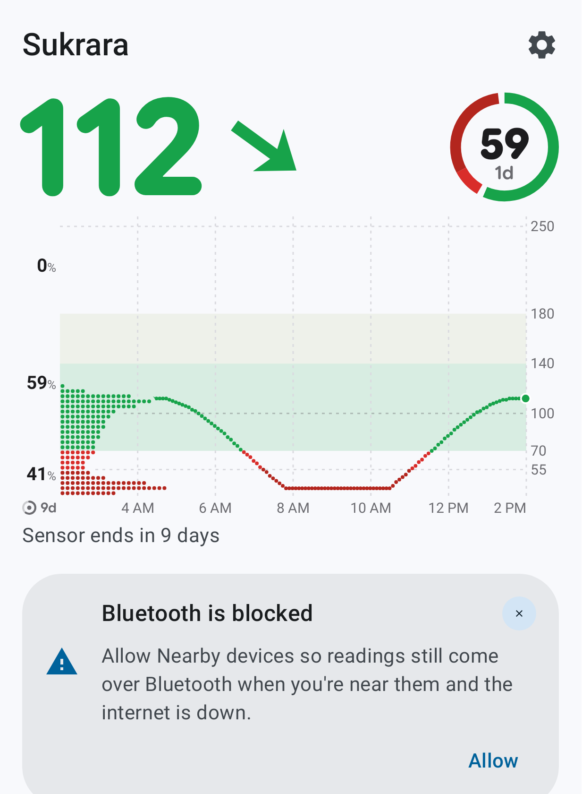
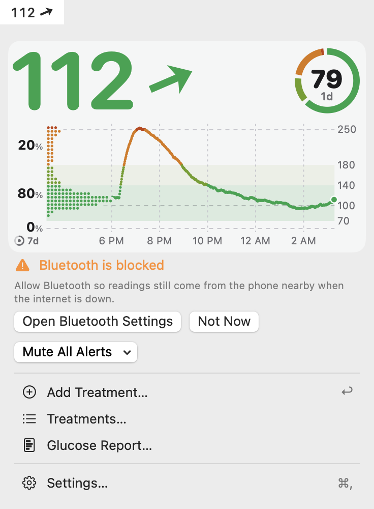
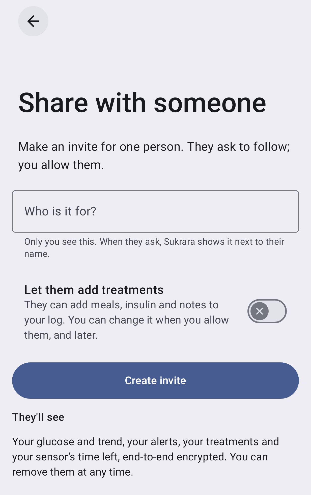
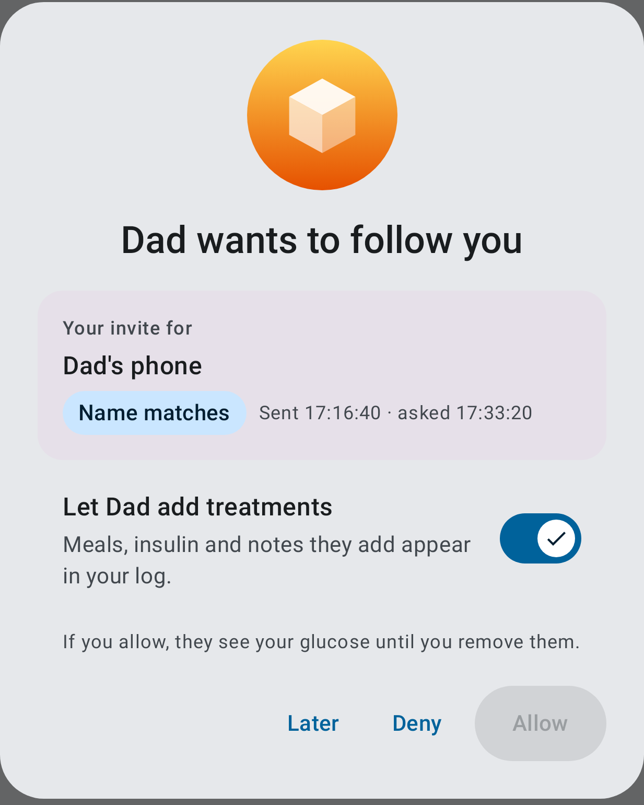
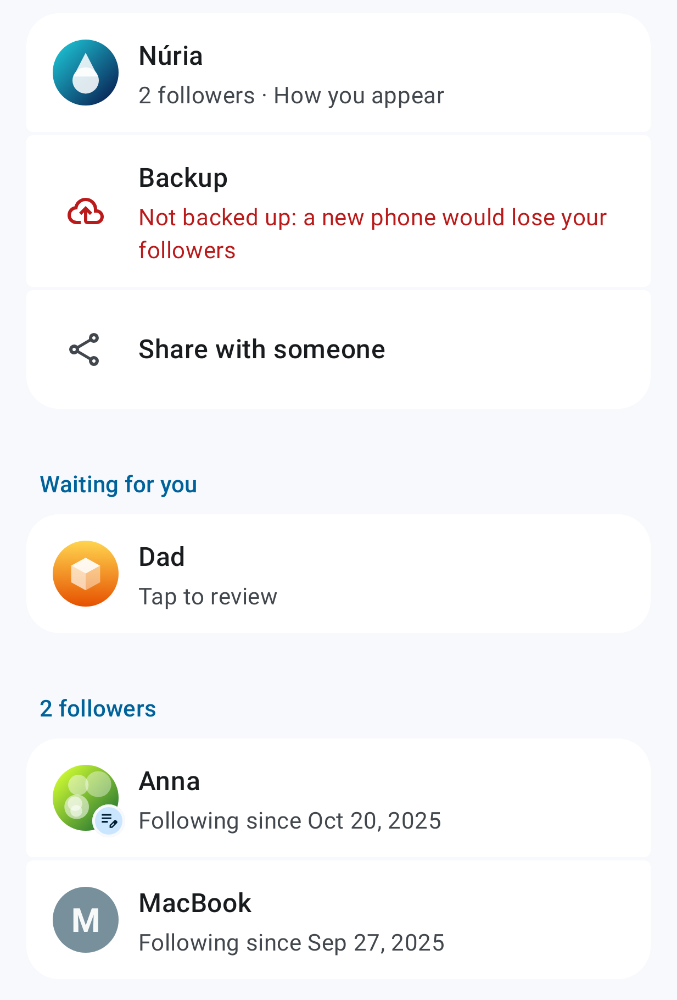
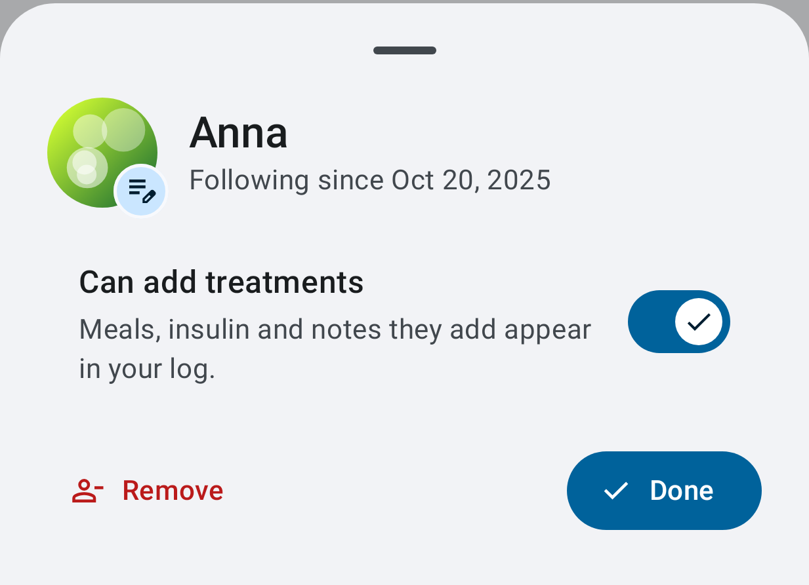

# 40 — Feature checks, sharing permissions, *Can add treatments*

The owner, 2026-11-15: Settings › Sharing › *Over Bluetooth nearby* said in red that a permission was missing, and
nothing outside that page did. *Can add entries* is off by default and easy never to find; the concept is called
*treatments*; the followers list shows it poorly.

## Cause

Android's *Nearby devices* group is three runtime permissions. Granting some of them doesn't grant the others: Android
grants only what is requested
([Bluetooth permissions](https://developer.android.com/develop/connectivity/bluetooth/bt-permissions),
[Request runtime permissions](https://developer.android.com/training/permissions/requesting)).

- The sensor flow and setup asked for `BLUETOOTH_SCAN` and `BLUETOOTH_CONNECT`.
- Bluetooth sharing is on by default, and the wearer's Bluetooth server needs `BLUETOOTH_ADVERTISE` + `CONNECT`.
  Nothing ever asked for `ADVERTISE`.
- The first follower was allowed from the approve dialog or its notification. The server then wanted to run, found the
  permission missing, and stayed `NeedsPermission`.
- The only sign was the red line on its page. It is not an alert item: followers still got readings over the internet,
  so the alert checklist was right not to show it.

A request for a permission in an already-granted group gets an immediate answer without a dialog
([Calciati et al., MSR'20](https://software.imdea.org/~alessandra.gorla/papers/Calciati-Autogranted-MSR20.pdf)), but only
if it is made. The fix is to make it at the right moment.

## What was chosen

| Point | Choice | Why |
|---|---|---|
| When to ask (wearer) | Bluetooth sharing stays **on by default**. *Nearby devices* is asked **in context**: (1) setup's Bluetooth row asks all three at once (sensor + sharing, one dialog); (2) the in-app *Allow* of a follower asks right then while sharing is on; (3) turning the switch on asks. | Google: ask when the person starts using the feature ([requesting](https://developer.android.com/training/permissions/requesting), [overview](https://developer.android.com/guide/topics/permissions/overview)). The first follower is the moment it becomes useful. Same group, so (1) and (2) usually show no dialog at all. |
| When to ask (follower) | Setup's permission step on a follower's phone gets a *Nearby devices* row (*Readings over Bluetooth when you're near them and the internet is down*). It is optional: the step goes on without it. The Mac already gets macOS's prompt when following starts (`CBCentralManager`). | That's the moment the follower grants the other permissions. Bluetooth is the backup of the internet path, never the only path. |
| A check for every feature | **Blocked features** (`BlockedFeature`, Android `core/model`; Mac `Panel/BlockedFeatures.swift`): a feature that is on and in use but the system blocks. Each is listed only while it costs the person something. Home (the Mac's panel) names the first: **Allow** asks the system, **Turn off** turns the feature off, and a feature without a switch has **Not now** instead. Settings marks the row whose page has the fix in the warning colour (Sharing, Share with apps). The page keeps its fix row. | The alert checklist answers "may an alert not ring?" and stays the safety banner. These are quieter: below the safety banners, above the tips. Every state has a visible way to fix it and a way to leave it (CLAUDE.md "Complete flows"). |
| *Can add treatments* at invite time | *Share with someone* has *Let them add treatments* (off). The choice travels with the invite (local `InviteRecord.writer`). The approve dialog shows *Let Anna add treatments* pre-set from it, changeable before *Allow*. *Allow* from the notification applies the invite's choice. | Dexcom Share, Google Home and Drive pick the role when the person is invited, then show it on accept ([Dexcom](https://www.dexcom.com/en-GB/faqs/data-sharing?ipc=US), [Google Home](https://support.google.com/googlehome/answer/9155535?hl=en), [Drive](https://support.google.com/drive/answer/2494822?hl=en)). Each place words the switch for itself (owner, 2026-11-15: a setting repeated elsewhere must make sense there). |
| "entries" → "treatments" | Every user-visible "entry/entries" that means a treatment, on both apps, in en and es ("tratamiento"), plus the docs and specs that quote the UI. | The owner's word. |
| Followers list | The summary line is just *Following since …*. A follower who can add treatments gets the *Can add treatments* icon (edit note) on their picture; TalkBack reads it as words. Tapping a follower opens THE app sheet (`SukraraSheet`, #207) instead of a dialog: picture, name, since, the nearby device's state, the *Can add treatments* switch, then *Remove* (with icon, confirmed: it can't be undone) and *Done*. | #207's lesson: show the exception as an icon, not a word on every row (the treatment list's pen and cloud marks). Use one sheet for an item's details everywhere, with icons on buttons. |

## Every feature, checked

| Feature | What can block it | Where it shows now |
|---|---|---|
| Alerts (both apps) | Notifications, full-screen, exact alarms, battery, channels, DND, sound when unlocked; Mac: notifications | Unchanged: the alert checklist (Android), the panel warning (Mac) |
| Sensor (Android wearer) | Bluetooth off or *Nearby devices* scan/connect | Unchanged: alert checklist item *Bluetooth* (no sensor = no alerts) |
| Bluetooth sharing (Android wearer) | `ADVERTISE` missing while someone follows | **New** blocked feature |
| Bluetooth following (Android, Mac) | *Nearby devices* / macOS Bluetooth not allowed while following | **New** blocked feature (Not now); Mac Settings › Following gains *Open Bluetooth Settings* |
| Health Connect (Android wearer) | Permission removed in Health Connect | **New** blocked feature (it was only on its page) |
| Nightscout API on home Wi-Fi (Android 17) | Local network access refused | **New** blocked feature (it was only on its page) |
| Open at login (Mac) | Waiting for approval in Login Items: nothing starts after a restart | **New** blocked feature (it was only in Settings › General) |
| Pen / sensor NFC taps (Android) | Android blocks Sukrara's tag intents | Unchanged: its own banner and cards |
| Juggluco on the LAN (Mac) | Local network refused | Unchanged: the panel's no-data reason (it stops monitoring) |
| Keychain (Mac) | Follow key unreadable | Unchanged: the panel's no-data reason |
| Camera (QR) | Refused | Asked at use; its screen has *Open System Settings* |
| Sensor-end calendar (Android) | Calendar permission removed | Discarded: the switch turns itself off on the next resume (visible, no silent "on") |

## Discarded

- **Off by default** for Bluetooth sharing: nearby readings without the internet help most at home and at night. The
  owner prefers on.
- **Asking `ADVERTISE` from the new-sensor flow:** it doesn't know about sharing, and the moment there is unrelated. Setup
  and the first *Allow* cover it.
- **Folding blocked features into the alert checklist:** that would mix "an alert may not ring" with "a convenience is
  off". The safety banner would fire for things that aren't safety.
- **One "Checks" page listing every feature with ✓:** a list of ticks for features nobody uses is noise. Warnings show
  only where something is blocked, on home and on the Settings row.
- **Merging the NFC taps banner into blocked features:** its *Allow* is one Android screen for pen and sensor taps
  together, with its own wording. It keeps its banner, which has the same shape.
- **A follower-side Bluetooth switch** (as the exit): it would be a new setting with no use besides silencing the
  warning. *Not now* closes the tip, and *Show closed tips* brings it back.
- **The invite's choice in the backup or on the wire:** an invite lives 24 h, so no protocol change is needed. A
  restore in that window falls back to off, and the dialog still shows the switch.

## In Sukrara

- Android: `core/model/FeatureChecks.kt`, `app/AppFeatureChecks.kt`, `designsystem/rows/BlockedFeatures.kt`, home's
  `BannerKind.FeatureBlocked`, the Settings overview rows, `sharing/NearbyRows.rememberAskNearby`, setup's
  `NearbyFollowRow`, `WriterSwitch`, `FollowerSheet`, `InviteRecord.writer` / `PendingRequest.writer`,
  `OwnerEngine.approve(…, writer)`.
- Mac: `Panel/BlockedFeatures.swift` (panel row, `AppModel.blocked`), *Open Bluetooth Settings* in Settings › Following,
  the renamed strings.
- Tests: `FeatureChecksTest`, `BannerSlotTest`, `OwnerEngineTest.theInvitesCanAddTreatmentsChoice…`,
  `BlockedFeaturesTests` (Mac).
- Pictures (synthetic data, Roborazzi / `sukrara-snap`):

| Home: Bluetooth sharing blocked | A follower's Bluetooth (no switch) | Mac panel |
|---|---|---|
|  |  |  |

| Share with someone | Approve | Followers | Follower sheet |
|---|---|---|---|
|  |  |  |  |

The *Can add treatments* switch has no icon anywhere (the owner's earlier "no icon" on it; FEATURES "Settings"); the
mark is on the follower's picture.
