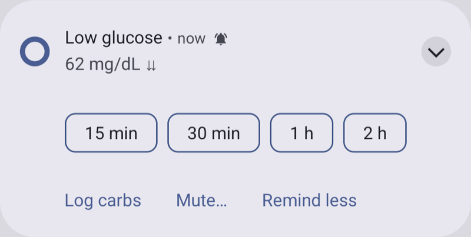

# Sukrara behaviour catalog

The features and exact behaviours of every Sukrara app. One line per behaviour, with the rule and the numbers; the
"why" stays in the investigation reports (`docs/NN-*.md`).

Rule: every change that adds or changes a behaviour updates this file in the same commit.

**Complete flows** (CLAUDE.md; user, 2026-10-21: "There's no way to unmute!"): every feature section has a
**States and exits** paragraph: each state a user can enter, where it is visible, and how to change it and leave it
(undo, cancel, turn off, unmute, go back) on every platform and surface that shows it. `tools/check/run.sh` (check
`states`) fails on a section without one unless `tools/check/allow.json` `states_pending` lists it with the reason.

## Alerts

Rules: [contracts/alerts/SPEC.md](../contracts/alerts/SPEC.md); timelines: [contracts/alerts/scenarios](../contracts/alerts/scenarios/).

- Every change to the alert rules adds or updates a scenario in `contracts/alerts/scenarios/*.txt`; Android
  `AlertScenarioTest` and the Mac `ScenarioTests` (`AlertsTests`) both run all of them and must pass (SPEC §7). Mac: the pure
  `SukraraAlerts` engine runs them in `AlertsTests` (`cd apps/macos && swift test --filter AlertsTests`, one test case
  per scenario from `contracts/alerts/scenarios`).
- **LO / HI** (Android and Mac, SPEC §1): a sensor's "below / above my range" reading (`sgv < 40` / `> 400`) matches
  every low / every high kind whatever the thresholds, so the most severe one turned on (very low, extremely high)
  alerts at once instead of waiting for *No glucose data*; never a falling-high prediction from a HI, and a LO / HI is
  never "back in range by the margin" (a Mute / Remind less of that side holds). Alert texts say
  *LO · below 40 mg/dL* / *HI · above 400 mg/dL* (es *por debajo de 40* / *por encima de 400*), never 39 / 401, and
  the Nightscout upload and the xDrip+ endpoint compute no slope from or to one (scenarios `levels.txt`).
- Kinds and defaults (the user's settings): very low < 55 every 5 min (alarm volume), low < 70 every 5 min, high ≥ 180
  every 15 min, very high ≥ 250 every 10 min, extremely high ≥ 300 every 5 min (alarm volume), falling/rising fast
  2 mg/dL/min every 30 min (off), no data after 20 min every 60 min; other kinds at notification volume.
- Lows are strictly below the threshold (70 → alerts at 69); highs at or above it.
- "Very low" (id `very_low`) replaced "urgent low" everywhere (settings JSON, channels, sounds, events); no migration.
- Level alerts: one at a time, the most severe wins; a worse kind of the same side alerts at once; getting better
  (very low → low) doesn't alert.
- Rate alerts (falling/rising fast) run next to level alerts; a reading without a rate (a LO / HI has none) keeps an
  open falling / rising fast as it is (alert up, repeat due, a Mute not back by it): a LO isn't a sign the fall stopped; no data runs on a timer and clears on the next reading. The Android timer is an elapsed-time alarm, so a clock change (`TIME_SET`) re-checks at once and plans it again (round 22: with the clock moved forward the old high stayed up and no "no data" came; a real gap alerts on time, scenario *A high with no more readings…*).
- Readings older than 15 min never alert; the alert clears when the reading gets that old.
- Episodes: one per group and side; a brief exit (back in range for less than the repeat interval, at least 5 min)
  clears the notification but keeps the episode, its repeat count and its treatments; no new "first" alert.
- Repeats count from the last alert of the episode; repeat 0 = once per episode.
- Logging the answering treatment clears the alert; when its mute window ends and it still matches, it alerts at once
  and the repeats count from there.
- Carbs mute very low, low and falling fast (default 15 min); rapid insulin mutes high, very high and rising fast
  (default 60 min); no treatment mutes extremely high or no data (the user's own Mute / Mute all do); window = `t ≤ now < t + min`; deleted entries don't count.
- Notification actions (round f30, SPEC §2; the user 2026-10-21: "two kinds of buttons … Mute 30 min doesn't conceptually belong there"; Android guidance: up to three actions that don't duplicate the tap, developer.android.com/develop/ui/views/notifications/build-notification#Actions, choices via RemoteInput): every alert notification, every kind (very low and extremely high included), has exactly **Mute…** and **Remind less** (Mac *Remind Less*) on Android and Mac. Mute… is one action whose choices are the lengths (Android direct reply: 15 min / 30 min / 1 h / 2 h and the setting's own length among them, shortest first, plus typing; TalkBack hears each chip as what it does, *Low alerts: mute for 30 min* / es *Alertas de glucosa baja: silenciar durante 30 min*, through a `TtsSpan` on the chip, whose text stays the reply (#103, `AlertMuteChoicesTest`); Mac text input, placeholder *30 min, 1 h, 2 h…*, empty = the setting); typed text goes through the shared duration parser (`45`, `1 h 30`, `1:30`, `2h`; 1–720 min); anything else changes nothing and the notification comes back silently. Remind less (es *Avisar menos*; was *Relax*) repeats the side every `max(repeatMin, relaxMin)`; it shows only when it would slow anything (no data, every 60 min, gets Mute… alone), and once relaxed the slot is **Remind as usual** (es *Avisar como siempre*); the interval is in the secondary text (*Reminders every 30 min*), never on the button. After Mute… Android replaces the alert with a silent *Low muted until 10:42* with **Unmute** and **Change…**; macOS removes a notification once an action is used and posts a passive one with the same two. Since macOS removes it on every action, the Mac posts an alert that is still up again without sound after *Remind Less* / *Remind as Usual* (now with the other button; nothing ringing came back meanwhile) and after a *Mute…* / *Change Time…* reply that isn't a length (unchanged; the muted note when the side is muted), for its own alerts and the wearer's mirrored ones (`AlertControllerTests`). Scenarios: `contracts/alerts/scenarios/actions.txt`. Android: the rules are the pure `:core:alerts` module (`AlertMachine`: inputs → effects Fire / Clear / Back / Mirror / Schedule; persisted `AlertState` incl. the wearer's shared run so a restart never re-rings followers; a restart alerts at once for whatever came due while the app was down; a follower's Mute / Unmute act on their side only — a high's Mute never hides a showing low; a clock set back keeps repeats, windows and mutes as far away as they were, and a reading dated in the future counts as taken now).
- Scope and end of Mute / Remind less (round f30; the user: "a high mute … then goes low, the low would be muted, and we don't want that"): they act on one side (lows incl. very low; highs incl. extremely high; falling fast; rising fast; no data), never the other. They cover very low and extremely high too (the user's decision; treatment mutes still never cover extremely high). They outlive the episode and end at their time (Mute) or once back in range **by the margin**: lows ≥ low threshold + 10 mg/dL, highs < high threshold − 10 mg/dL, for 10 min in a row (`notificationActions.backMgdl` / `backMin`, settings rows *Mute and Remind less end when back in range by* / *… for at least*); crossing back out restarts the count, so oscillation at the edge stays quiet. History: *Low back in range: mute and relax ended*.
- **Mute all** (round f30; the user: "a global mute button with a time option … Never is also an option"): Android home control **Mute alerts** (es *Silenciar alertas*), Mac dropdown **Mute Alerts**: 30 min · 1 h · 2 h · 4 h · 8 h · **Until you turn it off** (es *Hasta que lo desactives*, after AOSP Do Not Disturb; was *Never*) · Custom… (the one number input, 5 min–24 h, schema `muteAll`, whose special 0 is `until_turned_off`; was `never`). It quiets every kind, very low, extremely high and no data included, on that device only (the wearer still sends the followers' alerts); alerts showing go. When it ends, at its time or with *Unmute* (also a minute after muting), whatever still matches alerts at once, however recent its last alert (history *Alerts back on* / *Alerts unmuted*; scenario *Unmute (Mute all) right after muting*). It survives a restart.
- Notification actions and Mute all are per device (user 2026-10-21: "if someone wants to mute, it shouldn't mute the other"): only that device's notifications, pill and history change; nothing is sent. The wearer runs its rules twice (its own notifications with its actions, the followers' `alert` events without). On a follower mirroring the wearer (phone or Mac, `AlertMirror` on both) they drop the wearer's alerts there (while relaxed a repeat shows only after `relaxMin`; a more severe kind always shows) and end by the same time and margin rules on the readings that device gets. With own rules they act on that device's engine. Treatment mutes are shared data and quiet every device. Scenarios: `devices.txt` (`mirror`).
- Badge (`AlertStatus`, both platforms, `contracts/graph/status.json`): a side's Mute (or Mute all) out of range = the tonal pill with the bell and time left in the colour of what answers it (*Muted* when Mute all has no end); a treatment mute shows first. Mute all in range = the neutral **muted** pill with the "notifications off" bell, *Muted · 1h 20m* / *Alerts muted* (short *Muted*), on every card surface (app, widgets, glucose notification, Mac dropdown and widgets); the Mac menu bar puts a bell.slash before the value.
- Durations (round f30; the user: "Showing 60 min and 120 min is long, 1 h and 2 h is better"): every duration in words goes through one formatter per platform (Android `:core:model` `Durations.kt`, Mac `SukraraCore/Durations.swift`, cases `contracts/settings/durations.json`): *45 min*, *1 h*, *1 h 30 min*; the card keeps its compact *1h 4m*. tools/check rule `durations` fails on a duration written by hand.

  
  
  
  

- Countdown and copy (round f31; the user, 2026-10-22: "muted alerts should show a countdown, and the Never option makes no sense … figure out the best copywriting"): every muted state counts down. Android's muted notification uses a count-down chronometer (`when` = the mute's end) titled *Low alerts muted* with *Until 10:42*; the pill, sheet, Active now and Mute-all line tick on each minute boundary; widgets and the lock screen re-render each minute while a mute runs. Mac rows, pill, Active now and menu-bar tooltip tick; Mac notifications say *Until 10:42* (they can't count down). The state lines come from one builder per platform (`MuteCopy`) tested against `contracts/alerts/copy.json` (en + es): *Low alerts muted · 12 min left*, *Low reminders every 30 min*, *Alerts muted · 1 h 12 min left*, *Alerts muted until you turn it off*; choices *For 30 min* … *For 8 h*, *Until you turn it off* (AOSP DND's *Until you turn off* / *For 1 hour*); buttons *Unmute* / *Change time*, *Remind less* / *Remind as usual*; pill *Muted · 1h 12m* / *Muted*. Mac uses title-style buttons and menu items (*Change Time*, *Remind as Usual*, *Until You Turn It Off*). Round f33: the quiets after a treatment say it the same way and count down to the rule's end like a mute (*Low alerts muted after carbs · 12 min left*, *High alerts muted after insulin · 1 h left*; was *Low quiet after carbs until 10:42*), and the falling rule reads *High alerts muted while falling back into range*; the badge's screen-reader words (TalkBack on the widgets and the card, Mac VoiceOver) are the same line as the app's rows, a comma for the `·` (`contracts/graph/spoken`). Spanish agrees with the time left: *queda 1 h* / *queda 1 min*, *quedan 2 h* / *quedan 1 h 5 min* (Android: `plurals` for the pill *queda 1 h* and *Sensor: queda 1 d*, `_one` / `_other` string pairs for the mute lines (`MuteText`); the quantity is the duration's one number, `Durations.*Quantity`; `StringsParityTest` fails on a *queda(n) %s* in a plain string or in the wrong form). The Mac is English only (*left* doesn't change).
- **States and exits** (rounds f29, f30, f31; SPEC §2 "States and exits"; scenarios `actions.txt`, `exits.txt`, `devices.txt`; Android `AlertMuteTest`, `AlertExitsTest`, `MuteAllGallery`, `QuietGallery` read back the posted notifications; Mac `NotifierTests`, `AlertControllerTests`). Every way out acts on this device only and updates history, badge, widgets and ring at once.
  - *Normal*: the alert notification (Mute…, Remind less), the *Eat carbs* / *Take insulin* pill. Out: the episode ends.
  - *Side muted (N left)*: Android the silent *Low muted until 10:42* notification with **Unmute** / **Change time** (es *Reactivar*, *Cambiar duración*); the tonal pill *Nm left* → sheet (**Unmute**, **Change to** 15 min / 30 min / 1 h / 2 h); Settings → Alerts → **Active now**. Mac: the passive notification with the same two, panel rows (Unmute, Change To), the pill's menu, Settings › Alerts › Active now. Out: Unmute (still out of range → alerts at once), its end (alerts at once if it still matches), back by the margin; Change = a new end from now.
  - *Quiet after carbs / rapid insulin*: the tonal pill and ring; the line *Low alerts muted after carbs · 12 min left* (ticks; Android home chip, sheet, Active now; Mac panel row, Active now); sheet / panel / Active now **Alert me anyway** (this device only), which drops the quiet everywhere at once: the pill asks for the treatment again (*Eat carbs*), the sheet closes, and the mute line and ring of the entries logged up to then end at that moment, on the app card, the widgets, the glucose notification and the Mac (`AlertUiState.lifted` → `TreatmentQuiet` / `CardAlertsMapping.muteEnd`; a treatment logged later quiets again). On a mirroring follower the wearer's phone decides (the sheet says *Low alerts muted after a treatment. The wearer's phone decides when they come back.*, *Alert settings*).
  - *Quiet: falling back into range*: Active now / panel **Alert me anyway**.
  - *Side relaxed*: Android chip under the card *Low reminders every 30 min* (es *Avisos de glucosa baja cada 30 min*), the notification's **Remind as usual**, sheet / Active now; Mac panel row, pill menu, Active now. Out: Remind as usual (an overdue repeat at once), back by the margin.
  - *Muted + relaxed*: both lines and both exits; the margin ends both.
  - *All alerts muted (time / Never)*: Android under the card *Alerts muted · 1 h 12 min left* (counting down) / *Alerts muted until you turn it off* (es *Alertas silenciadas · quedan 1 h 12 min* / *… hasta que lo desactives*) with **Unmute** (es *Reactivar*) and **Change**, the muted pill everywhere, Active now, TalkBack actions on the card (*Alerts: Unmute*, *Alerts: Change time*); Mac dropdown row with **Unmute** and **Change Time**, the menu bar's bell.slash (tooltip and VoiceOver *Alerts muted …*), the pill's menu, Settings › Alerts › Active now. Out: Unmute (what matches alerts at once), its end (never with Never), Change.
  - History lines (Android; the Mac logs them): Settings › Alerts › **Lately** lists the newest 5 of the last 24 h with their time (es *Últimamente*): *Low · 66 mg/dL* (an alert's first ring; repeats aren't lines; *(from the wearer)* when mirrored), *Resumed High (no sound)* (es *Reanudada: Alto (sin sonido)*: an alert shown again silently after a restart), *High cleared* (the rules ended it, not a mute), *Low alerts muted for 30 min*, *Low alerts unmuted*, *Low alerts: remind less* / *remind as usual*, *Low back in range: alerts as usual*, *All alerts muted for 2 h* / *… until you turn it off*, *Alerts unmuted*, *Alerts back on* (es *Las alertas vuelven a sonar*: a timed Mute all ended by itself, before what it lets ring; noted once, also when it ended while the app wasn't running: the record keeps the end it last saw). The runtime keeps the last 20 lines in the alert record (`AlertNotes`, saved with the rules' state, so a restart keeps them; *Start fresh* clears them). The Mac's event log (`AlertLog`, worded like `MuteCopy`) has a line for each: *Low alerts muted for 30 min*, *Low alerts unmuted*, *Low reminders every 30 min*, *Low reminders as usual*, *All alerts muted for 2 h* / *… until you turn it off*, *Alerts unmuted*, *Alerts back on* (while the app runs), *Low back in range: alerts as usual*, next to its *posted* / *resumed silently* / *cleared* lines. The group shows only while it has lines; it is read-only (the strips and pages above are the ways out).

- Falling-high mute (default 20 min): no high/very high alert while `sgv + rate × min < high`; it only postpones (a
  repeat that came due fires when it ends).
- Headlines: "Very low glucose", "Low glucose", "High glucose", "Very high glucose", "Extremely high glucose",
  "Falling fast", "Rising fast", "No glucose data"; body "69 mg/dL ↘ · < 70 mg/dL".
- Headlines acknowledge treatments logged in the episode (or within the mute length before it): lows "· eat more"
  (1 carbs entry) / "· eat more again" (2+); highs "· still high after insulin" / "· still high after more insulin"
  (never advise more insulin). Counted even when the mute is off.
- The wearer's `alert` event carries `tr` (that count) so followers and the Mac show the same headline.
- Notification body (Android + Mac): the value and arrow only (`69 mg/dL ↘`); with no reading behind the alert (Android) *No recent reading*, never a made-up value; falling / rising fast add the rate (`120 mg/dL ↓ · falling 2.4 mg/dL/min`); no data: `Nothing received for 20 min · last 120 mg/dL`. No threshold, no source ("from the wearer's phone").
- Android timer: exact alarm (`USE_EXACT_ALARM`) at the engine's next check, so a mute end alerts on time between
  readings; Mac: one-shot timer at the next check plus the 60 s tick.
- Badge status (`AlertStatus`): None / Needed / Taken / Paused use the same thresholds and treatment windows as the engine.
- Notification channels: two per kind. Android ids `alert.<kind>` (notification volume, `USAGE_NOTIFICATION_EVENT`, group *Glucose alerts*) and `alert_alarm.<kind>` (alarm volume, `USAGE_ALARM`, passes "Alarms" in Do Not Disturb and overrides a mode that silences alarms once Do Not Disturb access is granted: Android applies `setBypassDnd` only with that access, so the checklist creates the channels again as soon as it is granted (on the return to the app), keeping every choice the person made; group *Glucose alarms (alarm volume)*); the person sees them as *Very low*, *Low*, … under those two groups in System settings › Notifications. Ids never change (renaming resets the person's choices). (PoC: `alert_n_<kind>`, `alert_a_<kind>`.) Every alert that can ring posts as `CATEGORY_ALARM` so Android 15+ *notification cooldown* (per app: a second sounding notification within 60 s at 30 % volume, a third within 10 s muted; only alarms are exempt) never quietens one — Low and Falling fast fire in the same reading. A notification-volume alert keeps `CATEGORY_REMINDER` only while Do Not Disturb would treat the two differently (Alarms only, Priority without both alarms and reminders), so DND lets it through exactly as before (`AlertCategory`, `AlertCategoryTest`, `AlertNotificationAttributesTest`). Android also makes only one sound per app per second, so when one reading fires several alerts the one to hear is posted first (alarm level, then the most severe; the others show without sound; `AlertRingOrderTest`), while the phone is unlocked and Android's *Vibrate only when unlocked* is on (the person's answer *Keep it on* in the checklist), Android only vibrates, so Sukrara plays the alert channel's own sound itself, once, on the alert's volume, only for a ringing post whose channel sounds and vibrates and only where Do Not Disturb lets the alert through; a Clear or Mute stops it (`UnlockedAlertSound`, `UnlockedAlertSoundTest`; also for *Send a test alert*); and the app's other notifications that would sound (sensor, status, requests, pens) wait 1.1 s and post only 1.1 s after the last alert sound, so a notice of the same moment (the sensor lost right before *No data*) never mutes the alert (`SoundGap`, `SoundGapTest`; the *Monitoring stopped* notice posts at once: Android is stopping the service). Debug builds: `ALERTS --es kinds low,falling_fast --el gapMs 2000` posts made-up alerts through the notifier (docs/15 has the check).
- Android runtime (`:monitor` `AlertRuntime`): one alert runtime per process owns the engine; the monitoring service feeds it (hub state, settings, treatments) and the exact alarm (`AlertCheckReceiver`; boot, app update, clock and time-zone change through `BootReceiver`) ticks it **with the service dead**, from the saved record (episodes, mutes, Mute all, the last reading, the sensor's life, whether monitoring started): *no data* still alerts on time when Android killed the service, then the service is asked to restart. Both paths share the one runtime, so an alert never posts twice. Effects are applied before the state is saved (a crash in between rings again rather than resuming silently); each effect step (the alarm first, then notifications, followers, saving, publishing) is tried on its own, so a refused notification never leaves the exact alarm unarmed or the state unsaved; a failed step is written to the diagnostic log (no values) and listed in the hub's alert state (`failedSteps`) until it works again: the alert checklist reads it, so home shows *Alerts may not ring* · *Android refused an alert step* with *Copy report* (the failed steps, the missing items, the app and Android versions; nothing personal), and Settings › Alert reliability lists *Alert delivery* with *Copy report* while it lasts; an alert Android refused to post is posted again, with its sound, on the next input. Boot, app update and clock changes check alerts and start the service once (`BootReceiver`). The alert check uses `setExactAndAllowWhileIdle`, not `setAlarmClock` (that would show an alarm icon and replace the person's wake-up alarm as the phone's "next alarm"); with exact alarms refused it falls back to an inexact while-idle alarm. **No phantom alarm**: before the first reading (or with no sensor / monitoring stopped) *no data* is off and nothing is scheduled; without a role nothing runs. Alerts are never bundled with other notifications: every alert and muted card is in Sukrara's own *Glucose alerts* notification group with its summary (Android 16 force-groups ungrouped and sparse groups; 0.11.53), the summary never rings and goes with its last alert. Alarm-volume kinds (very low and extremely high by default) also open over the lock screen with a full-screen intent when Android allows it; whether an alert may not reach the person has one answer, the alert checklist (`AndroidAlertReadiness`, below under Home screen), which home, Settings › Alert reliability and setup all read. A swipe only removes that notification: the episode keeps its repeats.
- Android alert delivery (`:monitor`): every alert channel's sound is `content://app.mauri.sukrara.alertsound/<kind>` (`AlertSoundProvider`, exported read-only because System UI's player opens it): the file is picked at play time (the pack chosen in the app, a random variant), and a file that can't be opened falls back to the system sound, never silence; a sound picked in the channel's system settings wins. One vibration per kind (`AlertHaptics`, so the alert is recognisable in a pocket: lows fall and thud, highs rise, no data ticks away), composed from primitives, with an on/off waveform of the same rhythm where primitives aren't supported. The notification's actions follow the side's state: an alert whose repeat isn't faster than *Remind less* shows only *Mute…*; a relaxed side shows *Remind as usual* (with its "reminders every …" subtext). No per-side notification light colour (most phones have no LED).
- One sound per alert: each channel rings only its Sukrara sound; the app restores its episodes after a restart (an
  update kills it) and shows the alerts that were up again without sound; the next sound is the normal repeat
  (Android + Mac: Mac UserDefaults `alertEpisodes`, restored at launch with the last stored reading; history/log line
  "resumed High (no sound)"; scenario event `restart`, SPEC §7). Mac: the engine snapshot (open episodes, the sides'
  Mute / Remind less, Mute all; format `v` 1) is stored apart from the settings (SPEC §3 JSON under the schema key
  `alerts`); an unreadable or other-version snapshot starts fresh (alerts on, nothing muted), Mutes already over are
  dropped and Mutes longer than the longest choice are cut to it; a clock set back never stalls the repeats.
- Default sound pack: Quest, a different variant each time, no per-kind packs; followers mirror the wearer by default.

## Treatments

- Amounts are written lowercase with no space before the unit everywhere (Android + Mac): `4.5u`, `18u`, `30g` (dialog suffixes, lists, chart labels, the slot; also the Nightscout API's long-acting note; the Mac's treatment rows and amount field).
- Short durations read `now` (< 1 min), `12m`, `1h 5m` (whole hours: `3h`), only hours from 6 h (`7h`), days from 48 h (`2d`); time left rounds up (`1m` until it is over).
- The home treatments list (wearer) and the follower's list: each row starts with the time of day, then the amount as the card writes it and the kind (*30g carbs*, *4.5u rapid insulin*), and ends with the time since the entry in the card's short durations (`12m`, `3h`), refreshed on home's minute tick. An entry an insulin pen logged reads *8.5u rapid insulin · from the pen* (on every role: a follower stores the entry's pen keys as received, `TreatmentWire.penJson`) and the whole row is one button (TalkBack: *show its doses*; its Delete stays a button of its own) that opens **the pen entry sheet** (`:core:designsystem` `pen/PenEntrySheet`, the same sheet as *Doses read*): the amount and time, *From the pen · 1.5u primed*, each dose with *Priming* / *Injected*, the note and the entry it replaced; *Save* corrects it (snackbar *Entry changed* / *Removed from your log* with *Undo*; *This entry changed meanwhile. Nothing was saved.* when a read or another phone changed it; *Couldn't undo* when it changed after), *Delete* is home's own delete (snackbar *Undo*), *Done*. On a follower (or a phone without pens) the doses are read only (their role in words) and only a writer's own entry has *Delete*. Mac: Treatments window rows end with the time of day and the same `12m` / `3h` (refreshed every 30 s while shown).
- The treatment dialog (Android + Mac) focuses carbs instead of rapid insulin when the latest fresh reading is below an enabled low-side alert threshold (`AlertStatus.level` in `Kind.LOW_SIDE`); otherwise rapid.
- The treatment dialog on Android (home screen and `QuickTreatmentActivity`): the Rapid / Long / Carbs labels always sit small on the field outline on one line, with the unit (`u` / `g`) shown throughout, so no field and not the dialog changes height when the focus moves (`TreatmentDialogHeightTest`, en + es, 360 / 412 dp).
- The treatment dialog's time (Android + Mac): *When?* switches between a clock time and *Minutes ago* (Android: M3 segmented button, a number field with 5 / 15 / 30 / 60 min filter chips; Mac: segmented control, field + buttons). Minutes ago are 0–1439 (under a day, like the clock time; OK disabled when empty or 1440+, the field outlined red), 0 = now; the chip shows *16 min ago* (es *Hace 16 min*) and the entries get the time 16 min before the moment of saving, not of picking. The quiet line counts from that time. Cases in `contracts/treatments/treatment-form.json` (`minutes`, `minute_filters`); `TreatmentTimeTest` (also at 411 dp).
- The treatment dialog's form (Android + Mac, `TreatmentForm`, cases in `contracts/treatments/treatment-form.json`): insulin rounds to 0.1u (≤ 100u), carbs to whole grams (≤ 500g), `,` or `.` as decimal mark; 0, or 0 after rounding, is invalid; one invalid field blocks Save; a blank note adds nothing, a note is trimmed and clipped to 100 bytes.
- Writer scope (investigation 24; Android + Mac; `WriterScope`): a follower allowed to add entries (a writer) creates entries and changes or deletes **only the ones it created**; the wearer changes any. The wearer's phone refuses a writer's change to the wearer's own or another writer's entry (logged `treatment REJECTED: … may only change its own entries`; no echo, so the writer's copy stays *not accepted yet*). Followers apply the same rule: each entry's creator is the key that signed its first accepted version; a writer's copy that arrives after the wearer's echo of it is ignored, not counted as rejected; the wearer's own entry replaces a copy a writer forged first, whatever its version.
- **Lock-screen countdown** (Android, round 52, 0.11.52; `:feature:treatments` `QuickTreatmentActivity.kt`, `LockCountdown.kt`, `LockCountdownTest`): while the quick dialog is over the keyguard (*lock mode*: `KeyguardManager.isKeyguardLocked`, checked on every resume, so a widget on the lock screen, the glucose notification, the Quick Settings tile and a pen notification's *Add treatment* all count, swipe-only locks too) it closes by itself after *Time to save* (Settings → Lock screen, `lockTreatmentTime`, 10–120 s, default 20 s; raised to Android's *Time to take action* and to at least 60 s with TalkBack). The time counts from the dialog's first frame. Touches and typing never add time (in a pocket they type too). *Cancel* carries the countdown: a 24 dp ring that empties every frame with the seconds left inside it (the user asked to see the seconds count, 2026-10-25; the spec had a ring only), primary colour; it pulses once at 5 s, plus one light haptic tick if something was typed. The *When?* picker's and *Already logged by your pen?*'s Cancel show the same ring; timing out closes them with the dialog. Timeout: the dialog fades out and *Treatment not saved* is toasted only if something was typed (no haptic). The screen going off closes it at once, no toast. *Unlock* takes *Open Sukrara*'s place: the countdown pauses for the unlock prompt; success keeps the same dialog with every input (amounts, note, *When?*, the focused field and its keyboard), the ring shrinks away and *Open Sukrara* comes back; a cancelled or failed prompt resumes with at least 5 s. Unlocking on the lock screen itself (fingerprint) ends lock mode the same way. When the action row doesn't fit (Spanish at 360 dp) *Unlock* wraps to its own start-aligned line above Cancel / Save; no button is ellipsized. *Remove animations*: the ring steps once per second, no fill-in, no pulse (the tick stays). TalkBack: the digits are hidden; Cancel's state is *Closes in N seconds* in 5 s steps, one polite *Closes in 10 seconds*, *Unlock* reads *Unlock to keep editing*. The home screen's dialog never counts down.
- **States and exits**: *Treatment dialog* (home *Add treatment*, a card pill, a widget, the glucose notification, the Quick Settings tile, a pen read's *Add treatment*; Mac *Add Treatment…*) → *Save*, *Cancel* / back / tap outside / Escape (nothing saved, back where the user was). *When?* picker → *OK*, *Now* (back to now), *Cancel* (keeps the earlier choice). An invalid amount → the red limits line, *Save* disabled until it's fixed or cleared. *Already logged by your pen?* → *Cancel* (back with the values) / *Log anyway*. A phone that can't add entries → the app opens instead. Lock-screen countdown: *Lock mode* (the dialog over the keyguard, from a widget on the lock screen, the notification, the QS tile or a pen notification) → the countdown ring on *Cancel* → *Save* (saved without unlocking), *Cancel* / tap outside (nothing saved), *Unlock* (bouncer: success = the same dialog unlocked with everything kept, no countdown; cancel / failure = the countdown resumes with at least 5 s), timeout (closes, *Treatment not saved* if something was typed), screen off (closes). *Unlocked dialog* → *Open Sukrara*, *Cancel*, *Save*. *Time to save* → Settings → Lock screen → number dialog (*Cancel*; default 20 s among the presets 10 / 20 / 30 / 60, *Custom…* 10–120 s). TalkBack: Cancel's state *Closes in N seconds*, one announcement at 10 s, at least 60 s.
- Android (`apps/android/feature/treatments`): the quick dialog (`QuickTreatmentActivity`, opened by the glucose notification's action intent, `QuickTreatmentIntents.open` for widgets and the Quick Settings tile *Add treatment*) with Rapid / Long / Carbs, Note (Carbs focused when the latest fresh reading is under the low threshold, alert on or off,
or when the card's *Eat carbs* pill opened it), *Now* / *Earlier…* (*When*: *Time* picker or *Minutes ago* with 5 / 15
/ 30 / 60 chips, resolved when saving; the chip then reads *16 min ago*), the quiet line (*Highs quiet for 44 min ·
lows quiet for 14 min*: what the entries quiet on this phone from the chosen time; none while alerts are off or a
follower mirrors the wearer's alerts), the limits line, *Open Sukrara*, and the lock-screen countdown (*Closes unsaved in N s* + *Unlock*; same rules, `LockCountdownTest`). Saves go through `TreatmentLog` (each version strictly newer, undo = a newer version, `WriterScope`) and the share layer's `TreatmentSync`. *Cancel* carries the countdown ring (24 dp, seconds inside, empties every frame, fills in with the dialog, pulses once at 5 s with one `SEGMENT_TICK` haptic only if something was typed, shrinks and fades away after an unlock; reduced motion: steps once a second, no fill-in, no pulse; TalkBack: digits hidden, Cancel's state *Closes in N seconds* in 5 s steps). The *When?* picker's Cancel carries the same ring while the countdown runs behind it (Cancel closes the picker only). With 10 s left TalkBack hears *Closes in 10 seconds* once (a polite live region; not while the unlock prompt holds the time, never per second; `LockCountdown.announceDue`). The Quick Settings tile's subtitle is the glucose as the card's face shows it (surface `quick-tile`, `TileSubtitleTest`): `123 ↗`, struck with the ring from 5 min (`1̶2̶3̶ ○`, a tile can't draw a line), *No reading since 00:32* from 20 min, *Sensor ended*, *Warming up · 12 min*, nothing before the first reading, *Open Sukrara to set up* when this phone can't add entries; redrawn each minute while the shade is open. Saving insulin near a pen entry asks *Already logged by your pen?* (`PenDuplicateDialog`, see [Insulin pens](#insulin-pens-docs29); Mac: `TreatmentsModel.penDuplicate`, *Already logged by the pen?*). Not included yet (#75): editing an entry from the home list (`TreatmentLog.edit` supports it; home offers delete and undo).
- Every writer sends `o: follower` (the Mac too; its own rows stay `mac` locally). Mac following someone: Delete (context menu, ⌫, Undo) works only on entries made on this Mac; the wearer's and other followers' rows are read-only.

## Mac menu and windows

  
  
  
  

- A click on the menubar number opens the glance panel (a borderless panel under the item, like `MenuBarExtra(.window)`: the menu material, 14 pt corners, a shadow); a second click, Escape, a click outside or another app taking focus closes it. Opening it brings Sukrara to the front, because macOS sends trackpad gestures only to the app in front (the user, 2026-10-22: "I pinch on the trackpad and nothing happens": the non-activating panel had the keyboard but never got a pinch); closing it gives the front back to the app that had it, so it still behaves like a menu: a second click, Escape or the right-click menu return to that app at once; a click outside returns to it unless the click went to another app or a Sukrara window (that one stays in front); a row that opens a Sukrara window (Add Treatment…, Treatments…, Glucose Report…, Settings…, Follow Someone…) leaves Sukrara in front with that window (checked by hand, QA.md Q6). Right-click (or Control-click) opens a short menu: Treatments…, Glucose Report…, Settings… ⌘,, Quit Sukrara ⌘Q.
- The panel, top to bottom: the glucose card in a recessed module (12 pt corners; black 18 % in dark mode, white 50 % in light mode, a separator outline with Increase Contrast); *Add Treatment…* ↩, *Treatments…*, *Glucose Report…* and *Settings…* ⌘, as menu-like rows (hover highlight). No source, follow or error lines (Settings › General / Following show them), no treatment list (Glucose Report › Treatments).
- The card in the panel uses the shared palette without a background colour (no halo disc / marker hole) and a grid one step stronger (#4A4A4F dark, #C8C8CE light); with Increase Contrast secondary ink #D8D8DC / #3C3C40 and grid #7C7C82 / #8A8A90.
- No data: *No readings yet* in the module, *Follow Someone…* when not following, else "Waiting for the wearer's phone."; no *Add Treatment…* row.
- *Add Treatment…* (the first menu-like row, the panel's default button: Return chooses it, shown as ↩) closes the panel and opens the Add Treatment window, the Mac form of Android's treatment dialog: an auxiliary window (HIG Windows) with the system frame and no title text, centred under the status item 6 pt below the menu bar (kept 12 pt inside its screen; `AppWindows.underMenuBar`), brought to the front; when it is already open, a card pill's field choice (*Eat carbs* → Carbs, *Take insulin* → Rapid) moves the focus there and keeps what was typed (`AddTreatmentFocus`). Inside, as on Android: *Add Treatment* and the time chip (*Now* / *16 min ago* / *Today 14:05* / *Yesterday 23:10*; a popover *When?* with a segmented control *Time* / *Minutes ago*: an hour:minute field (a time later than now is yesterday, within the current minute is now) or a minutes field with 5 / 15 / 30 / 60 min buttons; Now, Cancel, OK); Rapid `u`, Long `u`, Carbs `g` side by side (each with its chart marker; digits, `.` and `,`, at most 5 characters), Note below (placeholder *Pizza, exercise, sick…*, one line, at most 100 UTF-8 bytes, `n / 100` from 80 bytes); the quiet line (*Highs quiet for 60 min · lows quiet for 15 min*, Settings › Alerts minutes, not while this Mac mirrors the wearer's alerts or with alerts off); the limits line in red with a red outline on the bad field (*Insulin: up to 100u · carbs: up to 500g*); Cancel and Save (disabled until something valid is filled). Focus starts in Rapid, in Carbs when the latest fresh reading is below an enabled low threshold; Tab walks Rapid → Long → Carbs → Note; Return saves (every filled field becomes its own entry at the same time, in kind order rapid, long, carbs, note, each through the same path as before: v2 to the wearer as a writer, local when following no one); Escape or the close button cancels. When this Mac can't log, the row stays in place dimmed (HIG Menus) with the reason on a second, smaller line under it, also its tooltip (`TreatmentPaths.Blocked`): *Waiting for Marta to approve this Mac*, *Marta hasn’t turned on “Can add entries” for this Mac*, *Marta stopped sharing with this Mac*, *Not following Marta: ask for a new invite* (*the wearer* when the name is unknown). Settings › Following › *Treatments logged here* shows the same reason.
- Glucose Report window (panel row or right-click): the report only (no treatments; they have their own window): 1 day / 7 days / 14 days / 30 days (`reportDays`, default 14), the report, *Export CSV…*. Position remembered (`SukraraReport`).
- Treatments window (*Treatments…*, panel row or right-click; its own item like Android's treatments list, apart from the report): the last 7 days grouped by day (Today, Yesterday, weekday date), each row with the kind's symbol in its colour, amount, note, for entries made on this Mac a delivery symbol (clock = sending, paper plane = sent, ⚠︎ orange = not on the phone after 2 min, ✓ green = on the phone) whose tooltip says it in words ("Sent 14:05, waiting for Ana's phone", "On Ana's phone since 14:07"), then the time of day and the time since (`12m`); who logged it as the row's tooltip ("Logged on this Mac", "Logged on Ana's phone"); Delete in the context menu and ⌫ when this Mac may log, and while following someone only on entries made on this Mac. Position remembered (`SukraraTreatments`); ⌘W closes.
- Pen entries on the Mac (investigation 29; the phone reads the NovoPen, the Mac shows what arrives, SPEC §1 `pr` / `pen` / `pd`): in the Treatments window one row per injection with its total as title (`8.5u rapid insulin`) and a second line *From the pen · 1.5u primed* (*From the pen* without priming); with more than one dose a disclosure triangle opens the doses the pen recorded, one line each with its units (*1u primed* in secondary ink for an air shot, `8u`) and time; the row's tooltip starts *Read from the pen on Ana's phone* (no serial). Feel: an entry that arrives while the window is open slides in (default spring), a changed total or priming re-counts (`.numericText`), the doses open with the same spring; with Reduce Motion none of it moves. VoiceOver reads a pen row as one sentence (*8.5 units rapid insulin, from the pen, 1.5 units primed, 12:40, 47 min ago*) and each dose as *12:37, 1 unit, primed*. Add Treatment: saving a rapid (long) amount within 45 min of a pen entry of that kind asks *Already logged by the pen?* · *8.5u rapid at 12:40* (an alert sheet on the window) with *Cancel* (default, Escape: the carbs and note of the same save are saved, the insulin stays in the form) and *Log Anyway* (saves everything). No dose correction on the Mac: marking doses priming / injected (SPEC §1) is the wearer's, on the phone; the Mac only follows, and a follower may change only the entries it made (writer scope), never the phone's pen entries; a correction made on the phone arrives like any edit. Chart marks, the slot, insulin quiet times, widgets, the CSV export and everything sent use `a` (the injected units) only; priming is never counted. The Mac rejects an entry with a negative `pr`, a `pen` over 32 bytes or a malformed `pd` (OGS D§6.1; checked against `contracts/protocol/ogs/ogs-draft1.json` `treatment_payloads`, `OgsVectorsTests`). The Mac keeps the three keys through merge, storage, edits and deletes (`PenEntriesTests`). `sukrara-snap windows <dir>` renders the Treatments window with synthetic data, light and dark.
- Settings window (⌘, from the panel or the right-click menu): five panes General · Graph · Rings · Alerts · Following (a tab bar), reopening on the last pane shown (schema `settings.pane`, Mac only); changes apply at once, grouped forms with standard controls only.
- One number input (`NumberSettingRow`, every number on the Mac; the format of each is the shared schema's, `contracts/settings/settings.json` → `SettingsSpec.swift`, the same file Android's dialogs use): a pop-up menu of the presets and special values (*Off*, *Only once*, *None*, *Same as default (12 hours)*) and *Custom…* where custom values are allowed (the ellipsis character: it needs more input; `SettingsPanesTests`); Custom (or a stored value that is no preset) shows a number field + stepper (one click = the format's nudge, Shift-click 10 ×) + the unit, with the range under it (*Enter 1–48 h*). Typed text that isn't in range or on step turns that note red and is not applied; Return or leaving the field commits. Ranges: the six bands (very low 30–80, low 40–120, very good 80–250, high 100–300, very high 150–400, extremely high 200–450 mg/dL, kept in order), time shown 1–48 h, per-place time shown (Same as default or 1–48 h), ring periods 12 h or 1–90 days, sensor countdown 1–24 h, thresholds (very low 40–80, low 50–120, high 120–300, very high 150–400, extremely high 200–450 mg/dL, rates 0.5–5.0 mg/dL/min in 0.1 steps, no data 5–240 min), repeat (once or 1–240 min), quiet after insulin 10–360 min, falling back / after carbs 5–120 min, notification Mute… first length 1–720 min, Remind less (only presets slower than every enabled alert's repeat; custom from that repeat + 1 to 120 min), the margin 0–50 mg/dL and 0–60 min, Mute all 5 min–24 h or until you turn it off; minute presets read as *1 h*, *2 h*. Rings and numbers (None, 1–3) and vertical lines (Off, every 1/2/3/4/6/12 h) are plain pop-ups. Every stored value is loaded through its format (`NumberSpec.coerce`), so any value the settings accept persists (custom hours were dropped back to 12 h before) and nothing else gets in.
- Settings from (General; schema `follower.settingsFrom`): **Wearer** (default; *Marta (wearer)* while following), **Default** or **Custom**, for the mirrored settings: the six ranges, time shown (default), rings and numbers, each slot (kind, period, fainter), a ring's centre, ring order, rewards on the rings, time in range and crown beside the graph, treatments on the graph, lines across the graph, vertical lines, last treatment position and fallback, sensor countdown, and per alert (except no data) on / threshold / repeat plus the three quiet rules. Wearer = the wearer's latest settings event (PROTOCOL-v2 *Settings*; a key they didn't send, or nothing received yet, or not following = Sukrara's default); Default = Sukrara's defaults; Custom = this Mac's own values. *In use* says which in one sentence (*Not following anyone, so Sukrara's defaults are used.*, *Waiting for Marta's settings…*). Choosing Default or Wearer never overwrites this Mac's own values: they come back with Custom. Always this Mac's: sounds, the alerts main switch, no data, the notification's actions, Mute all, each place's own time shown and sensor time left, open at login. Only Custom shows the mirrored controls; elsewhere each pane starts with a read-only summary of what's in use and *Use my own settings* / *Change…* (opens General). In Custom, **Copy the Wearer's Settings…** (when theirs arrived; confirmation) makes the wearer's mirrored card settings and alert rules this Mac's own. One merge for every reader (`GraphConfig.load`: menu bar card and panel, widgets; `AlertSettings.inUse`: the alert engine, the badge, the mute lines).
- General: *Settings from* with *In use* and, in Custom, Copy the Wearer's Settings…; unit; open at login (`SMAppService.mainApp`, with its approval / failure notes); the version, Check now and **Quit Sukrara**.
- Graph: *Time shown*: Default (Custom only) and one per place, *Menu bar panel* and *Widgets* (`menubarHours`, `widgetHours`; *Same as default* = 0); *Graph*: time in range distribution, the crown beside the graph, vertical lines; *Treatments on the graph*: a checkbox per kind (rapid, long-acting, carbs, notes) and part it has (point, mute line, amount, time), Reset Treatments; the lines across the graph (each with a remove button, *Add a line at* with the line format, 40–400 mg/dL, up to 6); the six ranges, Reset Ranges; *Sensor*: sensor countdown (Custom only), time left in the menu bar panel / on widgets; Reset All Graph Settings… (Custom only, confirmation). Rings (Custom; otherwise the summary): rings and numbers (None, 1–3), each slot's kind and period, *Fainter* on the second and third only, what a ring's centre counts, rewards on the rings; the ring order as a list you drag to reorder (the list draws the insertion line; Control-click or VoiceOver actions *Move Up* / *Move Down*; no position numbers on screen, VoiceOver reads each row's place, *2 of 6*; Reset Order); last treatment: position, fallback kind, its period and *Fainter*. Following: the link with the wearer in words and its exits (Follow…, Cancel, Stop following…, Follow again…) and, while following, **Reconnect Now** (relays and Bluetooth at once). A change of System Settings › 24-hour time or the time zone redraws the card, the widgets and the Treatments window's times at once.
- Card data on the Mac: the wearer's live treatments are the chart's marks; each one's mute line ends when its quiet rule does (rapid insulin: quiet after insulin, carbs: quiet after carbs; a rule turned off draws none); the last-treatment slot shows running insulin (with the carbs logged meanwhile), else the treatment quieting the current alert, else the newest rapid / carbs entry still recent (insulin 4 h, carbs 3 min per gram, 30 min–3 h). The pill under the value: *Eat carbs* / *Take insulin* when needed; the treatment's colour and time left (*12m left*) while it quiets the alert; paused with the minutes left while a high falls back into range, or while the side or all alerts are muted. The widgets get the same data.
- Alerts: main switch and state line; in Default / Wearer a summary of the quiet rules in use; one row per alert (name, one-line summary of what applies such as `Off · Below 70 mg/dL · repeats every 5 min · Quest · like an alarm`, Details…, and its switch in Custom; no data always has its switch); in Custom quiet highs / quiet lows as switches with their minutes; *From the notification*: Mute… first length, Remind less every, the margin (mg/dL and minutes); sound pack and *Different sound each time* (a random variant of 3, never the one this alert played last, like Android), **Notification Settings…** (System Settings › Notifications › Sukrara; installed app only). The sound pack row and an alert's *Sound* row are buttons with the current choice that open a popover list with Android's options and words: (*Pack default (Quest)*, per alert only) *Arcade (8-bit)*, *Kart (racing)*, *Quest (adventure)*, *Soft (calm)*, *System default*, *None*; a checkmark on the chosen one and ▶︎ on every one that plays (the pack list plays the high alert's sound; each ▶︎ press another variant than the last). Files: the 96 IMA4 CAFs (4 packs × 8 kinds × 3 variants, 1.5–4.6 s) in `Sukrara.app/Contents/Resources`; Sukrara copies the sounds the current settings can ring (each alert's pack × 3 variants) to `~/Library/Sounds/app.mauri.sukrara.<pack>_<kind>_<n>.caf` at launch and when the sound settings change, checks the copy again right before a notification names it (a failed copy rings the default sound, never silence), and removes its own copies the settings can no longer ring; other apps' sounds are never touched. Naming the bundled file played Apple's default sound (2026-10-21). `SoundsTests` check that only ringable copies are installed (prefixed, idempotent, other files left alone) and the pack choice; `NotifierTests` that a failed copy rings the default sound. Details… opens a sheet: in Custom (and always for no data) the alert's switch and *Alert when* (threshold and *Repeat*: Only once / every n min); otherwise what applies, read-only; then sound (that list), *Like an alarm* and **Send Test Alert** (a real notification titled *Test ·* with its sound; the wearer doesn't get it, like Android's *Send a test alert*); Done (Return).
- Following: not following → a short explanation, **Follow from QR Image…** and **Follow with Invite Link…** (default button); following → the wearer's avatar and state, where entries logged here go, this Mac's own picture and name (*How you appear to Marta*) with **Edit…**, **Stop Following…** with a confirmation sheet. Edit… opens a sheet like Android's *How you appear* (`Identity/IdentityEditor.swift`): the 88 pt picture, *Shuffle* (a new random picture; each change pops in with a spring and a light haptic, a fade with Reduce Motion), *Customize* / *Done* (shape as a segmented control Cube · Drop · Dots · Rings · Letter, the 8 colours as circular swatches, *Turn the Colours* = 45° further and the next dots seed), *Your name* (at most 40 characters), the privacy note, *The person you follow sees the change as soon as it reaches them.*, Cancel and Save (disabled while the name is blank). Save stores it and sends the wearer a `profile` gift wrap (relays + the phone over Bluetooth), exactly as the Android follower; the wearer's phone applies it once this Mac is approved. Generated pictures only (no photo: PROTOCOL-v2 sends the numbers, never an image), drawn on the Mac by `AvatarDrawing` (the same geometry as Android's: gradient, cube / drop / dots / rings / letter, the grey initial for no picture or a newer version; `contracts/protocol/identity/avatar-v1.json`, `AvatarDrawingTests`), in Following (the wearer's), the nearby dialog and the How you appear row. The row shows while a follow exists (`FollowerSnapshot.me`, from the Keychain state); the runtime sends the update only once the wearer approved this Mac. Name and picture rules pinned by `contracts/protocol/identity/profile-v1.json` (Android `ProfileFixtureTest`, Mac `ProfileFixtureTests`; `FollowerRuntimeTests` `profileGoesWithTheRequestAndUpdatesWhileFollowing`). States and exits: *Edit…* → the sheet → *Save* (sent) or *Cancel* / Escape (nothing changes); *Customize* → *Done*.
- Mac shell (built today): the status item shows the value in its range colour (red below the range, orange above, the menu bar's ink in range), the card's own trend arrow at its continuous angle (`GlucoseCard.trendImage`; the hollow ring without a rate) and the slashed bell before it while Mute all or a side's mute is on; 5–20 min old: struck through and grey; ≥ 20 min: the antenna-slash symbol alone; warming up: the grey time left (*42m*, *Almost ready*) with an hourglass after it, ticking each minute; sensor ended: the checkered flag, switched exactly at the end time. Its tooltip says *Sukrara · reading at 14:05* / *no reading since 14:05* / *ready at 19:45* / *Sensor ended — replace sensor*, plus the Mute all countdown (it ticks down each minute on its own: the title's timer also wakes at each minute of a timed Mute all, `AppModel.nextWake`); VoiceOver reads the card's value sentence (or *Glucose: no reading since 14:05*) and the mute. A click opens the panel (an NSPopover), Escape or a second click closes it and gives the focus back to the app you were in; a row that opens a window keeps Sukrara in front. Right-click: *Treatments…*, *Glucose Report…*, *Settings…* ⌘,, *Check for Updates…*, *Quit*. The panel says why nothing is shown (*Not monitoring: not following anyone yet*, *Waiting for the first reading from the wearer*, *waiting for the wearer to allow this Mac*, *the wearer declined / stopped sharing*); the card's pill is pressable (*Eat carbs* / *Take insulin* open Add Treatment on Carbs / Rapid, a mute pill opens its ways out); under the card: Mute all with its countdown, *Unmute* and *Change Time* (the lengths, *Until You Turn It Off*, *Custom…* for a typed length such as *2 h 30 min*, 5 min–24 h); each quiet side with its line and *Unmute* (its own Mute) or *Alert Me Anyway* (quiet after a treatment or while falling back), *Remind Less* / *Remind as Usual*, and *Mute* / *Change Time* with the mute lengths; *Mute All Alerts* with the same lengths and *Custom…*; a warning with *Open Notification Settings* when notifications are off or banners / sounds are off (re-checked when Sukrara becomes active), and an update row; then menu-like rows (hover highlight, VoiceOver buttons): *Add Treatment…* ↩ (dimmed with the reason under it, in its tooltip and VoiceOver hint: *Follow someone to add treatments.*, *Waiting for Marta to approve this Mac*, *Marta hasn't turned on “Can add entries” for this Mac*, *The wearer stopped sharing with this Mac*, *Not following anyone: ask for a new invite*), *Treatments…*, *Glucose Report…* and *Settings…* ⌘,; each closes the panel and opens its window. Add Treatment (placed under the menu bar at the top right): Rapid / Long / Carbs side by side with their symbols and units, the Note with *n / 100* from 80 bytes, the *When?* chip (*Now*, *15 min ago*, *Today 14:05*; a popover with *Time* / *Minutes ago*, 5 / 15 / 30 / 60, Now, Cancel, OK; minutes ago are resolved when saving), the quiet line (*Highs quiet for 1 h · lows quiet for 15 min*; not while mirroring the wearer's alerts or with alerts off), Cancel / Save; Carbs has the focus while the latest reading is below the range or a low alert is up. Treatments window: the last 7 days grouped Today / Yesterday / weekday, each row with its kind's symbol, amount, note, time of day and time since (refreshed each minute), who logged it as tooltip and VoiceOver hint, the delivery state with Retry, delete with a 10 s Undo (⌘Z). Glucose Report window: 1 / 7 / 14 / 30 days (remembered, `reportDays`), time in the five ranges as a stacked bar with each share and its consensus goal (✓ green when met, orange when not), average glucose, GMI, CV, the share of the period with sensor data (a warning under 70 %), and *Export CSV…*: a save panel with a *Period* pop-up (This sensor when its start is known, Last 7 / 14 / 30 days, All time) that starts on the report's period and renames the file (`sukrara-glucose-<from>-to-<to>.csv`). Settings › Alerts: each alert's summary (*Below 70 mg/dL · every 5 min · Quest · like an alarm*) with its switch and *Details…* (threshold and repeat, read-only while the wearer's rules apply; its own sound with ▶; *Like an alarm*; **Send Test Alert**: a real notification titled *Test · …* with that alert's sound, its own identifier and no actions, so it mutes and logs nothing); *From the notification* (Mute's first length, Remind less every, back in range by n mg/dL for n min); the sound pack with ▶ and *Different sound each time*; *Notification Settings…*; *Active now* with each quiet's ways out. Not built yet on the Mac: the chart's scroll and zoom, the recessed module, the identity editor and avatars, pen entries in the Treatments window and the *Already logged by the pen?* question. The main menu has *Settings…* ⌘, first in the app menu, so ⌘, works while any Sukrara window is key. Update check: once a day (and *Check for Updates…* in the right-click menu) the app asks GitHub for the releases of `mauriciabad/sukrara`, offers the newest non-draft one above the running version (pre-releases too while the running build is 0.x) with *Download* (opens the release page, only when it is under `https://github.com/mauriciabad/sukrara/releases/`; any other link the API returns opens the releases page instead: `UpdateCheck.isReleaseURL`, `UpdateCheckTests`) and *Later* (that version isn't offered again unless checked by hand); no auto-install. Alerts: before the first reading (not following anyone, or the wearer hasn't sent one yet) no no-data alert is armed; stopping following disarms it; the no-data timer is the engine's own and is re-checked on wake from sleep and clock changes; open alerts and this Mac's mutes, including those on the wearer's mirrored alerts, survive a relaunch (`alert-state.json`; the alert that was up shows again silently). Alarms are posted Time Sensitive only when the system reports it allowed for the app; the bundle doesn't carry the Time Sensitive entitlement yet (it needs a provisioning profile), so today alarms are normal notifications that a Focus can hold back. A tap on an alert opens the panel; alert settings changed in Settings apply at once (rules and copied sounds). Dev and snapshot runs start no notifications, sounds, relays, Bluetooth, update check or login item.
- Mac log: a small text log for bug reports at `~/Library/Logs/app.mauri.sukrara/sukrara.log`, rotated (at most 2 files of 1 MB; the PoC's log grew forever); no glucose values or keys in it.
- The app installs a main menu (Settings… ⌘,, Close Window ⌘W, Quit ⌘Q, Edit: Undo, Redo, Cut, Copy, Paste, Select All) so the standard shortcuts work in its windows and dialogs, although a menubar-only app never shows it.

- Mac launch guard (`LaunchPlan`, `LaunchError`; `LaunchModeTests`): the app takes no arguments (snapshots are `sukrara-snap`'s); any argument but the system's `-psn_…` prints why and exits 2 without starting anything; a dev build (the `swift build` executable, or an app inside a git checkout such as `build/Sukrara.app`) starts the full app only with `SUKRARA_DEV=1` (else exit 3), so it can't share the installed app's Keychain item, data files and settings by accident. Installed and downloaded copies start as before.

- Mac following (runtime, `FollowerRuntime`): the follower key and trust state live in the login Keychain (service `app.mauri.sukrara`, account `follower`); readings (`readings.csv`, 31 days), treatments (`treatments.json`, with each entry's delivery *sending → sent → accepted*), the wearer's sensor and mirrored settings in `~/Library/Application Support/app.mauri.sukrara/`. The Mac starts empty: the owner follows once through the follow window. Joining: invite link / QR text (looked up on the relays for up to 25 s) or a phone nearby with *Pair nearby* open (Bluetooth; the Mac and the phone show the same 6-digit pairing code, and the Mac uses nothing of the wearer's until the person clicks *Same Code*: PROTOCOL-v2 §Nearby pairing). When the wearer restores their identity on a new phone, the Mac takes the new key and keeps following with no action; late messages from the old phone are ignored. *Stop following* wipes the wearer's readings, treatments, sensor and settings before the key, so two people's data never mix (a crash in between is healed at the next start). An unreadable Keychain (e.g. not unlocked yet at a login-item launch) keeps the history as the wearer’s and shows why (*Not monitoring: Can’t read the follower key from the Keychain*, also over the stored card); the Mac keeps alerting on the stored readings, so the no-data alarm fires if it doesn’t recover, and reads the Keychain again after 5 s doubling to 5 min and at every wake, network change or panel open. The relay watchdog drops a relay silent for 270 s and pings the ones silent for 150 s all at once, dropping any that doesn’t answer within 10 s. The widget gets `glucose.json` in the App Group on every follower update, alert badge change and unit / card settings change (`WidgetFeed`, started with the follower services, never in a dev or snapshot run) and is reloaded only when its value (at most every 5 min), state, badge or settings change.
- Mac following states and exits: *Not following* → Follow with Invite Link / QR / nearby; *Looking up the invite* → Cancel; *Who is inviting* (the confirmation) → *Follow* / *Cancel* (Escape; nothing was sent); *Waiting for the wearer* → Cancel request (= Stop following); nearby: *Asking Marta's phone…* → Cancel (ends the join), then the pairing code → *Same Code* (→ waiting for Marta's Allow, Cancel) / *Different Code* (→ *Not following* with *The codes didn't match, so nothing was shared*), in the follow window and Settings › General; *Following* → Stop following (warns when entries written here aren't sent yet); *Declined* / *Invite used* / *Removed by the wearer* / *Broken (Keychain, damaged state)* → Stop following, then follow again. *Removed by the wearer* also ends by itself when the wearer approves this same Mac again (a key delivery newer than the removal notice), also after a relaunch while the relays still replay the old notice; an older notice never removes it again (PROTOCOL-v2 Acceptance rules, `contracts/protocol/sync/revoke-reapprove.json`, Android and Mac).

**States and exits** (Settings): *Settings from Wearer / Default* → the panes show what's in use read-only with *Use my own settings* and *Change…*; choose Custom in General to edit (nothing was overwritten). *Custom* → choose Wearer or Default again; Copy the Wearer's Settings… and Reset All Graph Settings… ask first (Cancel leaves everything). *A place with its own time shown* → *Same as default*. *Lines, ranges, treatments, ring order changed* → their Reset buttons. *Ring order dragged* → drag back, Move Up / Move Down, Reset Order. Closing the window keeps the last pane for next time. Every row works with VoiceOver (the ring order rows read their place and offer Move Up / Move Down).

**States and exits**: *Add Treatment… dimmed* (this Mac can't log) → the reason is on the row and its tooltip and in Settings › Following; it becomes available as soon as the wearer approves / allows entries (nothing to undo here). *Glucose Report* → change the period, *Export CSV…* (Cancel in the save panel writes nothing), close (⌘W). *Mute all from the panel* → *Unmute*, *Change Time*, or *Custom…* → Mute / Cancel (Escape). *A side quiet* → *Unmute* / *Alert Me Anyway*, *Remind as Usual*, *Change Time*, also from the card's pill and Settings › Alerts › Active now. *Send Test Alert* → the notification closes like any other; nothing to undo (it changed nothing). *Panel open* (Sukrara in front) → Escape, a second click or the right-click menu close it and return to the app you were in; a click outside closes it and leaves you where you clicked; a row's window keeps Sukrara in front until you close or leave that window. *Quiet alerts* → the rows under the card (Alerts › States and exits). *A pen entry's doses shown* (Treatments window) → the disclosure triangle again (or ← / VoiceOver *collapse*) hides them; closing the window resets it. *Already logged by the pen?* (Add Treatment) → *Cancel* returns to the form with the insulin still typed (clear it or close the window), *Log Anyway* saves it.

## First-run setup (Mac)

- Mac: on first launch a setup window walks Welcome → Follow → Alerts → Notifications → Open at login → Done. Follow offers pasting or dropping an invite link (`https://sukrara.mauri.app/join#…` or `sukrara:join#…`; a link opened on this Mac fills it in), importing a QR code image (offline Core Image; failure text *No Sukrara invite QR code found in that image.*) and nearby pairing (the wearer's picture from the offer, drawn by the avatar renderer, and *Name for this Mac*, *Ask to follow* / *Not now*; while waiting *Waiting for <wearer> to approve* with *Cancel*). *Name for this Mac* (the computer's name until changed, at most 40 characters; a blank one sends the previous name) is the name the wearer sees: it goes with the request for a link, a QR image or nearby pairing. Text that isn't an invite never reaches the relays. *Continue* (or Return in the field, a dropped link, an imported QR image, an opened link) looks the invite up, only reading (`FollowerRuntime.lookUp`: no key made, nothing sent), then shows who is inviting (`InviteConfirmDialog`): the picture from the invite, *Follow Marta?*, *Marta invited you to see their glucose. Follow asks Marta to allow this Mac; nothing is shared until they do.*, the note *This name and picture come from the invite. Follow only if you know who sent you this link.*, *Name for this Mac*, *Cancel* (Escape) and *Follow* (no Return shortcut, so a link another app opened never follows by a stray keypress); it springs in (a fade with Reduce Motion) with a trackpad tap. *Follow* makes the key and sends the request (`FollowerRuntime.join(invite:)`; an invite that expired meanwhile says so); *Cancel* sends nothing and removes an opened link from the field (a pasted one stays). Not on the Mac: universal links (the https link opens in the browser, whose invite page offers *Open in Sukrara*: the `sukrara:` link, which lands on the same confirmation); they need the Associated Domains entitlement, which needs a provisioning profile. The Alerts step has Android's rows: *Very low*, *Low*, *High*, *Very high*, *Extremely high* and *No data* (*<kind> (off)* when that alert is off), each the threshold in use (the wearer's, the defaults or this Mac's own; no data is always this Mac's) in THE number input (`NumberSettingRow`); changes stay in the step until *Use these* (never confirmed silently; disabled with *Keep the order: very low below low, …* while the levels are out of order). A changed level applies as this Mac's own rule: while the levels come from the wearer or the defaults the step says so (*These are Marta's alerts, from their phone. Changing a level makes them this Mac's own settings (Settings from: Custom).*), and *Use these* first makes the settings in use this Mac's own (`SettingsModel.useInUseAsOwn`, as *Copy the wearer's settings* does) and switches to Custom; a changed no data alone keeps *Settings from* as it is; nothing changed stores nothing (`SetupAlertStepTests`). The setup and Settings windows share one alert store. The Open at login step is done only once macOS has the login item on (`SetupModel.openAtLogin`, `LoginItemTests`): *Open at login* asks macOS; waiting for approval or refused, the step stays with the reason (*Waiting for your approval…* / *Couldn't change Open at login: <reason>*) and **Open Login Items…**; once it's on (approved there, or already on) the step says *Sukrara opens at login.* and the button is *Continue*; a run that may not touch login items says *Not available in this run* with the button dimmed. Each step state is stored under `setup.steps` (`SetupFlow`, `SetupFlowTests`). Steps slide in with a spring (a fade with Reduce Motion).
- Settings window (Mac): two panes, *General* (Following: wearer, last reading age, link state, *Stop following…* confirmed with "they have to send a new invite"; unit mg/dL / mmol/L (`general.unit`); Open at login with every `SMAppService` state in words: on / off; *Waiting for your approval…* with **Open Login Items…** (the switch stays on so it can be turned off); not found = off (for the main app it means never registered); the switch always shows what macOS reports, and a change macOS refused or didn't take adds *Couldn't change Open at login: <reason>* / *Move Sukrara to the Applications folder…* with **Open Login Items…** (the switch tries again; a `register()` that throws while macOS still creates the item awaiting approval shows *Waiting for your approval*); re-read whenever Sukrara becomes active; a run that may not touch login items (dev / fixture / snapshot) shows the switch dimmed with *Not available in this run*; version + *Check now*) and *Alerts* (alerts on, per kind on / threshold / repeat, quiet times, sound pack, the six range bands). Every number uses `NumberSettingRow` over the generated `SettingsSpec`. While following in *Settings from: Wearer* with the wearer's settings received, the mirrored rows are read-only under *From <wearer>* with *Use my own settings* and *Defaults*. An unreadable stored alert value keeps the last one read and shows *Alert settings couldn't be read* with *Reset alert settings*.
- Treatments (Mac): *Add treatment* (Rapid, Long, Carbs, Note at once; minutes ago; the `contracts/treatments/treatment-form.json` rules; Carbs focused when opened while low; save gives a `.levelChange` haptic and a short spring, none with Reduce Motion). The Treatments window lists entries newest first with the delivery of this Mac's entries (*Sending* / *Sent* / *On the phone* / *Not sent* + *Retry*); only this Mac's entries can be deleted, with a 10 s *Undo* bar (⌘Z). The phone's and the pens' entries are read-only.
- Wiring (Mac): the setup window opens by itself only while the walk never started (`setup.steps` empty); the panel shows *Finish Setup…* while a step is skipped or not reached (it closes the panel and reopens the walk at the first unfinished step) and, once setup is complete, *Follow Someone…* whenever this Mac follows nobody (after *Stop following*, a decline, a revoke, a used invite). Settings › General › *Follow…* opens the walk's Follow step. Nearby pairing is searched only while a Follow step is on screen and not following. An invite link (`sukrara:`, or `https://sukrara.mauri.app/join#…` handed to the app; other https links are ignored, `AppLink`) opens the Follow step, looks the invite up and shows who is inviting with *Follow* / *Cancel*: it never follows by itself (only text that parses as an invite reaches the relays; *This Mac already follows someone…* when it does); `sukrara://treatment/new` opens *Add treatment* (or the Treatments window when the wearer hasn't allowed this Mac to add) and `sukrara://open` the panel (`AppLink`, `AppLinkTests`); a link that launches Sukrara (the web invite too) arrives before the windows exist, so it waits and opens once launch is done, after the first-run setup window (`LinkInbox`). The right-click menu is Treatments…, Settings… ⌘,, Check for Updates… (opens the panel with the result), Quit Sukrara ⌘Q. In *Settings from: Wearer* while following, the alert rules this Mac runs take each kind's on / threshold / repeat and the three quiet rules from the wearer's settings event (what it didn't send stays this Mac's; the alerts switch, alarm, sounds and no data are always this Mac's); a change in Settings or a new wearer event reaches the rules and the copied sounds at once, and the unit (`general.unit`) reaches the menu bar title and the panel's card. After *Follow* the Follow step shows *Waiting for <wearer> to approve* (with the code to type on the phone for a nearby join) and *Cancel*; an invite link while already following keeps the following state and says *This Mac already follows someone…*. The Treatments window says *The wearer hasn't allowed this Mac to add treatments* under the list when adding isn't allowed (*Follow someone to see and add their treatments* while following nobody). While notifications are allowed but not Time Sensitive (the app ships without the entitlement), the panel and the setup's notification step say *A Focus (Do Not Disturb, Sleep…) can hold back Sukrara's alarms on this Mac. Allow Sukrara in each Focus, and keep the phone as the alarm.* with *Open Focus Settings*. Relay and Bluetooth connection changes run one after another in the follower runtime (start, join, reconnect, unfollow, stop); triggers that arrive while a reconnect is queued join it. The Mac reconnects on wake and when the network comes back (a change to connected, not the monitor's first report); a clock change only re-checks the alerts. The app declares `CFBundleLocalizations` en + es, so the bundled app shows Spanish on a Spanish Mac. The card and its VoiceOver sentence use the user's ranges and hours (`GraphConfig.load`, the wearer's in *Settings from: Wearer*), redrawn on every settings change or wearer event. The windows', panel's, menu's and menu bar title's text is in English and Spanish (`Localizable.xcstrings`; `LocalizationTests` checks every key has both and the same placeholders), and so is the card's VoiceOver sentence including the status pill's (*Come hidratos*, *Alertas de glucosa baja silenciadas tras los hidratos, quedan 10 min*); the pill's drawn words and the mute lines (`MuteCopy`) are still English on the Mac. When the Keychain won't read the follower key (a login-item launch before the keychain unlocks, a refused prompt) the follower runtime retries and the alerts go on over the wearer's stored readings, no data included: the panel shows *Can't read the follower key from the Keychain. Retrying; alerting on the last data.* above the card (*Not monitoring: can't read the follower key from the Keychain. Retrying…* with nothing stored), *Add Treatment…* is dimmed with *Can't add treatments until the follower key can be read*, and *Follow Someone…* stays as the way out if it never reads again (`AppModelFollowerTests`). A Mac that was monitoring and stops without the person stopping it (the wearer stopped sharing, the follow broke) posts one passive notification, *Sukrara stopped monitoring* with the panel's line and *No glucose readings or alerts until it's back.* (no sound, no actions; a click opens the panel); it goes when monitoring is back, and *Stop following* posts none (`NotifierTests`). Review pictures: `sukrara-snap shell|windows <dir>` (append `-es` for Spanish) renders the menu bar title + panel states and every window state with synthetic data.
- Debug builds only: `SUKRARA_DEV=1 SUKRARA_FIXTURE=1` starts the menu bar app offline following a made-up wearer *Fixture* with a seeded synthetic day (panel line *Synthetic data (dev build)*); no service starts and no socket opens. `apps/macos/Bundle/smoke.sh [<executable>]` starts a dev build (the bundle by default; `FIXTURE=1` for the fixture run) with fresh data, checks the bundle's resource bundle (es.lproj) and `CFBundleLocalizations`, that it stays up with the first-run setup window on screen and that `lsof -i` shows no socket, then stops it. `bundle.sh` copies the SwiftPM resource bundle (the String Catalog) into Contents/Resources and fails without it (a release `Bundle.module` traps when it's missing). A release build refuses `SUKRARA_FIXTURE` on a dev copy and ignores it as the installed app.
- Not on the Mac: Graph and Rings panes, the Glucose Report window, the CSV export UI.

**States and exits**: setup step (Back, Skip, the primary action; closing = *Finish Setup…* in the panel later) · alert step: change a value → *Use these* (disabled with the order message while the levels are out of order) or *Skip*; a changed level makes Settings from Custom (back: Settings › General › Settings from) · Open at login waiting for approval or refused (**Open Login Items…**, *Open at login* again, *Skip* = *Finish Setup…* later) · setup done with skipped steps (*Finish now* / *Done*, *Finish Setup…* in the panel) · setup complete but following nobody (*Follow Someone…* in the panel) · following states: not following (*Follow…*), looking up (*Cancel*), waiting for approval (*Cancel*), following (*Stop following…* → confirm / *Cancel*), declined / invite used / revoked / broken (*Follow again…*) · who is inviting (*Follow* / *Cancel*, Escape) · follow error (shown under the field; edit and retry) · nearby offer (*Ask to follow* / *Not now*) · mirrored settings (*Use my own settings* / *Defaults*; back with *Use <wearer>'s settings*) · alert settings unreadable (*Reset alert settings*) · treatment not sent (*Retry*) · deleted treatment (*Undo* for 10 s / ⌘Z) · follower key unreadable (retried by itself, also on wake and when the network comes back; *Follow Someone…*) · *Sukrara stopped monitoring* note (a click opens the panel with the reason's exits; it goes when monitoring is back). Every control has a VoiceOver label; every window works with the keyboard (Return = primary, Escape = Cancel).

## First-run setup (Android)

Android (`apps/android/feature/sharing` `setup/`): a calm ordered journey from install to home. The order is
binding: **Welcome → Role → Permissions → Sensor → Alert thresholds → Your followers → home**. "Step N of M" is announced by TalkBack; steps cross-fade with a spring (snaps with reduced
motion); setup done gives a confirm haptic. Progress is kept in the typed store `setup` (`SetupMachine`, pure;
`SetupMachineTest`), so setup resumes at the same step after a restart; the role lives in its own store (`role`), so a
damaged setup file never asks for the role again or turns alerts off.

- **Role**: *I wear the sensor* ("This phone reads your sensor and shares it") / *I follow someone* ("This phone shows
  someone else's glucose"), confirmed: "One role per install. Changing it later means reinstalling Sukrara." Choosing
  or changing the role resets the alert runtime first (no phantom no-data alarm), stores it where the hub and the
  alerts read it (`role`) and starts monitoring (the monitor runs once a sensor source exists). Following on Android isn't in this
  build: choosing it says "Following on Android comes in a later version. Use Sukrara for Mac to follow." and setup
  stays on the role step. When the choice would delete history this phone kept for the other role (the followed
  person's readings, or one's own before following, and every treatment), Continue asks *Delete the earlier history?*
  with the counts and dates, *Export CSV first*, *Delete and continue* and *Cancel* instead (Readings and backfill).
- **Permissions**: THE alert checklist (`graph.alerts.readiness`, the monitor's `AndroidAlertReadiness`: the same
  instance home's reliability row and Settings › Alert reliability read) with the same names as Settings (one string
  set, `:core:designsystem` `ds_req_*`): *Notifications*, *Full-screen alerts*, *Alarms and reminders*, *No battery
  restrictions*, *Alert sound and Do Not Disturb*, *Alarms in Do Not Disturb* (while a kind rings like an alarm: Do Not Disturb access, Android's access list), *Sound while the phone is unlocked* (no *Allow*: *Open the setting* and the answer *It's off* / *Keep it on*, as in Settings), *Bluetooth* (wearer only). Each missing item has *Allow*: runtime permissions are asked in context
  the first time, then the matching system page opens. Re-read on every resume. *Continue anyway* / *Later*.
- **Sensor**: *Set up sensor* opens the new-sensor flow (Libre 3 start / takeover with the LibreView receiver
  ID, or Juggluco). Until a reading arrives it says "Not monitoring: no sensor yet. No alert can ring until a reading
  arrives."; the step completes only with a live reading from this phone's own sensor (≤ 15 min old): "Reading
  received. Sukrara is monitoring."
- **Alert thresholds**: Settings › Review alert thresholds' own rows (`AlertThresholdRows`, passed in by the app)
  — *Very low* (Below 55 mg/dL), *Low*, *High* (At or above …), *Very high*, *Extremely high* (300), *No data* (No
  reading for …), *Off (…)* when the kind is off — from the settings the alert runtime reads, each editable with the
  number dialog, which offers only values that keep the levels in order (very low < low < high < very high < extremely
  high). Nothing is saved until *Use these thresholds*; *Later* leaves them unconfirmed (never silently defaulted).
- **Your followers**: *Restore from your recovery code* (`ncryptsec` + password or `nsec`, typed as hidden text, never
  saved state) or *Start fresh*. The warning "Your followers move to this phone: the phone that shared until now stops
  reaching them. Do this once this phone has your sensor." is always shown, then a numbered checklist that ticks
  itself: 1 *Sensor running in Sukrara*, 2 *Paste your recovery code*. Restore is enabled only when this phone has a
  live reading from its own sensor (`RestoreGate`, re-checked just before restoring; `RestoreGateTest`). *Start fresh*
  is confirmed: "Your followers (and your Mac) will need a new invite. To use your old identity again later, restore
  it in Settings › Sharing › Backup › Replace this identity."
- **Finish setup** (home's banner): names the first skipped step that still matters — *Allow what alerts
  need*, *Alerts not confirmed*, *Connect your sensor*, *Restore your followers*, in that order; its action walks
  every skipped step in that order, each alone (done or *Later* → the next one, then home; *Later* and Back keep the
  step on the card); items drop out by themselves when the checklist is complete,
  a reading arrives, the thresholds are confirmed (also in Settings › Alerts:
  `alerts.thresholdsConfirmedAt`) or an identity exists. First launch (no role yet) opens setup on top of home.

**States and exits**: every step → *Back* (not into the role once chosen) and its primary action; Permissions,
Sensor, Alerts and Followers → *Skip* / *Later* (→ the Finish setup banner → reopens each skipped step → completes or
*Later* / Back again). Role → choose → confirm / *Cancel*; a role change that deletes history → *Delete the earlier history?* → *Export CSV first* (Export data; Back → the same dialog) / *Delete and continue* / *Cancel* (nothing changes); Follower in this build → stays on the role step with the note. Sensor waiting → *Set up sensor* (the new-sensor flow, its own Cancel) / *Later*;
reading received → *Continue*. Alerts → edit (number dialog *Cancel* / OK) → *Use these thresholds*, disabled with the
order message while stored levels are out of order. Followers → restore disabled (no reading yet: the note says so) / restoring ("Looking for your backup on the relays…") / restore error (inline,
the code stays, fix and retry; never drops into Start fresh: needs password, wrong password, not a code, relays
unreachable, no backup, unreadable, another phone still sharing) / restored (followers count) → home; *Start fresh* → confirm
/ *Cancel*; identity unreadable → note + restore; another app sharing as you → the conflict content (below) / *Later*.
System back on the first step leaves setup (home shows "Not monitoring: setup incomplete" with *Set up*).

## Following (Android)

- **Join** (setup, after *I follow someone*): the *Follow someone* step takes the wearer's invite link (pasted, or filled
  in when the link was opened on this phone, or read from their QR code) and an optional name the wearer sees.
  *Scan QR code* opens the back camera inline (CameraX frames decoded on the phone by zxing-cpp: nothing recorded or
  sent; only a Sukrara invite link is taken, any other QR code is ignored); the first invite read fills the link with a
  confirm haptic and *Invite read. Add your name if you like and tap Join.* (spoken by TalkBack). *From a picture* reads
  it from a screenshot through the photo picker (no storage permission); a picture without one says so. The camera is
  asked for only on *Scan QR code*: refused once → why it's needed with *Allow camera* / *Cancel*; refused for good →
  *Open settings* / *Cancel* (back from settings with it allowed, scanning starts); no camera → says so with *Cancel*. *Join* looks up the invite on the
  default relays (AUTH as the invite key, up to ~25 s while the wearer's phone may still be publishing it) and opens it,
  only reading (`FollowerEngine.lookUp`: no key made, nothing saved or sent); then it shows who is inviting (the name
  and picture in the invite): her picture, *Follow Ana?*, *Ana invited you to see their glucose. Follow asks Ana to
  allow this phone; nothing is shared until they do.*, the note *This name and picture come from the invite. Follow only
  if you know who sent you this link.* (another app could open a link it made up), the name field, *Follow* / *Cancel*
  (Back = Cancel), with a tick and one TalkBack announcement. An invite link opened on this phone is looked up by itself
  (once per opening), so it lands on that confirmation; *Cancel* removes an opened link from the field (a pasted one
  stays). Errors say what to do (*not a Sukrara invite link*, *not found — ask for a new link*, *expired* — also when
  it expired before *Follow* —, *doesn't match its link*, *no internet*, *already follows someone*, *couldn't save the
  key*). *Follow* (`FollowerEngine.join`): a new follower key goes to the
  SecureStore, any previous follow's readings and entries are wiped, the alert state and "monitoring since" are reset,
  monitoring starts and sends the access request (gift wrap to the identity, 7 d; again on every connect while it waits).
  The step then shows *Waiting for Ana to allow you* with her picture and the 4-digit code she may ask for; *Continue*
  goes on to permissions and alerts. Back on the join step returns to the role step.
- **The stream** (`:share` `FollowerEngine`, connected exactly while the monitoring service runs it as the follower's
  reading source): subscriptions as the Mac follower (inbox; once approved: roster, hour chunks with a 13 h – 7 d
  backfill, live + alert events, mirrored settings, treatments), every event judged by `StreamFollower` (the acceptance
  rules of PROTOCOL-v2, pinned by the sync fixtures: only the wearer's identity and roster devices are believed).
  Readings go to the hub (home, widgets, the live notification and alerts follow them), the wearer's sensor to the hub's
  sensor state, entries to the treatment log, `alert` events and the mirrored alert settings to the follower's own
  alert runtime (its mute stays on this phone). A missed rotation sends a rekey request (≤ 1 per epoch per 5 min); after
  the chunk backfill, missing hours of the last 12 are asked for (≤ 1 per 30 min, only while the stream is live). A
  roster or key with other relays reconnects there. The record (key, read keys, roster, marks) is saved when what it
  trusts changes, else every 5 min.
- **No data**: the follower's `no_data` alarm is the same alarm-driven runtime as the wearer's (it runs with the service
  dead and restarts it), armed by the first reading that arrives; a follow that ends (declined, invite used, removed)
  disarms it, so nothing rings for a stream that won't come. A follower key the Keystore can't open now is never treated
  as "not following": the service keeps running the source, retries 5 s doubling to 5 min, and the stored readings keep
  alerting.
- **Entries**: a follower the wearer lets *add entries* writes in the treatment log as its follower key; each entry is
  *pending* until a relay accepts it (resent on every connect), then delivered.
- **Notifications** (info channel *Requests*): *Invite already used*, *Ana didn't allow you*, *You no longer follow Ana*;
  a tap opens the app.
- **Following page** (Settings › Sharing on a follower): picture and name, *Waiting for Ana to allow you* with the code
  or *You follow Ana*, when the last reading arrived, whether this phone may add entries, the relay connection, and
  *Stop following* (confirmed: the key, readings and entries leave the phone, the alert state resets, the role is cleared
  and setup opens). A follow that ended says why with *Join with a new link*.
- **Invite links** opened on a phone with no role or a follower that follows no one open setup's join step with the link
  and its confirmation (who is inviting, *Follow* / *Cancel*; never a join by itself);
  on a wearer phone (or one already following) they open *This phone shares its own readings* with *Copy link*.
- **Bluetooth**: the Following page's *Bluetooth:* line and its exits (see *Sharing over Bluetooth*).
- **Settings from** (Settings › Settings from, only on a follower): see *Settings*. The wearer's last settings are
  also kept in a plain file (`wearer_settings.json`, not secret), so a Keystore that can't open the follower record at
  start still runs the wearer's thresholds, not this phone's own; stopping following forgets them.

**States and exits**: Role step → *I follow someone* → join step (Back → role step). Join step: typing (Join, Back),
scanning (*Cancel*, or an invite read → the link filled), camera explained (*Allow camera* / *Cancel*), camera off
(*Open settings* / *Cancel*), no camera (*Cancel*), picture without an invite (the note; pick again or paste),
looking up (spinner, the fields locked), who is inviting (*Follow* / *Cancel* / Back → the form, nothing sent), failed
(the reason; edit the link to clear it, Join again), waiting (code,
*Continue*). Following page: waiting (code, *Stop following*), following (*Stop following*), ended — declined / invite
used / removed (*Join with a new link* → join step, *Stop following*), key unreadable (*Stop following*), damaged (*Stop
following*). Stop following → confirm dialog (Cancel / *Stop following*) → setup's role step. Notifications → tap opens
the app (Settings › Sharing shows the same state). Invite link on a wearer phone → *Copy link* or Back.

## Readings and backfill

- Wearer phone (`:sensor` `SourceManager`, the hub's one `ReadingSource`): readings come only from the Libre 3 (one live value a minute plus its 5-minute historic point, 24 h backfill on every connection) or Juggluco (history of 1600 entries at start, 180 after a reconnect, then its live stream; backoff 5 s → 60 s; entries marked `device: Sukrara` are refused so the app never re-reads its own values as fresh). Nothing is invented, repeated as new or extrapolated; values outside 39–501 mg/dL are dropped. Plain `http://` is allowed only to this phone (127.0.0.1 / localhost: Juggluco); every other connection is https / wss (`network_security_config`). The source is the setting `source.source` (Libre 3 directly by default, or Juggluco); a switch, a new pairing, *Try again* or Bluetooth coming back fully closes the old source before the new one starts.
- Android user-facing errors are sentences in the app's language (one mapper, `:core:designsystem` `errors/UserErrors` → `Trouble`, en + es; `UserErrorsTest`), never an exception's class, an HTTP code or a socket address: the home panel's and the source page's source line (*Can't reach Juggluco. Open it and check that its web server is on.*, *Juggluco stopped sending readings. Reconnecting…*, *Bluetooth is off*, *No sensor paired*, *The sensor has ended. Pair a new one.*, *This sensor isn't supported*, *Lost the sensor. Reconnecting…*, the Nearby devices permission, else *Can't get readings from the sensor. Retrying…*), and the failures of LibreView / Tidepool sign-in, the Nightscout test, the Nightscout / Tidepool / LibreView upload status lines (*<reason> Trying again soon.*), the status-bar page's root / LSPosed actions, settings export / import, CSV export, invite lookup and password-manager restore (failures by kind, each with its next step: no internet / can't find the server / can't connect / didn't answer in time / secure connection failed / sign-in expired or wrong password or secret / the service has a problem / the service didn't accept the data / the address doesn't work; our own and LSPosed's short messages as written; else *Something went wrong. Try again.*). The technical text stays in the log. The home panel shows the newest of the engine's and the source's reading and takes the current time again when the app comes back to the front (round 22: it once showed a 3-min-old value).
- Android: whose readings the phone keeps follows its role. Every read (the hub's window, history, report, the 7/14/30-day rings, the CSV export, every upload and the local servers) leaves out the other role's sources (`SourceId.notOf`: the followed person's relay / nearby feed on a wearer, the phone's own sensor on a follower; `DataModule.readingsFor`), so a reading of the previous role still on its way never shows. Choosing another role in setup (`AppRoles`; the join step's Back to the role, or a follow that ended) deletes the other role's readings and every treatment (they were the previous person's), only after the person confirms it: when anything would be deleted (`AppRoles.loss`: the other role's readings, plus the not-deleted treatments when the role really changes), Continue opens *Delete the earlier history?* instead of the role confirmation, saying in plain words what goes and when (*You chose “I wear the sensor”. This deletes what this phone kept from before: 1,204 glucose readings and 12 treatments, from Oct 3, 2026 to Nov 10, 2026. It can’t be undone. To keep a copy, export a CSV file first.*), with *Export CSV first* (Export data opened on *Everything on this phone*, still under the old role, so the file holds exactly what will go; Back returns to the same dialog), *Delete and continue* (error colour, confirm haptic) and *Cancel* (also Back / a tap outside: the role step as it was, nothing deleted, role unchanged); with nothing to delete it's the usual role confirmation (`RoleLossDialog`, `RoleLossDialogTest`, `SetupViewModelTest`, `AppRolesTest`; #125). Choosing the same role again keeps the treatments; start-up deletes any of the other role's readings that landed after the change. Whether a role change also fences queued readings out of arming *no data* is the owner's decision (#128): not changed here.
- Mac user-facing words never use protocol terms (v2, relay, roster, writer, epoch, BLE): the data source reads `Internet` or `Internet · Bluetooth: connected to <phone>`, `Bluetooth · <phone>` or `Wi-Fi · Juggluco`; the follow state `Following Ana`; logs stay technical (`LocalizationTests.noProtocolTermsInWhatPeopleRead` checks the catalog).
- Mac: every backfilled reading (v2 hour chunks over relays or Bluetooth, the BLE backlog, v1 Nostr, Juggluco's Wi-Fi history) goes into the 31-day readings store as it arrives, whatever its age; only the live 3 h working window is trimmed (a chunk older than 3 h before the newest reading used to be dropped, which left gaps in the graph after every launch, wake or reconnect).
- Mac follower (protocol v2): the chunk subscription starts 1 h before the newest stored reading, at least 13 h and at most 7 days back (the chunks' expiry); recomputed on every reconnect (wake, manual reconnect).
- Mac follower: 90 s after the chunk subscription starts (and again 90 s later) it checks the last 12 whole hours of the store; hours still empty while the stream is fresh (newest reading ≤ 15 min old) send one `history` request (`since` = the first empty hour) to the wearer over relays and Bluetooth, at most every 30 min (PROTOCOL-v2 "Missing history", as Android's follower).

## Graph and value card

  
  

- Treatment marks on every chart (Android + Mac: app, widgets, notification, lock screen, menubar panel, report window, Mac widgets) are labelled with the amount and the time since it (`4.5u 12m`), **under** the markers: in the time axis' row (an hour label that touches a treatment label is not drawn) and, when needed and the chart is ≥ 90 dp tall, a second row 11 dp under it (the plot shrinks by that row only then). Labels are never drawn over the glucose line.
- **Treatments on the graph** (the user, 2026-10-21: "I don't care about the carbs amount and time label (and also line)"): per kind, what every chart draws: the **point** (marker), the **mute line**, the **amount label** and the **time label**, each on its own; only the parts a kind has (long-acting: no mute line, it mutes nothing; notes: the point only). Defaults: rapid and long-acting everything, **carbs the point only**, notes their point. One setting for every graph (Android app panel, notification, every widget, lock screen; Mac dropdown and widgets): global, not per place or widget (no comparable per-widget option exists for the marks). Schema `graph.marks` (`rapid:point+line+amount+time,long:point+amount+time,carbs:point,note:point`), mirrored: a follower in *Settings from: Wearer* draws the wearer's choice. Android: Settings › Graph › *Treatments on the graph* (a page with a group per kind and a switch per part, the live panel on top); Mac: Settings › Graph › *Treatments on the graph* (a row per kind, a checkbox per part). An entry with nothing shown is left out; the marker lane under the plot is there only when a point or a mute line is drawn. Labels: an entry takes part in a label only when its amount or time label shows; a shared label holds only the amounts that show, and its time shows **once**, since the newest member whose time label shows (`4u · 40g 1h 4m` → carbs time only: `4u 1h 3m`; nobody's time: `4u · 40g`; a label of times only: `25m`); the placing (rows, sliding, dropping the time, collisions with the hour labels and the sensor badge) works on what shows. Pinned by `contracts/graph/labels` (cases with `marks`) and the cross-surface rule `marks` (layout/rules.json: what each entry shows is the same on every surface and both platforms; settings variants `marks-all`, `marks-mixed`).
- Treatment labels: entries ≤ 3 min apart (a meal, chained) or whose marker is < 9 dp from the group's first marker share one label, amounts in kind order (insulin, long-acting, carbs) joined by ` · ` plus the time since the newest (`4.5u · 45g 1h 35m`); notes get a marker only. Newest group first, each takes the first free place of: row 1 with its time, row 2 with its time, row 1 without, row 2 without; else no label (markers stay). A label may slide sideways while its marker stays ≥ 3 dp inside it; labels keep 4 dp apart and stay inside the chart's width.
- Treatment labels are laid out with a fixed per-character width model (`TextModel`, same table on both platforms), so Android (Roboto) and the Mac (SF Pro) make the same decisions. The side columns are not: the % column and the values on the right are each their widest label as drawn plus 3 dp on each side (layout/rules.json `gaps`). Pinned by `contracts/graph/labels/` (Android `GraphFixtureTest.labels`, Mac `LabelFixtureTests`).
- Every treatment label has a 3 dp halo: its outline is erased from the chart (the chart is drawn in its own layer; `DST_OUT` / `.destinationOut`), so it reads over anything on any background (card, transparent widget, lock screen, notification colour, Mac material, tinted Mac widget).
- From each rapid / carbs mark a 2 dp line in its colour runs along the treatment lane to where its alert mute ends (`AlertStatus.muteUntil`: rapid + insulin mute, carbs + carbs mute); insulin's line sits 1.5 dp above the lane centre, carbs' 1.5 dp below. Ended: a vertical tick at the end. Still running: the line reaches the chart's right edge with a chevron. Long-acting, notes and kinds whose mute is off get no line.
- Where each mute ends comes from the rules the alert engine runs, never a copy: on Android the alert runtime publishes its treatment quiet windows (quiet after rapid insulin / after carbs, on and minutes; on a follower mirroring the wearer, the wearer's) with its state (`AlertUiState.treatmentQuiet`), and every card builds its mute rule from them in one place (`muteRuleOf`: `cardModelOf` for the widgets, lock screen and notification, `panelModel` for the app panel), so the mute lines, the last-treatment ring and the insulin + carbs pair end exactly when the engine's quiet does; the Mac does the same from its engine's settings (`CardAlertsMapping`). Changing those rules redraws the widgets and the notification. No engine running (setup not done) or both rules off: no mute lines, the slot shows its entry on the empty track. Tests: `CardMuteRuleTest`, `PanelModelTest`, `AlertTreatmentQuietTest`, `WidgetUpdaterTest`; status.json's `last` cases run through the same rule (`GraphFixtureTest.status`).
- The card's big numbers are rounded on both platforms: the Mac uses SF Pro Rounded (value bold, ring / slot numbers heavy, their window labels semibold); Android uses Google Sans Flex with its roundness axis at full (ROND 100, opsz 18, weights 600 / 700 / 800, SIL OFL 1.1, bundled in `:core:graph` `src/main/assets/fonts/` with `OFL.txt`) for the same texts, with proportional figures for the value (like the Mac): app panel (rolling digits), widgets, lock screen and the notification's value (drawn as a picture, since RemoteViews text can't use an app font).
- Status badge under the value (app panel, value/combined widgets, lock screen value; Mac dropdown and value/combined widgets) from `AlertStatus` (Mac: `CardAlertsMapping.status`, from the Mac alert engine's state): None → nothing; Needed → filled pill in the colour of what to log with its marker: `Eat carbs` (low side), `Take insulin` (high side, extremely high included); Taken → the same pill tonal (colour at ~24 % dark / 18 % light, text in the colour) with the "notifications paused" bell and the time left of the mute (`9m left`). A mute that has already ended shows no pill (never `0m left`) until the next status arrives. The card's screen-reader sentence says the pill's words only where the pill is drawn (a value shows and the place has the badge on). Android: the alert runtime maps its status to the renderer's `CardStatus` (None / Needed / Taken / Paused / Muted); the renderer has no alert logic of its own.
- An old value (from 5 min, struck through) is always grey: no surface colour (a widget's ink, the app panel's colour animation) can paint it in a range colour.
- **Range in words, never by colour alone** (#26, WCAG 1.4.1: low red and very high orange look alike to protan / deutan eyes; the Libre 3 app writes *Low Glucose* / *High Glucose* under its reading, the Dexcom G7 app says it by colour alone between 40 and 400): an out-of-range value says its range under it on every card (app panel, widgets, notification card, lock screen; Mac dropdown and widgets): *Very low*, *Low*, *High*, *Very high*, *Extremely high* (es *Muy baja*, *Baja*, *Alta*, *Muy alta*, *Extremadamente alta*; the Mac card in English like its other words), the word in the card's ink on a pill tinted with the value's colour (4.5:1 on every tint, `PillContrastTest` / `ContrastTests`; outlined in the value's ink on the notification's range colour), easing with the value's colour on the app panel. In the pill's row after the pill (the pill drops to its short words or its icon to keep room for it), else beside the arrow, else left out for room (the screen reader still says it). Not shown when the value is struck (grey), LO / HI (the text says it) or *Eat carbs* / *Take insulin* already says the side; a mute pill (*45m left*, *Muted*) says what was done, so the word shows beside it. Text places: the glucose notification's title `62 mg/dL ↘ · Low` (es `· Baja`), the root status bar's TalkBack text (`Glucose 62, low`), the Mac status item's tooltip (*Sukrara · Low · reading at 9:05*) and every screen-reader sentence (*…, low, …*). Fixtures `contracts/graph/range`; on every surface `layout/rules.json` `status` (`value.range`, scene `covered`).
- **The pill is an action** (round f33, the user: "tapping Eat carbs does nothing"; Android `:feature:home` `PillAction.kt`, Mac `PillAction` in Panel.swift, the same decision): *Eat carbs* opens Add treatment with **Carbs** focused (Android: the number pad up), *Take insulin* with **Rapid** focused; a side's mute pill (`45m left`, *Muted*) opens its ways out (the sheet / the menu); Mute all's pill opens Mute all's lengths (Android) or its menu (Mac). Only where this device may add entries (the wearer, a writer follower, a Mac that can log); elsewhere *Eat carbs* stays a label (the follower home says why it can't add entries). Android app panel: the renderer still draws the pill; a button node sits on it (`PillButton`: Button role, the pill's words as its description, click label *Add treatment* / *Show alert options*, capsule ripple, a touch target of at least 48 dp). Mac dropdown: a click on the pill, and VoiceOver sees it as a button (`PillAccessibilityElement`: label *Eat carbs*, help *Add Treatment*, VO-Space presses it). Cancel closes the dialog with nothing saved, back on home (Android) or with the dropdown closed (Mac). Home-screen widgets, the lock screen widget and the glucose notification are pictures with one tap target: their tap already opens the quick Add treatment dialog, which focuses Carbs while the reading is low (the *Eat carbs* state) and Rapid otherwise, so the pill's field is the one asked for there too. Mac widgets are pictures too; their click asks for quick Add treatment (`sukrara://treatment/new`, see [Mac widgets](#mac-widgets)). Tests: Android `PillGallery` (Eat carbs → carbs, Take insulin → rapid, the asked field takes the focus, Cancel, a muted pill → its sheet, a follower that can't add has no action, every pill status has an action), Mac `AddTreatmentAvailabilityTests` (`PillAction.of`: the same table) and `aPillAsksTheOpenWindowToMoveTheFocus`.
- The badge needs the value box to keep ≥ 26 dp of number after a row of 14–24 dp; otherwise it becomes an icon-only circle beside the arrow when there is room, else it is left out. A late reading's time sits after the badge on its row.
- Widgets redraw when the alert settings change (badge, mute lines and slot depend on them; Mac: the host writes its alert settings into the widget snapshot); the Android widget's description for screen readers includes the badge's words.
- A treatment's mute ending between two readings never leaves the widgets on its last minute while the alert sounds: Android widgets redraw when an alert fires or clears (the wearer's own engine, and a follower mirroring the wearer's alert events); Mac widgets get a timeline entry at each mute end, so the ring empties and the badge turns from Taken to Needed on time (also when the Mac mirrors the wearer).
- Mac widgets in tinted rendering (desktop not focused: accented / vibrant, where the system keeps opacity or luminance and drops the hue) knock text out of filled shapes: the Needed pill is solid with its words and marker cut out (transparent); Taken stays a faint pill under solid words; the last-treatment slot gets a faint track under a solid mute arc, and the gap around the latest dot is cut out of the lines. Full-colour rendering is unchanged. Mac-only: Android widgets have no tinted mode.
- Last-treatment slot beside the value (Android + Mac; on by default, *Next to the number* = leftmost; *At the right end*; *Off*): kind marker, amount and time since, inside a ring in the kind's colour for the share of the alert mute left (shrinking towards 12 o'clock); empty grey track once the mute is over or when the kind's mute is off.
- Insulin and carbs together (the user, 2026-10-21): while rapid insulin's mute runs, the newest carbs still inside their keep time (3 min per gram, 30 min–3 h) ride along in the same slot (`LastTreatment.Info.carbs`, fixtures `status.json` `last.with`): two concentric rings, the outer one (0.16 × the radius) the insulin's mute left, the inner one (0.13 ×, 0.05 × apart) the carbs' mute left, each in its kind's colour over a grey track, and the two amounts stacked inside in their colours, one size (`8u` over `5g`); no markers and no time (the colours and units say which is which). Only on slots at least 40 dp across (radius ≥ 20 dp: every card size, the app panel, the lock screen, the notification strip without a laurel); a smaller slot shows the insulin alone (the priority below). Same on the Mac (`LastSlot.drawPair`).

  

- The slot shows rapid insulin while its mute runs (carbs logged on top of it show only once that mute is over, or in the inner ring above), else the treatment that mutes the current alert, else the newest rapid insulin (kept 4 h) or carbs (kept 3 min per gram, 30 min–3 h: 15 g → 45 min, 60 g → 3 h); a meal logged at the same minute shows the insulin. Long-acting insulin and notes never show.
- Without a recent treatment the slot shows its fallback (default: time in range, 30 days, faded 55 %; any slot kind and period, or nothing), only where the slot's data covers ≥ 25 % of its window.
- Slot priority when room is short: main ring, recent treatment, second ring, fallback, third ring. Slots are sized from the height of the box they sit in (≤ 84 dp) and never squeezed; beside the value they take at most 55 % of the row (the number shrinks to fit the rest), in a box of their own (lock screen, notification) as many as fit whole, laurels included (≤ 4). The app panel is the same card (its header is 76 dp tall: 73 dp slots, two beside the value on a phone), so it follows the same rule as the widgets and the Mac.
- Settings `lastPlace` (`OFF` / `NEAR_VALUE` / `END`) and `lastElse` (`TIR:2592000:1`, `""` = nothing): Android in the graph settings JSON, Mac in UserDefaults keys of the same names and spellings, set in Settings → Rings → *Last treatment* (place, fallback kind, period, fainter).

- Time shares next to a goal (Android report card rows and its coverage note and footer, the time-in-range rings' number on the card, widgets, lock screen and notification slots, the Live Update metric; Mac report rows and coverage line, the rings in the dropdown and widgets) use one rule (`ShareText`, fixtures `contracts/graph/share`): whole percent from 10 %, one decimal under 10 % (`4.2 %`, `0.6 %`), and more decimals (up to two) whenever whole-number rounding would put the number on the other side of its goal than the value: 5.2 % very high reads `5.2 %` against `< 5 %` (not `5 %`), 70.2 % in range `70.2`, 24.6 % above range `24.6 %`, 69.7 % coverage `69.7 %` against the 70 % the report needs, 0.96 % very low `0.96 %`. A value that is on the same side as its rounding stays whole (69.8 % in range → `70`, not > 70, missed). A non-zero share that rounds to nothing is `<0.1 %`; one that isn't all never reads `100` (that number is the crown's): 99.6 % is `99.6`, 99.96 % `99.96`, closer than that `>99.9`. Goals: very high < 5 %, above range < 25 %, in range > 70 %, below range < 4 %, very low < 1 %, coverage ≥ 70 %; the very-good (tight) ring has no goal. Decimal separator from the locale on Android (`5,2` in Spanish), `.` on the Mac. A ring's number with more than three characters (`70.2`, `<0.1`) is drawn at 70 % size, and any number (`100`) is shrunk to fit inside the ring.
- Time-in-range marks (the user, 2026-10-19; `TirMark`, fixtures `contracts/graph/mark`; Android and Mac, every surface that draws a ring: app panel, widgets, lock screen, notification slots, Mac dropdown and widgets): only when the ring's window has ≥ 70 % data. **Crown** when no reading in the window was outside the ring's range (in range: nothing below or above; very good: nothing outside 70–140): a crown in the text colour (white in dark, black in light; 0.74 × the ring's radius wide) set into 12 o'clock like a cap (its base at 0.72 × the radius inside the ring, its top above it; a faded ring fades it as one layer, no darker rim), cut out of the ring and of the countdown ring with a margin; a crowned ring wears the flowered laurel too. **Laurel** from 90 % as the ring shows it, **with a flower on each branch tip** from 95 % (`94.6` → `95` counts), one per shown percentage (`Bloom`, picked by the user on the flower options page): 95 lavender (a violet bud spike growing from the stem's end, tangent to it), 96 forget-me-not, 97 daisy, 98 cherry blossom, 99 and the crowned 100 golden rosette (99.6 counts as 99). Where two flowered laurels meet, one shared piece replaces their inner tip flowers, the flower of the ring that isn't faded, or of the higher number when both are faded or neither is: two lavender spikes (one per branch, each in its ring's fade), a dome of five forget-me-nots, a double daisy among small daisies, a branch of three blossoms, or an award rosette with ribbon tails, on two leaves where it has them (by the share alone: lows don't take the mark away, the user 2026-10-19): two green branches of six leaf pairs up the ring's sides (from 45° below to 30° above the middle), clear of the ring (leaves 0.27 × its radius long, at 1.17 × and 1.35 ×). Laurels move the slots apart (`Slots.extraGap`): 0.22 × the radius more gap next to a laurel (a 0.5 × gap), and a laurelled ring at the card's edge keeps 0.3 × the radius from it (`Slots.edgeInset`; the app panel's value fits in what is left). One laurel's branch then clears the neighbour; between two laurelled rings the facing stems (on circles of 1.25 × the radius) touch in the middle of the gap, so the two wreaths meet there, both still circles, and those sides leave out the outer leaves that would cross into the other branch. Rings keep their size: a mark overflows the slot; laurels are drawn for all slots before any ring, so what is next to them (the next ring, the value) covers them; home-screen widgets (Android, Mac) draw the card inset in a picture that covers their margin (Android 10 dp, Mac 15 pt of the 16), so overflow at the card's edge shows in the margin; faded rings fade their mark. The share of time in range is exactly 1 when nothing is below or above (`TimeInRange.inRange`). Static: the mark stays for as long as the window qualifies, no animation. Settings (both on by default; Android Graph settings, Mac Settings › Rings (rewards) and › Graph (crown); `ringMarks`, `columnCrown` in the graph settings JSON and UserDefaults): *Rewards on the rings* (laurel, flowers, crown; off also drops the extra gaps) and *Crown at 100 %* beside the chart (es *Premios en los anillos*, *Corona al 100 %*). Tinted Mac widgets draw it white, the flowers with their details cut out or half see-through (centres, petal edges, stamens, every other lavender bud) so they don't read as one solid shape. The glucose notification's slot strip has no room around it: when a slot wears a laurel, its rings are drawn at the strip's height / 3 so laurel, crown and flowers fit.
- The % column beside the chart is exactly as wide as its widest label as drawn (number + `%`, measured with the drawing font: Roboto on Android, SF Pro on the Mac) plus 3 dp on each side, on every surface and size (the user, 2026-10-21: "it should depend on the longest text width"; layout/rules.json `gaps`, CardLayoutTest + Mac `LayoutTests`); labels are right-aligned 3 dp before the distribution; its in-range `100` wears the same green crown (0.62 × the number's width, 1.5 dp above its caps) when the chart's window qualifies (`TirMark.column`, same rule), only where it clears the label above; the three numbers (largest remainder) give `100` to in range only when below and above are both nothing (0.4 % low → `1 / 99 / 0`).
- **Scrolling the chart through time** (the user, 2026-10-21): the Android app panel and the Mac dropdown (the only cards that can scroll: widgets, the notification, the lock screen and the Mac widgets are pictures the system shows, so they always end at now). Android: a horizontal drag or fling with the platform's own scroll physics and stretch overscroll (`Modifier.scrollable` + `rememberScrollableState` with the system's stretch `overscroll`; default fling decay; TalkBack: *Show earlier*, *Show later*, *Zoom in*, *Zoom out* and *Back to now* custom actions on the card); Mac: two-finger horizontal swipes with the system's own momentum (the scroll events' `momentumPhase`, what NSScrollView follows) or a mouse wheel (10 pt per line), the content following the fingers 1:1 in points; a trackpad gesture's axis is decided by its first movement and a mostly vertical one is left alone (Mac `ChartScrollTests` cover the scroll and zoom rules; the gestures are checked by hand). The window moves through the stored history (the wearer's 31 days, a follower's received history; the Mac's 31-day store, all of it handed to the dropdown's card), from the first reading at the left edge to now; it stays on the same hours while new readings arrive, and the Mac dropdown opens at now again. The renderer draws the window it is given (`ChartView`), so **everything on the chart is about the visible window**: the line, the distribution and the % column (time in range of that window), the y range, the hour labels, the treatment marks; the slots and the value stay about now. The y range is the window's own (the 54 / 250 rules included) and **eases** there (critically damped, no bounce), and so does the plot's bottom when the treatment lane comes or goes, so nothing jumps; only the newest reading gets the big dot. Away from now a **Now** pill (the action pill, neutral colour, Material `arrow_forward` / SF `arrow.right`; `Ahora` in Spanish) shows at the plot's top right; a tap / click on it scrolls back to now (Android: the spatial spring through the scroll state; screen readers get it as a custom action). Pinned by `layout/scenes.json` `scroll` (CardLayoutTest `scrolledWindowShowsOnlyItsData`; Mac `ChartScrollTests`): a scrolled chart equals the chart of the visible data alone, its y range is the visible readings', the pill shows only when scrolled, a tap on it goes back to now, a drag scrolls into the past. Cost per scrolled frame over 31 days of 1-minute readings: ~3 ms on the JVM (`ChartScrollPerfTest`, sorted history cut by binary search), ~2.7 ms for the whole Mac card (release).
- **Zooming the chart's time axis** (the user, 2026-10-21: "zoom in and out the x axis with pinch gesture"; "24h max limit is too low. vertical lines and axis labels should adapt"): the same two cards. Android: two fingers zoom the x axis only, anchored at their centroid so the moment under the fingers stays put, and move it with their centroid (Compose multi-touch `calculateZoom` / `calculateCentroid` / `calculatePan`); one finger stays the scroll's (drag, fling). Only fingers down in two events in a row count, so a finger landing or lifting never jumps; once one lifts the window's length is frozen, the remaining finger pans the chart 1:1 and, lifted, flings it with the scroll's fling (the user, 2026-10-21: "release only one finger, it suddenly changes the scale"; `CardLayoutTest` lifts one finger, then the other). Mac: a trackpad pinch or ⌘-scroll, anchored at the cursor; the dropdown's window hands pinches (and a two-finger double tap: the place's window ↔ 3 h) to its card wherever they land on it; opening the dropdown brings Sukrara to the front, without which macOS sent it no pinches at all (the user, 2026-10-22: "I pinch on the trackpad and nothing happens"; Mac menu and windows; checked by hand, QA.md Q2). From 2 h up to the whole history (at most 31 days, the stores' keep); a window that reaches now keeps following now. The renderer draws the zoomed window like a scrolled one (`ChartView` span): line, distribution, %, y range, treatments. The vertical lines and their labels pick their step for the zoom: 1, 2, 3, 4, 6, 12 h, then 1, 2, 3 days and a week (Mondays), fixed to the calendar so they don't shift while scrolling, the day steps labelled with dates (`17 Oct`). Far out (more than 6 readings per dp) the line is drawn as 1 dp columns from each column's lowest to highest reading, split and coloured by band, instead of tens of thousands of dots. Past 24 h of window (zoomed out, or a place set longer) the treatment labels (amounts, times) are left out on every surface (the user, 2026-10-21: "when I zoom out a lot, the treatment labels become irrelevant"; `layout/rules.json` `treatmentLabels` `maxHours` 24, checked on both platforms); points and mute lines still follow the mark settings, and on a scrolling card the second label row and the marker lane ease away with the plot instead of jumping. The Now pill shows while zoomed and returns to now **and** the place's "time shown"; leaving home (Android) or closing the dropdown (Mac) resets the zoom too. Pinned by `layout/scenes.json` `scroll` cases with `span` (a zoomed chart equals a place set to that time shown, on both platforms), the pinch / magnify / ⌘-scroll / Now tests (`CardLayoutTest`, Mac `ScrollSelfTest`) and the 31-day frame timing (~6 ms JVM, ~5 ms Mac release).
- The distribution's outline is erased (`DST_OUT` / `.destinationOut`) 3 dp around its dots (was 1.6), so the lines behind stop further from them (the user, 2026-10-21: "more outline so it masks out more of the content behind"); one value for every surface and both platforms: `layout/rules.json` `distribution` (`pitch` 3.6, `dot` 1.35, `cut` 3), checked against the renderers' constants and against every drawn distribution (the erased box is the dots' box plus `cut`).

**States and exits**: *scrolled into the past* (Android panel, Mac dropdown) → the **Now** pill (tap / click; Android also a TalkBack action) eases back to now; the Mac dropdown opens at now again. *A muted level alert* → the tonal pill opens its ways out (Alerts › States and exits). *Eat carbs* / *Take insulin* (where this device can add entries) → the pill opens Add treatment with Carbs / Rapid focused; Cancel, back or Escape closes it with nothing saved, back where the user was (TalkBack / VoiceOver: a button). *Sensor ended* → the *Replace sensor* pill opens the new-sensor flow (wearer).

## One card on every surface

- Every place that shows the card or its value is registered once (`contracts/graph/surfaces/surfaces.json`; Android `CardSurface`, Mac `CardSurface`): Android home widgets (value, graph, combined; their settings preview is the widget's own picture), app panel, glucose notification (chart and slots; its text, icons, chip and Live Update), the new-sensor flow's *Sensor ready* page (the first reading, value only), SystemUI hook text, root status-bar icons, Quick Settings tile, the widgets' and lock screen's screen-reader words; Mac menubar dropdown and title, widgets of every kind and family.
- Card pixels come only from `GlucoseCard` (Android) / `GlucoseCard` in the `SukraraGraph` library (Mac, `apps/macos/Sources/SukraraGraph`): a surface chooses its size, its place's settings and the part (`CardPart`: whole card, value + slots, value, slots, chart), nothing else. The app panel is drawn by the card too (header + chart); its motion is paint only (the number rolls digit by digit, the arrow turns, the colour fades). Text and icon places take the value, the trend mark and the freshness steps from `GlucoseCard.face` (the card's `Freshness.look` with the sensor's state), so a warming-up sensor shows its time left in the SystemUI text (`42m`), *Warming up* on the Quick Settings tile and in the screen-reader words, and no root status-bar icons until the first reading (they exist only as numbers). The trend as text is one mapping per platform: the glucose notification's title and the Mac menu bar write the face's `arrowText` (the ring when the value is struck, as the card), the alert notification text (Android) and alert titles (Mac) write `TrendAngle.text` of the reading the alert fired on (`TrendAngle.symbol`: Nightscout's ±1 / 2 / 3 mg/dL/min bands; `○` without a trend), pinned with the drawn arrow's angle by `contracts/graph/trend` (Android `TrendFixtureTest` + `LiveNotificationContentTest`, Mac `TrendFixtureTests` + `MenubarTitleTests`; the Android alert text calls `TrendAngle.text` directly and has no test of its own). The drawn arrow still turns continuously, so between about −1 and −0.3 it already tilts down while the text says →.
- Guards: `tools/check` (card-surface, card-api, card-text) and the cross-surface tests (Android `CardLayoutTest` + `FreshnessFixtureTest`, Mac `GraphTests` in `apps/macos`: `LayoutTests` + the fixture suites, `swift test`) render every registered surface through its real code with the scenes of `contracts/graph/layout` and fail when two surfaces lay out the same input differently, or Android and the Mac disagree (`layout/expect.json`). Android: the widget surfaces render through their real style (`widgetCardStyle`); until the other surfaces' own code lands, `CardLayoutTest` renders each remaining registered card surface's shape (its parts and sizes from surfaces.json, its place's settings) through `GlucoseCard.draw` and checks every rule plus every shared answer it produces against `expect.json` (never rewritten by the test); the real entry paths replace the stand-ins as the surfaces arrive.

- Mac: the slots' 7 / 14 / 30-day numbers are counted once per new reading over the source's whole stored history (`SlotNumbers` in `CardData.slots`, loaded when monitoring starts) and every surface looks them up: the menu bar, the panel and the widgets (in their snapshot) show the same rings, and they don't change when the panel opens. A window the drawn readings cover (24 h) is counted from them. The Glucose Report and its CSV export use the same stored history. Android: `MetricsCache` over the stored days.
- Mac: every surface reaches the card through four entry points over one input (`CardData`: readings, treatments, sensor, the alert decision, now): `GlucoseCard.image` / `draw` (the menubar card, the widgets), `face` (the menu bar title) and `accessibilityLabel` (VoiceOver: the spoken sentence below, English or Spanish by the system language; the menu bar title says the glucose sentence only). Each takes the unit explicitly: every number is written in mg/dL or mmol/L by the setting (never the region; see *Glucose unit*). A surface's style is decided in one place (`CardSurface.style`), so the tests render exactly what the surfaces show. The badge, the last-treatment slot and the mute lines come from the alert engine's decision (`CardAlerts`), never re-derived by the renderer; a mute that has run out by the time a picture is drawn (an old widget snapshot) shows no badge rather than "0m left". The widget gets the whole input as a versioned `WidgetSnapshot` in the App Group; another version reads as none (the widget's own empty state, never a guessed value).

- **Spoken sentence** (#25): TalkBack and VoiceOver hear one sentence for the glucose state on every surface, built once per platform by the renderer (Android `:core:graph` `A11y`, Mac `SukraraGraph` `A11y`) from the decisions the card draws, and pinned word for word in English and Spanish by `contracts/graph/spoken` (`card.json`, `slots.json`; Android `SpokenFixtureTest`, Mac `SpokenFixtureTests`). Most important first, the unit said once, no symbol read as punctuation (no arrow, `·` or `<`; Android accessibility and Apple's VoiceOver guidance: a short label, the key fact first): the value with its unit (*112 milligrams per decilitre*, *6.2 millimoles per litre*; *Below 40 …* / *Above 400 …* for LO / HI, *Below 2.2 millimoles per litre* in mmol/L), *old reading* when struck (then no trend), the trend in words, the range in words (the card's range word: *very low* … *extremely high*, *in range* inside it; not for LO / HI), the age (*just now*, *2 min ago*); without a value *Glucose: no readings yet*, *Glucose: no reading since 9:50*, *Sensor warming up, 40 min left*, *Sensor almost ready, waiting for the first reading* or *Sensor ended. Replace sensor*. Then what the status pill shows, where it is drawn: *Eat carbs*, *Take insulin*, *Low alerts muted after carbs, 10 min left*, *High alerts muted, 1 h left*, *Alerts muted until you turn it off* (es agrees with the time left: *queda 1 h*). Then each slot the card shows (*86% in range over 1 day*, *GMI 6.7% over 14 days*, *Average 141 over 1 day*, *Variability 37% over 1 day*, *Rapid insulin 4.5 units, 12 min ago*), the sensor's time left where the card shows it (hour row or countdown ring: *Sensor ends in 13 days*), and the chart summary (*Last 12 hours: 82% in range, 3% below, 15% above*). A card without a value (the graph widget) says its data's age as its pill does (*Glucose: last reading 9:50*, *…, old reading* from 5 min, *no reading since* from 20 min). Surfaces: Android home panel, home widgets, the notification card, the Quick Settings tile (its state: the glucose sentence; the subtitle stays `123 ↗`), the home pill's words; Mac menu bar title (glucose sentence only), dropdown card, widgets. Not included: the root status-bar icons and the System UI text say a short English line (*Sukrara glucose 120 mg/dL high ↗*, *Glucose 120, high*) because System UI matches our icons by it and can't load the app's translations; the text-only notification's title and text are what TalkBack reads there. The sentence has no state of its own: it follows the card's (value, struck, LO / HI, no readings, warming up, ended, each alert and mute), whose exits are in their sections.

## Glucose unit (mg/dL or mmol/L)

- One setting per device (`general.unit`, not mirrored: a follower reads in their own unit): Android Settings → Ranges → *Glucose unit*, Mac Settings → General → *Unit*. Values are stored, sent, alerted on, synced and uploaded in mg/dL; mmol/L is only how numbers are shown and typed, so switching never changes a threshold or a range.
- One conversion and one format per platform (Android `:core:model` `GlucoseUnit`, Mac `SukraraCore` `GlucoseUnit`), pinned by `contracts/settings/units.json` (Android `UnitsFixtureTest`, Mac `GlucoseUnitTests`): 18.0182 mg/dL per mmol/L (glucose's molar mass, the WHO / IFCC factor; xDrip+'s, the CSV export's), rounded half away from zero; mmol/L values with one decimal always written (`5.0`), rates (mg/dL/min → mmol/L/min) with two; the language's decimal separator (`7,8` in Spanish); LO / HI stay words, their bounds written in the unit (*below 2.2 mmol/L*, *above 22.2 mmol/L*). AndroidAPS and many charts use 18 (100 mg/dL is 5.6 there, 5.5 here; never more than 0.1 apart). Health Connect gets its own factor (18) so it shows the stored mg/dL back.
- Everywhere a person reads a glucose number, both apps: the card's value and the average slot, the chart's range labels (the lines stay where the mg/dL values are), the spoken sentence, the glucose notification's title and Live Update chip / MetricStyle unit, alert texts (value, LO / HI bound, the fast alerts' rate), the Quick Settings tile, widgets and their screen-reader words, the System UI text, the Mac menu bar and setup's Alerts step, the glucose report (ranges, average and its goal), the CSV export, *Lately*'s alert lines and every settings number: ranges, alert thresholds, rates, lines across the graph and the back-in-range margin. The root status bar's system icons are drawables of the mg/dL numbers: in mmol/L the System UI module writes the value as text in their place.
- Settings: each glucose number setting has a mmol/L variant in the schema (`settings.json` `mmol`: its own range, 0.1 steps (0.01 mmol/L/min for rates), stepper click and presets such as 3.0 / 3.9 / 10.0 / 13.9); what is picked or typed is stored on the mg/dL step (3.9 → 70, 10.0 → 180), and every value of the variant comes back unchanged (`gen.py`, `UnitsFixtureTest`, `GlucoseUnitTests`). The same NumberDialog / NumberSettingRow follow the screen's unit (Android `LocalGlucoseUnit`, Mac `glucoseUnit` environment value); a stored value that isn't one of the variant's presets (140 shows as 7.8, the preset is 141) still reads as that preset.
- Layout: the `mmol` settings variant of `contracts/graph/layout/scenes.json` renders every registered surface on both platforms (rule `value` by `unit`).

**States and exits**: *mg/dL* (the default) and *mmol/L*: change it on the Ranges page (Android, its own row with a two-choice dialog that Back or Cancel leaves as it was) or in Settings › General (Mac, a pop-up), at any time, in both directions; every surface follows on its next draw. TalkBack / VoiceOver read the row's value (*mg/dL*, *mmol/L*) and say every number with its unit in words.

## Freshness (every glucose surface)

  

- One decision per platform (the user, 2026-10-21): `Freshness.look` (Android `graph/Freshness.kt`, Mac `SukraraGraph/Freshness.swift`) turns the latest reading's age into what every surface shows: Android app panel, home widgets of every kind, glucose notification (title, small icon, card, Live Update chip and card), root status-bar icons, LSPosed SystemUI text, Quick Settings tile, widget descriptions for screen readers; Mac menubar title, dropdown and widgets. Steps: up to 90 s the value alone; from 91 s the reading's time too; **from 5 min struck through and grey** (no range colour) with the "no trend" ring; **from 20 min no value**: *No reading since 00:32* and the "no readings" icon; **from 3 h no chart**. The reading's time is the clock time while it is today's and at most 12 h old, **the day with it from 12 h or on another day** (*No reading since Tue 7:14 AM*: a bare clock time a day later reads as today's), the date after 6 days (*12 Oct*); every surface redraws at those two ages too (`Freshness.nextChangeAt`), so a widget last drawn in the morning never says *since 7:14 AM* the next day (#105). Shared cases in `contracts/graph/freshness` (`steps`, `times`, `cases`; Android `FreshnessFixtureTest`, Mac `FreshnessFixtureTests`); `tools/check` `freshness-surface` fails a listed surface that formats a value itself or judges the age on its own.
- A card without a value (the *Glucose graph* widgets on Android and Mac) shows its data's age with the same steps,
  so a chart never looks current when it isn't (`graph_only` in `contracts/graph/freshness`; `Freshness.AgeMark` on
  both): the reading's time on a pill over the chart's top **at every age, fresh too** (a launcher or WidgetKit can
  stop redrawing a widget; one drawn while fresh must still say when its data is from), and VoiceOver says it
  ("last reading 9:50"); **from 5 min the chart dimmed** (40 %, grey) with the time; from 20 min the "no readings" icon
  before the time; from 3 h no chart (the value's face, *No reading since*). The pill's text shrinks to fit a narrow
  chart (down to 60 %) and the pill never grows past the chart. Once the sensor has ended the pill says so instead: the
  checkered flag and *Sensor ended* (the value's place's words), never the last reading's time, which looked like a gap
  in the readings; VoiceOver says *Sensor ended. Replace sensor*. A new sensor warming up likewise says so in the pill,
  never the previous sensor's last reading time: its disc filling and *Warming up · 40m* (*Almost ready* past the
  warm-up's end, until the first reading), the time left always labelled and at the pill's size, never a figure that
  could pass for a value (#27); VoiceOver says *Warming up* (layout rule `age`: `graph.age` is the same on every
  graph-only surface and both platforms, scene `ended` → `ended`, `warmup` → `warmup`). Tests: Android
  `FreshnessFixtureTest` + `GraphOnlyAgeTest` (every case, fresh time, ended, warm-up, pill inside the chart at
  40–332 dp), Mac `FreshnessFixtureTests.graphOnly` + `anEndedSensorIsNeverAGap` + `aWarmingUpSensorIsNeverAGap` +
  `agePillStaysInsideTheChart`.
- "No readings" icon: Material Symbols `sensors_off` (`:monitor` `res/drawable/monitor_ic_no_readings.xml`); Mac SF Symbol `antenna.radiowaves.left.and.right.slash` (a template image in the menubar). Status bar: the icon alone in the trend slot (number slot removed) / in the hook's text; notification small icon; the card and the app panel draw it before *No reading since*. Menubar: the symbol alone, tooltip `Sukrara · no reading since 00:32`.
- "No trend" (no rate from the sensor, or the value is struck through): a hollow ring in the arrow's place, the arrow's size (radius 0.24, stroke 0.11 of its box; text `○`), everywhere an arrow goes (card, app panel, widgets, notification, chip icon, status bar `sb_t_none` / grey `sb_t_none_s`, SystemUI text, tile, alert notification body, Mac menubar and dropdown). Not a dot (read as a speck) nor `?` (doubts the number); a circle has no direction, so it can't be read as steady (→).
- Root status bar slot icons: SystemUI spaces the number and the trend icons like its own status icons (5.7 dp on the user's Pixel, root path), so the drawables add no padding between them (0.11.34–0.11.37 added 1.5 dp: 7.2 dp, "too separated"); `SlotDrawablesTest` keeps the visible gap at 5.0–6.5 dp (SystemUI's share 5.74 dp, measured) for root alone; with the LSPosed module the pair sits at the card's own gap, about 3 dp (*Root status bar (system icons)* below). They are two slots (`glucose`, `glucose_trend`); how a full status bar keeps them together: *Root status bar (system icons)* below.
- Struck through where a line can't be drawn: the root status bar uses per-value struck drawables at half strength (`sb_s40`…`sb_s400`, `sb_slo`, `sb_shi`; SystemUI tints them, so they read grey; tools/android/gen-slot-drawables.swift derives them); the chip and the tile strike each character (U+0336); the notification card turns grey instead of its range colour; screen readers say "123 (old)" (es "123 (antiguo)").
- Redraws without a reading: Android arms one non-waking exact alarm (`FreshnessTicker`, `RTC`) at the latest reading's next step, re-planned on every reading and at each step, which redraws the notification, the status bar and the widgets (the screen-on render catches up while the screen is off; the SystemUI text also re-checks every 30 s); the Mac menubar re-arms a timer at each step and the Mac widgets get a timeline entry per step.

## Sensor life

- Android reads two sources (`:sensor`, `SensorProfile`): **FreeStyle Libre 3 / 3 Plus directly** (NFC start / takeover, then Bluetooth; 60 min warm-up and 15 d life when the patch info doesn't say; a sensor's own patch info wins) and **Juggluco's local web server** (Juggluco owns the sensor), plus five families **never tested on a real sensor** (`SensorProfile.verified = false`; decoding pinned by open-source recorded frames in `contracts/sensor/traces`): **Dexcom G7 / ONE+** and **G7 15 Day / Stelo** (read along with the Dexcom app on a G7 this phone is bonded with, writing nothing to the sensor; 30 min warm-up, 10 / 15 d), **Dexcom G6 / ONE** (keys from the typed 6-character transmitter id; needs a session started by the Dexcom app or receiver; 2 h, 10 d), **Accu-Chek SmartGuide** (the standard Bluetooth CGM Service, bonded with the cap's PIN in Android's dialog; 60 min, 14 d) and **Aidex X / LinX / GlucoRx** (keys from the typed 10-character serial; 60 min, 15 d). These are found by short filtered scans (`ble/SensorScanner`: 30 s on, 60 s off, by service UUID or exact name, never unfiltered; Nearby devices covers it, no location), the found address is kept and later connections go straight to it over the same `GattLink` (indications, reads, write-without-response, a bond that waits 2 min for the PIN). After 10 empty scans the status says *not found* (check the id) and scanning goes on. Value rules (`brand/BrandDriver`): only the sensor's own number in its range (Dexcom and SmartGuide 40–400 mg/dL); below / above it the reading is the flagged **LO / HI** (`Reading.lo` / `Reading.hi`, stored and shared as 39 / 401 like Nightscout and xDrip+, no rate): the card says *LO* / *HI* in the range colour and the alerts treat it as beyond every threshold (see *Alerts*). The same for every family: Libre 3 (the capped word's range flags, below → LO and above → HI, when the numbers don't contradict them, and otherwise uncapped and capped value both below 40 → LO, above 400 → HI; a data-quality error, too hot / too cold included, a flag the numbers contradict or the no-range code is no value; a HI keeps the sensor's number for LibreView; `contracts/sensor/traces/libre3.txt`, #132), Dexcom, SmartGuide (−∞ with its *below range* warning → LO, +∞ with *above range* → HI; NaN or a contradiction → no value), Aidex X. A field that isn't a measurement is no value, never a LO / HI: Dexcom 1–12 (old special codes) and the all-ones 0xFFF, Aidex outside 18–800 (Juggluco); stored backfill records keep only in-range numbers; timed by the sensor's own clock (G6 by the transmitter clock from its time reply, Aidex by a start that is kept once known); a value from the future is dropped, one older than 3 min is history, and the same value again after a restart is history (never the current value the alerts read). A wrong id / refused authentication / failed PIN closes the link (*Pair the sensor again*) and is kept with the pairing (`Pairing.failed`): a restart, reboot or Bluetooth toggle never retries it in the background (no PIN dialog out of nowhere), only a new pairing does. Before a new pairing ever reached its sensor, the first device that refuses the id (G6: it advertises only "Dexcom" + the id's last two characters) or the PIN (SmartGuide: every one advertises "AC-…") may be another person's sensor that the scan found first (#133): it is skipped (`Pairing.strangers`, never picked again for this pairing; a new pairing starts without them, since a corrected id may be for that very device) and the scan runs once more (one 30 s window); a second refusal, or no other sensor in that window, fails the pairing as above. An Aidex X advertisement only ever adds a reading: one heard between two polls with a warm-up flag, no value or a status byte never seen with a value (no public map of it: Juggluco leaves it a TODO) leaves the link's state as the polled record set it (no flicker). A Dexcom G7 that is already past its wear when this pairing first sees it (an old sensor still bonded, ended or in its grace period) is never adopted and never ends the new pairing: its address joins the pairing's skip list (`Pairing.skipAddresses`, at most 8; a new G7 pairing after an ended one also skips the ended sensor) and the scan goes on; Dexcom states other than *ok* give no value (calibration, temporary issue, sensor error); a Dexcom end state ends the sensor for good; a SmartGuide "session stopped" is confirmed with a status read and shown as *no session*, never as the end (its end is start + 14 d).
- The Libre 3 source (`sensor/libre3/Libre3Driver` over `sensor/ble/GattLink`): connect by the address from the NFC tap with autoConnect (no scanning), one GATT operation at a time. Protocol ported byte for byte from the PoC (handshake, fresh pairing after a scan, resume with the saved authorization, every notification subscribed, 120 s glucose wait after authorizing, 24 h backfill, warm-up wait), pinned by `Libre3DriverTest`. Reliability: every GATT operation and the service discovery time out after 10 s; a dropped or failed link is closed at once and a **new** connection is made after 1 s, doubling to 30 s while it keeps failing, back to 1 s once the sensor sends data; Bluetooth off closes everything with no retries (state *Bluetooth is off*), Bluetooth on reconnects at once with a new connection; callbacks of a closed connection are ignored; a revoked Nearby devices permission stops the link with a state that asks for it. No reading for 10 min on a running sensor (not warming up, not ended) restarts the link (`SourceManager` watchdog). After 3 authorization rejections in a row (the sensor's PIN / key changed: another app took it over) it stops reconnecting and says *another app has the sensor* (*Try again* / scan it again).
- NFC commands to the Libre 3 (`sensor/libre3/Libre3Nfc`) are retried up to 10 times within 5 s on a transient error or an answer with the error flag (Juggluco's `wholenfccmd`); a lost tag (phone moved away) aborts at once and the scan screen asks to try again.
- The owner knows the current sensor's start, end and warm-up end (`core/SensorLife`, persisted): the direct source gives serial, start, end = start + the wear length from the NFC patch info (LE16 at +6, minutes; Libre 3 Plus 21600 = 15 d; the profile's 15 d when unknown or for a pairing saved before this field) and warm-up end = start + the patch info's warm-up (byte 13 × 5 min; the profile's 60 min default).
- Juggluco source, API secret (optional; schema `source.jugglucoSecret`, the Keystore SecureStore `juggluco`, never in a settings file): when set, every request (history, `sgv.json`, the `/x/live` stream) carries `api-secret: sha1hex(secret)` as Juggluco and Nightscout clients expect (the Mac sends the same); it is read again at every connection. Juggluco answering 401 / 403 is `JugglucoStatus.Refused`: no readings, retried with the usual backoff, and Settings › Sensor says Juggluco refuses the secret. The secret authenticates Sukrara to Juggluco, not Juggluco to Sukrara: another app holding the port can still answer.
- Juggluco source: the start comes from Juggluco's `sgv.json?count=1&sensor=Y` (`sensor_status` `"dd-mm-yy HH:MM (…)"`, the phone's local time; serial = the entry's `_id` before `#`), read with every history fetch and again when the SSE `sensorId` changes; end = start + 15 d, warm-up 60 min (Juggluco publishes neither length). A new sensor started in Juggluco shows no warm-up countdown here: Juggluco's web server names a sensor only with its first reading (`sensor_status` rides on the newest `sgv.json` entry, `/x/live` sends only `glucose` events), so Sukrara learns of it once its warm-up is over (#140).
- Sensor badge (the time left) on every card: Android app panel, every widget kind and size, lock screen, the glucose notification's chart; Mac dropdown and every widget. **One decision for all of them** (the user, 2026-10-21: the move had reached only some surfaces): `GlucoseCard.sensorSpot` (Android) / `GlucoseCard.sensorSpot` (Mac), from the whole card's style, also where a surface draws the value and the chart in boxes of their own (`CardPart`: the app panel, the lock screen). **In the chart** whenever the card shows a chart with hour labels (with or without the % column: narrow charts, side off, graph-only widgets, the notification): at the start of the hour labels' row, at the chart's left edge under the % column and the distribution (10 dp tall, centred on the labels' x-height, `GlucoseGraph.sensorTop`); it is drawn last, over the time row, with its outline erased 2 dp around it (`DST_OUT` / `.destinationOut`) from whatever passes under it: hour and treatment labels are laid out as if it weren't there, so it never pushes a label to the second row, drops its time or makes the chart jump while scrolling (the user, 2026-10-22; `layout/rules.json` `badge`: every render with and without the badge has the same labels, second row, plot and hour labels; scene `live` has a labelled treatment right under it). **Nowhere else**: a card without such a chart (value widgets; a chart with the time labels off) shows just the number and its trend (the user, 2026-10-21: "It should not be there at all if we just show the number"; beside the arrow, top right, it turned `120 ○` into `120°`). Also nowhere when the place's setting hides it, nothing is known, or the sensor warms up / has ended (the value's place shows those states). Fixtures: `contracts/graph/place` (Android `GraphFixtureTest.place`, Mac `PlaceFixtureTests`); every surface draws it through the one card renderer and the cross-surface tests check it lands in the same place on all of them (below, *One card on every surface*). The badge: a small Libre sensor disc (circle + centre dot) whose outline is an arc depleting clockwise from 12 o'clock with the share of the sensor's life left (faint full track under it), then the time left: ≥ 24 h → whole days `13d`, ≥ 1 h → hours `20h`, else minutes `45m` (floor), in the secondary text colour. Ended: the header turns into the ended text instead (below); `0m` in the very-low colour is the label's rule (fixtures). Screen readers (app): `Sensor: 13d left` / `Sensor ended`.
- Setting *Sensor time left* per place (on by default): Android Graph settings, one switch per place (App, Notification, Widgets = home widgets and lock screen; `sensorHidden` in the graph settings JSON, e.g. `"NOTIFICATION"`), and per home widget in its own settings (`sensor`, over the place's); Mac Settings › Graph › *Sensor*: *Time left in the menu bar dropdown* / *Time left on widgets* (`menubarSensorTime`, `widgetSensorTime`; always this Mac's, whatever Settings from says). es *Tiempo restante del sensor*. Off leaves the badge out of that place's cards; the warm-up, *Sensor ended* and the countdown ring stay.

  
  

- Countdown ring: in the sensor's last `countdownHours` (1–24, default 8; Android: `SensorLife.setCountdownHours`, shared with the end-countdown notification; Mac: Settings → Graph → *Sensor countdown*, UserDefaults `countdownHours`), a ring over the main slot (the first ring; else the only slot) drains clockwise from 12 o'clock, full at N h left, empty at the end; same size as the slot ring (on its stroke's centre line), ink 0.3 × the ring's stroke on a background halo 0.62 × (black / white where the background is transparent, cut out in tinted Mac widgets), round caps. Also on the glucose notification's slots and the lock screen's slots. No ring when no slot is drawn.
- Warm-up (a new sensor, no reading since its start, until 15 min past the warm-up's end): the card's value place says it in words, never as a figure that could pass for a value (#27): the sensor disc filling up, then `Warming up · 42m` (es `Calentando · 42 min`; minutes rounded up, from 60 of them hours, `1h`, one rounding on every surface so 59:15 left never shows `60m` on one and `1h` on another) in the secondary colour at the size of *Sensor ended* (at most 20 dp, never the number's size; a box too narrow for one line puts the time left on its own line under *Warming up*, at the same size), and `Ready at 19:45` under it (es `Listo a las 19:45`) when there is room (`layout/rules.json` `warmup`, every surface and size on both platforms); the ring over the main ring fills 0 → 1 over the warm-up (the opposite of the countdown). The first reading ends it. From the warm-up's end until the first reading no countdown is shown (never `0m` or a negative time): the words say `Almost ready` (es `Casi listo`) with `Waiting for the first reading` (es `Esperando la primera lectura`) under it, the ring full; same on the app's value card, widgets, the New sensor screen, the notification title and the Mac. Notification title `Ready at 19:45` / `Almost ready`; Mac menubar title `42m` / `Almost ready` with an hourglass after it (secondary colour, ticks every minute; never a bare figure) with the tooltip `Sukrara · Ready at 19:45` / `Sukrara · Waiting for the first reading`. Screen readers (app): `Warming up. Ready at 19:45` / `Almost ready. Waiting for the first reading`; the empty chart beside it still says `Warming up`.
- Ended sensor: as soon as `SensorLife` says it has ended, the value header says `Sensor ended` in the secondary text colour (a state, not an error; no time), after the checkered flag (the status bar's glyph, so users connect the two) with the action pill `Replace sensor` under it: the same pill as `Eat carbs` (StatusBadge, kind `sensor`: neutral note colour, the sensor-disc marker; full words, short `Sensor`, or icon only as room allows; a box too short for the pill's row gets the icon-only pill beside the words). No value, arrow or badge (the last value stays greyed in the chart). Everywhere: app card (pill opens the New sensor screen on the wearer's phone), every widget size (on the wearer's phone the widget tap opens the New sensor screen while ended), lock screen, chart placeholder, widget screen-reader text (`Sensor ended. Replace sensor`), Mac dropdown and widgets (pill only, no tap: the Mac follows). Ongoing notification: title `Sensor ended`, the checkered-flag small icon, no chip, and on the wearer's phone the action `Replace sensor` (and tap) opening the New sensor screen.
- Ended sensor in the status bar: a checkered flag from each platform's icon set (Android: Material Symbols `sports_score`, `:monitor` `res/drawable/monitor_ic_sensor_ended.xml` = `SensorLife.FLAG_PATH`; Mac: SF Symbol `flag.checkered`) instead of a stale value: the notification icon, the root system-icon slots (flag in the trend slot, number slot removed) and the LSPosed SystemUI text (no number, the flag drawn in the text colour; it switches by itself at the end, `sensorEnd` in the hook broadcast). The wearer's and the follower's notification and status bar re-render as soon as the sensor info changes. Mac menubar: the SF Symbol `flag.checkered` as a template image (follows light / dark), no text, tooltip `Sensor ended — replace sensor`; a timer switches it at the end. The flag also marks the sensor-end settings: Android Settings → *Sensor end* (its row icon) and the Mac's Settings → Graph → *Sensor countdown*.
- `no_data` alerts stay quiet while the sensor has ended or warms up (Android and Mac, wearer and followers); a running one clears; a warm-up that brings no reading alerts 15 min after its end (scenarios in `contracts/alerts/scenarios/other.txt`).
- **One warm-up rule** for the card and the alerts (#87): the 15-min grace, the 60-min default warm-up and the 15-day default wear live in one place per platform (Android `:core:model` `SensorTiming`, Mac `SukraraCore` `SensorTiming`); the card's badge, the alert engine's quiet `no_data` and the sensor source all decide warming up with it, so the badge never says *Warming up* while the alerts say *No data*, or the reverse. Both apps check the numbers and the cases in `contracts/sensor/life.json`.
- Followers and the Mac get the sensor from the live events' `ss`/`se`/`sw` (PROTOCOL-v2 "Sensor life"): every reading's live event carries it, and the owner publishes a reading-less live event when the sensor changes and every 5 min while it warms up; the newest by `created_at` wins, one without `se` clears it. Mac: kept in UserDefaults (`sensorStart`, `sensorEnd`, `sensorWarmupEnd`) and in the widget snapshot (`sensor`).
- Debug builds: `SYNTHETIC --ei endsInMin N` makes the synthetic sensor end N minutes from now, `--ei warmupMin W` makes it a new sensor warming up for W more minutes (the debug commands: [Sensor reminders and countdowns](#sensor-reminders-and-countdowns)).
- Libre 3, ended sensor (`sensor/libre3/PatchState`; seen on the owner's Libre 3 Plus: `state=5 currentLifeCount=21635`, then no glucose and a reconnect every 2 min for ever): the BLE patch state ≥ 5 (5 expired, 6 terminated, 7 error, 8 error terminated) or a life count ≥ the wear length marks the sensor ended (its end moves to now if earlier). States 6–8 stop at once; an expired sensor (5, or past its wear length) keeps the session for one glucose wait (120 s, a possible grace period) and then stops for good: no reconnects (the saved pairing's `ended` flag) until a new sensor is scanned. Out-of-range values (outside 39–501 mg/dL) are dropped and never stop the 120 s glucose wait, so a stream of them ends in a reconnect, never in silence.

**States and exits** (sensor source, `SensorStatus` / hub `SensorState`): *No sensor yet* (not monitoring, no data alarm) → scan a sensor. *Libre 3 core missing* (a debug build without Juggluco only; release builds can't be made without it) → install a release build or use Juggluco. *Pairing unreadable* (secure storage lost, e.g. after a restore) and *Unsupported sensor* → scan the sensor again (a takeover gives a fresh pairing). *Connecting / waiting for the sensor / reconnecting* → leaves by itself (backoff, watchdog); the no-data alert covers a long gap. *Bluetooth is off* → turn Bluetooth on (reconnects at once). *Nearby devices permission missing* → grant it, then *Try again*. *Warming up* → leaves with the first reading. *Ended* → scan a new sensor. *Another app has the sensor* → *Try again*, or stop it in the other app and scan the sensor (take over). *Juggluco unreachable* → open Juggluco and turn its web server on, or switch the source back to the Libre 3. *Juggluco refuses the API secret* → type the secret set in Juggluco (Settings › Sensor › *Change API secret*), or remove it there and here.

## New sensor (pairing flow)

Wearer only (`:feature:sensor` `newsensor/NewSensorScreen.kt`; rules in `NewSensorMachine.kt`, tests `NewSensorMachineTest`; docs/21).
- **Android**: one full screen with one page per step (`:feature:sensor` `newsensor/`: the pure `NewSensorMachine`, `NewSensorPage` = each step's title, one line and buttons, `NewSensorScreen`; tests `NewSensorMachineTest`, `NewSensorPageTest`, `NewSensorViewModelTest`, screenshots `SensorGallery`). It opens on *Which sensor?* (a radio list, FreeStyle Libre 3 / 3 Plus preselected; every other family tagged *Untested* in the error container colour, read by TalkBack as "untested with real sensors"), *Continue*. An untested family first shows *Untested with real sensors* in red: never tested with a real <family>, it may not connect, readings may be wrong or missing, keep the official app or a meter at hand and check every value; *Continue anyway* stays disabled for 10 s with the count in its label (*Continue anyway (7)*), *Cancel* goes back to the list. Then the family's gates (Nearby devices incl. scanning → Bluetooth on → notifications) and its setup: *Set up Dexcom G6 / ONE* with the transmitter ID field (6 letters and digits, upper-cased, dashes and spaces dropped), Aidex X's 10-character serial, the Dexcom G7's *Pair the sensor in the Dexcom app first and keep it running*, SmartGuide's *Have the cap at hand: type the PIN when Android asks*; *Pair* (enabled once the id is valid) saves the pairing, makes reading the sensor directly the source and starts monitoring. *Connecting over Bluetooth…* then says where it is (*Looking for the sensor*, *hasn't shown up yet: check the ID*, *type the PIN*, *waiting for the Dexcom app*, *no session running: start it in the Dexcom app or receiver*); *The sensor isn't answering yet* comes after 10 min (2 for a Libre 3). *Pairing didn't work* (the ID isn't this sensor's / refused / Android's pairing didn't finish) → *Try again* (back to the setup) or *Close*. Warm-up and *Sensor ready* as for the Libre 3. A step bar over every page: *Sensor · Scan · Pair · Readings* (*Set up* instead of *Scan* for a family found by a Bluetooth scan; reached stages filled with a short fill animation, the current label in the primary colour; with the largest fonts only the current label, under the bar; TalkBack: "Step 2 of 4: Scan"; `NewSensorProgress`, test `NewSensorProgressTest`). The tap page draws the back of a phone with the sensor on this phone's NFC antenna (`NfcAntennaInfo`, else the upper middle) and rings pulsing out from it (still with reduced motion); *Nothing happens?* opens the tips (move slowly, take off a thick or metal case, keep the screen on and unlocked), and they open by themselves after 10 s without a tap. *Reading the sensor…* shows the sensor in a spinner. *Connecting over Bluetooth…* ticks off three steps from the link (*Connecting over Bluetooth* → *Pairing securely* → *Starting readings*; TalkBack reads each as done / in progress / not yet); after 45 s *Taking longer than usual?* says what usually holds it up (another app holding a Libre 3: force-stop LibreLink or Juggluco; a scanned family: keep the phone close, a sensor paired with another phone can't pair here). The warm-up countdown sits in a ring that fills over the hour; *Sensor ready* shows a big check. Haptics: a light tick when a tag answers, `CONFIRM` on a successful tap and on *Sensor ready*, `REJECT` when the tap read something unusable. The screen stays on from the first page until the warm-up (or until the flow ends). No debug stages or Glucose source page (the untested-sensor card is on home, below). Ways in: home's *Pair sensor*, and Sukrara's own intents for `NavTargets.ACTION_SENSOR_SETUP` (the *Sensor ended* notification's **Pair new sensor**, the glucose notification, a widget, a sensor tap) open `NewSensorKey` in the app's navigation. Those intents target the non-exported trampoline `SensorSetupActivity`, which signs the request for `MainActivity` with a token made for the process (`SensorSetupGate`); another app's intent with the action only opens the app; NFC reader mode stays on for the whole flow (tags are taken only on the tap page), so the system never grabs the sensor's tag. Before anything is sent to a sensor the screen checks, in order and again every time it comes back to the front: this build can read a Libre 3 → NFC exists → NFC on → signed in to LibreView (the account receiver ID: no tap is even read without it) → an official Libre app installed (`OfficialApps`, *Close the Libre app first*, *Continue*) → Nearby devices allowed → Bluetooth on → notifications allowed (*Not now* goes on) → *Hold your phone to the sensor* (NFC reader mode, NFC-V only, on only while a tap is accepted and the screen is in front). The tap (`PairOutcome` from `:sensor`) runs to its end in the app's scope even if the screen closes (a read that fails with an error ends as *The tap didn't finish*); success vibrates (`CONFIRM`), makes the Libre 3 the glucose source (Juggluco may have been it) and starts monitoring at once, as does *Use Juggluco instead*. Then *Connecting over Bluetooth…* (2 min until *The sensor isn't answering yet*), *Sensor warming up* with *Ready in 52 min* big (the one duration formatter; TalkBack: "Ready in 52 minutes"), *Sensor ready* (vibrates). Only the sensor this tap paired moves the steps on (serial checked; *sensor ended*, which names no sensor, only after this one was seen warming up). *Bluetooth off* / *Allow nearby devices* go back to *Connecting* by themselves when the link returns. Each step's title is a heading in a polite live region; pages cross-fade (snap with reduced motion); buttons are full width so the largest font wraps. **Use Juggluco instead** sets the glucose source to Juggluco (`source.source`). LibreView sign-in (`libreview/LibreViewSignInScreen`): email, password with *Show password*, *Sign in*; errors *Wrong email or password.*, *LibreView has new terms. Accept them in the LibreView or Libre app, then sign in again.*, *Couldn't sign in to LibreView. Check the connection and try again.*; signed in → *Signed in as …*, *Done*, *Sign out* (keeps the running sensor; the next start asks again). The password is sent once and never saved (not even in the screen's saved state). No "Sensor ready" notification: the page says it, home shows the warm-up.

**States and exits**: *Checking* → *Cancel*. *Which sensor?* → *Continue* or *Cancel*. *Untested with real sensors* → *Continue anyway* (after 10 s) or *Cancel* (back to the list). *Set up <family>* → *Pair* (a valid id) or *Cancel*. *Pairing didn't work* → *Try again* (the setup) or *Close*. *Libre 3 core missing* / *No NFC* → *Use Juggluco instead* or *Cancel*. *NFC off* → *Open NFC settings* (re-checked on return) or *Cancel*. *Sign in to LibreView* → the sign-in screen (*Back* / back gesture returns, re-checked) or *Cancel*. *Libre app installed* → *Continue* or *Cancel*. *Allow nearby devices* → *Allow*, *Open app settings* or *Cancel*. *Bluetooth off* → *Open Bluetooth settings* or *Cancel*. *Allow notifications* → *Allow*, *Not now* or *Cancel*. *Hold your phone to the sensor* → tap, or *Cancel*. *Reading the sensor…* → no button for those seconds (stopping could lose a started sensor's pairing; back does nothing), it always ends in a result. *The tap didn't finish* / *This sensor has ended* → *Try again* (or just tap again), *Use Juggluco instead*, *Done*. *Libre 1 and 2 sensors aren't read here* / *This isn't a Libre 3* (a Lingo, an unknown Libre) → *Use Juggluco instead*, *Done*. *That wasn't a sensor* (a card or another NFC tag) → *Try again* (or just tap the sensor), *Done*. *Another app has this sensor* → *Try again*, *Done*; nothing changed on the sensor. After a successful tap leaving never aborts: *Connecting* / *Bluetooth off* / *Allow nearby devices* / *Not answering* / *Warming up* → *Close* (Sukrara keeps going in the background), plus *Open Bluetooth settings* / *Allow* / *Try again*. *Sensor ready* / *Juggluco is now the source* → *Done*; changing the source back: Settings › Sensor. Back gesture = the page's exit everywhere.

- Ways in: home *Pair a sensor* / *Pair new sensor* under the glucose card (`NewSensorDue`: filled while the direct source says `no sensor` (*Pair a sensor*), `sensor ended` or `unsupported sensor`, or `SensorLife` says the sensor has ended; tonal in its last 24 h; hidden otherwise), the card's *Replace sensor* pill, the ended / reminder notification actions and widget taps (`MainActivity.sensorIntent`), Settings → Glucose source → *Pair new sensor*, Glucose source → *This phone* (from Juggluco) → *Pair a sensor*, and tapping a sensor while Sukrara doesn't listen (`SensorTapActivity`, protected by `DISPATCH_NFC_MESSAGE` as Android 17 requires, forwards the tag to `MainActivity`: the tap's `EXTRA_TAG` is read at once, no second tap; owner role only).
- Brand step first: *Which sensor are you starting?*, a radio list of every family (`NewSensorFlow.choices`), *FreeStyle Libre 3 / 3 Plus* first and preselected; every other family carries the *Untested* tag (red: error container, with the Material Symbols `science` flask; the same tag in Settings → Glucose source). *Continue* (an untested family asks first, below). NFC reader mode is already on here, so tapping a Libre 3 skips straight to its scan. Back from a later step (before pairing) returns to this list. The Libre 3 then gets exactly the NFC flow below; the others get their setup: *Open the Dexcom app* (Sukrara reads along, sends nothing; keep it installed and running), *Enter the transmitter ID* (G6 / ONE, 6 characters), *Enter the sensor's serial number* (Aidex X, 10 characters), *Have the PIN ready* (SmartGuide: Android asks for the cap's 6-digit PIN), then *Pair* (enabled once a typed id is valid) and *Choose another sensor*.
- Untested confirmation (every family but the Libre 3, on *Continue* of the brand step; `NewSensorFlow.onContinue`): an AlertDialog in red (the error colour roles for the warning icon, the title *Untested sensor* and the accept button; the user's ask, the one exception to "red only for errors") · support for <family> is untested, readings may be wrong or missing, keep using the official app or a meter before treatment decisions, the feedback banner stays until it's verified. *Continue anyway* is disabled for 10 s with the count in its label (*Continue anyway (10)* … *(1)*; `UntestedConfirm`); *Cancel* is always enabled, the tonal (emphasised) button, and what back / a tap outside do: it stays on the brand step. Every opening starts the wait again. *Continue anyway* opens the family's setup. *Pair* then saves the sensor (`SensorPairing.forBrand`), clears its ended flag, forgets the old sensor's dates and starts the direct source on it; the pairing and readings steps follow as for the Libre 3 (named by the typed id or the family). A `failed` status → *Couldn't pair the sensor* with the reason, *Try again* (back to the setup) and *Choose another sensor*; slow pairing → *Open the Dexcom app and keep it running* / *Keep the phone near the sensor*.
- One full screen: close button, title *New sensor*, a step bar *Sensor · Scan · Pair · Readings* (*Set up* instead of *Scan* for a family without NFC; done and current steps filled, the current label in the primary colour; screen readers: "Step 2 of 4: Scan"), an illustration, a title and one line, the stage's action at the bottom. The screen stays on until the warm-up or the first reading.
- Scan — waiting: the back of a phone with the sensor on this phone's NFC antenna spot (`NfcAntennaInfo`; else the upper middle) and rings pulsing out from it; *Hold your phone to the sensor* · *Touch the sensor with the back of your phone, where the circle is, and keep still until it vibrates.* No button: *Nothing happens?* (and after 10 s by itself) opens the tips. Cards: Bluetooth off (*Turn on Bluetooth*: the system's request dialog), no LibreView receiver ID known (*Starting a new sensor?* · *Sign in*, optional), Juggluco is the source (force-stop it first). A note says what a scan does (a new sensor starts and warms up for an hour; a running one moves to Sukrara and the other app stops getting readings and alarms). NFC reader mode only while this screen is in front and waiting (off during the sign-in and after a successful tap).
- Scan — reading: indeterminate wavy ring around the sensor disc, *Reading the sensor…* · *Keep your phone still.* Result: success vibrates (`CONFIRM`) and saves the pairing (source switches to direct, or the source restarts); failure vibrates `REJECT` and shows *Couldn't read the sensor* (the only red: error container) with *Try again*; *This sensor has ended* (flag, neutral) with *Scan another sensor*; Libre 1/2 (*Glucose source* + *Scan another sensor*); not a Libre 3 (*Not supported*, *Try again*). A sensor that needs the LibreView account (new, or started by another app under another account) → *Sign in to LibreView* (email, password, nothing sent to the sensor) → *Now hold your phone to the sensor again*.
- Pair: Bluetooth in an indeterminate wavy ring, *Pairing with your sensor* · *Sensor <serial>. You can put the phone down: this takes up to a minute.*, then three ticked steps from the direct source's status: *Connecting over Bluetooth* (connecting, discovering services, waiting for sensor, reconnecting), *Pairing securely* (pairing with the sensor, authorizing), *Starting readings* (authorized, subscribing; or live without a reading yet). After 45 s without finishing: *Taking longer than usual?* (another app may hold the sensor: force-stop LibreLink or Juggluco). `waiting for Bluetooth` → *Bluetooth is off* (step Pair) with *Turn on Bluetooth*.
- Readings: a started sensor (or one taken over during its warm-up) → *Sensor warming up*: the minutes left (rounded up) in the rounded face inside a determinate wavy ring that fills over the warm-up, *Readings start at 21:08. You can close this screen: Sukrara tells you when the sensor is ready.*, *Done*. The first reading after the tap (a started sensor: newer than the tap; one taken over: from the tap's minute, 90 s slack) → *Sensor ready* (the check) with the first reading drawn by the card renderer (#135, the registered `sensor-ready` surface, value part: the number and arrow in the range colour, *LO* / *HI*, the person's unit; TalkBack reads the value and its trend), *Glucose readings are coming in.*, *Done*. The reading shown is the newest one stamped after the flow opened (3 min slack for a sensor's clock), never the previous sensor's last value; without one yet the page shows the check alone.
- NFC missing → *This phone can't scan sensors*; NFC off → *NFC is off* with *Turn on NFC* (system NFC settings), re-checked on resume.
- Settings → Glucose source, one page (`:feature:settings` `sensor/SensorSettingsPage.kt`, 0.11.28; was a Source choice "Libre 3 directly" / Juggluco plus a nested Sensor page). Laid out like AOSP's device details (`bluetooth_device_details_fragment.xml`: header, action button, categories): a header card with the current sensor (family name, the red *Untested* tag when unverified, serial, *Started …*, *Ends …*, *Now: <source status>*; *No sensor yet* · *Pair your sensor to start reading it here*; under Juggluco: *Juggluco* · *Now: …*) and *Pair a sensor* / *Pair new sensor* (the New sensor screen; from Juggluco it asks first). Group *Read glucose from*: an inline radio choice (SPA `RadioPreferences`) *This phone* (*Sukrara reads the sensor itself: FreeStyle Libre 3 / 3 Plus, or an untested Dexcom, Accu-Chek or Aidex sensor*; with a sensor: *Reads your Dexcom G7 / ONE+*) or *Juggluco* (its web server; Juggluco keeps the sensor and its alarms). Choosing *This phone* from Juggluco asks *Read the sensor directly?* → *Pair a sensor*. Group *Sensor* (this phone only): *Open Sukrara when you scan a sensor* (on Android 16+ when the user blocked Sukrara's tag intents: *Blocked in Android settings. Tap to allow* → `ACTION_CHANGE_TAG_INTENT_PREFERENCE`), *Forget this sensor*. Footer: only one app can read a sensor at a time. The Settings overview's row says *This phone · Dexcom G7 / ONE+ · live* / *Juggluco · …*. Search finds every row, *Pair new sensor* included.
- Only one app can own a sensor. A sensor started with the LibreView account's receiver ID (by Sukrara, Abbott's apps or Juggluco on the same account) is taken over with one tap; one started with another app's private ID can't be (the flow says so). After a takeover the other app's Bluetooth session stops working (new PIN); if the other app takes the sensor back, Sukrara says *another app has the sensor* after 3 refused connections instead of retrying for ever. Verified from code and docs/02; device test pending.
- No debug command forces a stage: `SensorGallery` (JVM screenshots: light and dark, font 1× and 2×, a few in Spanish) renders the steps, and the emulator shows the ones a real tap or the synthetic source reaches.

## Home screen

Android (`:feature:home`: `HomeScreen`, `HomeViewModel`, `NoDataReason`, `banners/HomeBanners`, `HomeCard` = the
registered `app-panel` card surface; tests `NoDataReasonTest`, `BannerSlotTest`, `HomeViewModelTest`, `HomeGallery`).
Glucose first: the card (value, arrow, slots, 6 h chart through the one renderer) with the sensor's time left under it
in the card's spoken words (*Sensor ends in 13 days*, *… in 4 h 59 min* in the last day, partial minutes up;
*Sensor ended 2 h ago* once the end has passed and the sensor still reports; es *El sensor termina en …*; in the
sensor's last day, the wearer gets a tonal *Pair new sensor* button there). The chart scrolls through the
stored 31 days (drag, fling, stretch at the ends) and two fingers zoom its time axis from 2 h to 31 days; the y range
and the plot's bottom ease to the visible window; the renderer's *Now* pill (tap, or TalkBack *Back to now*) returns.
TalkBack (#74, `HomeA11yTest`): the card is one node with the renderer's sentence and custom actions
for the history without the drag (*Show earlier*, *Show later* once moved, *Zoom out*, *Zoom in*, *Back to now*) besides
the alert ones; over the drawn number a polite live region says each new reading once as it came in (`A11y.reading`:
*112 milligrams per decilitre, falling, in range*, no age or alert, so the minute's tick says nothing; silent while the
card shows no value). *Remove animations* (animator duration scale 0) is observed: turned on or off while home is open,
motion stops or comes back at once (`rememberReducedMotion`).
The history is `:monitor` `GlucoseHistory`: the stored days before the live 24 h window, read once an hour, joined with
the hub's live readings (so a new reading never re-reads the month); the 7 / 14 / 30-day slots on home and on the
widgets count it (each window once per reading, `MetricsCache`). The pill under the value is a button: *Eat carbs* /
*Take insulin* open Add treatment with Carbs / Rapid focused; a side's quiet (`45m left`, *Muted*) and Mute all's pill
open the quiet sheet; *Replace sensor* opens the new-sensor flow (wearer). Under the card, one chip per quiet state the
pill doesn't show (the other side, a fast-change alert, *Low reminders every 30 min*), counting down; a chip opens its
side's sheet. The **quiet sheet** lists Mute all's state (*Unmute*, *Change time*) while it is on, then each quiet state
of the side with its line counting down and its ways out (*Unmute* / *Alert me anyway*, *Remind as usual*, and for a
mute **Change to** 15 min / 30 min / 1 h / 2 h), and *Alert settings*; it closes once its last state is left. Then at
most **one** non-glucose banner; the **Mute alerts** control (anyone with a role): an outlined *Mute alerts* button that
opens the lengths (*For 30 min* … *For 8 h*, *Until you turn it off*, Custom: the one number input, schema `muteAll`),
and while Mute all is on its tonal state (*Alerts muted · 1 h 12 min left*, counting down) with **Unmute** and
**Change time**; the last 24 h of treatments (delete → *Treatment deleted* snackbar with *Undo* for as long as it shows: about 4 s, longer with TalkBack or
Android's *Time to take action*, the offer ending only with the snackbar; the
delete and Undo go through the treatment log like the Treatments screen: a tombstone version so sync carries it, Undo a newer version; a follower can delete only the entries it added — on the wearer's rows the delete does nothing and no Undo shows); *Add treatment* (floating pill, opens chunk
19's quick dialog). Follower: the header says *Following <name>* and, from the same decision as the card's reason, *Last heard just now* / *Last heard 2 minutes ago* (never "0 minutes"), *Not hearing from <name> since 1:24 AM* (error colour; the date too after 12 h) or *No longer following*. TalkBack reads the
card as one sentence (*112 milligrams per decilitre, falling, in range, 2 minutes ago*, *Old reading: …* when struck)
plus the chart summary (*Chart of the last 6 hours: 80% in range*); the alert states' ways out are custom actions on
the card (*Low alerts: Unmute*, *… : Alert me anyway*, *… : Remind as usual*, *Unmute alerts*, *Change how long alerts
are muted*, and *Mute alerts* while nothing is muted, which opens the lengths). Haptics only on the
person's actions (dismiss, delete, undo, unmute, a quiet's way out); passive updates never vibrate or bounce; reduced motion snaps.

**No data reasons** (never a bare "---"; the first match wins; a reason is given only when the card itself hides the
number, or when every new reading is being dropped: the phone's clock). The card always stays, with its chart (the renderer draws *No reading since …* + `sensors_off`, the warm-up
countdown or *Sensor ended* + *Replace sensor*), and the reason sits **under** it, compact: title, one explanation, the
action, no icon. Only when there is nothing to draw (not set up, no sensor yet, core missing) a full-width reason takes
the card's place. Reasons: *Sukrara isn't set up yet* → Set up; *Phone clock is behind* (wearer and follower, #50: the
newest reading came stamped more than 5 min ahead of this phone's time, so it and the next ones are dropped; the
explanation says by how much, e.g. *12 min*, and that alerts may say there is no data; shown under the card even while
the last value is still on screen, after *Sensor ended*) → Date & time settings (Android's page); it leaves with the
next reading the phone accepts; *Not monitoring: no sensor yet* before the first reading ever, and on
the wearer after *Forget this sensor* (under the card, which keeps the older readings; never *No readings from the
sensor*, which says it reconnects) (no "no data" alarm is armed in this state; follower: *not following anyone yet*
→ Join) → Pair sensor; *This build
can't read Libre 3 sensors* (no action); *Sensor ended* → Pair new sensor; *Sensor warming up* (first reading at …);
*You no longer follow this person* → Join with a new invite; *Monitoring stopped* → Resume monitoring; *Bluetooth is
off* → Turn on Bluetooth; wearer, when the sensor needs the person (#48, hub `SensorState.ActionNeeded`, never "it
reconnects on its own"): *Sensor used by another app* (the official app or Juggluco took it over and keeps refusing
Sukrara; close that app, then scan the sensor) → Take over sensor (the new-sensor flow, whose tap takes it over), *Scan
the sensor again* (the saved pairing can't be used; the sensor keeps running) → Scan sensor, *Pair the sensor again* (a
scanned family refused the pairing: wrong ID or PIN) → Pair sensor again (Settings › Sensor says the same: *Used by
another app*, *Needs a new scan of the sensor*, *Needs pairing again*, each with *Pair new sensor*); follower *No
readings from the wearer's phone* (last heard …); wearer *No readings from the sensor* (last reading …) → Sensor
details. The Nearby devices permission and the LibreView sign-in keep *No readings from the sensor*: the alert checklist
and Settings › Sensor ask for them.

**One banner slot**, by priority: (0) *Monitoring stopped* (Android stopped the service; shown even while the last value is on screen) → Resume monitoring; (1) *Alerts may not ring* + the alert checklist's first problem (`AlertReadiness`,
the same items and order as setup's permission step) → Fix; (2) *Some saved data was damaged*
(`DataModule.corruption`) → Review; (3) *Finish setup* (next step) → Continue; (4) *Not backed up*; (5) *Add the glucose
widget*; (6) *Share with your clinic*. 0–2 are *safety* banners: error-container colours with a filled action at the start (clear of the floating button), drawn right under the card so they're on screen without scrolling, and *Add treatment* turns icon-only while one shows or the page is scrolled; tips use the neutral container. 0–2 can't be dismissed; Finish setup's close = later (back after 24 h until
done); 4–6 close for good (typed state `home-banners`). A banner whose input isn't known on this build yet is never
shown. Not shown: tips, the quiet all-green reliability row, the clinic report card.
The alert checklist (Android, `:monitor` `AndroidAlertReadiness`, ONE instance `AlertsModule.readiness` for home's
banner, Settings › Alert reliability and the setup step; THE one answer to "may an alert not reach the person?"): the alert runtime's last steps worked (its `failedSteps`; first in the order, *Copy report*, not in setup); notifications on; full-screen alerts while a kind rings like an
alarm; exact alarms; battery exemption and not *Restricted*; the alert channels in use not blocked or below sound, and Do
Not Disturb not silencing the alarm-level ones (total silence, or Priority without alarms and the channel not overriding
it; a non-alarm alert in Do Not Disturb is the person's choice); while a kind rings like an alarm, its alarm channel overriding Do Not Disturb (*Alarms in Do Not Disturb*: Fix opens Do Not Disturb access; once granted the channels are created again and take the override; a channel the person edited keeps their choice and Fix opens its page); *Sound while the phone is unlocked* answered (Android's *Notification cooldown › Vibrate only when unlocked* drops every notification sound, alarms included, while the phone is unlocked, and Android hides it from apps: the person opens the cooldown page and answers *It's off* or *Keep it on*, schema `alerts.unlockedSound`; home's banner for it opens Settings › Alert reliability; were Android ever to tell the app, its answer wins and nothing is asked); Bluetooth on and allowed for the wearer's own sensor (Nearby devices: connecting and scanning, the families found by a
scan need both; setup asks for both in one dialog, as the new-sensor flow; not Juggluco, not followers). Re-read on every resume, on a settings / role / source change and, while a screen shows it, on
Bluetooth, Do Not Disturb, Do Not Disturb access, blocked-channel and exact-alarm broadcasts. *Fix* opens the Android screen for the item (the
channel's own page for a silenced channel or Do Not Disturb, where *Override Do Not Disturb* is).
Role kept safe (Android): the role is stored twice (`role.json`, `role-backup.json`); a damaged copy is reported in the
*Some saved data was damaged* banner and the other copy keeps the phone monitoring (never back to setup with the service
silently stopped); the copies are brought back in line at start.

**Glucose report** card (Android, `ReportCard`, at the bottom of home for wearer and follower once any reading is
stored; tests `ReportCardTest`, `HistoryGallery.reportCard`): the clinic report's numbers over home's stored 31 days
(`GlucoseMetrics`, time-weighted like the rings, re-counted every 5 minutes): a 1 d / 7 d / 14 d / 30 d segmented
picker (opens on 14 days; a view control, not a setting — schema `report.days` is the Mac's remembered window; a tick
haptic on change), the stacked bar of the six bands beside time very high / high / above range, in range / very good,
low / very low / below range, each with its share (`ShareText`) and, where the international consensus sets one, its
goal as a chip (green with a check when met, orange when not); average glucose (< 154 mg/dL), GMI in % and mmol/mol
(< 7 % / < 53 mmol/mol) and CV (≤ 36 %); a note when readings cover less than 70 % of the period, and the coverage in
the footer. No readings in the period → *No readings in the last day. Choose a longer period.* TalkBack reads each
row as one line with its goal and *goal met* / *goal not met*; the bar animates to new shares (snaps with reduced
motion). Ranges and the average are in the glucose unit, like the chart's range labels.

**Damaged data** screen (from the banner's Review; back arrow in the top bar): each damaged file as what it means for
the person: settings → *Your settings were reset to the defaults. Check your alert levels and mutes.* with *Open alert
settings* (opens Settings › Alerts); readings / treatments may be
missing; a key or sign-in may need redoing; other saved data started again (the store's kind is typed in `:core:data`,
kept copies found at the next start keep it). *Copy report* (store kind and name, the error's class name and the kept
file's name; never an error message, which can quote the damaged readings or keys), *Got it* (acknowledges it; the banner leaves when none is left), Back. No exception or
file names on screen.

**States and exits**: *value* → scroll/zoom the chart → *Now* (tap or TalkBack *Back to now*); *quiet sheet* (the
pill or a chip) → *Unmute* / *Alert me anyway* / *Remind as usual* / *Change to* a length, Mute all's *Unmute* /
*Change time*, *Alert settings*, or back / swipe down / tap outside (nothing changes); a quiet chip → its sheet (it
leaves when the quiet ends); *sensor's
last day* → *Pair new sensor* (or keep the sensor; it leaves when the new one runs); *no data* → the reason's action (or wait: warming up,
core missing explains why); *sensor used by another app* / *scan the sensor again* / *pair the sensor again* → the
reason's action opens the new-sensor flow (*Cancel* there leaves everything as it was); the reason leaves with the next
reading; *phone clock is behind* → *Date & time settings* (set the time to automatic; back returns home), the reason
leaves with the next accepted reading; *banner* → its action, or close (non-safety), safety banners leave when fixed (*Alerts may not ring* for a failed alert step → *Copy report*; it leaves when the step works again, tried with every reading); *not muted* → *Mute alerts*
(button or TalkBack action) → a length or Cancel; *muted* → Unmute or Change time (button, sheet and TalkBack action),
or its end; *treatment deleted* → Undo (while the snackbar shows; TalkBack: its action) or let it go; *damaged data* → Review → Got it /
Back; *not set up* → the reason panel's Set up; invite links open setup over home (Back returns home). *Glucose report* → another period (the picker), or scroll past it; nothing to undo (it changes nothing).

## Untested sensor banner

- **Android** (`:feature:home` `SensorFeedback.kt` / `UntestedSensorCard`, fed by `HomeDeps.untestedSensor` from the sensor source's detail; test `SensorFeedbackTest`): as below, the card under the card's reason row, the issue's sensor field is the family's brand name (*Dexcom G7 / ONE+*); *Send feedback* ticks and opens the browser. No debug command to force a family.

Wearer only. While the direct source runs with a sensor whose profile isn't verified, home shows a permanent card directly under the glucose panel: a flask icon, *<family> support is untested. Tell us how it works.* and the pill *Send feedback*. Not dismissible, not red (surface container). The pill opens a pre-filled GitHub issue (`.github/ISSUE_TEMPLATE/sensor-feedback.yml`, label `sensor-feedback`): title *Sensor feedback: <family>*, fields sensor model, Sukrara version, Android version (`16 (API 36)`), phone model — no glucose values, serials or anything personal. Followers and the Mac never show it (it is about the wearer's own sensor). Setting the family's `SensorProfile.verified` to true removes it. Debug builds: `DebugReceiver --es cmd sensorProfile --es profile <id>` forces the active family (screenshots).

**States and exits**: *shown* (an unverified sensor profile on the direct source) → *Send feedback* opens the issue form and the card stays; it leaves when the source or sensor changes or the profile is verified. No close button by design (it asks for feedback the project needs).

## Share-with-your-clinic banner

Android, wearer only: home's banner place (`BannerKind.ShareWithClinic`, the lowest-priority info banner: never above
a safety, setup or data banner) and the top of the Settings overview. While neither LibreView nor Tidepool is signed
in and on (`IntegrationsModule.clinicUploadSet` / `clinicSet`, `ClinicSetTest`; a follower's phone feeds null, so it
never shows there), a card with the cloud-upload symbol says *Share your data with your clinic* · "Upload your readings
and entries to LibreView or Tidepool so your care team sees them." with two pills side by side, *LibreView* and
*Tidepool*, each with the service's own icon (`ds_ic_service_libreview` / `_tidepool`, `BannerChoice`), opening
Settings → Share with apps → LibreView or Tidepool, and a close button. Not red. Either upload signed in and on hides it.
Close hides it on both places (the home-banners memory); the snackbar's *Undo* and Settings › *Show closed tips* bring it back ([Closed tips](#closed-tips)).
Mac: none.

**States and exits**: *shown* (neither upload set up) → *LibreView* or *Tidepool* opens that page (Back returns); it
leaves once either is signed in and on. *Closed* → stays closed (restoring closed tips: issue); both stay reachable in
Settings → Share with apps. Follower → never shown. Before the app knows whether both are signed in (start-up) → not
shown.

## Home screen widgets

Android (`apps/android/widgets`, Glance; tests `WidgetUpdaterTest`, `WidgetTapTest`, `WidgetSettingsStoreTest`,
`WidgetManifestTest`, Roborazzi `WidgetShotsTest`). Three widgets, each a registered card surface drawn only by the
renderer at the placement's real size (`SizeMode.Exact` → `LocalSize`; the PoC's exported `WidgetProbe` provider is
gone): *Glucose* (value, trend, rings / last treatment), *Glucose graph* (the chart alone) and *Glucose and graph*
(value + slots + chart). Sizes: *Glucose* is placed at 2×1 and resizes down to one cell, where the renderer keeps
the value and its arrow and drops the rings (surfaces.json `widget-value` 48×48 in `CardLayoutTest`; `WidgetShotsTest`
`oneCell`); *Glucose and graph* is placed at 4×3; *Glucose graph* at 4×2. Their style is `widgetCardStyle` (`:core:graph`), the same one `CardLayoutTest` renders. Light
and dark palettes, the system corner radius, the widget fills its cell. Freshness as on every surface: the number is
struck through and greyed from 5 min and replaced by *no readings since …* from 20 min; the graph goes after 3 h.
*Glucose graph* has no value, so the renderer marks its age on the chart (contracts/graph/freshness `graph_only`, same
rule on the Mac): the reading's time on a pill over the chart's top at every age (a widget the launcher stops
redrawing still says when its data is from; the pill never grows past the chart), the chart dimmed to 40 % from 5 min,
the *no readings* icon before the time from 20 min, the value's face instead of the chart from 3 h (`GraphOnlyAgeTest`).
All three draw with the person's graph settings (ranges, time shown, rings, distribution…: `GraphSettings.config`, the
one `GraphConfig` source home's panel draws from too; `GraphSettingsTest`).
Followers see the followed person's data and TalkBack starts with their name (*Ana: 112 milligrams per decilitre…*).
TalkBack reads the renderer's value sentence plus, with a chart, its summary.

- **Tap**: with a value on the widget, quick *Add treatment* (Carbs focused while a low alert fires or the value is
  under the low band; `QuickTreatmentIntents.open`, source *Widget*); the wearer's ended sensor opens the new-sensor
  flow (`WidgetTap.NewSensor`); without a value otherwise (no reading, 20 min+, warming up, a follower's wearer's
  ended sensor, setup not done) the app opens. The widgets declare `home_screen|keyguard`, so a device that hosts
  lock-screen widgets (tablets' hub) offers them there too.
- **Per placement** (*Widget settings*, shown when placed and from the launcher's *Reconfigure*): time shown,
  distribution beside the graph, rings and what they count, sensor time left; each *Same as the app* by default.
  Stored per appWidgetId in the typed state file `widgets` (schema `widget.overrides`), forgotten when the widget is
  removed (inside Glance's own deletion work, `CardWidget.onDelete`; `WidgetDeleteTest`). The settings screen previews the widget with the change.
- **Updates (battery)**: no periodic update (`updatePeriodMillis` 0) and no polling. `WidgetUpdater` redraws each
  placed widget (one `update` per id) only when its picture would change: a new reading, a freshness step (monitor's
  non-waking `FreshnessTicker` alarm), the sensor, *Mute all*, treatments, settings, the theme or the follower's
  name. Nothing is drawn while the screen is off; one redraw catches up when it comes on. Pictures are sized to the
  cell and capped at 1400 px on the long side (RemoteViews memory).
- **Never fresh-looking with the app gone** (#98): the launcher keeps a widget's picture after the app's process dies,
  and the monitor's ticker is armed only while its service posts, so a value could look current for up to the 15-min
  health check. Every picture now plans its own redraw at its reading's next freshness step (time shown at 90 s,
  struck through at 5 min, *no reading since* at 20 min, graph gone at 3 h): the widgets' own non-waking alarm
  (`WidgetRedrawAlarm`, `RTC`, exact when allowed, else within a minute; only while a widget is placed), whose
  private receiver (`WidgetRedrawReceiver`) starts the process if needed and redraws from the reading's age at that
  moment, also with the screen off (the process may be gone again by the time it comes on). A sleeping phone delivers
  it as it wakes. `WidgetUpdaterTest`, `WidgetManifestTest`.
- **Picker preview** (`WidgetPreview.kt`): on Android 15+ the picker shows each widget drawn by the renderer over a
  sample day (`previewFrame`: in range, 120 and rising, source `widget-preview`; never the person's readings, and
  only in the picker and the pin dialog), composed at two sizes per widget (`CardWidget.providePreview`,
  `previewSizeMode`) and handed to the system when the widgets start (`setWidgetPreviews`; rate-limited by the
  system, a refused call keeps the previous preview). Older launchers show the static layout (`previewLayout`).
- Not included yet (#66): the LSPosed lock-screen widget ([Lock screen widget](#lock-screen-widget)).

**States and exits**: *Placed* → touch & hold → *Reconfigure* (*Widget settings*: *Save*, *Cancel* / back leaves it as
it was, *Reset* puts every row back to *Same as the app*) or *Remove* (its settings are forgotten). *Just placed* →
*Widget settings* opens; back keeps the app's settings. *Stale* (5 min+, struck through; the graph widget dimmed with
the reading's time), *no readings* (20 min+), *sensor ended* (the graph widget's pill: the flag and *Sensor ended*)
and *warming up* (the graph widget's pill: the disc and *Warming up · 40m*) show on the widget itself; the tap opens the app where the reason and its fix are. *Follower* → the same exits.

## Add-the-widget banner

Android, wearer and follower homes (`:widgets` `WidgetPresence` feeds home's `widgetPlaced` and `widgetPinnable` on every resume and the pin callback; `:feature:home` `BannerKind.AddWidget`; tests `BannerSlotTest`, `HomeTextTest` `widgetBanner*`, gallery `widget-banner`, `widget-banner-manual`). Sukrara is meant to be used through the big home-screen widget, so while no graph widget is placed (`AppWidgetManager.getAppWidgetIds` of *Glucose + graph* or *Glucose graph* is empty; the value widget and the lock screen widget don't count) home shows a card under the glucose panel: the widgets icon, *Put your glucose on the home screen* (es *Pon tu glucosa en la pantalla de inicio*), a close button and the pill *Add widget* (es *Añadir widget*). The pill asks the launcher to place *Glucose + graph* (`requestPinAppWidget`; the launcher's own dialog, with the widget's preview in the request: `EXTRA_APPWIDGET_PREVIEW` = Glance `composeForPreview` of the picker's `providePreview`, one layout per preview size: without it Pixel Launcher shows a blank card with the app icon). When the launcher can't pin (`isRequestPinAppWidgetSupported` false, or it refused a request in this run of the app) the card has no button and says *Touch & hold the home screen, then tap Widgets › Sukrara.* (es *Mantén pulsada la pantalla de inicio y toca Widgets › Sukrara.*); a refusal switches it at once. Checked again whenever home resumes and on the pin's success callback, so the card leaves as soon as the widget is placed. Not red, not before setup. Close hides it for good on this phone (`widget-banner` prefs, not in the settings export: widgets are per launcher); placing a widget is not a dismissal, so removing it later (or a launcher reset) brings the card back. Debug builds: `DebugReceiver --es cmd widgetBanner` prints the state, `--ez reset true` undoes the dismissal. Mac: none (the menubar is its main surface; macOS has no API to place a widget).

  

**States and exits**: *shown* (no graph widget placed) → *Add widget* (the launcher's dialog: *Add* places it, its cancel leaves the card as it was), or, when the launcher can't pin, the touch-and-hold hint with × as the way out; it leaves when a widget is placed and comes back when none is. *Closed* (on this phone) → *Undo* in the snackbar right after, or later Settings → *Show closed tips* ([Closed tips](#closed-tips)); placing a widget from the launcher still works.

## Restart-System-UI card

Android (`apps/android/monitor` `systemui/SystemAccess`, `SystemUiTest`): Settings → Status bar shows the restart as its access card; home shows the same need as its one banner (`BannerKind.RestartSystemUi`, after the taps-blocked banner) while the module needs a restart and root wasn't refused: *Restart System UI* · *Sukrara's System UI module is on but not loaded yet…* (or *…still runs the previous Sukrara module…*), shown only with root confirmed, as on the Status bar page; *Restart* runs the same root restart (once at a time; a failure: a toast *Couldn't restart System UI: <reason>*), × closes it for that state and this build (the version code; a new build or the other state shows it again). Which code System UI runs comes from the module itself: its hello (when System UI starts, and when the app first sends its state) carries `HookCode.VERSION`, a fingerprint of the `systemui` package that `HookCodeTest` keeps in step with the code; an install with the same System UI code asks for nothing. Decision (`SystemAccess.decide`): the hello's code = this build's → fine; another code → *Sukrara was updated: System UI still runs the previous module…*; no hello: LSPosed (libxposed service, advisory) says the module is missing (*LSPosed module off*), System UI isn't in scope (*System UI not in scope* + *Add System UI*, LSPosed's own prompt) or it is in scope but not loaded (*Restart System UI*). The action is always the root restart of System UI, never a reboot: `su -c 'kill $(pidof com.android.systemui)'` (not `am crash`, which counts towards rescue mode), waiting up to 30 s for the root prompt; a failure shows *Couldn't do it: <reason>* in the error colour; then it follows LSPosed for up to 20 s. Root missing shows *Root needed* with *Check again*. Module steps show only while the value is on. Mac: none.

**States and exits**: *Root needed* → grant root in KernelSU / Magisk, then *Check again* (or come back to the page: it checks on resume); *LSPosed module off* → enable the module in LSPosed (the card leaves on resume); *System UI not in scope* → *Add System UI*; *Restart System UI* → the button (*One moment…* while it runs) → the card leaves when System UI says hello with this code; *failed* → the reason in the error colour, the button again. Turning *Value in the status bar* off hides the module steps. All in Settings, reachable with TalkBack (the card is a polite live region). Home card → *Restart* (it leaves when System UI says hello with this code) or × (back with the next build, or Settings → Status bar keeps the card).

## Closed tips

Android, both roles (`:feature:home` `banners/HomeBanners.kt` `BannerMemory`, typed state `home-banners`; tests
`BannerSlotTest`). Home's info tips (*Back up your account*, *Put your glucose on the home screen*, *Share your data
with your clinic*, *Finish setup*'s *Later*) and the Settings overview's *Share your data with your clinic* banner close
into one memory. Every close shows a snackbar *Tip closed. Settings › Show closed tips brings it back.* with *Undo* (es
*Consejo cerrado…*, *Deshacer*), over home or the settings overview wherever it was closed; *Undo* puts the tip back at
once. The Settings overview (wearer and follower, above *About*) shows *Show closed tips* with *2 tips closed* while any
tip is closed (Finish setup's *Later* doesn't count: it comes back after a day by itself); a tap brings every closed tip
back (snackbar *Closed tips will show again where they apply*) and the row goes away. A tip that comes back shows only
where its own conditions hold (no clinic upload set up, no widget placed, …). Safety banners can't be closed. A safety
banner's action is always on screen without scrolling (#73): while one shows, the card gives up height for it (300 dp
down to 200 dp, easing with the spatial spring; reduced motion: at once) and takes it back when the banner goes; its
action stops short of the floating button and wraps at a large font (`SafetyBannerFitTest`: 360 × 640 dp at 2×
font). Mac: none (the dropdown has no closable tips).

**States and exits**: *Tip shown* → its close button (TalkBack *Dismiss*) closes it. *Just closed* → the snackbar's
*Undo* (a TalkBack-focusable button) brings it back; the snackbar leaves by itself or with its close button. *Closed* →
Settings → *Show closed tips* brings every closed tip back; nothing closed → the row isn't shown.

## Sensor scan: other sensors

- **Android**: the Libre 3 receiver-ID rules below are in `:sensor`; the other sensors' scan is not included (see *Not included*). A Libre 1 / 2 tag (TI chip) shows *Libre 1 and 2 sensors aren't read here* (nothing sent; start and read it with Juggluco) with *Use Juggluco instead*; another Libre-made sensor (a Lingo, unreadable patch info) *This isn't a Libre 3*; any other tag (a card, an NFC sticker) *That wasn't a sensor* with *Try again* (`PairOutcome.NotASensor`).
- The New sensor screen's NFC tap checks the chip first (UID maker byte): only 0x7A (Abbott, Libre 3 / 3 Plus) gets Libre 3 commands. 0x07 (Texas Instruments: Libre 1 / 2 / 2 Plus) gets no command at all and shows *Libre 2 sensors aren't supported* — start it with Juggluco, then pick Juggluco as the glucose source — with a *Glucose source* button; any other tag → *Not supported* / "not a FreeStyle Libre 3".
- Receiver ID (`sensor/pairing/ReceiverIds`, `ReceiverIdPolicyTest`): a Libre 3 is bound for its whole life to the receiver ID it was started with; a takeover (`A8`) works only with that ID, a wrong one is refused (`B1`) and changes nothing. Starting a never-started sensor (patch state 1, `A0`) uses only the LibreView account's receiver ID (from *Sign in to LibreView*: LibreLinkUp login, read-only, stores the receiver ID and the email — never the password or a token), so Juggluco or Abbott's apps on the same account can take it over later; without it **nothing** is sent and the flow asks for the sign-in. A takeover tries the account's ID, then Sukrara's own (a random ID made once; it can't succeed in practice because Sukrara never starts a sensor with it); without the account ID nothing is sent either. Sign-out forgets the account's ID; Sukrara's own ID and the paired sensor stay. Every successful tap replaces the saved pairing (the sensor gives a new PIN) and the next Bluetooth connection pairs afresh.

## Data export

- Settings → Export data (wearer and follower; Mac: Glucose Report › Report › *Export CSV…*): readings and treatments of a period as one CSV in LibreView's "Glucose Data" layout (the file Tidepool Uploader's LibreView import reads) plus four columns at the end: `Time (ISO 8601)` with the offset, `Trend (mg/dL/min)`, `Entered By`, `Primed Insulin (units)` (a pen entry's priming, `0.0` when it had none, empty for typed entries; the insulin column holds only the injected units).
- Line 1 `Glucose Data,Generated on,<UTC> UTC,Generated by,Sukrara`, line 2 the 23 column names, then one row per entry oldest first (readings before treatments at the same time), CRLF line ends, UTF-8, RFC 4180 quoting; a note that starts with `= + - @` (or tab / CR) gets a leading `'` so spreadsheets show it as text.
- Readings: Record Type 0, `Historic Glucose mg/dL` whole numbers (`Historic Glucose mmol/L` one decimal through `GlucoseUnit`, '.' in every language, when the glucose unit is mmol/L on either app), at most one row per 5 minutes (a reading ≥ 280 s after the last row), trend one decimal when the reading has one. Treatments: rapid → type 4 + `Rapid-Acting Insulin (units)`, long → type 4 + `Long-Acting Insulin (units)` (one decimal), carbs → type 5 + `Carbohydrates (grams)` (whole), note → type 6; the note text in `Notes`; deleted entries skipped.
- `Device` is `Sukrara`; `Serial Number` is the current sensor's serial for rows inside its wear time, else empty (followers and the Mac don't know serials). `Device Timestamp` is local `yyyy-MM-dd HH:mm` (year first, no offset); the ISO column keeps the repeated hour apart when the clocks go back.
- No person's name anywhere: the file is `sukrara-glucose-<first day>-to-<last day>.csv`, `Generated by` is `Sukrara`, `Entered By` is the device kind (`phone`, `mac`, `follower`).
- Android (`:integrations` `GlucoseCsv`, `Exporter`, `ExportPage`; `GlucoseCsvTest` over `contracts/export`): Settings → Share with apps → *Export data* (both roles), and setup's *Export CSV first* before a role change deletes the history (opens on *Everything on this phone*). Period: This sensor (only when a sensor is known), Last 7 / 14 / 30 days, Everything on this phone (from the oldest reading or live entry) (default 14 days, not saved); the page shows how many readings and entries the file will have ("Counting…" until then). *Save file* opens the system file picker (create document, `text/csv`); *Share* writes the file to `cache/export/` (emptied before every share and at app start) and opens the share sheet with a read grant for that one file. Only data already on the phone: the wearer's readings and treatment log, a follower's received readings and entries (the page says it is the followed person's data, not theirs). In the glucose unit (`general.unit`), as on the Mac.
- Mac: the same periods as Android (`GlucoseCsv.Period`, in the order of the schema's `exportPeriod` options): This sensor (only when the wearer's sensor start is known, `SensorStore`; until its end), Last 7 / 14 / 30 days, All time (from the oldest reading or treatment the Mac holds: its 31-day readings store and its treatment log), as a *Period* pop-up in the save panel's accessory view (HIG File management: an accessory view with options in the Save dialog); it starts on the report's period (14 days when the report shows 1 day) and the file name follows the period. `ReportTests.csvPeriods` checks the periods.

**States and exits**: *choosing a period* → the period dialog (Cancel keeps the old one). *Counting* → the buttons are disabled until the counts show. *Saving* → the system file picker (its Cancel writes nothing); "File saved" or "Couldn't write the file". *Sharing* → the share sheet (Back cancels; the cached copy is deleted on the next share or app start). Back leaves the page; nothing is kept.

## Settings
- Followers' *Settings from* (round f28; schema `follower.settingsFrom`, Android `WearerSettings`, Mac `WearerSettings`): **Wearer** (default), **Default** or **Custom**. It decides the settings marked `"mirror": true` in `contracts/settings/settings.json`: the six graph ranges, time shown (default), rings beside the value (count, slots, centre count, order, rewards), time in range beside the graph, crown at 100 %, lines across the graph, vertical lines, last-treatment place and fallback, the sensor countdown hours, each alert's on / threshold / remind every (not *No data*) and the three quiet rules. *Wearer* = the wearer's own values from its settings event (PROTOCOL-v2 "Settings"; the defaults until the first one arrives; newest `u` wins); *Default* = the schema's defaults; *Custom* = this device's own. Everything else stays per device in every mode: sounds, like an alarm, the notification's Mute / Remind less, Mute all, *No data*, the alerts main switch, time shown and sensor time left per place. The alert source follows it: *Wearer* mirrors the wearer's alert events, *Default* / *Custom* run the rules on this device (SPEC §3 `source`). Android: `FollowerSettingsRepository` (`:core:data`) is what the cards, the notification and the sensor-end reminders read (a mirrored graph row resolves per choice; everything else and every write is this phone's own), `FollowerSettingsBridge` (`:app`) feeds the alert runtime (`AlertMirror.effective`: only the mirrored alert rows, never no data) and keeps `alerts.source` on the choice; the wearer's phone always reads its own. *Copy the wearer's settings* / *Reset to default* overwrite only the mirrored fields of this phone's own. Tests: `FollowerSettingsTest`, `FollowerSettingsBridgeTest`, `FollowerEngineTest`, Mac `IntegrationTests.wearerValuesReplaceOnlyMirroredFields`.
- The wearer's phone publishes its mirrored settings (PROTOCOL-v2 "Settings": kind 30078, `d = H("cgm2:settings:"+sid)`, encrypted to the group key) 3 s after a change of one of them, at every start, on a new epoch and weekly, over relays and Bluetooth (backlog key `settings`); followers and the Mac accept it only from a roster device under a known epoch.
- Number settings take every value the schema's number format allows (presets, specials, custom values in range on step; `NumberSpec`); a stored or received value out of spec comes back as the nearest valid one (Android `GraphConfig`, `AlertSettings`, `FeatureState`, `SensorLife`: `SettingsSchemaTest`).

- Settings pages are AOSP SettingsLib SPA (android17-release, vendored as `settingslib-spa`): SettingsTheme, SettingsScaffold, Category, Preference / SwitchPreference / TwoTargetSwitchPreference / MainSwitchPreference / CheckboxPreference, Footer, SettingsBanner, HighlightBox.
- A page opens with the large title (36 dp) expanded; scrolling collapses it into the 22 dp title of the top bar; the round tonal back button stays.
- Groups are 20 dp rounded cards (4 dp inner corners) 16 dp from the screen edges, 2 dp between rows, surfaceBright on a surfaceContainer page; group titles in primary.
- Rows: 72 dp min height, centred vertically, title 16 sp medium (500), summary 14 sp onSurfaceVariant, icons 24 dp in a 40 dp box tinted onSurfaceVariant; plain rows show no chevron.
- A row that both toggles and opens something (two targets) shows › then a 1 × 40 dp line, then the switch; switches show a check (on) / close (off) thumb icon.
- Overview category icons: the 24 dp glyph in the hue's tone 30 on a 40 dp circle in tone 90 (dark theme: 80), AOSP homepage colours (Android `CategoryIcon` in `:core:designsystem`, decorative: the row's title says what it is).
- Every row has an icon (2026-10-21; the number and slider cards excepted, and the *Can add entries* switch in a follower's dialog: user: no icon), so a page can be scanned by its icons: Material Symbols Outlined (Android `:core:designsystem` `ds_ic_*`, shared by every feature), the services' own icons, and custom icons for diabetes things drawn on the Material Symbols grid (960 units = 24 dp, 80-unit strokes, `ds_ic_dia_*`): the sensor disc (glucose source, *This sensor*, Nightscout sensor upload), rapid insulin (the graph's filled triangle, *Quiet after insulin*), carbs (the graph's dot), a range (two lines with the trace between: TIR counts), and one per level alert, the reading as a dot below one / two lines (*Low*, *Very low*) or above one / two / three lines (*High*, *Very high*, *Extremely high*); fast falls / rises use Material's double arrows, no data the no-readings icon. The status bar chip has its own (`ic_glyph_chip`, a capsule with the value).
- Adding to a list is a button under the list, not a row of it: SettingsLib's SectionButtonPreference drawn by SPA's CategoryButton (medium button, surfaceBright, + icon; *Add reminder*). A list's hidden rest is a pill with its count (SettingsLib NumberButtonPreference, as BannerMessagePreferenceGroup folds dismissed items: *2 Removed*), and *See less* folds it again.
- Page intros are plain body-large text (TopIntroPreference), no illustration.
- Choice dialogs are SPA ListPreference dialogs: choosing saves and closes.
- A row shows a changed value at once (switch, summary), without reopening the page (`SettingsGroupTest`).
- **One settings schema** (round f28, the user 2026-10-21: settings must not diverge across platforms): `contracts/settings/settings.json` lists every setting of both apps (store and key per platform, or the one platform with the reason), the number formats and what a follower mirrors from the wearer; `tools/settings/gen.py` generates `SettingsSpec.kt` / `SettingsSpec.swift` from it. `tools/check` rule `settings` fails on a stale generated file, an entry on one platform without a reason, a stored key without an entry (or an entry whose key isn't stored), or a number input that doesn't take its spec; `SettingsSchemaTest` (Android) and `SettingsPanesTests` / `SettingsCodecTests` (Mac) test the models' keys, defaults and every valid number against it.
- **One number input** for every number setting on both platforms (schema `numbers`: presets, special values, range, step, unit): the special values (*Off*, *Once*, *None*, *Default (12 h)*, *Every reading*) and presets as choices, then *Custom…* (es *Personalizado…*, the ellipsis character because it asks for more input, like the Mac's; only where the schema allows custom values; `StringsParityTest`) with a number field: unit as its suffix, "From 1 to 48 h" under it, the same text as the error while the value isn't in range on the step; OK saves only a valid value. A custom value shows as *Custom…* selected with its value and round-trips through settings export / import. Closed lists (rings 0–3, vertical lines Off / 1 / 2 / 3 / 4 / 6 / 12 h) are plain choices. Android: the dialog (`NumberDialog`); Mac: a pop-up of the same choices plus *Custom…*, which shows a field with a stepper and the unit. No sliders: the range limits are typed exactly.
- Number formats (stored units; custom range): ranges very low 30–80 (presets 50 / 54 / 55 / 60), low 40–120 (65 / 70 / 75 / 80), very good 80–250 (120 / 140 / 160), high 100–300 (160 / 180 / 200), very high 150–400 (220 / 250 / 300), extremely high 200–450 (300 / 350 / 400) mg/dL, kept in order by `Bands.sane`; graph time 1–48 h (3 / 6 / 12 / 24), per place the same or *Default*; ring and fallback periods 12 h / 1 / 3 / 7 / 14 / 30 days or 1–90 days; lines 40–400 mg/dL, up to 6; sensor countdown 1–24 h (2 / 4 / 8 / 12 / 24); thresholds very low 40–80, low 50–120, high 120–300, very high 150–400, extremely high 200–450 mg/dL (five presets each), rates 0.5–5.0 mg/dL/min in 0.1 steps (1 / 1.5 / 2 / 2.5 / 3), no data 5–240 min; remind *Once* / 5 / 10 / 15 / 30 / 60 / 120 or 1–240 min; quiet after insulin 10–360 min, falling 5–120, carbs 5–120; notification Mute 1–720 min, Remind less 5–120 min (only slower than every level alert's repeat), the margin 0–50 mg/dL / 0–60 min (10 / 10), Mute all 5–1440 min or until you turn it off (For 30 min / 1 h / 2 h / 4 h / 8 h / Until you turn it off); upload interval over the internet *Every reading* / 5 / 15 / 30 / 60 or 1–240 min; LibreView upload every 5 / 15 / 60 or 1–240 min. Values outside a format are brought back into it when the settings load.
- **Settings from** (followers, Android and Mac; schema `follower.settingsFrom`): *Wearer* (default), *Default* or *Custom*, for what a follower mirrors (`"mirror": true`: the six ranges, the graph's default time, lines, vertical lines, rings (count, kind, period, fainter, centre count, order, rewards), time in range and crown beside the graph, last treatment (place, fallback), sensor countdown hours, each alert's on / threshold / remind except no data, and the three quiet rules). The wearer's phone sends those as its settings event (PROTOCOL-v2 *Settings*; Android: whenever one of them changes, 3 s after the last change, nothing for any other setting; the same content again on start, a new epoch and weekly). Only in Custom are they shown and changed; there *Copy the wearer's settings* and *Reset to defaults* (each after a confirmation) start Custom from either. Always the follower's own: per-place times, sensor time per place, sounds, *Like an alarm* / volume, the notification's Mute / Remind less, Mute all, no data, the alerts main switch. Android: Settings › *Settings from* (on the overview of a follower, summary *Ana's settings* / *Default* / *Custom*): the three choices as radio rows; *Wearer* says when their settings last changed or *Waiting for their settings* (the defaults apply meanwhile); *Custom* adds *Copy Ana's settings* (only once theirs arrived) and *Reset to default*, each confirmed (*Replace* / *Cancel*) and acknowledged with a snackbar. Alerts, Ranges, Graph (and Treatments on the graph), an alert's page and Sensor end's countdown of a follower not in Custom show the values in use and start with *In use: Ana's settings* / *Default* (*Read only here. To change them, choose Custom*), which opens Settings from; the mirrored rows are read-only (shown at full contrast, TalkBack "disabled"; no section Reset, Reset all, line removal, ring-order dragging or threshold review), this phone's own rows stay editable (alerts main switch, Mute all, no data, *Like an alarm*, sounds, notification actions, time and sensor time per place). Mac: the same choice in General; in Custom *Copy the Wearer's Settings…* and *Reset to Defaults…* beside it, each confirmed (*Copy Settings* / *Reset to Defaults*, *Cancel*; the reset says what goes back: ranges, graph, rings, lines, last treatment, sensor countdown, alert rules and quiet rules, and what stays: sounds, the no-data alert, Mute all and the notification's buttons; `MirroringExitTests`). Wearer mode waits for the wearer's settings with the defaults (says so).
- Ring order (Android + Mac; the user 2026-10-21: the first version fought the page's scroll and looked wrong on the Mac): rows show the segment's colour and name, no position number. States: idle → dragging → dropped (saved, the row settles with a spring) or cancelled (the order before the drag comes back, nothing saved). Android (`ReorderList`): pick up at once on touch-down on the trailing drag handle (the handle owns the touch, so the page never scrolls from it) or by a long press on the row (a swipe before that scrolls the page and never reorders); the held row lifts (8 dp elevation, 2 % larger, dragged state layer), follows the finger, and the other rows slide out of its way live (`animateItem`); the page auto-scrolls near its top / bottom edge; haptics on pick-up, each slot change and the drop; TalkBack actions *Move up* / *Move down* / *Move to top* / *Move to bottom*. Mac (`RingOrderList`): the system's reorderable list (a SwiftUI `List` with `onMove`, gap feedback as in the Finder sidebar): the drag image is the row itself, the source row leaves a gap and the others slide apart where it will land; Escape or a drop outside flies it back; *Move Up* / *Move Down* in each row's context menu and for VoiceOver. Reset beside the heading (Android) / Reset Order (Mac). Tests: `ReorderDragTest` (handle drag reorders without scrolling, a swipe on a row scrolls without reordering, long press then drag, a drop in place saves nothing), Mac `CardSettingsTests` (ring order stored and read back; Move Up / Down checked by hand, QA.md Q18).
- Alerts page: Mute all's strip while it is on (*Unmute*, *Change time*), **Active now** while any side is quiet (each muted, after-treatment, falling-back or reminding-less side with its line counting down and its ways out: *Unmute* / *Alert me anyway*, *Remind as usual*, *Change to* 15 min / 30 min / 1 h / 2 h for a mute; the same rows as home's quiet sheet), main switch, then one two-target row per alert (switch = on/off, row = the alert's page), quiet rules, sounds.
- Each alert has its own page: main switch "Use the <alert> alert" (the kind in the sentence, lower case; es *Usar la alerta de glucosa baja*, *… sin datos*, as the turn-off questions), Alert when (threshold, remind), Sound (sound, volume), Test (play sound, Play with vibration, send a test alert, notification category). Followers not in Custom (Settings from) see threshold and reminders read-only ("Set by the wearer's app" / "Sukrara's default").
- **Settings › Sensor** (Android; the overview's *Sensor* row, home's *no readings* action and the new-sensor flow's "change it in Settings › Sensor"): *Current sensor* (*Glucose from*: the active source in words, *The sensor, read by this phone* or *Juggluco on this phone*; *Sensor*: the paired family's brand name, *· untested* while Sukrara's support for it was never confirmed on a real sensor; status in words, serial number, started, ends with the time left; from the source's `sensorInfo`, Libre 3 pairing or Juggluco's sensor) and *Pair new sensor* (opens the new-sensor flow); *Reading source* (*Libre 3 directly* / *Juggluco*, schema `source.source`): choosing the other one asks first with what changes (to Juggluco: Sukrara stops connecting, Juggluco's web server must be on, the pairing stays saved; back: stop Juggluco's connection first, never-paired sensor → Pair new sensor), then the monitoring service picks its source again (`MonitorModule.sourceChanges`): Juggluco or a saved pairing → monitoring (re)starts and the status shows it connecting; reading the sensor directly with nothing paired → the service and its notification stop and monitoring is reset like *Forget this sensor* (no *No data* alarm; home: *No sensor yet* with *Pair sensor*); *Juggluco's web server* (Juggluco is the source only): *API secret* (*Set* / *Not set*, never shown) opens a dialog with a hidden field (never kept in saved state), *Save* (enabled once something is typed), *Remove* (while one is saved), *Cancel*; saving reconnects to Juggluco at once; *LibreView account*: signed-in email and receiver ID, *Sign out* (confirmed; the running sensor keeps working) or *Sign in to LibreView* (the sign-in screen; the password is never stored); *This phone* (reading the sensor directly only): *Open Sukrara when you scan a sensor* (off by default; the switch is the NFC tap activity's enabled state, so it can't disagree with Android; a Libre tap while Sukrara isn't in front opens the new-sensor flow, whose reader mode reads the sensor still at the phone, but only when no sensor is being read (no pairing, or it ended or failed): with a working sensor the tap just opens the app, so resting the phone on the sensor never re-pairs it; turned off whenever Juggluco is the source or the phone isn't the wearer, by any path; only on a phone with NFC) and *Forget this sensor* (only with a saved pairing; asks first: the pairing is deleted, the source stops (*No sensor yet*), then "monitoring since" is reset so no *No data* alarm follows and the service stops (nothing left to read); alerts showing stay as they are; readings stay). The page reads the sensor through a seam (`SensorSettingsSensors`; `SensorSettingsBridgeTest`). **States and exits**: *Monitoring stopped* (a pairing or Juggluco is set up but the service isn't running: Android stopped it, or it hasn't started; the source isn't read, so the page never says *No sensor yet* then) → *Resume* (starts monitoring). *No sensor yet* (direct, nothing paired) → *Pair new sensor*. *Ended* → *Pair new sensor*. *Sign in needed* → *Sign in to LibreView*. *Another app has the sensor* → stop it there, *Pair new sensor*. *Pairing unreadable / Nearby devices missing* → *Pair new sensor* (the flow asks for the permission). *Bluetooth off* → *Open Bluetooth settings*. *Connecting* / *warming up* / *Looking for the sensor* → leave by themselves (the status never says *Working* until readings arrive). *Looking for the sensor* after the scan found older sensors of the family and skipped them (ended, still bonded and advertising nearby; counted since the last reading) → *An older Dexcom G7 / ONE+ nearby has ended: Sukrara skips it and looks for your new one* with *Pair new sensor*. Connected without a value → the reason: *asks for a calibration* (do it in the Dexcom app or receiver), *a temporary sensor issue* (values come back by themselves), *no value, waiting for the next one*; *the sensor reports an error* → *Pair new sensor* (if it lasts, replace the sensor). *Juggluco not answering* → *Open Juggluco* (turn its web server on) or choose *Libre 3 directly*. *Juggluco refuses the API secret* → *Change API secret* (the dialog: *Save*, *Remove*, *Cancel*). *API secret dialog* → *Save*, *Remove* or *Cancel* (nothing changes). *Libre 3 core missing* → *Use Juggluco* (asks first). *Source change dialog* → confirm or *Cancel* (nothing changes). *Sign-out dialog* → *Sign out* or *Cancel*. *Open on scan* on but Android blocks Sukrara's tag intents (Android 16+, the one check `core/data` `TagIntents` the pens use too) → the card *Sensor taps are blocked* · *Allow* on top of the page (the pens page's card), the row becomes a warning row (warning icon, *Blocked · tap to allow* in the error colour) that opens Android's tag-intent screen (Sukrara's App info when there is none), its switch still turns it off; home's banner says the same with *Turn off*; all of it goes on return once allowed. *Forget dialog* → *Forget* (→ *No sensor yet* → *Pair new sensor*) or *Cancel*. Back / back gesture leaves the page. Mac: no sensor page (the Mac never reads a sensor).
- **Where settings live (Android, `:core:data`)**: one Preferences DataStore file per schema store (`datastore/<store>.preferences_pb`, e.g. `graph`, `alerts`, `sharing`), keys exactly the schema's; settings are declared by schema id (`SchemaSettings.number("graph.hours")`), so store and key are never typed by hand; number values read back snapped to their format; an unknown enum value reads as the default. A damaged settings file is copied aside (`<file>.corrupt-<epochMs>`) and reported on the home screen with *Copy report*; its settings then read as defaults (never silently). Nothing is in cloud backup or device transfer.
- Every ▶ (sound pack list, an alert's sound list, Play sound) also plays that alert's vibration (AlertHaptics, alarm or notification usage) unless "Play with vibration" is unticked; the check box is a per-phone UI preference, on by default, and only affects previews.

- **Android settings pages (`:feature:settings`)**: Overview (the wearer's profile: name, or *Add your name*, opening the profile page; Alerts, Alert reliability, Ranges, Graph, Status bar, Lock screen, Sensor, Sensor end, Sharing, Share with apps, Insulin pens; Backup (*Backed up* / *Not backed up* / nothing to back up before sharing; the wearer only) and *Export data*; *Show closed tips*, Advanced, About; a *Mute all* strip with *Unmute* / *Change time* while everything is muted), Alerts (main switch, Mute all, one row per alert with its threshold sentence, Review alert thresholds, the three quiet rules with their lengths, the notification's Mute / Remind less / back-in-range margin, sound pack, vary the sound, a shortcut to Android's notification settings), each alert's page (use it, threshold, remind every, like an alarm, its own sound or the pack's, notification settings; its side's quiet state on top with its exit), Ranges (the glucose unit, mg/dL or mmol/L, with what it changes; the six bands, each kept between its neighbours: the number input refuses a value that would cross one), Graph basics (time shown, vertical lines, rings beside the value, time in range beside the graph, crown, ring rewards), Alert reliability (the same checklist as home's row and the setup: notifications, full-screen alerts, alarms and reminders, battery restrictions, alert sound / Do Not Disturb, alarms in Do Not Disturb, sound while the phone is unlocked (*Open the setting*, *It's off* / *Keep it on*, changeable any time), Bluetooth; each missing item with *Fix* opening the Android screen; re-checked on return) and About (version; update check against the GitHub releases of mauriciabad/sukrara once per page open: the newest non-draft release newer than the installed one, prereleases only while the installed version is 0.x; offline -> a link to the releases page; the newest release's files for other devices; *Report a problem* -> the project's issues; source code; a note that this app is separate from Sukrara Showcase). Values are mg/dL only. Every number uses the one `NumberDialog` with the schema's format. Tests: `SettingsPagesTest`, `UpdateCheckTest`, `AlertThresholdReviewTest`; screenshots `SettingsGallery`.
- **Settings › Advanced** (Android, `advanced/`): *Settings file*: *Export settings* (Android's file picker, `sukrara-settings-<date>.json`), *Import settings* (any JSON file; *N settings imported*, or *That isn't a Sukrara settings file: nothing changed*), *Reset all settings* (asks first). The file is driven by THE schema (`SettingsTransfer` in `:core:data`): every Android setting is carried unless `SettingsTransfer.KEPT` names it with the reason (the glucose source, sharing over the internet / Bluetooth, the connected apps and accounts, the calendar, Health Connect, widgets placed, the pens read, closed tips); identity, followers, the sensor pairing and passwords are not settings and never in it. Import applies each value through the same checks as reading it (numbers snap to their format, unknown enums read as the default, the alert settings must pass their codec or are skipped) and keeps what the file doesn't have; a new alert settings value (import or reset) clears *thresholds confirmed* and opens *Review alert thresholds* right away. A file over 1 MB isn't read. Import and reset finish even if the page is left meanwhile. *Relays*: each relay with *Connected* / *Connecting…* / *Not connected · <reason>* and *Reconnect now* (relays that dropped connect at once; *N of M relays connected*); *Not sharing / following over the internet* when there are none. *Diagnostics*: *Log* (the diagnostic log, newest first, the last 300 lines, selectable; nothing personal by the log's own rule) and the sharing identity (short npub and key generation; a follower: this phone's key). Tests: `SettingsTransferTest`, `AdvancedPageTest`. **States and exits**: export / import → the system picker (back cancels, nothing changes) → a snackbar with the result; reset dialog → *Reset* (then the threshold review: *Use these thresholds* or *Cancel*) or *Cancel*; an import that changed the alert settings → the threshold review; log page → Back.
- **Settings search** (Android, `:feature:settings` `search/`): a search field at the top of the overview finds any row of any settings page, Sensor / Sharing / Share with apps included, in English or Spanish; case and accents don't matter (*vibracion* finds *Vibración*) and every word typed must start a word of the row's title, summary or page. Results list the row with *In <page>* and its summary, title matches first, and open that page (an alert's settings lead to the Alerts list; *Insulin pens* only on a phone that reads pens); *No settings match "…"* otherwise. The index is one declarative list next to the pages (`SettingsIndex`, the pages' own string resources; `SettingsSearchTest` checks every page has entries and no entry shows a format placeholder in en or es).
- **Review alert thresholds** (`AlertThresholdReview`): the five level thresholds and no data as a draft; tapping a row changes the draft only; *Use these thresholds* saves them onto the stored alert settings and stores when (schema `alerts.thresholdsConfirmedAt`, Android only); *Cancel* / back saves nothing. Until confirmed, home's Finish-setup card asks for it; setup's alert step shows the same rows (`AlertThresholdRows`) with its own *Use these thresholds* / *Later*.
- Turning off all alerts, the *Very low* or *No data* alert, or their *Like an alarm*, asks first and says what changes; turning them on is immediate. Level thresholds stay in order (very low < low < high < very high < extremely high): the number input refuses a value that would cross a neighbour and offers only presets that fit (settings and the review). The update check treats `-rcN` as older than the release and compares rc numbers. About opens only the project's own release links: a release page outside `https://github.com/mauriciabad/sukrara/releases/` (or one that could leave it: dot segments, encoded dots, backslashes, spaces) becomes the releases page, and such a file isn't listed under *Sukrara on other devices* (`UpdateCheck.isReleaseUrl`, `UpdateCheckTest`).

**States and exits (settings pages)**: Search: typing → results replace nothing until a result is tapped (opens its page; Back returns to the overview with the query kept); the × clears it and Back clears it first; no match → *No settings match* with the same exits. *Mute all* on -> the strip on Overview and Alerts with *Unmute* (ends it now) and *Change time*; *Until you turn it off* is an explicit choice and shows the same strip. A side muted / quiet after carbs or insulin / falling back / reminding less -> the strip on that alert's page with *Unmute*, *Alert me anyway* or *Remind as usual*. Alerts off (main switch) -> the row says so (Overview too) and turning it on again is one tap. An alert off -> its row says *Off*; its page turns it back on. Reliability item missing -> *Fix*; back on the page the check updates (a failed alert step -> *Alert delivery* (*Failed*) with *Copy report*, listed only while it lasts). *Sound while the phone is unlocked* not answered -> *Open the setting* (Android's cooldown page; back returns) and *It's off* / *Keep it on*; answered -> the chosen answer stays selected and the other is one tap away (*Keep it on* says Sukrara plays the alert sound itself while unlocked). Threshold review -> *Use these thresholds* or *Cancel* (nothing saved). Update check offline -> link to the releases page; up to date -> *Check again*. Every dialog has *Cancel*. Graph (Android: Settings › Ranges / Graph / Treatments on the graph, the app's own panel on top as a live preview): a section that differs from its defaults -> its Reset icon beside the title (TalkBack *Reset <section>*) puts it back at once; *Reset graph settings* asks first (*Reset* / *Cancel*) and keeps the ranges; Ranges -> *Reset ranges*. A line -> its chip's × removes it; six lines -> *Add a line* is unavailable and says to remove one. A slot / last-treatment fallback -> *Nothing* or another kind; the ring order -> drag by the handle or a long press (a cancelled drag puts the order back), TalkBack *Move up / down / to top / to bottom*, the Reset icon. Per place: *Same as default* is the first choice. An alert's two-target row: the switch turns it on or off (very low and no data ask first), the row opens its page. A sound dialog (an alert's *Sound*, the *Sound pack*): ▶ beside every option that plays (not *None*, none while Android silences the channel; a sound the person chose in the channel's settings is what every ▶ plays, as the alert would) plays it once on the volume the alert rings on, sound only (the pack list plays the low alert's sound); closing the dialog stops it, choosing saves and closes. An alert's *Try it*: *Play sound* plays once (leaving the page stops it), *Play with vibration* off plays sound only; *Send a test alert* posts the real notification on its channel titled *Test · …* with no reading and no actions, in its own slot (never replaces a real alert) -> tap it, swipe it away, or it goes by itself after 2 min; *Notification channel* opens Android's page for that channel (back returns). Lock screen -> *Time to save* number dialog (*Cancel*).

**States and exits**: *Settings from* Wearer / Default / Custom (follower phone and Mac) → switch any time on the same row (Android: Settings › Settings from, radio rows; TalkBack reads them as one radio group); Custom keeps this device's values and offers *Copy the wearer's settings* (disabled with *Nothing received from their phone yet* until theirs arrive) and *Reset to default* (Mac *Copy the Wearer's Settings…* / *Reset to Defaults…*; each with a confirmation: Android *Replace* / *Cancel*, Mac *Copy Settings* / *Reset to Defaults* / *Cancel*); Wearer / Default show what's in use read-only (Mac with *Change…*; Android with the *In use* note on Alerts, an alert's page, Ranges, Graph and Sensor end that opens Settings from: choose Custom there to edit, nothing was overwritten). Wearer waiting for the first settings → the page says so, the defaults apply, choose Default or Custom to leave. Back leaves the page. A number's *Custom* value → the presets again from the same input.

## Root status bar (system icons)

- Android (`apps/android/monitor` `systemui/`; Settings → Status bar → *With root*): *Value in the status bar* (off by default; only someone who turns it on is asked for root) with a `slot:` placement (Placement: *With the system icons* = leftmost, *After the VPN icon* / *Bluetooth icon*, *Before the mobile signal* (the default: left of the more permanent mobile / Wi-Fi / battery), *After the mobile signal* / *Wi-Fi icon*) shows the reading as Android system icons, set by the root slot daemon (`SlotDaemon`, run with `su` through `app_process`, `IStatusBarService.setIcon`): two slots of its own, `sukrara_glucose` (the number, `sb_n…` / struck `sb_s…` / `sb_lo` / `sb_hi`) and `sukrara_glucose_trend` (the arrow every 5°, double from ±3, the ring, `sb_t…`); no readings / sensor ended = one icon in the trend slot (number slot removed); warming up = none. What they show is `GlucoseCard.face` for `status-icons` (`SlotIcons`, `SystemUiTest`). SystemUI draws and tints them; with the LSPosed module they get the range colour (out of range only; struck values keep SystemUI's tint). Their TalkBack text starts with *Sukrara glucose* (English: System UI reads it to recognise them), never matching another app's icons. The daemon never leaves a stale value: it clears its slots when it starts, when the app lets go or dies (EOF), when it crashes, and after 10 min without a word from the app (the app pings every minute and sends every reading and freshness step); it accepts only its own slots. The app talks to it on one background thread with timeouts (30 s for the root prompt, 5 s per reply), newest state only. A failed start (root refused, no answer) is retried after 5 min, doubling to 30 min (at once after a settings change or a System UI hello). The value never vanishes from the bar: while a `slot:` placement's icons aren't on screen (no root, the daemon failed) the module draws the text after the clock instead, and Sukrara's notification icon is hidden only while the value shows (text or icons). *Value in the status bar* stays switchable while on, so it can be turned off after root was revoked; root is asked only when it is turned on (and on the page while it is on).
- The LSPosed module (`SystemUiHook`, libxposed API 102, `META-INF/xposed`, scope System UI) draws the value as text after / before the clock or left of the system icons (the clock's font, tint and fading; range colour when on; the card's arrow or ring; struck at half strength from 5 min; the "no readings" icon from 20 min; the flag once ended; a warm-up's time left), keeps our icons ordered, coloured and first in line, and hides Sukrara's notification icon (*Hide Sukrara's notification icon*, on by default; the app re-posts its notification after the module's hello so it applies at once). It re-renders every 30 s by itself. It is fed by a broadcast only the app can send (signature permission + the sender's identity checked) with every value clamped. Safety: the whole entry and every hook catch everything (PROTECTIVE hooks; a failing piece turns itself off), at most 40 log lines a minute, kill switch `adb shell setprop debug.sukrara.systemui_off 1` (or `settings put global sukrara_systemui_off 1`) then restart System UI.
- **mmol/L**: the system icons are drawables of the mg/dL numbers (`sb_n40` … `sb_n400`), so with the glucose unit in mmol/L the app shows no icons and the module writes the value as text in their place (`HookState.unit`, the same text placement as without root).
- **Glucose wins the space (LSPosed module, 2026-10-22).** Android 17 lays the icons out right to left and turns the first one that doesn't fit, and everything left of it, into one overflow dot; ours are external icons, so they were the leftmost and the number went first, leaving a lone arrow when vibrate / hotspot icons appeared. The module hooks SystemUI's `EllipsizingRow` measurement (`hook/SystemUiHook.hookIconFit`, logic in `hook/IconFit`, `IconFitTest`): SystemUI's own fit runs with our icons first in line, then the shown icons go back to their on-screen order. Other icons fold into SystemUI's dot (from the left, in SystemUI's order) before ours; number and arrow are one unit: both shown, or both inside the one dot (never one without the other) when even the pair alone doesn't fit. The placement only decides where they sit. Our icons are recognised by their TalkBack text (`RootStatusBar.isOurDescription`). If SystemUI's code doesn't match, the hook logs `icon fit … failed` and SystemUI's own behaviour stays.
- *Before the mobile signal* (`slot:<mobile`): right before the mobile icon; with mobile hidden (no SIM, Wi-Fi only), where it would be: after the last shown icon ranked before mobile in `config_statusBarIcons` (`IconFit.insertBefore`). On the user's Pixel that order is … speakerphone … vpn, bluetooth … mute, volume (vibrate), zen … hotspot, stacked_mobile, mobile, wifi, airplane, battery, so the pair lands after vibrate and never between mobile and Wi-Fi. Same on the lock screen status bar (the same icon list).
- **Without the module** (root only, or the module not in System UI's scope / not loaded, per `SystemAccess`): every `slot:` placement still shows the icons, as plain system icons first among them (SystemUI's own position, no priority, gap or order fixes); the Settings rows say so (*Before the mobile signal needs the LSPosed module. For now, it shows first among the system icons.*) and those placements stay selectable in the dialog with that line under them. The clock / left-of-icons placements show nothing without it, so they stay disabled with *Needs the Sukrara LSPosed module*. No root: the switch is unavailable, as before.
- "After X" while X is hidden (Bluetooth off, no VPN): SystemUI's list only has the shown icons, so ours go where X would be, by the platform's slot order (`config_statusBarIcons`): after the last shown icon that comes no later than X (`IconFit.insertAfter`). Before, they jumped to the far left.
- **Number and arrow at the card's gap (LSPosed module, 2026-10-22; the user: "closer, less spacing").** SystemUI puts its 6 dp icon spacing between our two slots (5.74 dp measured). The module brings the trend to the card's own number → arrow gap, so every surface reads alike: the renderer's geometry (`ValueGlyphs` `MARK_GAP` 0.08, `MARK_BOX` 0.62, `ARROW_IN_BOX` 1.05 of the text size, the arrow's outline) with the card's font, ink to ink, averaged over the digits and the 5° angles = 0.27 of the digits' height (`IconFit.CARD_GAP_OF_DIGIT`, recomputed by `IconFitTest`); at the status bar's 13 sp icons (digits 28 px at 420 dpi) that is 8 px ≈ 3 dp instead of 16 px. How: the measure hook makes the row that many px narrower and SystemUI's own placement block (hooked) moves the trend and everything after it left by as much, so the gaps to the neighbours and the dot stay SystemUI's; each icon is still placed once by SystemUI. Those px go to the other icons (2026-10-22; the user saw the dot where vibrate would fit): SystemUI's fit is offered the row's width plus the pull (its own measure Constraints, widened through Compose's `Constraints.copy`), so an icon that fits once the pair is closer shows instead of the dot. Ours are fitted first, so either both fit, side by side, and the pull takes the px back (the row ends within the real width), or they fold into the dot together and nothing else fits either (`IconFit.pulledRow`, a 20,000-row check in `IconFitTest`). Only when the number sits right before the trend in SystemUI's order (the order hook) and the gap hook is in place; SystemUI's fitting rules are otherwise unchanged. The trend slot's TalkBack text is *Glucose trend ↗* (the number's stays *Glucose 120 mg/dL ↗*), which is how the module tells them apart. Only left-to-right layouts, only when number and trend are shown side by side; anything unexpected → SystemUI's spacing (`icon fit … failed`). Root alone keeps SystemUI's spacing (nothing can move a system icon without the module).
- **After a System UI restart (2026-10-22; the user: the arrow showed on the left, then jumped).** system_server hands System UI our two icons back in hash order, trend first. With the module, the order hook always shows number then trend (`IconFit.arrange`), with every placement including the plain one and before the app's state arrives, so the pair is right from the first frame. The slot daemon's own fix (re-adding both icons 8–13 s after it sees a new System UI) was that visible jump and a remove / add blink, so it is skipped when the module said hello in that System UI with its order hook in place (the app sends `order module` to the daemon; keyed by System UI's pid, so a restart without the module re-adds again).
- **Root without the module**: after a System UI restart the arrow can show left of the number until the daemon re-adds them (8–13 s). The placement is always leftmost and SystemUI fits the row on its own, so a crowded row can still drop the number and keep the arrow. Not fixed with one combined icon per (value, trend): the Compose status bar ignores the icon level, so that needs 14,883 drawables (363 values × 40 marks + struck), measured +6.4 MB on the release APK.
- Not done: hiding the mobile network type (LTE / 5G) or the signal bars to make room. SystemUI hides the type only when mobile data isn't the active connection; hiding it while on mobile data drops real information without any sign, whereas the overflow dot is the platform's own "more icons" signal.

**States and exits**: *Shown* (value pair, or the single no-readings / ended icon): turn it off in Settings → Status bar → *Value in the status bar*, or move it with *Placement*. *Folded into the overflow dot* (the row is too narrow even for the pair, or other icons win without the module): the value stays in the glucose notification and the app; the dot is SystemUI's own and goes away as soon as there's room (an icon leaves, or another placement). *After a hidden icon*: shown where that icon would be; it moves next to it when the icon appears. *Just after a System UI restart*: with the module, number then trend at once; without it, swapped until the daemon re-adds them (seconds, by itself). *Module missing or failed*: a `slot:` placement shows first among the system icons, SystemUI's own fit; the *Value in the status bar* and *Placement* rows name the placement and say it needs the LSPosed module and shows first for now; Settings → Status bar says what's missing and home's *Restart System UI* card reloads the module; leave it by enabling the module (then the placement applies by itself) or by choosing *With the system icons*. A clock placement without the module shows nothing: its rows say it needs the module and the dialog offers the system-icon placements (selectable) to leave it. All of it reachable with TalkBack (Settings rows; the icons read "Glucose 120 mg/dL ↗", "Glucose trend ↗"). The closer gap is not a state: it follows the module (on with it, SystemUI's spacing without it).

## Live notification

Android (`:monitor`, `LiveNotification` = registered surface `notification-text`; content decided by the pure
`LiveNotificationContent` from the hub state and the card's face rule, tests `LiveNotificationContentTest`).
- One ongoing notification on channel `glucose` (silent, no badge), which is also the monitoring service's foreground
  notification. Title `138 mg/dL ↗` (`7.7 mmol/L ↗` in mmol/L; value struck through from 5 min, the "no trend" ring instead of an arrow); text
  *Reading at 14:05* once the reading is late; *No readings since 14:05* from 20 min (no value, the no-readings icon).
  Small icon = the renderer's trend arrow (`ValueGlyphs.trendIcon`), the ring, no-readings, sensor-ended or Sukrara's drop.
- **Live Update chip** (Android 16 QPR2+ / 17, `canPostPromotedNotifications`): promoted ongoing, BigText style, never
  colorized, no custom view; chip = the arrow icon (the renderer's) + `setShortCriticalText("138")`: no text arrow beside the icon, so the chip
  never shows two arrows that disagree (text-only places use THE text arrow `TrendAngle.symbol`, the Mac menubar's bands). From 5 min the chip shows the
  reading's time instead of a number (the chip can't strike text through, and a bare old number reads as current);
  from 20 min the chip is the icon only. **Fallback** when Live Updates are off for Sukrara (system setting) or the
  person demoted it: the same notification unpromoted (title, text, arrow icon in the shade; no chip).
- States: *Waiting for glucose…*; *Not monitoring: no sensor yet* with *Set up sensor* (followers: *Open Sukrara*) before
  the first reading or while setup isn't done; *Sensor ended* (wearer: tap / *Replace sensor* → sensor setup); *Sensor
  warming up · ready at 14:05*; *Bluetooth is off: turn it on to get readings* under the value on a wearer.
- Sub text on a wearer with followers, in every state: *2 followers* (active ones), then *· 1 nearby* while follower
  devices are connected over Bluetooth (`SharingLine`, from the owner engine's followers and named Bluetooth links).
  None without followers (no "0 followers" on the lock screen) and none on a follower phone.
- **Tap → quick Add treatment** (`NavTargets.ACTION_QUICK_TREATMENT`, Carbs focused while a low / very-low alert fires);
  action *Open Sukrara*. Until the quick-treatment dialog is in the build the tap opens the app.
- Swiped away (Android 14+ lets the person dismiss a foreground notification): it is posted again (delete intent).
- One post path (`PostGate`): the same content is never posted twice; at most one post per second, the first change
  after a quiet second at once, a burst folded into its latest content; monotonic clock.
- **Freshness ticker**: one exact non-waking alarm at the latest reading's next freshness step (90 s, 5 min, 20 min,
  3 h, then 12 h and 6 days when the reading's time gains the day and the date; none when nothing will change) redraws the notification without a new reading; the widgets can listen to the same ticks.
- **Without the chip** (Settings › **Status bar** › *Live Update chip* off, or Live Updates refused by Android): a
  colorized foreground-service card in the value's range colour (grey once struck through), drawn by the renderer
  (registered card surface `notification`, `NotificationCard`, `notificationCardStyle`): the card's header row
  (value, trend, late time, status pill, slots on discs) collapsed, header + the chart (the Notification place's
  window) expanded. The slots count the stored days and the live window (`CardFrame.slots`, the 31-day history), so
  the 7–30-day rings match home and the widgets. Roborazzi goldens `NotificationCardShotsTest` (light / dark × fresh,
  struck, status pill). Small icon = the number itself (`ValueGlyphs.icon`, struck at half strength) when *Number as
  notification icon* is on, else the arrow. Pictures are drawn at most at 2× density, cached (header per minute, chart
  per 5 min / reading), never drawn while the screen is off (an out-of-date card posts as text and screen on redraws
  it); a drawing failure posts the same notification as text, and the foreground start never draws.
- **Android 17 Live Update card**: MetricStyle with the face's value (its unit `mg/dL` or `mmol/L`, styled danger / caution / safe by the
  person's low and high bands; plain once struck through), the late reading's time, then the card's slots as words
  up to three metrics (`GlucoseCard.slotTexts`, the notification card's choice and order: *74%* · *in range 1d*,
  *4.5u* · *12m ago*), only while the value is a reading.
- Settings › **Status bar**: *Live Update chip* (default on), *Allow Live Updates for Sukrara* (shown while the chip
  is on and Android refuses it; opens Android's per-app Live Updates setting, re-read on return), *Number as
  notification icon* (default on; disabled with "The chip already shows the value" while the chip shows).
- **States and exits**: *Live Update chip* → turn off in Settings › Status bar (or Android's per-app Live Updates
  setting, or demote it from the chip) → the colorized card; back on in the same places (*Allow Live Updates* row when
  Android refuses it). *Number icon* → Settings › Status bar. *Notification swiped away* → it comes back (it is the
  monitoring service's; turning off the `glucose` channel in Android's settings hides it, the app's home still shows
  the value). *Not monitoring* → *Set up sensor* (notification action, home) → sensor setup; leaves on the first reading.
  *Sensor ended* → *Replace sensor*. *Bluetooth off* → turn Bluetooth on (Quick Settings) → readings resume on their
  own. TalkBack reads the title (value, unit, arrow) and the text.

## Monitoring (service, restarts, stopped)

Android (`:monitor`: `GlucoseHubImpl`, `MonitoringService`, `MonitorStarter`, `MonitorReceiver`, `HealthCheck`;
tests `GlucoseHubTest`, `MonitorServiceLogicTest`).
- One `connectedDevice` foreground service for both roles hosts the role's one reading source; START_STICKY.
- Started from: opening the app, boot, app update, time / time-zone change, the **health check** (an exact wake-up
  every 15 min on the monotonic clock that restarts the service when there is something to monitor), the alert check, and the *Resume* notice. Nothing starts when setup isn't done or nothing is set up to monitor.
- **Monitoring starts at the first reading** of the current source (remembered across restarts). Before that every
  surface says *Not monitoring: no sensor yet* and no "no data" alarm can be armed. Only removing the
  sensor or changing the role (explicit actions) go back to *Not monitoring*.
- Readings: LO / HI kept (never dropped) and stored as the flags at the one way in (Android hub `GlucoseRange.normalise`,
  Mac follower `GlucoseRange.normalised`): any number below 40 from any source (sensor, Juggluco, relay, Nearby) is
  stored as 39 and any above 400 as 401, without a rate, so the follower's card shows *LO* / *HI* and the graph, uploads
  and the CSV export (39 / 401, never "LO" / "HI": Tidepool's LibreView import refuses a non-numeric cell) all agree;
  0, negatives and values above 1000 are dropped as malformed; a reading stamped more than 5 min ahead of the phone's clock is dropped
  (it would look fresh for too long); the gap then shows and alarms as no data, and the hub says the phone's clock is
  behind (`GlucoseState.clockBehind`, #50: home's *Phone clock is behind*) until it accepts a reading at least as new
  (older backfill doesn't clear it). The hub keeps the last 24 h for every surface.
- Bluetooth off → the wearer sees *Bluetooth is off*; on → the source reconnects with a fresh connection.
- **Monitoring stopped**: when Android refuses to start the service (background start not allowed, permission) the
  hub says Stopped and a notification on `status` says *Monitoring stopped* · *No glucose readings or alerts until it
  runs again. Tap to resume.* with *Resume*.
- **States and exits**: *Running* → (Android kills it) → START_STICKY / the health check bring it back within 15 min.
  *Stopped* → tap the notice or *Resume* (starts it; a notification tap is an allowed start), or open the app; the
  notice goes away once it runs. The in-app banner for Stopped / Not monitoring (visible without notifications) is the
  home screen's. *Not monitoring* → *Set up sensor* / finish setup → first reading.
- After a restart, monitoring resumes at the **first unlock**, not before: see
  [Before the first unlock](#before-the-first-unlock-android).

## Before the first unlock (Android)

Android (`:monitor` `lockedboot/`: `LockedBootPlan`, `LockedBootStore`, `LockedBoot`, `LockedBootReceiver`; `App`;
tests `LockedBootPlanTest`, `LockedBootTest`, `LockedBootReceiverTest`, `LockedBootPlanSaveTest`, `ManifestTest`;
investigation [docs/30](30-direct-boot.md)).
- After a restart (an overnight OS update, a crash, the phone's own restart after days locked) a phone with a screen
  lock keeps the app's storage encrypted until the person unlocks it once. Readings, the sensor pairing, the
  identity and the alert state live there, so **Sukrara doesn't monitor before the first unlock**: no Bluetooth, no
  relays, no readings, no level alerts.
- What it does instead, from a small **device-protected plan** (`locked-boot.json`: whether monitoring had started,
  the last reading's *time*, *No data*'s minutes / re-alert / sound, whether any alert that is on rings as an alarm,
  *Mute all*'s end and the sensor's life; never a glucose value), which the alert runtime rewrites with every save:
  - at the locked boot, if a role is set and monitoring had started: a **lock-screen notice** on `status`, public and
    silent, *Unlock to resume monitoring* · *Your phone restarted. Sukrara can't read your sensor or alert you until
    you unlock it.*;
  - when *No data* would have rung (the last reading + its minutes; later while the sensor warms up or *Mute all* is
    on; never once the sensor has ended or with *Mute all* until turned back on, *No data* off or alerts off), the
    notice **rings as an alarm**: *No glucose data · unlock your phone* · *No readings since 3:10. Sukrara can't read
    your sensor or alert you until you unlock your phone.*, on *No data*'s channel at alarm volume when any alert that
    is on rings as an alarm (very low by default: every alert waits for the unlock), else at notification volume;
    *No data*'s sound pack; again every *No data* re-alert interval (0 = once). A restart long after the last reading
    rings at once.
- Nothing shows on a phone without a screen lock (Android unlocks it by itself) or when nothing was set up to monitor.
- No full-screen alarm, *Mute…* or *Remind less* before the unlock (those open the app or need its storage).
- **States and exits**: *Waiting for the first unlock* (notice on the lock screen) → unlock (or tap the notice, which
  asks for the unlock and opens the app): the notice and its alarm go at once and monitoring starts as after any
  restart (alert check, service). *Ringing* → swipe it away (it comes back at the next re-alert) or unlock. Turning
  *No data* off (Settings › Alerts) before a restart leaves only the silent notice. TalkBack reads the notice on the
  lock screen like any notification.

## Lock screen widget

- The LSPosed lock-screen widget (the card around the fingerprint icon, drawn by a System UI hook) is not in the app
  yet (#66): no hook hosts it and it is not a registered card surface. The schema's `lock.widget`, `lock.background`
  and `lock.appearance` are its settings; no page shows them.
- What the lock screen has today: the home widgets declare `home_screen|keyguard`, so a device that hosts lock-screen
  widgets offers them there ([Home screen widgets](#home-screen-widgets)); the LSPosed status-bar text also shows on
  the lock screen's status bar ([Root status bar](#root-status-bar-system-icons)); and the treatment dialog opened
  over the lock screen counts down ([Treatments](#treatments), lock-screen countdown).
- Settings → Lock screen (`:feature:settings` `lock/LockScreenPage.kt`) holds one group, *Add treatment over the lock
  screen*, with *Time to save* (`lock.treatmentTime`); the overview's *Lock screen* row reads *Time to save a
  treatment*.

## Mac widgets

- Three desktop / Notification Center widgets in `Sukrara.app/Contents/PlugIns/SukraraWidget.appex` (bundle
  `app.mauri.sukrara.widget`): **Glucose** (`app.mauri.sukrara.widget.value`: value, trend, badge, rings; small,
  medium), **Glucose graph** (`….graph`: the chart with time in range beside it; small to extra large), **Glucose +
  graph** (`….combined`: the whole card; small to extra large). Names in English or Spanish by the system language.
- Each draws the card of its registered surface (`widget-value`, `widget-graph`, `widget-combined`) through the one
  renderer (`GlucoseCard.image`), with the app's graph settings, unit and the alert decision from the snapshot. Light
  and dark follow the system; the tinted modes (accented / vibrant) use the renderer's tinted palette; the system's
  margins and container background.
- Data: only `glucose.json` in the App Group `QWUV9H4A3G.app.mauri.sukrara` (the group from the appex's Info.plist
  `SukraraAppGroup`), written by the app (`WidgetFeed`). No network, no other file, no log file. An unreadable file or
  another format version shows *Open Sukrara* (no number). The gallery shows the real snapshot, or *Open Sukrara*:
  never a sample value.
- Honest age without the app: the timeline (`WidgetTimeline`) has an entry at each freshness step of the latest
  reading (time shown from 91 s, struck through from 5 min — *Glucose graph* shows the reading's time at every age and dims
  the chart from 5 min —, no value from 20 min, no chart from 3 h), at every mute's
  end with a tick each minute of its last 15 min and every 5 min of the 45 before (the badge counts down; at most
  100 entries, 24 h), and at the sensor's warm-up end and end; WidgetKit
  asks again only after the last one. The app reloads the widgets only when the shown value or state changes, at most
  once every 5 min for a new value; a state change (no data, alert, mute) reloads at once (`WidgetReloadPolicy`).
- VoiceOver: the card's sentence and chart summary (`GlucoseCard.accessibilityLabel`; *Glucose graph* starts with
  the data's age: *Glucose: last reading 9:50 AM*, *…, old reading*, *Glucose: no reading since 9:50 AM*), or
  *Glucose: no data. Open Sukrara.*
- A click asks for quick Add treatment (`sukrara://treatment/new`: *Add treatment*, or the Treatments window when the
  wearer hasn't allowed this Mac to add); with no data, the app (`sukrara://open`: the menu bar panel, which says why
  there's no value and offers *Finish Setup…* / *Follow Someone…*).
- The value stays visible on a locked or privacy-redacted desktop (no `privacySensitive`), like the menu bar: the point
  is a glance.

**States and exits**: *showing a value* → ages by itself to struck through / *No reading since* / no chart; a new
reading from the app brings the value back. *Open Sukrara* (no snapshot) → open the app (tap) and set up or follow;
the app's first write replaces it. *Muted* badge → counts down and leaves at the mute's end; the ways out are in the
app (Alerts › States and exits). *Add treatment* (tap) → *Cancel* / Escape closes it with nothing saved. A widget is
removed or resized from the desktop's *Edit Widgets* (system). No widget state blocks anything.

## Sensor reminders and countdowns

Wearer only (`sensorend/`; rules in `SensorEndPlan`, tests `SensorEndPlanTest`); followers get none of these. Settings → **Sensor end**.
- **Android** (`:monitor` `sensorend/`: `SensorEndPlan` pure rules on virtual time, `SensorEndNotifier`,
  `AndroidSensorEndPresenter`; page `:feature:settings` `sensorend/SensorEndPage`; settings `sensor.reminders` JSON +
  `sensor.countdownHours`; tests `SensorEndPlanTest`, `SensorEndNotifierTest`). Differences from the description
  below: reminders and *Sensor ended* use channel `sensor`; both countdowns and *Sensor ready* (silent) use
  `sensor.countdowns`; every one of them is in Sukrara's info group (`g:app.mauri.sukrara.INFO`, with its summary),
  the countdowns too (#156: with the glucose notification, the one ungrouped notification, they went into Android's
  automatic bundle; a group child can still be a Live Update); the sensor's start is derived from its end (15 d) or ready time (60 min); a sensor is a new one
  when the source names another one (its serial: Libre 3 / Juggluco; the debug synthetic source makes a new one per
  `SYNTHETIC`), so one replaced on its first day gets its own warm-up countdown, *Sensor ready* and reminders; a
  source without a serial falls back to a start and an end that both move by more than a day. Swiping a countdown away goes to `AlertCheckReceiver` (kept away for that
  sensor). States and exits: each reminder (tap opens the app, swipe); countdowns (swipe = gone for this sensor, or
  the switches on the page); *Sensor ended* and its repeats (*Replace sensor* → new-sensor flow; a new sensor clears
  it and stops them; *Remind again* · *Off* on the page; *Forget this sensor*); turning a switch off removes what it
  shows on the next re-plan.
- Reminders: a list of (days before the end day 0–3, time of day), at most 6; default *1 day before at 09:00* and *on the end day at 09:00*. Each fires in the phone's time zone on (end day − days) at its time, only if that is after the sensor's start and before its end (a sensor ending at 07:30 skips "end day 09:00"). Text: *Sensor ends today / tomorrow / on Wednesday at 14:30* (≥ 7 days: the date) · *Have a new sensor ready.* One notification slot: the later reminder replaces the earlier one.
- Reminders that passed before Sukrara knew them (new sensor, edited list) never fire; one missed while the phone was off fires late if the sensor hasn't ended (of several, only the latest).
- The page lists the reminders, then *Add reminder* as a button under the list (the same dialog, empty; hidden at 6), then the first-unlock switch in its own group.
- **First unlock** (switch *Remind at first unlock*, default on; 0.11.19): a reminder set for the morning (after 05:00, before 12:00) shows at the first unlock (`ACTION_USER_PRESENT`, registered at runtime by the wearer service; it can't be in the manifest) of its day from 05:00, if that comes before its time; otherwise at its time (the exact alarm stays as the fallback). The evening reminder below works the same way. An unlock counts only if it brings a reminder forward (`SensorEndPlan.unlockWanted`; other unlocks do nothing) and only if it is newer than the last reminder / the last settings change. The slot is remembered (`PlanMemory.lastReminder` = its time), so a later unlock, the fallback alarm or a restart never shows it twice; no alarm is left at its time.
- **Night-time end** (group *Night*: switch *Remind the evening before*, default on; *Bedtime* 23:00, *Wake-up time* 07:00, editable with the time picker; Android doesn't share its Bedtime schedule with other apps, so the window is Sukrara's own): if the end falls in the night window (bedtime inclusive, wake-up exclusive; it may wrap midnight), one more reminder at bedtime − 2 h (21:00) the evening before that night (for an end at 03:10 on Wednesday: Tuesday 21:00), or at the first unlock from bedtime − 4 h (19:00) if earlier: *Sensor ends tonight at 3:10* · *Change it before bed*. A night-time end means a gap in readings and a no-data alert during sleep. Same channel as the other reminders; not an alarm, not a Live Update (Live Update guide: "Inappropriate uses: … upcoming calendar events").
- **Last day, take the spare**: a reminder shown on the end day for an end later that day outside the night window says *Sensor ends today at 7:08 pm* (the phone's 12/24 h format) · *Take your spare sensor with you*; an end inside the night window keeps *Have a new sensor ready.* (the evening reminder covers it). Wording per the notification design guide (developer.android.com/design/ui/mobile/guides/home-screen/notifications): when it ends in the title, what to do in a short text that doesn't repeat it.
- End countdown (default on): an ongoing ProgressStyle notification from end − *Countdown starts* (`SensorLife.countdownHours`, 1–24 h, default 8, shared with the card's countdown ring) to the end: *Sensor ends at 14:30* · *Have a new sensor ready to replace it.*, the bar = time gone in the window (it fills toward the end like a journey's ProgressStyle bar and the warm-up's, #140; a plain bar, no tracker icon at its tip), a chronometer counting down to the end, no action buttons. Silent channel, refreshed every 15 min (non-waking). It takes the place of a reminder shown before its window (that one is removed when the countdown starts; one that comes during the window stays). It goes by itself at the end (`setTimeoutAfter`), so its timer never runs below zero however late the end's alarm is (#140); that timeout sends the swipe's delete intent, which at the end isn't taken for a swipe.
- It is promoted (Live Update chip with the timer) only while the glucose chip is off: the status bar shows one chip and the countdown would take it from the glucose value for hours. With the glucose chip on it stays in the shade and lock screen. On Android 16 without QPR2 (API 36.0, no promoted notifications) both countdowns are plain ongoing notifications (the promotion calls are tried, never required; `SensorEndNotifyTest` posts both on Robolectric's 36.0).
- Warm-up countdown (default on): from a new sensor's start to the warm-up's end (`SensorInfo.warmupEndEpoch`, 60 min), always promoted: *Sensor warming up* · *Readings at 19:45*, the bar fills up (`SensorLife.warmupFraction`), the chip counts down; refreshed every 5 min. **A countdown never goes below zero**: at the warm-up's end (exact alarm) it becomes *Almost ready* · *Waiting for the first reading*, bar full, no timer, until the first reading; it gives up 15 min after the warm-up end without a reading (`SensorTiming.WARMUP_GRACE_S`). The first reading cancels it (in any state) and posts its own *Sensor ready* · *Readings have started.* (sound, gone after 10 min), only if the warm-up countdown was shown and within 1 h of that reading. The first reading's time is remembered per sensor, so a restart (an app update) doesn't bring the countdown back; every re-plan without a warm-up cancels a leftover one. The end countdown likewise stops at the end (exact alarm) and hands over to *Sensor ended*.
- No *Hide* button on either countdown (0.11.20: the user wants no Hide button on any notification). The way out: **swipe it away** (since Android 14 an ongoing notification is dismissible except while the phone is locked and on *Clear all*, developer.android.com/about/versions/14/behavior-changes-all; a Live Update can be "temporarily dismiss[ed] or demote[d] … to a standard notification", developer.android.com/develop/ui/views/notifications/live-update), which keeps it away for that sensor through the delete intent (the guide: "Don't repost Live Updates that the user dismissed. Use setDeleteIntent to detect dismissed updates"), the warm-up one then also skipping *Sensor ready*; or **turn it off**: Settings → Sensor end → *End countdown* / *Warm-up countdown*, the system's *Sensor countdowns* channel, or Live Updates for Sukrara in the system settings (`ACTION_MANAGE_APP_PROMOTED_NOTIFICATIONS`).
- At the end (or when the sensor reports it ended early, end moved to now): *Sensor ended* with the action *Replace sensor* (tap or action: the New sensor screen; the card's wording) once, on the reminders channel, at most 12 h after the end; a new sensor clears it. **Remind again** (#140; the user: "every 2h or so (configurable) it reminds me to apply a new sensor"): it comes again (same notification, with its sound) every *Remind again* hours from the last one (group *After the end* on the page, the one number input: *Off*, *Every hour*, *Every 2 hours* (default), *Every 4 hours* or custom 1–12 h; a field of the `sensor.reminders` JSON, its format the schema number `endedRepeatHours`), never in the night window (one due then comes at the wake-up time), at most 3 days after the end, until a new sensor (or *Off*, or *Forget this sensor*). The night window's *Bedtime* / *Wake-up time* stay editable while either the evening reminder or *Remind again* uses them.
- Channels: *Sensor reminders* (default importance, sound) for reminders / ended; *Sensor countdown* (`sensor.countdowns`: default importance so it shows on the lock screen also when it isn't promoted, the normal case with the glucose chip on, and with the phone's "hide silent notifications" option; no sound, no vibration) for both countdowns and *Sensor ready*. It replaced the low-importance `sensor.countdown`, which the lock screen hid as silent; Android can't raise an existing channel's importance, so the old one is deleted (`Channels.DELETED`; `ChannelsTest`, `ChannelsCreateTest`, #148). Not the alert channels.
- Scheduling: two AlarmManager alarms, re-planned on every alarm, new sensor or end change, settings change, boot, app update, clock and time-zone change. The next event (reminders, window start, warm-up end, warm-up give-up, the end, *Sensor ended* again) is always its own `setExactAndAllowWhileIdle` alarm (Sukrara already holds `USE_EXACT_ALARM` for alerts; 10-min window if exact alarms are unavailable); a progress refresh before it is a second, non-waking `setWindow` alarm (it waits while the phone sleeps: #140, a countdown left to a held-back tick ran its timer below zero). The first reading re-plans at once (while the warm-up may be up), and a failing re-plan doesn't stop that watch.
- **Announced once** (#102): what was shown for a sensor (each reminder slot, *Sensor ended*, *Sensor ready*, the
  warm-up, a swiped countdown) is saved (typed DataStore `sensor_end`) **before** it is posted, so a process killed
  while posting loses at most that post and never rings it twice; while the hub knows no sensor (forgotten, or not read
  yet after a restart, an app update or before the first unlock) every notice goes and nothing is planned, but that
  memory stays, so the same sensor coming back never announces a step again (a new sensor starts fresh; a follower,
  *Start fresh* or leaving the role forgets it). Tests `SensorEndNotifierTest` (a restart, a swipe through a restart,
  a post killed half way).
- Settings export / import / reset include the reminders, the first-unlock and evening switches, the night window, both countdown switches, the countdown hours and *Remind again*.
- Debug commands (Android debug builds only, `app/src/debug` `DebugReceiver` / `DebugFakes`, adb only: `adb shell am broadcast -n app.mauri.sukrara/.debug.DebugReceiver -a app.mauri.sukrara.debug.<NAME> …`): `SYNTHETIC --ez on true|false [--ez frozen true] [--ei cycle M] [--ei endsInMin N] [--ei warmupMin W]` (the synthetic source replaces the sensor: a 3-hour curve between 45 and 215 mg/dL, `cycle` puts now at minute M of it, 135 = the lowest point; a sensor ending in N minutes; a new sensor warming up for W minutes), `ALERTS [--es kinds low,falling_fast] [--el gapMs 0] [--ez reminder true]` (made-up alerts through the real notifier, outside the alert runtime), `PEN_READ` and `PEN_TAGS` ([Insulin pens](#insulin-pens-docs29)). Nothing else: the reminders, the end countdown and *Sensor ended* follow the synthetic sensor's end. The release app never shows a glucose value, an alert, a treatment or a sensor state that isn't real: the `src/debug` source set isn't in a release build (`tools/check` rule `debug`; `verify-apk.sh` fails an APK whose manifest or R8 mapping names `DebugReceiver`, `DebugFakes` or `Synthetic*`). The Mac's: `sukrara-snap card|windows|shell <dir>` (`-es` for Spanish) and `SUKRARA_DEV=1 SUKRARA_FIXTURE=1` ([Mac menu and windows](#mac-menu-and-windows)).
- Android permissions and `<queries>` (#36): only what a shipped feature uses, each declared by the module whose code uses it with the reason in its manifest (`:monitor` the monitoring service, notifications, exact / full-screen alarms, battery exemption, calendar; `:share` / `:sensor` Bluetooth; `:feature:sharing` the camera; `:integrations` uploads, the local network, Health Connect and the broadcast receivers' formats; `:pen` NFC and Juggluco). Not declared: Health Connect's controller packages (the platform API needs none), xDrip+ by package (found through the broadcast formats), and androidx.biometric's `USE_BIOMETRIC` / `USE_FINGERPRINT` (removed: the system's Credential Manager sheet asks for the screen lock). The merged list is `tools/check/allow.json` `permissions` / `queries`: `ManifestTest` and `verify-apk.sh` fail on any difference.

## Sensor end in calendar

Android (`monitor/sensorend/SensorCalendar.kt` writes, `app/AppSensorCalendar.kt` keeps it in line, Settings ›
Sensor end › *Calendar* group `feature/settings/sensorend/SensorCalendarGroup.kt`; `SensorCalendarPlanTest`). The
*Sensor ends in …* / *Sensor ended* notifications stay the reminder; the event is for planning a change around the day.

- Setting *Sensor end in calendar* (`sensorCalendar.on`; wearer only, off by default; hidden on a follower). Turning
  it on asks for READ_CALENDAR + WRITE_CALENDAR; refused → stays off with *Off · needs access to your calendar*;
  refused for good → *Off · access blocked, tap to allow in Android's settings* and the next tap opens Sukrara's page
  in Android's settings; coming back re-reads it. A permission revoked later turns the setting off (on the page's
  return; the writer writes nothing without it).
- Summary: *On · <calendar>* or *Off · an event when each sensor ends*.
- Where (`sensorCalendar.calendarId`, *Calendar* row, enabled while on): **Sukrara's own calendar** by default
  (`ACCOUNT_TYPE_LOCAL`, account "Sukrara", brand colour, read-only for the person, created when needed and found by
  account, never twice; it never syncs, so it stays on this phone), or **any writable calendar on the phone** (e.g. the
  person's Google calendar, *syncs to your other devices*), written as a normal app so the account syncs the events and
  their deletions; their ids are kept in `files/state/sensor-calendar.json`. Changing the choice removes the events from
  the old place and writes the current sensor's event in the new one. A picked calendar that is gone (or its account)
  → back to Sukrara's own.
- *Show in Google Calendar* row (on, own calendar, Google Calendar installed): *Google Calendar → Settings → Manage
  accounts → Sukrara*; tapping it opens Google Calendar. Google Calendar hides a non-Google account's calendars until
  the person turns the account on there, and no other app can.
- One event per sensor: *Sensor ends*, *Sensor <serial>, started <date>. Sukrara keeps this event up to date.*, 30
  minutes from the sensor's end (calendar apps draw a block with its title), free, no reminder of its own, one accepted
  organizer attendee for the calendar's owner (no RSVP in Google Calendar). Keyed by serial, so restarts update it. A
  future event follows the end; once its time has passed it stays put. Past sensors' events stay (a history); a
  replaced or forgotten sensor's event still ahead is removed. A picked calendar that is gone: the events are removed
  from it and go to Sukrara's own (a calendar only hidden in a calendar app keeps them).
- Turning it off deletes Sukrara's calendar with its events, or Sukrara's events in the picked calendar.
- Only the wearer's phone writes; followers never do. A phone that stops being the wearer removes what it wrote and
  turns the setting off (the group is hidden on a follower).

**States and exits**: *Off* → switch on → Android's permission dialog → *Allow* (on, the event appears) / *Don't
allow* (off, says why; switch again to ask again) / refused for good (switch opens Android's app page; back → switch
again). *On* → switch off (events removed). *Calendar* → dialog with Sukrara's own calendar and every writable one →
pick (events move) / *Cancel*. *Show in Google Calendar* → Google Calendar (back returns). Permission revoked in
Android → off on return. TalkBack reads the switch with its summary and the calendar dialog as radio buttons.

## Share with followers (wearer)

The wearer's phone shares readings, alerts and the stream's roster with approved followers over Nostr relays
(contracts/protocol/PROTOCOL-v2.md; `apps/android/share`).

- **Identity**: one sharing identity (key I) per wearer, created on first use (setup's *Start fresh*: the person's name
  and picture first, a name is needed) or **restored** from the password manager or a recovery code (the `ncryptsec` /
  `nsec` of *Recovery code*). Kept encrypted with the Android Keystore (`sukrara.identity.owner`), never in backups or
  logs.
- **How you appear** (home's top bar: the picture, the name or *Add your name*, *N followers*; Settings › Sharing's
  first row): name (≤ 40 characters, trimmed, blank keeps the previous) and a generated picture (*Shuffle*;
  *Customize*: shape chips Cube / Drop / Dots / Rings / Letter, eight colour swatches named for TalkBack, *Turn the
  colours*). Pictures are drawn by THE avatar renderer (`core/designsystem` `AvatarDrawing` + `AvatarImage`, v1 of
  PROTOCOL-v2 §Profiles; a newer version or none draws the grey initial). *Save* sends the roster at once (and the
  backup); followers see it the next time their app connects. During *Another app is sharing as you* Save is refused
  with a note and the edit stays.
- **Backup** (home's *Not backed up* card, Settings › Sharing › Backup): *Save to password manager* (Credential Manager
  password `Sukrara · npub1…`, the system's sheet asks; saved / cancelled / failed shown under it), *Recovery code*
  (a password of ≥ 12 characters → the code in a secure dialog — no screenshots, hidden in Recents — *Copy and close*
  copies it marked sensitive), *Follower list on relays* (when the encrypted owner backup last went out). The phone
  counts as backed up once the password manager took it or a code was copied (a restore counts too); until then home
  shows *Not backed up* (dismissable, back after a while). Last, *Replace this identity* (see below).
- **Replace this identity** (Backup's last row; `backup/ReplaceIdentity.kt`): a working identity replaced without
  reinstalling. The page first says what followers lose, by name (*Your glucose stops reaching Dad and Marta right
  away.*, *Each one needs a new invite from you to follow you again. Until then their Sukrara warns that no data
  arrives.*, *Requests waiting for you and unused invites stop working.*; *No one follows this identity now.* when
  so), and, while the identity exists nowhere else, *This identity isn't backed up: once replaced, it's gone for good.*
  with *Back up first* (back to Backup). Then two ways: *Restore another identity* (the setup restore form: the same
  gate — this phone's own sensor live —, the password manager or a pasted code; *Replace with this identity*) or
  *Start fresh* (a new identity with how the wearer appears now). Each is confirmed in a dialog that names the followers
  again and repeats the backup warning; its button (*Replace* / *Start fresh*) is armed only by *I understand they must
  be invited again*. The engine replaces only when asked (`OwnerEngine.createIdentity` / `restore` with
  `replaceExisting`), never over an unreadable identity, and a code for the identity already in use changes nothing
  (*That code is for the identity this phone already shares as.*). The old identity stops publishing at once; followers
  aren't told (they see no data until they join again). Leaving the page doesn't stop a replace that started. Done:
  *Started fresh. No one follows this phone yet: invite your followers again.* with *Invite someone* (the share screen)
  and *Done*, or *Replaced. N followers of the restored identity follow this phone now.* with *Done*. Setup's *Start
  fresh* confirmation says the old identity can be restored later there. Tests: `OwnerEngineTest`,
  `ReplaceIdentityViewModelTest`, the `replace-*` gallery scenes.
- **Restore** (switching phones): *Restore from password manager* (only once the restore gate is open: the secret is
  never fetched before; an `ncryptsec` fills the code field and asks for its password; a saved password that isn't
  an `nsec` / `ncryptsec` is never used, it says so) or the pasted code → the newest
  owner backup on the relays →
  followers, invites, writers and profile come back; this phone gets a new device key and a new epoch, every follower
  gets the new read key before the new roster, so existing followers (Mac included) keep following without doing
  anything.
- **Invite** → single-use link (`https://sukrara.mauri.app/join#…`, 24 h, a label for who it's for); the first phone
  to use it claims it, later ones get *invite used* and the request shows how many others tried.
- **Approve / Deny** a request; **Remove** a follower → *revoked* notice + new epoch, so it can't read anything new.
  Writers (followers allowed to add treatments) are named in the roster. The **approve dialog** shows over whatever
  screen is open (not over setup or sensor pairing): the follower's picture and name (control / direction characters
  removed), *Your invite* with the wearer's label and a *Name matches* / *Different name* hint, *Sent 10:02 · asked
  10:05*, the 4-digit code to compare (read digit by digit by TalkBack), *Later* / *Deny* / *Allow*. Allow is armed
  600 ms after the dialog appears and works once per tap. When other phones also tried the same link the wearer types
  the code shown on the follower's phone instead (the engine refuses Allow without it). An Allow that didn't happen
  says why in a dialog over the app (*Couldn't give access*: the invite expired or was used — send a new one; or
  sharing is paused while another app shares as you).
- **Readings**: live event per new reading (< 10 min old), hour chunks of the last 25 h (current hour at most every
  5 min), all of the last 24 h again on start, approval and rotation. **Alerts** go out at once.
- **How readings travel** (Settings › Sharing, a group with *Over the internet*, *Upload interval* and *Over Bluetooth
  nearby*; `RelayPolicy`): **Over the internet** (globe icon, on by default, schema `sharing.nostr`; *Encrypted,
  through Nostr relays*). Off: the relays close and nothing more is published to them (readings, alerts, roster,
  treatments, settings, invites); Bluetooth followers still get every event; its summary says *Off. Followers who only
  use the internet see no new readings.* Control events wait (`pendingControl`), and turning it on again connects and
  sends what the relays missed: the waiting control events, the last 24 h of chunks, the treatment log and settings,
  roster / backup when due (not again over Bluetooth). **Upload interval** (schema `sharing.nostrInterval`, the one
  number input: *Every reading* (default) / 5 / 15 / 30 min / 1 h or 1–240 min; disabled with *Sharing over the
  internet is off* while it's off): with an interval no live events go to the relays and the current hour's chunk goes
  out at most every N min (earlier hours at once); alerts still go at once; Bluetooth followers stay live. *Share with
  someone* while internet sharing is off says an invite link and its request travel over the internet, offers *Turn on
  sharing over the internet* (or Pair nearby) and doesn't create a link. The interval is in the settings export; the
  switch isn't (who receives the data).
- **Access request notification** (channel *Access requests*, Sukrara's info group): *Ana wants to see your glucose ·
  Asked with your invite for Ana · 14:02* with **Deny** and **Allow** (Allow only on an unlocked phone); a tap opens
  the app. When another phone also tried the same invite there are no actions: open the app and check. The
  notification goes as soon as the request is answered anywhere (notification or app) or sharing pauses (another app
  sharing as you). An Allow that didn't happen (invite expired, request no longer waiting, sharing paused) is replaced
  by *Couldn't give access* (open Sukrara to send a new invite). Sharing runs only while the phone is the wearer.
- **Names someone else chose** (a follower's, the wearer's) are trimmed when typed, when received and when shown
  (control and direction-changing characters dropped too; `Profile.shownName` on both apps,
  `contracts/protocol/identity/profile-v1.json` `received` / `shown`); one that is empty reads *Someone* (*Alguien*) in
  the access request (notification, dialog, followers list) and *the person who invited you* / *the wearer* where the
  sentence names the wearer, never "?" or nothing.
- **Treatments** (PROTOCOL-v2 §Treatments): every change of the phone's treatment log (add, edit, delete, undo) goes
  to followers at once, signed by this phone's device key; the whole log of the last 30 days (deleted entries too)
  again on start, on a new epoch (restore, removing a follower), when a follower is approved, and weekly. **Can add
  entries** (writer scope) for an active follower: the roster names it; its entries are merged into the log only for
  a new entry or one it created (never the wearer's or another writer's), then echoed to every follower.
- **Mirrored settings** (PROTOCOL-v2 §Settings): exactly the schema's `mirror` settings (ranges, graph, per-alert
  on / threshold / repeat except no data, the three quiet rules) go to followers 3 s after a change, only when one of
  them changed (sounds, notification actions, Mute all and the alerts main switch never leave the phone); the same
  version again on start, a new epoch and weekly. Nothing is sent until the settings layer provides them.
- **Relays**: `wss://nos.lol`, `wss://relay.primal.net`, `wss://nostr.mom`, `wss://relay.snort.social`; reconnect
  2 s doubling to 5 min (random 50–100 %), at once when the network comes back; per-relay status, never an error
  thrown at the person. Roster and backup are refreshed every 6 days. A relay that sends a message over 1 MiB, or
  more messages than the phone can handle (4096 waiting), loses its socket (status *message too big* / *too many
  messages*) and is retried with the same backoff (Android; the Mac's URLSession caps messages at 1 MiB). On both
  apps an event a relay sends for a subscription that isn't open, or that doesn't match it, is dropped unread; a relay
  that sends more than 2000 events at once or 20 a second after that loses its socket (*too many events*) the same
  way; a follower remembers at most 5000 seen events (the least recently seen forgotten first). Relay lists from a
  roster, key delivery, backup, invite or nearby pairing keep at most 8 `wss://` relays with a public host (no
  `localhost`, `.local` / `.lan` names or private addresses; `contracts/protocol/relays/relay-lists.json`); a debug
  build's local test relay comes from the `RELAYS` debug command, never from a list. Readings (live or in an hour
  chunk) more than 5 min in the future are refused.
- **Screens** (`feature/sharing` `share/`, `followers/`, `conflict/`; Settings › Sharing = `SharingScreen`
  under the settings page's title and Back (system / predictive back too): no identity → *Set up sharing* (setup's
  followers step alone; done or Back → Settings › Sharing, Back also leaves *Restore your followers* on home's
  Finish setup card), sharing → Followers, conflict → the conflict screen): *Share with someone* (a label only
  the wearer sees, *Create invite* → the QR springs in with a confirm haptic, the link as selectable text, *Send link* /
  *Copy*, "works once, until <date>", *They'll see*, *Invite someone else*); *Settings › Sharing* (your row → How you
  appear, *Backup*, *Share with someone*, *Waiting for you* requests → the approve dialog, followers with their
  pictures, since <date> and *Can add entries* / *Sees only* → dialog with the picture, a *Can add entries* switch — a
  refused change snaps back and says why — and *Remove* confirmed "They stop seeing your data. To follow again they need
  a new invite."; removed followers folded under an *N Removed* pill → their group with the date, *See less*);
  *Another app is sharing as you* screen (what
  happened, whether followers still receive readings, *I turned it off. Retry*,
  *Close*; it blocks only the sharing area — readings and alerts keep running).
- **Another app sharing as you**: a newer roster / backup signed by this identity from another device (the
  old phone still running after a restore) blocks roster, backup, rotation and follower changes instead of
  republishing back and forth; readings and alerts continue. The retry first reads the other app's newest roster and
  backup from the relays; when the other app moved its followers to an epoch this phone doesn't hold, it rotates above
  the other app's newest (read from its backup, or 100 past the newest known when that can't be read), so followers
  take this phone's readings again (PROTOCOL-v2 "Two apps as one identity").

**States and exits**: *No identity* → *Share with followers* (create) or *Restore from recovery code*. *Restore*
errors → *Needs password* (type it), *Wrong password* / *Not a recovery code* (edit and retry), *Relays unreachable*
(retry when online), *No backup found* (check the code; nothing changed), *Backup unreadable*; none of them changes
anything. *Identity unreadable* (blocking; the file is never replaced silently) → *Retry* (when the Keystore was busy)
or *Restore from recovery code*. *Sharing* → invite, approve / deny, remove, allow / stop a follower adding entries,
How you appear (*Save* / *Cancel* / Back; leaving drops an unsaved edit), Backup (each row can be repeated; closing the
recovery dialog while the code is being made drops it; a code not copied isn't a backup), Replace this identity (the
choice → *Cancel* / Back, *Back up first*; the restore form → *Back* (to the choice), its errors inline with the code
kept; each confirmation → *Cancel* / Back / a tap outside, its button armed only by the checkbox; working → Back leaves,
the replace finishes; done → *Invite someone* / *Done*). *Not backed up* → *Backup*
or dismiss. *Request waiting* → the approve dialog over the app (*Later* or Back hides that request until the app
process restarts; Settings › Sharing's request row shows it again), notification *Allow* (needs unlock) / *Deny*;
both leave once answered. *Removed* pill → expand / *See less*. *Over the internet* off → its switch (on again sends
what the relays missed), or *Share with someone*'s *Turn on sharing over the internet*; *Upload interval* → its dialog
(*Every reading* goes back to live; Cancel / Back keeps it); every row is a switch or button TalkBack reads with its
summary. *Another app is sharing as you* (home + Settings › Sharing; says whether followers
still get readings) → turn off sharing in the other app or uninstall it, then *I turned it off — retry* (republishes once,
past the other app's event; blocks again if it's still running) or *Help*.

## Sharing over Bluetooth

- **Wearer** (Android, Settings › Sharing): *Over Bluetooth nearby* in the *How readings travel* group (Bluetooth icon,
  on by default; schema `sharing.bleFollowers`). Its line says what holds: *2 devices connected nearby*, *On · no
  follower device nearby*, *On once someone follows you* (the phone advertises only while it has a follower, B§3),
  *Bluetooth is off* (row *Turn on Bluetooth* → Android's Bluetooth settings), *Needs the Nearby devices permission*
  (row *Allow Nearby devices* → the permission dialog for Bluetooth advertise + connect), *This phone can't share over
  Bluetooth*, or off: *Off. Followers get readings over the internet.* (*Off. Followers get no new readings.* while
  sharing over the internet is off too). The page looks again on resume and after the permission answer.
- While the switch is on, *Nearby devices* lists the follower devices connected now (*Connected*, oldest link first;
  *Bea · phone* / *Sam · Mac*, their picture), then the followers paired with *Pair nearby* that aren't connected
  (*Disconnected*, by name), like Android's Connected devices (`NearbyDevices.rows`, `NearbyDevicesTest`). Which
  followers paired nearby is kept on this phone only (`OwnerState.nearbyPaired`, never in the owner backup) and cleared
  by Remove. The follower's dialog says *Connected* / *Disconnected* for such a device. A connection is named only by the identity proof in its `HELLO`
  (poc/spec/ogs-ble.md B§5/B§6): the follower signs a kind-21080 event with content `H("cgm2:ble-id:"+sid+":"+nonce+":"+dev)`
  with its follower key, and the wearer's phone checks it against each active follower and device type
  (`HelloProof.identify`; vector `ble.hello_id`). An unnamed link is not listed (no made-up name); a replayed `HELLO`
  names nothing. A row opens the follower's dialog; *Remove* there also drops that follower's Bluetooth links
  (`OwnerEngine.forget`), and a device that connects again is neither named nor trusted.
- The wearer's phone (`AndroidNearbyServer`, protocol in `NearbyServerCore`) advertises the Sukrara service connectable
  with **no name** (no scan response), opens a new GATT server after Bluetooth comes back, and stops with a visible state
  when the permission is revoked (never a crash). It pushes every event it publishes except the owner backup and the
  invite wrap, which stay on the relays; live and alert pushes go ahead of a long backlog. Events a follower device writes
  are trusted only by their signatures: gift wraps to the identity are verified before they count as seen (requests,
  rekeys, history requests), a writer's entry goes through the writer rules and is forwarded to the other devices.
- **Follower** (Android, `AndroidNearbyCentral` + `NearbyLink`; Mac `NearbyCentral`): while following, Bluetooth runs
  beside the relays; copies are one reading (deduplicated by event id, one reading source). The Following page says
  *Bluetooth: connected to their phone* only once the phone's `INFO` proved it's this wearer's; otherwise *looking for
  their phone*, *Bluetooth is off* (*Turn on Bluetooth*), *Needs the Nearby devices permission* (*Allow Nearby devices*:
  scan + connect, `neverForLocation`) or *not connected* (monitoring stopped).
- `HELLO` carries a fresh random nonce; the phone's `INFO` answers `m = H("cgm2:ble:"+sid+":"+nonce)`. A follower writes
  nothing to a phone (requests, rekeys, history requests, treatments) until its `INFO` proves our stream (`m` over one
  of its last 4 nonces; once the follower knows the stream id a pairing `i` never proves it). Another wearer's phone is
  avoided for 10 minutes (that phone only, by its current Bluetooth address / Mac peripheral id: never the one connected
  since; a phone that rotates its address sooner can be tried again) and the scan goes on; on
  the Mac, a phone with nothing to pair with (not following yet) is left for a minute. A pending request: receive only.
  After a new key the follower sends `HELLO` again with its proof. Entries still pending go to the phone as soon as it
  proved it's the wearer's; one counts as delivered on a relay's OK or the wearer's echo (a bare write response doesn't).
- Reliability (Android follower): scan by service UUID (starts spaced: at most 4 per 30 s; restarted every 25 min), one
  connection at a time with a 25 s connect timeout (that phone skipped 60 s), MTU 517, a 10 s timeout on every GATT
  step, `HELLO` again after 3 min without data, link dropped after 5 min, rescan after 3 s doubling to 1 min while
  connections fail, a new `BluetoothGatt` per connection.
- Frame sizes: every frame fits one ATT write / notification at the link's MTU (Android central: the negotiated MTU;
  Mac: CoreBluetooth's write-without-response length + 3), so a Mac at the default MTU 23 needs no long write; the
  wearer's phone still accepts a long (Prepare/Execute) write as one frame (`contracts/protocol/ble/default-mtu.json`).
- Limits: reassembly drops a message idle for 30 s or over 256 KiB, at most 16 open at once (Android and Mac). The
  wearer's phone takes at most 8 follower devices at once (a connection counts only once it writes to the service), checks
  each write before answering (a malformed frame, a long write out of offset order or over 512 bytes, or more than
  256 KiB a minute → error and disconnect;
  more than 30 messages a minute → dropped), sends one backlog per device per 5 s (a sooner `HELLO` is answered when due),
  and never re-sends an expired event from its backlog.
- **Pair nearby** (Android wearer, Settings › Sharing › How readings travel, shown while Bluetooth can serve): a switch that opens
  a single-use invite for 10 minutes (`OwnerEngine.openNearbyPairing`; no link and no invite wrap on the relays, the
  backup records the token). While open the phone advertises even with no follower and its `INFO` carries `i`, `relays`
  and `pair` (token, expiry, the wearer's profile and `c`, the commitment to a fresh pairing nonce; PROTOCOL-v2
  §Nearby pairing); the summary counts down (*Open · closes in 9:41*). It closes at the first request with it (one that
  carries the follower's nonce `n`; one without claims nothing), after 10 minutes, with the switch (*Stop*), when *Over
  Bluetooth nearby* is turned off or when sharing stops or the app restarts; each drops the unclaimed invite (a restore
  keeps an invite nearby). The request that claims it gets the wearer's nonce at once (`pair`, over the relays and
  Bluetooth), so both phones show the same **6-digit pairing code** (`021 472`; a numeric comparison as in Bluetooth LE
  Secure Connections pairing: a phone in the middle can't make the two codes match). The approve dialog says anyone in
  Bluetooth range can ask and shows the code big (*Allow only if their phone shows this same code*; TalkBack reads it
  digit by digit); its notification has no Allow (*Open Sukrara and check that their phone shows the same code*).
  Vectors: `contracts/protocol/ble/nearby-pairing.json` (`NearbyPairingVectorsTest`, Mac `NearbyPairingVectorsTests`).
- **Find phones nearby** (Android follower, setup's join step, under the link field): looks over Bluetooth while the list
  shows (`FollowerEngine.findNearby`): each phone found is connected in turn, sent a `HELLO` without a proof, its `INFO`
  read and the phone left for 5 s, offering or not (nothing else is written: with no identity every phone is
  "unknown", B§6), so a wearer who opens *Pair nearby* while the list shows appears within about 10 s. Phones with an
  open `pair` that carries a commitment `c` and expires within the next 10 minutes plus 2 minutes of clock skew are
  listed with the wearer's picture and name (by invite; an offer claiming to last longer is ignored, so a fake one
  can't stay listed); one that stops offering leaves the list at its next read, one that doesn't answer 12 s after the
  next connection to it starts leaves then, and one not even reached for a minute (out of range) leaves too. Scans
  share the app's scan-start budget with the follow link (Android allows 5 starts per 30 s); a read the budget holds
  back never takes an offer from under the person's finger, as the 12 s count from the connection, not the last
  answer. A follow that ended never asks again over Bluetooth. A tap joins with that offer
  (no relay lookup) as the name typed above, with a fresh pairing nonce `n` made then; the follow's own Bluetooth link
  then sends the request to the phone whose `INFO` names that identity, and to the relays. The name and picture prove
  nothing: the join step (and the Following page) shows *Asking Ana's phone…*, then the 6-digit code with *Does Ana's
  phone show this code?* and *Same code* / *Different code* (a tick when it arrives; TalkBack reads it digit by digit).
  A wearer's nonce that doesn't open the offer's commitment is refused (not the phone that made the offer). Nothing of
  the wearer's is used before *Same code*: a key that arrives first is held (kept in the follower record) and used on
  *Same code*, so a phone posing as the wearer that approves at once still shows only a code nobody confirms. *Different
  code* ends the join (the follower key goes, nothing is sent) and says *The codes didn't match, so nothing was shared*.
  The Mac follower does the same from its follow window and Settings › General (*Same Code* / *Different Code*,
  *Cancel*; the code counts in with a spring, not with Reduce Motion, a trackpad tap marks its arrival, VoiceOver reads
  it digit by digit).
- Mac follower: gift wraps (access request, rekey, history request) carry an absolute expiration (7 d; history 1 d); a key
  delivery naming another stream id is rejected; a chunk whose `c`/`d` tags don't match its hour is rejected; a rekey
  request goes out only for an unknown key on an event from the wearer's identity or device.

**States and exits**: wearer switch on/off (the switch itself); Bluetooth off → *Turn on Bluetooth* (Android settings,
back returns and the page looks again); permission missing → *Allow Nearby devices* (allow → serving; deny → the row
stays, and its next tap opens the app's Android settings page); no follower yet → serves once someone follows; unsupported → nothing to do, sharing goes on over the internet. A
device in *Nearby devices* *Connected* / *Disconnected* → it moves between the two by itself as it comes into or out of
range; its row opens its follower dialog (*Close*, *Remove* → confirm → removed, disconnected and no longer listed;
*Pair nearby* pairs it again from scratch). Follower:
the Bluetooth line follows the link by itself; Bluetooth off → *Turn on Bluetooth*; permission missing → *Allow Nearby
devices*; *Stop following* ends Bluetooth with the relays. *Pair nearby* open → its switch (*Stop*), or it closes by
itself (first request, 10 minutes); the request it brings → the approve dialog with the pairing code (*Later*, *Deny*,
*Allow* once their phone shows the same code). *Find phones nearby* → *Stop looking*, a phone (asks to follow →
*Asking Ana's phone…* → the code with *Same code* (→ waiting for Ana's Allow, then following) / *Different code* (→ the
join ends with the reason, back to the link and the list); *Continue* leaves the join step meanwhile and the Following
page shows the same card; *Stop following* ends it in every state), Bluetooth off / permission missing → the same fix
rows; leaving the join step stops looking. Every state works with TalkBack (rows are buttons with text, the code is read
digit by digit).

## Share with apps on this phone (investigation 22)

- Settings → *Share with apps* (both roles; `:integrations` `AppsPage`): the overview row's summary names what is on
  ("Nightscout upload · xDrip+ server"), or "Nightscout, Garmin watches, a file for your clinic" while nothing is.
- *Nightscout* group (wearer only): *Nightscout upload* with its status line ([Nightscout upload](#nightscout-upload-docs25)).
- *Watches* group: *xDrip+ server* switch, **off by default** (schema `apps.xdrip`). On, it listens on
  `127.0.0.1:17580` only (`LocalHttpServer`: loopback, 4 workers + 8 queued, 8 KiB request head, 5 s per connection,
  GET / HEAD only, only for the host 127.0.0.1 / localhost and without CORS headers so a web page can't read it;
  anything more is closed, never a new thread; a failing request can't stop the app). Summary: "On ·
  127.0.0.1:17580 · last asked 2 min ago" ("not asked yet"), plus "read by Garmin Connect" when Garmin Connect or
  Connect IQ is installed (manifest `<queries>`). Port taken by another app → "Another app uses port 17580 · turn its
  server off, then this one off and on" (no retry loop). While Juggluco is the sensor source the port is Juggluco's:
  the server stays down and the row says "Juggluco is the source, so Juggluco serves the watch" (our Juggluco source
  refuses entries that say `device: Sukrara`, so it can never read its own answers). Any app on this phone can read the
  last 24 h of glucose from it while it is on; the switch and the footer say so.
- Answers are Juggluco's server byte for byte (`XdripEndpoint`, `LocalHttpServerTest`): `/sgv.json`,
  `/api/v1/entries[/sgv].json`, `/api/v1/entries` (`count` (floats cut at the dot), `interval` with 10 % slack,
  `brief_mode`, `sensor` → `sensor_status` "dd-mm-yy HH:MM (Xd Yh)"), `/pebble`, `/status.json`; readings from the
  phone's store, newest first, ≥ 270 s apart by default, `_id` `<serial>#<minute>`, `device` `Sukrara`, 5-minute
  `delta` from the sensor's rate (else the slope), `direction` from ±1 / 2 / 3 mg/dL/min. "Last asked" lives in memory
  only: no request log.
- *Files* group: *Export data* ([Data export](#data-export)).
- *Your clinic* group: *LibreView* (wearer, [LibreView upload](#libreview-upload)) and *Tidepool* (both roles,
  [Tidepool upload](#tidepool-upload-docs27)).
- *Apps on this phone* group: *Nightscout API on this phone* (both roles; `:integrations` `localserver/NightscoutApi`,
  `NightscoutApiServer`, `NightscoutApiPage`; tests `NightscoutApiTest`). **Off by default** (schema `apps.nightscout`);
  on, it listens on `127.0.0.1:17581` only (the same bounded `LocalHttpServer` and host rule as the xDrip+ server).
  Every data route needs the **API secret**: 128 random bits as 32 hex digits, made when the API is first switched on,
  kept Keystore-encrypted in the secure store (`nightscout-api`) and kept when the API is switched off. Accepted as
  `api-secret: <SHA-1 of it>` or the secret itself (xDrip+, Home Assistant), `?token=` (watch faces, Nightguard,
  LoopFollow) or `Authorization: Bearer`, compared in constant time; no `?secret=`. Only `api/v1/status` answers
  without it, with server facts only (no name, no thresholds, no glucose). Routes: `api/v1/entries[/sgv|/current]`
  (`count` up to 10 080, `find[date|dateString][$gt|$gte|$lt|$lte]`, sgv only), `api/v1/treatments` (not deleted, the
  last 30 days, the upload's mapping), `api/v1/verifyauth`, `api/v2/properties` (`bgnow`, `delta`, `direction` only:
  no insulin / carbs on board or pump data), `devicestatus` / `profile` / `food` → `[]`, `api/v3/*` → 404 so clients
  fall back to v1. Readings of the last 7 days, newest first; each entry's `device` says where it came from:
  `Sukrara · FreeStyle Libre 3`, `Sukrara · Juggluco`, `Sukrara · Dexcom G7 (untested)` (and the other untested
  families), `Sukrara (following)` for a followed person's readings; a reading from any other source, or another role's
  (a wearer never serves readings left from following someone, and the other way round), is never served. The stores
  are read only while the API is on; a secure-store failure shows *The API secret can't be read* instead of a crash.
  LO / HI go out as 39 / 401 with direction `NONE`, and no slope is taken across them. The page: the switch with
  "On · http://127.0.0.1:17581 · last asked 2 min ago", *Show API secret* (screenshots blocked while it shows; tap to
  copy, marked sensitive for the clipboard preview; the xDrip+ address `http://<secret>@127.0.0.1:17581` and the
  token address), *Hide API secret*, *New secret* (confirmed: apps using the old one stop reading), and a footer that
  says only apps on this phone can reach it and that it isn't a source for a closed loop. Requests are never logged.
- *On your home Wi-Fi* (inside the API page while it is on; `LanPolicy`, `LanWatcher`; tests `LanPolicyTest`,
  `NightscoutApiTest`): *Also on this Wi-Fi*, **off by default** (schema `apps.nightscoutLan`). Turning it on asks first
  with the plain warning (any device on this Wi-Fi can read glucose, doses and notes with the secret; not encrypted, so
  someone on the same Wi-Fi can see the secret), then Android 17's local network access (Nearby devices). On, a second
  listener binds only the phone's private IPv4 Wi-Fi address (RFC 1918, prefix 8–30; never 0.0.0.0, a public, VPN or
  hotspot address) on port 17581, drops callers outside that subnet without an answer, and answers only a Host header
  that is exactly that address; same secret, routes and bounds, plus a write deadline (a caller that stops reading is
  cut off). It is pinned to the Wi-Fi the phone is on when it is turned on (or *Allow on this Wi-Fi* is tapped); away
  from a qualifying Wi-Fi turning it on is refused ("Not turned on: it works only while the phone is on a home Wi-Fi with
  a password") and nothing is pinned, so it never opens on a network joined later. A lost pin pauses it until *Allow on this Wi-Fi*. Android hides the Wi-Fi's name without location permission
  (never asked), so "the same Wi-Fi" is a fingerprint of subnet, gateway, DHCP server and DNS domain, which tells most
  networks apart but not two look-alike routers. Open, WEP, OWE or unknown-security Wi-Fi is refused (a café's WPA2
  password still passes: the warning says it works wherever you turn it on). The Wi-Fi is watched (one ConnectivityManager
  callback) only while the option is on; a new address on the same Wi-Fi rebinds. Turning the API off turns this off
  too. Status: "On · http://192.168.1.23:17581 for devices on this Wi-Fi", "Paused · the phone isn't on Wi-Fi", "…
  doesn't look like a home network", "… has no password", "… isn't the Wi-Fi you turned it on in" (+ *Allow on this
  Wi-Fi*), "… Android doesn't allow local network access" (+ *Open Android settings*, which says to keep Nearby devices
  allowed: the sensor needs it). The API's status line and the Share with apps row add "also on Wi-Fi 192.168.1.23";
  with the secret shown the page lists the Wi-Fi address too.
- *Send glucose to apps* (wearer; `broadcasts/` `Broadcaster`, `BroadcastPlan`, `BroadcastPayloads`, `BroadcastsPage`;
  tests `BroadcastPlanTest`): every app on the phone that declares a receiver for the xDrip+ `BgEstimate`, LibreLink
  `GLUCOSE_READING` / `SENSOR_ACTIVATE` or Juggluco `glucodata.Minute` broadcast (manifest `<queries>`), with its
  package name and format and a switch each, **none on by default** (schema `apps.broadcasts`). Allowing an app pins the
  SHA-256 of its signing certificate; before every send `hasSigningCertificate` checks it, so a reinstall with another
  key gets nothing ("this app changed since you allowed it": tap → a confirmation that it may be another app and that
  AndroidAPS may dose from these readings → *Allow again*; or *Remove*). A follower's page still lists apps allowed
  earlier with *Remove*. An allowed app that was
  uninstalled stays listed as "Not installed · Tap to remove". What goes out (a closed loop may dose from it): only the
  Libre 3 driver's live reading on the wearer's phone (never history, Juggluco, an untested family, a follower feed or
  debug data), at most 5 min old and never in the future, never LO / HI, at most one per 55 s and never the same reading
  twice (persisted sensor serial + life count, so a restart or a clock change can't repeat one; a last-sent time ahead
  of the clock is ignored). One format per app (xDrip+, else LibreLink, else Juggluco), so an app that listens for all
  three gets a reading once; xDrip+'s `SourceInfo` is `Libre3`, as Juggluco sends it (AAPS decides its filtering from
  it). `SENSOR_ACTIVATE` goes with the LibreLink format only, with the sensor's real start, once per app and sensor.
  Each copy is sent to its package only (`setPackage`). Status: "Last sent 2 min ago", "Waiting for a reading from this
  phone's Libre 3", or why the newest wasn't sent (too old, future time, LO / HI, no allowed app listens); "Off · no app
  is allowed". When AndroidAPS and xDrip+ or GlucoDataHandler are both on, a note says AndroidAPS may get each reading
  twice if the other forwards it. A follower's page says nothing is sent from a follower's phone.
- *Health Connect* (wearer; `healthconnect/` `HealthConnectSync`, `PlatformHealth`, `HealthConnectPage`; tests
  `HealthConnectSyncTest`): *Write glucose to Health Connect*, **off by default** (schema `healthConnect.on`), through the
  platform `android.health.connect` API. Turning it on asks Health Connect's own permission sheet (blood glucose, write
  only); denied → the switch stays off with "Health Connect didn't allow it" and *Open Health Connect*. On, the last 30
  days go in first, then each new reading: only this phone's own sensor readings (by the stored source, so a followed
  person's readings never go in), never LO / HI (no number: a gap at severe lows and highs), as blood glucose
  (interstitial fluid) with the sensor as device (Abbott · FreeStyle Libre 3; Juggluco; the untested families say
  "(untested)"). One record per minute (clientRecordId `sukrara-glucose-<minute>`): writing a minute again updates it.
  The written minutes are remembered, so each pass writes only new minutes (a new reading, or a gap a reconnect filled
  in the last day); a rate limit backs off from 15 min. Status: "On · last written 1 min ago", "waiting for a reading",
  "Health Connect asked to slow down", "refused the last write (error N)", "Health Connect doesn't allow writing now"
  (permission removed in Health Connect: nothing is written until it's allowed again). *Open Health Connect* opens this
  app's Health Connect permissions (allow again, see or delete what was written). Health Connect's "why this app needs
  it" link opens this page. Turning it off stops writing; records stay in Health Connect. A follower's page says nothing
  is written on a follower's phone; a phone without Health Connect says so (both still show the switch to turn it off
  when it was left on). A history copy cut short (rate limit, process stop) is finished on the next passes; a new
  reading never cancels a running pass.

**States and exits**: *xDrip+ server off* (default) → switch on. *On / listening* → switch off stops it at once.
*Port in use* → turn the other app's server off, then the switch off and on. *Left to Juggluco* → change the source in
Settings › Sensor, or switch the server off. *Nightscout API off* (default) → its switch. *On* → switch off (the secret
stays). *Port in use* → as for the xDrip+ server. *Secret can't be read* → *New secret* (the API starts with it).
*Secret shown* → *Hide API secret* or Back. *New secret* dialog → *Cancel* keeps the old one. *Home Wi-Fi off* (default)
→ its switch → the warning dialog (*Cancel* keeps it off) → Android's permission. *On / listening* → switch off (or the
API's switch). *Paused: another Wi-Fi* → *Allow on this Wi-Fi* or switch off. *Paused: no permission* → *Open Android
settings* or switch off. *Paused: no Wi-Fi / not a home network / no password* → join the home Wi-Fi or switch off.
*Home Wi-Fi refused* (not on a qualifying Wi-Fi) → join it and switch on again. *Paused: API not running* → see the API's
own state above. *Broadcasts: no app allowed* (default) → an app's switch. *Allowed* → its switch off. *App changed* →
tap → confirm *Allow again* (*Cancel* keeps it blocked), or *Remove*. *Not installed* → tap to remove. *No app listens* → install one, come back (the list refreshes on return).
*Health Connect off* (default) → switch → Health Connect's sheet. *Denied* → *Open Health Connect*, then the switch.
*On* → switch off (records stay; *Open Health Connect* to delete them). *Permission removed* → *Open Health Connect* or
switch off. *Slowed down / refused* → retries by itself, or switch off. *Nightscout upload*,
*LibreView* and *Tidepool* states are on their pages. Back leaves the page.

## Insulin pens (docs/29)

Android (`apps/android/pen`: `opennov/` reader, `engine/PenEngine`, `Pens` runtime, `PensModule`, `PenReadActivity`; tests `PenScenarioTest` over `contracts/pens/scenarios.json`, the OpenNov decoding vectors, `PensTest`). The wearer's own phone with NFC only (never a follower: every pen path checks the role and that this phone writes the log as the wearer; the Mac shows pen entries only). NovoPen Echo Plus over NFC (OpenNov); NovoPen 6 is recognised but **untested: nothing of it is logged until its display check passes** (below).

- **Settings → Insulin pens** (overview row only on the wearer's phone with NFC; `feature/settings` `pens/PensPage`): *Read insulin pens* **Ask at the first pen tap** (default) / On / Off; *Notification after each read* (`pens.notify`, off by default); *Automatic detection*: *Priming is smaller than* (`penPrimeBelow`), *Priming ahead of time*, *One injection*, *Small doses on their own*, *Last injection on a new pen*, *Doses you type: time apart / amount apart*, *Amount apart, big doses* (each the one number input with its schema format), *Reset to defaults* (disabled at the defaults; dialog *Reset automatic detection?* · *Cancel* / *Reset*); footer: which pens work (*NovoPen Echo Plus and NovoPen 6 (untested: not logged yet). Other NFC pens, and Bluetooth pens or caps like Tempo, InPen or Mallya, aren't supported.*). The page opens with where to touch: the back of this phone with a circle on its NFC antenna (`NfcAntennaInfo`, else the upper middle; the drawing the new-sensor scan uses, `designsystem/nfc`) and *Touch the back of the phone with the end of your pen, where the circle is, and hold still until it vibrates.* (the failed-read tip's *where the circle is* points here). *Your pens* lists each pen (name; *Rapid · read 13:14*, *· Review its settings* until its page was opened once; an untested pen *Check it once before Sukrara logs it* / *Not usable: it didn't match its display*). While reading is Ask or On: *Pen taps are blocked* card on top when Android blocks Sukrara's tag intents (`NfcAdapter.isTagIntentAllowed`), *Allow* opens Android's tag-intent screen (Sukrara's App info when that screen is missing); choosing *On* while blocked opens that screen once and a toast says how it went on return; *NFC is off* row → NFC settings; with reading On and Juggluco installed (it reads NovoPens too), a warning row *Juggluco also reads pens · Both apps react to the same tap, so a dose could be logged twice. Turn pen reading off in one of them.* opens Juggluco's App info; *Notification after each read* on but blocked in Android → the row opens the *Pen reads* channel settings (*Blocked in Android settings · tap to allow*), its switch still turns it off. All of it is read again on every resume. The tap component (`PenTapActivity`, TECH_DISCOVERED IsoDep + NfcA, only the NFC service may start it) and the read card are enabled only while pens can be read (wearer + NFC + not Off), since the filter also matches bank cards.
- **A tap from any app** (unlocked) reads the pen in the background: a card at the bottom over the current app (no scrim; *Close*, Back or a tap outside closes it; it closes by itself after 6 s, 60 s when it asks something, longer with the accessibility timeout, and never while TalkBack is on), haptics (composition primitives, `HapticFeedbackConstants` fallback, following the touch-feedback setting). A card or passport held to the phone (any tag that doesn't answer the pen's selection) does nothing at all. A partial read logs nothing. Card states: *Reading your pen…* (*The first read takes a few seconds.*), *8.5u logged* (Rapid · 13:12 · 1.5u primed; *Replaced your 8u entry at 13:05*), *3 injections logged*, *Now 9.5u* (a session that grew), *Nothing new · Last injection …*, *Only priming so far*, *Priming or injected?* (*Log 1.5u* / *All priming*), *Same injection?* (one hand-typed candidate: *Same injection* / *Different injections*; several: *Different injections*), *New pen added · NovoPen Echo Plus · rapid · 412 earlier doses left out*, *Pen clock changed* (nothing new logged), red *Couldn't read the pen · Your doses are safe in the pen…* (a second failure within 2 min adds the tips), *Log this pen in Sukrara?* (Ask: *No* / *Turn on*; nothing is logged before *Turn on*), *Untested pen* (nothing logged). Logged reads offer *Undo* (only until the next pen change: a later read or answer may have grown the entry) and *Add treatment*.
- **Notifications** (`:monitor` channels): *Pen reads* (only with *Notification after each read*; replaced per read, 2 h timeout, *Pen read* on the lock screen, *Add treatment* and *Undo*; an *Undo* that came too late says *Couldn't undo*), *Pen doses to check* while a question is open (ongoing, posted again on every change and app start; *Log 1.5u* / *All priming* / *Same injection* / *Different injections*; an answer to a question that changed since is refused and the notification shows the question as it is now).
- Rules (the engine, scenario-tested): doses ≤ 10 min apart are one session; small doses before the last large one are priming, after it a top-up; a small-only session ≤ 30 min before an injection is its priming; any other small-only session is asked (the newest under 30 min waits; a timer turns it into a question); the first scan logs nothing older; a hand-typed entry of the same kind within 45 min and max(1u, 25 %) is replaced (keeping its note and id), several or a mismatch ask; corrections win over later reads; `pd` ≤ 20 doses. The ledger (`state/pens.json`, never synced) is saved before the entries; each pen entry keeps the engine's `u` as its version, so a rescan changes nothing and a session that grows updates the same entry. Entries keep `a` = injected units; `pr`, `pen`, `pd` travel with them (SPEC §1).
- **A pen's page** (`pens/PenPages`): facts (model, serial, *Read by Sukrara since*, *Last read*, *N earlier doses left out* or, for a pen whose entries were already in the log, *Known pen: its doses were already logged up to …*); a new pen's newest injection before Sukrara under the *Last injection on a new pen* window: *Last injection before Sukrara: 8.5u at 13:10* · *Log it* (*Replace your entry* + *Matches your 8u entry at 13:10* when a typed entry matches); *Name* (dialog, 40 characters), *Insulin* (Rapid / Long-acting: what its doses are logged as), *Doses read*, *Check again* (untested models), *Forget this pen* (dialog: its entries stay, the next tap adds it again and continues after the newest logged dose).
- **Untested pen (NovoPen 6)**: its first tap only notes the pen (no doses) and holds the read in memory; the card says *Untested pen · Sukrara logs nothing from it until you check it once against the pen's display* with *Check it* (opens the pen's page). The page shows a red confirmation first (*Continue anyway* enabled after 10 s), then *Your pen's display should show 6u, 2 hours ago. Does it?* — *It matches* applies exactly that read as the pen's first scan (earlier doses left out, nothing logged) and the pen then logs like a tested one; *It doesn't* makes it *Not usable* (every tap: card *Pen not usable*, nothing logged). A held read older than 10 min, or none (app restarted): *Tap your pen to check it*. *Check again* (also after *It matches*) returns to the check; nothing is logged until a new tap is checked. The runtime refuses every write for an unchecked pen (logging by hand, corrections, the timer).
- **Doses read**: totals of the last 30 days (logged · priming), every session newest first grouped by day (*Today*, *Yesterday*, date) with its status (*Logged · 1u primed*, *Logged · replaced your 8u entry*, *Logged · changed by you*, *Only priming*, *Priming or injected?*, *Same injection?*, *Waiting for more doses*, *Not logged: the pen's clock changed*, *Not logged*, *Not used*; *· incomplete*); the doses from before Sukrara folded behind *N earlier doses*. A logged session opens **the entry sheet**: amount and time, *From the pen · 1.5u primed*, each dose with *Priming* / *Injected* (segmented button; TalkBack reads one node "13:10, 1 unit, priming" with a *Mark as injected* action), the note and the entry it replaced; once a dose changed *Cancel* / *Save* (*Remove from log* when every dose is priming); the snackbar's *Undo* puts the entry back as it was, refused (*Couldn't undo*) when a read or another phone changed it since. A waiting session opens its question's answers (*Log 1.5u* / *All priming*, *Same injection* / *Different*); any other session opens *Log this injection* (*Log as injection* for only priming, *Replace your entry* when it matches a typed one, *Add to the 13:10 entry* for a dose held after a pen clock reset). Every action is refused, with *Something changed since. Nothing was logged.*, when the doses it showed were logged or changed meanwhile.
- **Review of a big read** (the card's or notification's *Review*, and the pen page's *Review the last read · 23 injections logged on 23 Oct* for 7 days after it): *Doses read* filtered to that read (`PenDoses(review = true)`), under a card *23 injections logged on 23 Oct · The oldest is from 2 Oct 13:00. Tap one to check its doses or delete it.* with **Undo this read** (dialog *Undo this read?* · *Its 23 entries leave your log (entries of yours they replaced come back). You can log each one again here.* · *Cancel* / *Undo read*). Each row opens its sheet as in Doses read. Undo takes every entry of the read back (new ones deleted, replaced typed entries restored, its doses *Not logged*, its questions withdrawn); its sessions stay listed as *Not logged* so each can be logged again. It is **refused with the reason** (*Couldn't undo: some of these entries changed since. Fix each one in its sheet.*) when any entry of the read changed since (a later read grew it, a correction, a delete on any device: each entry keeps the `u` the read wrote); later reads of new doses don't stop it. The read is kept in the pen's ledger (`Pen.big`: when, its oldest injection, its entries and their `u`, the undo record), so Review and *Undo this read* work after a restart; a newer big read replaces it, an undo (here or on the card) clears it. The 72 h threshold is fixed (an engine guard, not a setting); scenarios *big read threshold…* and *big read: old priming alone…*, `PensTest`, `PenCardTextTest`, `ReviewUiTest`.
- **Already logged by your pen?** (the Add treatment dialog, any role, from the synced log): saving rapid or long insulin within *Doses you type: time apart* of a live pen entry of either insulin asks *Your pen logged 8.5u at 13:10. Log this dose too?* · *Cancel* (back to the form, nothing saved) / *Log anyway*.
- **Home banner, taps blocked** (one banner for pens and sensor, `BannerKind.TapsBlocked`): while pen reading is On (the wearer's phone; never in *Ask*, it would nag people without pens) and/or *Open Sukrara when you scan a sensor* is on and Android blocks Sukrara's tag intents (one check, `TagIntents`), it names what is blocked: *Pen taps are blocked* / *Sensor taps are blocked* / *Pen and sensor taps are blocked* · *Android doesn't let Sukrara open when you tap your pen / scan a sensor…* with *Allow* (Android's tag-intent screen, App info when there is none; confirm haptic) / *Turn off* (turns off only what is blocked: pen reading, the sensor tap). It can't be dismissed and goes by itself once allowed (read on every resume). The pens page and Settings › Sensor show the same card (`TapsBlockedCard`) on top.
- Debug builds: `DebugReceiver PEN_READ [--es doses "-9:8.5,-8:1"] [--ez first true] [--el firstAgo 7200]` runs a made-up read through the real path (emulators have no NFC; a big read: `--ez first true --el firstAgo 7200 --es doses "-6000:6,-3000:5,-30:4"`); `PEN_TAGS --ez blocked true|false` shows the blocked-taps state (pens and the sensor tap); `PEN_JUGGLUCO --ez installed true|false` shows *Juggluco also reads pens*.
- Not in this app yet (issue): reading the pen from the Add treatment dialog, the pen hints (*Next time, just tap your pen*, *Pen read 2d ago*), *Add treatment* at the pen's time, the home question card and the multi-candidate *Same injection?* sheet (the page answers single-candidate questions; the card and notification answer all), the wavy reading ring and count-up, Roborazzi goldens of the pen pages.

**States and exits**: *Ask* → the first tap's card *Turn on* (reading on, the read goes in) / *No* (reading off) / *Close*; Settings → *Read insulin pens* changes it any time. *Reading on / off* → Settings → Insulin pens (off: taps do nothing, entries stay). *Read logged* → *Undo* on the card or the notification (until the next pen change; later the entry is edited or deleted in the treatment list like any other). *Big read logged* → *Review* on the card or the notification, or the pen page's *Review the last read* (7 days) → the read's sessions → *Undo this read* (dialog: *Cancel* / *Undo read*; refused with the reason once an entry changed, then each entry's sheet) or each session's sheet; Back leaves; *Undo* on the card also undoes it. *Juggluco also reads pens* → Juggluco's App info; goes on resume once Juggluco is gone or pen reading isn't On. *Read notification* → Settings → *Notification after each read*. *Waiting question* → the ongoing *Pen doses to check* notification (reposted until answered) and the read card → *Log 1.5u* / *All priming* / *Same injection* / *Different injections*. *Untested pen* → nothing logged; *Close*. *Failed* → tap again. *Automatic detection* → each number's dialog (*Cancel*), *Reset to defaults* (dialog, *Cancel*). Followers: no pen settings, taps do nothing. TalkBack: the card's title is a polite live region with amounts spoken as units; the card stays until closed. *Taps blocked* → home's one banner naming pen / sensor / both taps → *Allow* (Android's screen) or *Turn off* (what is blocked goes off); the same card on the pens page (Ask or On; Ask: no home banner) and on Settings › Sensor (plus its warning row); leaves by itself once allowed. *NFC off* → the row opens NFC settings. *Untested pen unchecked* → its page: confirmation (*Cancel* = Back) → *It matches* / *It doesn't*; *Not usable* → *Check again* or *Forget this pen*. *Entry corrected / removed* → the snackbar's *Undo* (until it changed), then the entry sheet again. *Pen entry on home* → its row opens the entry sheet → *Done*, *Save* + *Undo*, *Delete* + *Undo*; followers see it read only. *Already logged by your pen?* → *Cancel* / *Log anyway*. *A pen known* → its page → *Forget this pen*.

## Tidepool upload (docs/27)

- Settings → Share with apps → *Your clinic* → *Tidepool* (both roles; Android only, the Mac doesn't upload;
  `:integrations` `tidepool/`: `TidepoolClient`, `TidepoolData`, `TidepoolQueue`, `TidepoolUploader`, `TidepoolPage`;
  tests against MockWebServer only). **Off by default** (schema `apps.tidepool`). Sign-in uses Tidepool's own login
  (`POST /auth/login`): the password is used once and never stored; only the session token and the account's user id
  are kept, Keystore-encrypted (secure store `tidepool`). A refused login says Tidepool didn't accept the email and
  password.
- *Upload to Tidepool* main switch (enabled once signed in), *Status*, *Glucose* (one reading per 5 minutes, the last
  30 days included, each tagged with its sensor model; untested families are labelled) and *Insulin, carbs and notes*
  (edits and deletes follow; a note on its own becomes a Tidepool note), each unavailable while the upload is off.
- Wearer: uploads its own readings and entries. Follower: *Upload the person you follow*, **off by default**; until it
  is on nothing is sent. Only the role's own readings go up (the wearer's sensor sources, or the followed person's
  feed), never ones left from the other role. A note removed on Tidepool's web page and then edited here goes up again
  as a new note; a 403 is a failed request (retried), not a sign-out.
- One upload record per account, install and role (found again by device id, made when missing; if Tidepool deleted
  it, a new one is made). Every datum has an origin id, so sending it again replaces it (no duplicates); an edited
  entry is sent again, a deleted one deleted. Every 5 minutes and at once on an entry or setting change; failures retry
  with backoff up to an hour ("<reason> Trying again soon."); a session Tidepool ended shows "Signed out by Tidepool:
  sign in again" (the switch stays on). *Sign out* (confirmed) forgets the session; what Tidepool has stays there.
- The Share with apps row shows the status; the overview summary names *Tidepool* while it uploads.

**States and exits**: *Signed out* → the sign-in dialog (*Cancel* keeps nothing). *Off* (default) → main switch.
*Waiting for the follower's choice* → *Upload the person you follow*. *Waiting / up to date (last upload, count)* →
main switch off, *Sign out*. *Trying again* → retries by itself; switch off to stop. *Signed out by Tidepool* → *Sign
in again* on the status row. Every state shows on the Status row and every control is reachable with TalkBack and
without a notification. Back leaves the page.

## LibreView upload

- Settings → Share with apps → *Your clinic* → *LibreView* (wearer only; Android only, the Mac doesn't upload;
  `:integrations` `libreview/`: `LibreViewClient`, `LibreViewQueue`, `LibreViewUploader`, `LibreViewPage`; tests
  `LibreViewPayloadTest` over `contracts/treatments/libreview-fixture.json`, `LibreViewUploaderTest` against
  MockWebServer). **Off by default**; the Share with apps row shows the status and the overview summary includes
  `LibreView` while it is on.
- *Account* opens *Sign in to LibreView* (email, prefilled from the sensor screens' LibreView account; password, "Used
  once to sign in, never saved"). The LibreView app login (`/api/nisperson/getauthentication`, Abbott's config URLs
  checked to be https) gets a token; the token and the profile fields the sensor registration repeats are kept only in
  the Keystore-encrypted secure store (`libreview`); the password never leaves the dialog's memory and that request.
  Wrong password: "LibreView didn't accept this email and password". If another device uploads for the account
  (LibreLink, the Libre 3 app, Juggluco), the dialog says so and offers *Take over* (`SetDevice:true`, that device stops
  uploading) or *Cancel*: Sukrara never takes over by itself. "The same account" as the last sign-in (what LibreView
  has stays remembered) is decided by LibreView's AccountId (kept in `libreview-upload`), by the email only when one
  side has no AccountId. If the account isn't the one Sukrara starts and takes over sensors with (Settings › Sensor ›
  LibreView account: its receiver ID ≠ `ReceiverIds.fromAccountId(AccountId)`), nothing is saved yet and the dialog
  asks *Not your sensor's LibreView account* (glucose and entries would go to this account; the clinic won't see them
  in the other one) with *Upload to this account* or *Cancel* (that sign-in is forgotten; a take-over already made stays,
  LibreView gives no AccountId before it). While signed in to such an account the *Account* group says *Not the account
  in Settings › Sensor* (warning icon). No receiver ID on the phone (Settings › Sensor not signed in): no question.
- *Upload to LibreView* (enabled once signed in; turning it off always works, also after signing out or on a follower
  phone, which sees "Only the phone that wears the sensor uploads"), *Status* ("Last upload 4 min ago · 3 items", "On ·
  nothing sent yet", "<reason> Trying again soon.", "LibreView asks you to sign in again (another app may have taken
  over the account)" — tapping it opens the sign-in).
- *What to send*: *Glucose* ("From a Libre 3 connected to this phone, since <date time>") and *Insulin, carbs and
  notes* (entries made or changed from now on; edits and deletes correct what LibreView has); both on, disabled while
  the upload is off. *Upload every* (`apps.libreviewInterval`, `NumberDialog`: 5 / 15 / 60 min or a custom 1–240 min,
  default 5; disabled while the upload is off): the upload's cycle, and new glucose wakes it only once that long has
  passed since the last upload; entry and setting changes still go at once. Each part goes up only from the moment it (or the upload) was switched on: the person's earlier
  LibreView data (from LibreLink or another app) is never doubled. *Sign out* (confirmed) forgets the token; LibreView
  keeps what it has.
- What goes up: exactly what the FreeStyle Libre 3 app sends (contracts/treatments/SPEC.md §3, byte for byte). Entries:
  one record per version (`recordNumber` from the entry id and version); an edit sends a retraction of the version
  LibreView has plus the new one, a delete only the retraction, one deleted before it went up nothing. What LibreView
  got is remembered for a year (typed store `libreview-upload`), so later edits still retract it; entries made on
  another device wait 2 min. Glucose: only readings Sukrara takes from a Libre 3 itself (the sensor link tags each
  batch with its serial; Juggluco's readings never go up), record number = the serial's base | life count; the newest
  reading as current (< 5 min old), the 5-minute history, `sensorstart` once per sensor after `PUT /api/nisperson`
  registered it (skipped if sign-in didn't return the profile, so it can't blank it). History LibreView hasn't got yet
  is also kept in the typed store `libreview-unsent` (one sensor, at most 3 days, only what would go up; rewritten
  when it changes and after each upload), so a restart or a process death never loses it: the next cycle sends it.
- When: after each new Libre 3 reading, entry change or setting change, and every 5 minutes. At most 100 entries and
  288 readings per upload; a bigger catch-up continues at once. Network or server trouble retries after 30 s doubling
  to 15 min (±20 %); a token LibreView no longer accepts (401 / 403 / `wrongDeviceInToken`) stops until the person
  signs in again (unlike the contract's re-auth: the password isn't kept); entries LibreView refuses (`status` ≠ 0)
  wait until an entry or a setting changes (glucose goes on without them), refused glucose retries with the backoff,
  a refused sensor registration holds that sensor's glucose until the next sign-in; the reason is in the status. An
  entry whose kind changed is retracted under the kind LibreView has. Redirects are never followed.

- Home's treatment list (wearer, while the upload is signed in and on with *Insulin, carbs and notes*): a small grey
  cloud after each entry the upload covers, by the uploader's own rules (`LibreViewQueue.mark`): cloud with a tick =
  "In LibreView" (the version LibreView has), cloud with an arrow = "Not in LibreView yet" (a new entry) or "LibreView
  has an older version: updating" (edited), crossed-out cloud = "LibreView upload stopped" (sign in again, or LibreView
  refused the last upload; tapping it opens the LibreView page). Entries changed before the upload was switched on, or
  older than 30 days, get none. Deleting an entry LibreView has while the upload runs (not stopped) says "Treatment deleted. It will be removed from LibreView
  too." in the Undo snackbar; Undo sends it up again as a new record (a retracted entry has no live record to retract).

**States and exits**: *Signed out* → *Account* → dialog (*Cancel* keeps nothing). *Another device uploads* → *Take
over* or *Cancel*. *Not your sensor's LibreView account* → *Upload to this account*, or *Cancel* / back (nothing saved).
*Signed in to another account than the sensor's* → *Account* (sign in with the sensor's) or *Sign out*. *Off* (default) → main switch. *On · nothing sent yet / last upload* → main switch off, *Sign out*.
*Trying again* → retries by itself; switch off to stop. *Sign in again* → the status row or *Account*. *Refused* → change
or switch off. *Follower phone* → switch shown off and disabled with the reason. Back leaves the page.

## Nightscout upload (docs/25)

- Settings → Share with apps → *Nightscout* → *Nightscout upload* (wearer only; Android only, the Mac doesn't upload;
  `:integrations` `NightscoutUploader`, `NightscoutPage`; `NightscoutUploaderTest` against MockWebServer). **Off by
  default**; the Share with apps row shows the status line and the overview summary includes `Nightscout upload` while
  it is on.
- *Site* opens a dialog: address, *Access token* or *API secret*, the token / secret field (empty keeps the saved one of
  the same kind for the same address: a saved token is never sent to a new address), *Test* (read-only: the site's status with that credential; "Connected · Nightscout <version>", "The
  site refused this token or secret", "Couldn't connect. <reason>") and *Save*. The token or secret lives only in the
  Keystore-encrypted secure store (`nightscout`), never in settings, logs or backups, and is never shown again.
- Addresses: `https://` with a certificate from a public authority (user-installed / private CAs aren't trusted, so a
  self-signed home server fails *Test* with a TLS error); `http://` only to this phone (`localhost`, `127.0.0.1`),
  the only cleartext the network security config allows. Any other `http://`, home network included, shows "Use
  https://: Sukrara sends your data only encrypted" (issue filed: a home-network `http://` site needs a network-config
  and local-network-permission decision). A redirect is never followed (it could carry the secret elsewhere): it shows as
  a retry with "That address doesn't work. Check it, including https://.".
- *Upload to my Nightscout* (enabled once a site is saved; a follower phone sees "Only the phone that wears the sensor
  uploads"), *Status* ("Last upload 3 min ago · 12 items", "On · nothing sent yet", "<reason> Trying again soon.",
  "The site refused the token or secret: change it" — tapping it opens the site dialog —, "The saved token can't be read:
  enter it again" when the secure store can't decrypt it any more — tapping it opens the site dialog, which then needs
  the token or secret typed again — (a Keystore that is only busy is never shown as "Set up the site first": it reads as
  "<reason> Trying again soon." and is tried again with the backoff), "Paused: another app (<device>) uploads to this
  site" with *Upload anyway*).
- *What to send*: *Glucose readings* (every reading, the last 30 days included), *Insulin, carbs and notes* (edits and
  deletions too), *Sensor changes*, *Phone battery*; all on, disabled while the upload is off. *Advanced*: *API* (v1
  recommended; v3 only with an access token, a secret keeps v1) and *Remove this site* (confirmation; forgets the site,
  the credential and what was sent; the site keeps its data).
- What goes up: only readings this phone took from its own sensor (Libre 3 or Juggluco; never a followed person's or
  test data): `sgv`, integer `date`, `dateString` (local on v1, UTC on v3), `utcOffset`, `direction` or `NONE`, 5-minute
  `delta`, `noise` 1, `app` `Sukrara`, `device` this install's own name `Sukrara-<6 hex>` (chosen when the site is set,
  so another app or another install is never mistaken for this one), with the family after it for an untested sensor
  (`Sukrara-<6 hex> · Dexcom G7 (untested)`, also G6, Accu-Chek SmartGuide, Aidex X; `NsDocs.entryDevice`, `NsDocsTest`)
  so downstream apps can tell those readings apart; the conflict pause counts both names as this uploader;
  Nightscout's v5 identifier; rapid insulin as
  `Correction Bolus`, carbs as `Carb Correction`, notes as `Note`, long-acting as a `Note` with the dose only in `notes`;
  a new sensor as `Sensor Change` + `Sensor Start`, the notes naming the real family (*Libre 3 <serial>*, *Dexcom G7
  (untested) <serial>*); the battery as devicestatus when it changes or every 30 min.
- When: a cycle at start, after each new reading, entry change or setting change, and every 5 minutes (never in the
  reading path). v1 sends 500 readings per request; v3 one per request, at most 240 per cycle.
- Catch-up and duplicates: what the site lacks is planned from the phone's store every cycle; on the first run, after
  failures and every 6 h the phone compares with the site's readings: minutes the site lost are sent again, minutes
  within 2 min of another uploader's reading count as covered (a backfill never doubles someone else's data), and
  another device's readings in the last 30 min **pause everything** (readings, entries, sensor, battery) until *Upload
  anyway*. Failures retry after 30 s doubling to 15 min (±20 %, or the site's Retry-After); 401 / 403 stops until the
  token is changed.
- Entries another app already uploaded (AndroidAPS's pump bolus, xDrip+, a pump's app, the careportal) are never
  doubled: Nightscout merges a treatment only on its `identifier` (or, without one, on time + eventType), so the site
  would keep both and count the insulin / carbs twice for everyone reading it, loops included. Before an entry goes up
  the first time (and after an edit of a linked one) the site's treatments within ±2 min are read (`/api/v1/treatments.json`
  by `created_at`, both APIs): one from another uploader with the same amount in the field Nightscout counts — rapid
  insulin ↔ `insulin` (±0.01 U), carbs ↔ `carbs` (±0.5 g), whatever its eventType (`Meal Bolus`, `SMB`, `<none>`…); a
  note or long-acting dose ↔ a `Note` with the same text — **links** the entry instead of sending it (`NsState.linked`,
  `NsDocs.sameTreatment`; `NsDocsTest`, `NightscoutUploaderTest`). Never one of Sukrara's own documents, a soft-deleted
  one, or the same field of one already linked (a `Meal Bolus` covers one insulin and one carbs entry). The other app's
  document stays as it is: deleting a linked entry sends nothing; an edit that no longer matches goes up as Sukrara's
  own. A site that refuses that lookup drops the entry like a refused document (never sent blind). Upload only: nothing
  is read back except those reading dates and treatments.

**States and exits**: *Not set up* → *Site* → dialog (Cancel keeps nothing). *Off* (default) → main switch. *On ·
nothing sent yet / last upload* → main switch off, *Remove this site*. *Trying again* → retries by itself; switch off to
stop. *Token refused* → the status row or *Site* opens the dialog; saving a new token resumes. *Saved token can't be
read* → the status row or *Site* opens the dialog; entering the token again resumes; the switch and *Remove this site*
still work. *Keystore busy* → retries by itself; switch off to stop. *Paused (another
uploader)* → *Upload anyway*, or switch off. *Entry linked to another app's* (no state of its own: it shows as sent) →
change it in Sukrara so it no longer matches (it goes up as Sukrara's own), or change / delete it in the app that
uploaded it. *Follower phone* → the switch is disabled with the reason. Back leaves the page.

## Languages

- English (default) and Spanish (Spain) everywhere, settings pages included (every page, alert page, dialog, search and the alerts page's "lately" list); the phone's language picks one, or Settings → Apps → Sukrara → Language (per-app language, Android 13+).
- Settings search finds rows in the shown language, accents optional ("insulina rapida" finds "Tras insulina rápida"): the index is built from the pages as they are drawn.
- Settings words follow Android's own Spanish where a stock setting exists: Ajustes, Activado / Desactivado, Pantalla de bloqueo, Barra de estado, No molestar, Restablecer, Buscar en Ajustes.
- Text lives in `res/values/strings.xml` and `res/values-es/strings.xml`; a unit test fails when a key or a format argument is missing in a translation.
- Numbers, dates and times follow the chosen language (decimal comma in Spanish, localized day and month names); units stay as they are (mg/dL, `4.5u`, `30g`).
- Every clock time follows the device's 12/24-hour setting, not the language's default (Android: Settings → System → Date & time → *Use 24-hour format*, read live; Mac: System Settings → Date & Time → *24-hour time*): `21:08` / `9:08 PM` (es `9:08 p. m.`). That covers the card (`Ready at`, *No reading since*, a late reading's time), the graph's hour labels, widgets, lock screen widget, the live notification, sensor reminders and countdowns, the calendar event's description, treatments (list, dialog, followers' entries), alerts list, access requests, settings summaries (reminder times, sensor end, LibreView), the Mac menubar tooltip, dropdown, report and treatments. One helper per platform (Android `graph/Clock.kt`, Mac `Clock` in SukraraGraph.swift), and it is the only place the setting is read (Android: `Clock.hour24Source`, installed by the app; Mac: `Clock.hour24`, formatting with the bare locale so the cycle asked for is the one shown): no surface passes a 24-hour flag of its own (2026-10-21: the value widget showed `08:59` beside the chart cards' `8:59 AM`). Shared cases in `poc/spikes/graph-fixtures/clock`; every surface is rendered in 12- and 24-hour time by the cross-surface tests (`clock12` / `clock24`: every time any surface formats or draws must be in that cycle); `tools/check` `clock` rejects an own flag or time formatter. Switching the setting (or the time zone) while Sukrara runs redraws everything at once: Android's monitor receiver takes Settings' `ACTION_TIME_CHANGED` / `ACTION_TIMEZONE_CHANGED` and re-renders the notification and the widgets (`MonitorModule.onClockChanged`: a redraw tick), and `Clock.signature()` is in every redraw key (the notification's card, the widgets' `DrawKey` with the language too; `WidgetUpdaterTest`, #148); the Mac redraws the menubar and dropdown and re-publishes to the widgets on the current locale's change and the time zone's (`Clock.observeChanges`, `-graphselftest`). The log and debug output keep 24 h.
- Spanish terms: hidratos (carbs), insulina rápida / lenta, tiempo en rango, seguidores; alert headlines like "Glucosa baja · come más".
- Changing the language (the phone's, or Sukrara's own per-app language) renames the notification channels and groups (the person's channel settings stay) and redraws the glucose notification and home's *Finish setup* step at once; the next alert is worded in the new language (Android: `App.onConfigurationChanged` and the monitor's `ACTION_LOCALE_CHANGED` receiver → `MonitorModule.onLocaleChanged`). The widgets redraw at once too (the language is in their redraw key).
- Alert rules and their timeline scenarios stay in English: the engine reports the kind and what was logged, and the notification and the settings pages word them. The log stays in English.

## Juggluco on this network (Mac)

- Settings › General › *Source*: the switch *Juggluco on this network* (schema `source.jugglucoLan`, off by default), an
  *Address* field (`source.jugglucoAddress`; blank = *Find it automatically*; Return or closing the pane saves it) and
  an *API secret* field (`source.jugglucoSecret`, kept in the Keychain, never in the defaults). The footer says where
  to turn Juggluco's server on (Settings › Web server, *Local only* off) and that it is plain http on the home network:
  readings travel unencrypted between the phone and the Mac. Dev, fixture and snapshot runs have no source (the
  switch is dimmed: *Not available in this run*); `ServicesPlan.lan`.
- `SukraraShare/Lan`: with no address it sweeps the Mac's up, non-loopback IPv4 networks of at most /22 in the home
  ranges (10/8, 172.16/12, 192.168/16; never 169.254 or a public network, never the Mac itself), 64 probes at a time,
  for `/api/v1/status.json` saying `juggluco` on :17580. The probes carry no secret; a set secret goes only to hosts
  that refused for want of one. A typed address must be such an IPv4 address (with an optional `:port`); anything
  else (a name, a public address) is refused and never contacted. Then the history
  (`/api/v1/entries.json?interval=0`, `count` = the minutes since the newest stored reading, 180 to 1600; rate = `delta` / 5, none when `direction` is
  empty) and the live stream (`/x/live`, `glucose` events), header `api-secret: sha1hex(secret)`. A value that isn't a
  measurement (0, negative, above 1000, NaN) or from the future is dropped; below 40 / above 400 becomes LO / HI;
  entries written by Sukrara are refused (that server isn't Juggluco). Readings go into their own 31-day store
  (`juggluco/readings.csv`), apart from a followed wearer's. Reconnects with backoff 5 s → 60 s; a sweep that found
  nothing runs again every minute (a sweep that found only a Juggluco asking for another secret says so); the found address is swept for again after three failed connections; a wake or the network coming back tries again at once. macOS asks
  once for Local Network access (`NSLocalNetworkUsageDescription`, in Spanish from `Bundle/es.lproj/InfoPlist.strings`
  like the Bluetooth one; `LocalizationTests`). A refusal is its own state when macOS says so (the failed connection's
  path is unsatisfied as *local network denied*; `JugglucoApi.isLocalNetworkDenied`): *macOS doesn't let Sukrara use
  the local network. Turn Sukrara on in System Settings › Privacy & Security › Local Network.* with **Open System
  Settings…** (that pane) and *Try Again*; tried again every minute and when Sukrara becomes active. macOS doesn't
  always say so, so *Not found* keeps the hint and the same button.
- Sensor life: after the history Sukrara reads `/sgv.json?count=1&sensor=Y` (as Android's Juggluco source):
  `sensor_status` "dd-mm-yy HH:MM (…)" is the running sensor's start in the phone's local time (taken as the Mac's:
  same home), with the Libre 3 / 3 Plus wear (15 days) and warm-up (60 min), since Juggluco publishes neither. It is
  read again when a live event's `sensorId` changes (a new sensor). It feeds the card's sensor life (ring, countdown,
  warm-up, sensor ended) and the alert rules' sensor window like a followed wearer's sensor; an older Juggluco
  without it, or a failed request, keeps the last one known and the readings go on.
- The readings feed the card, the rings, the widgets, the report and the alerts exactly as a followed wearer's do
  (this Mac's own alert rules, no mirroring). Following someone always wins: while following, the source is paused
  and never mixed with the wearer's readings (two people's values must never be interleaved).
- Monitoring starts at the first successful connection; from then on a lost Juggluco keeps monitoring and the no-data
  alert rings if it doesn't come back. Before that, the panel says why nothing is shown (*looking for Juggluco on this
  network*, *Juggluco wasn't found on this network*, *can't reach Juggluco at …*, *Juggluco refused the API secret*,
  *… isn't an address on your home network*, *macOS doesn't let Sukrara use the local network*, *Waiting for the
  first reading from Juggluco*).
- Tests: `JugglucoLanTests` (formats, address ranges, the sweep, the secret only to the host that asked, a dropped
  stream, the sensor's life and a new sensor, a refused local network) and `AppModelSourceTests` over a fake network (`FakeLanHTTP`); nothing touches a real network.

**States and exits** (Settings › General › Source): *Off* → turn the switch on. *Looking…* → found or not found by
itself; switch off. *Not found* → *Try Again*, type the address, or switch off. *Reading Juggluco at …* → switch off.
*Can't reach Juggluco at …* (retrying) → comes back by itself, *Try Again*, fix the address, switch off; the no-data
alert covers a long gap. *Juggluco refused the API secret* → type the secret, *Try Again*, switch off. *Not a
home-network address* → fix or clear the address, switch off. *macOS doesn't let Sukrara use the local network* →
**Open System Settings…** (turn Sukrara on there; back in Sukrara it looks again at once), *Try Again*, switch off.
*Paused while following …* → stop following
(Settings › Following) or switch off. Every row is reachable with VoiceOver (the state line reads as one element).

## Not included

- Android settings pages: the sent / stored statistics rows, battery-lab knobs. Reason: only what daily use needs; the defaults are the owner's own values.
- Mac: the Nostr v1 `cgmnostr:` follow link (v1 links carried plaintext secrets and had no UI). Follow the wearer with a protocol v2 invite instead.
- CSV export: the Device column stays `Sukrara` for every sensor family. Reason: it's the LibreView CSV layout shared by
  both apps (contracts/export), read by people and clinics, not by loop apps; the Nightscout upload, the phone's
  Nightscout API, Health Connect and Tidepool name untested families.
- Sensors: the Libre 3 experiment preferences (minimal subscription set, connection priority, screen-off skip). Reason: no hardware to test them, the owner uses a Libre 3.
- The LSPosed lock-screen widget (#66; [Lock screen widget](#lock-screen-widget)). Reason: not ported from the PoC yet; the root status bar and the LSPosed status-bar text are.
- Planned (issues filed): the rest of insulin pens (see its section). The sections above that describe it are the behaviour to build. Reason: what daily use needs comes first.

**States and exits**: none (these features aren't in the app).
